# 【麻省理工】大数据与机器学习数学-｜-MIT-RES.LL-005-D4M-Signal-Processing-on-Databases,-Fall-2012-p18-18-演示-7--BV1eEtTzhE4F_p18-

The following content is provided under a Cative Commons license。

 Your support will help Mi T OpenCourseware continue to offer high quality educational resources for free to make a donation or to view additional materials from hundreds of Mit courses。

 Visit Mitopcourseseware at Ocw。 Mt Eduu。

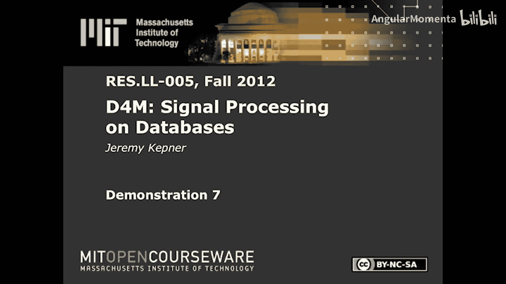

All right。 well， I wan to thank you all for coming to。What I've advertised is the penultimate course。

In this lecture series， everything else we've done up to this point has sort of been。

Building up to actually finally really using databases， you know， and hopefully you haven't been。

Too disappointed at how long I've sort of led you。LED you along here to get to this point。 But the。

 but the point being that if you have certain abstract concepts in your mind。

That once we get to the database part， it just feels sort of very straightforward。嗯。

If we do the database piece and you don't have those concepts。

 then you can easily get distracted by sort of。Extraneous information。

So today there's no no view graphs， so I'm sure you're all thrilled about that it's going to be all demos showing interacting with the actual technologies that we have here and everything I'm showing to is stuff that you can use I mean。

 so everyone has been。So I'm just kind of kind of。Get into this and let's just start with step1。

 we're going to be using the amululator databases that we've set up。

 We have sort of a clearinghouse of these databases on our Elgrid system。

 and you can get to that list by going to this web webpage here， dbtatuselgrid。m。edduu。

And when you go there， it will prompt you for your one password。

 and then it will show you the databases that you have access to。

Now I have access to all the databases， but you guys should only have C these class。

Databases when if you log into that。And。And so as you see here we have five databases that are set up。

 these are five independent instances of acumulo and I've started a couple already and we can even take a look at them。

So this is what a running acumullo instance looks like， this is its main page here。

And it shows you kind of how much disk is used and the number of tables and all that type of stuff。

 and it gives you a nice history that shows ingest rate， you know。

 over the last few bit and scan rate， this is all in entries per second ingeest in megabytes。

 all different kinds of really useful information here。

And you'll see that this has got the URL of Class db01。cloud。lgrid。That's been a， you know。

 when I started it， it was an actual machine that was allocated to that。InFact just for fun here。

 I could turn one of these on。You guys are free to start them。

 I would encourage you to hit the stop button because if someone else is using it and you get stopped。

 then。You know， that could be， that could be that may not be something you want to do。

 but it's the same setup， for instance， if you have a project。

Everyone in the class can see this because we've made you all a part of the class group。

But you can see here there's other classes， we have a bioinformatics group。

 and they have a couple of databases， those are theirs， they're not running right now。

 there's a very large graph。Database group it's running now。 And just to show。This as it's running。

 you see this has about 200 gigabytes data， and if we look in the tables here。

You see here we have a few tables here here are some tables with a few billion entries that have been put in there。

 and this is really what accumulate does very， very well。

But I'm going to start one just for fun here， if that works， and so it will be starting that。

While that happens and so you can and you can see it's starting and all those type of stuff。

So we're going to get going here now with these specific examples。All right， And I have these。

Just so you know， today's examples， so it's in the examples directory in the scaling directory and two parallel database。

So this is the director we're going to be going through today。And。

And then we have a lot of examples to get through because we're going to be covering a lot of ground here about how you can take advantage of D4M and a chillo together here。

So。诶。First thing I'm gonna do。Is。Go here， I'm going to run these。

 I have essentially two versions of the code。One that's going to do fairly smaller databases on my laptop。

 and then have another version that's sitting in my Lgrid account that I can do some bigger things。

With so。So to get started， we're going to do this first example of PB01 data test。Okay。

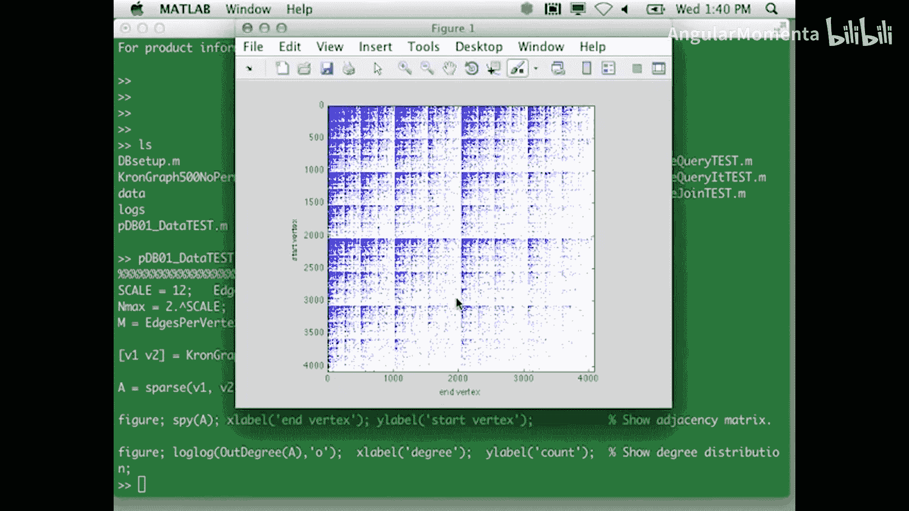

All'm righty。So in order to do database work and to test data， we need to generate some data。

And so I'm using a built in data generator that we have。Called the Chroner graph。

It's basically borrowed from a benchmark called the Gra 500 benchmark there's actually a list called Graph 500 and I helped write that benchmark and in fact I actually the MatTLb code on that website is stuff that I originally voted wrote and other people have since modified and so this is a graph generator generates a very large。

Power law graph using a chronicer product approach， and it has a few parameters here。

 a scale parameter， which is basically the number of vertices。

 so two to this scale parameter is approximately the number of vertices。

 so  two to the 12 gets you about what 4000 vertices。

 it then creates certain number of edges per vertex。So 16 edges per vert。

 and so thiss computes n max its two to the scale here。

 and then the number of edges is edges per ver X times n max is the maximum number of edges。

And then it generates this and it comes back with two vectors。

which is just the list of the the first list is a vector is a list of starting vertices and the second vector is a list of ending vertices and we're not really using any D4M here。

 we're just creating a sparse adjacency matrix of that data。A showing it。

And then plotting the degree distribution， so if we look at that。

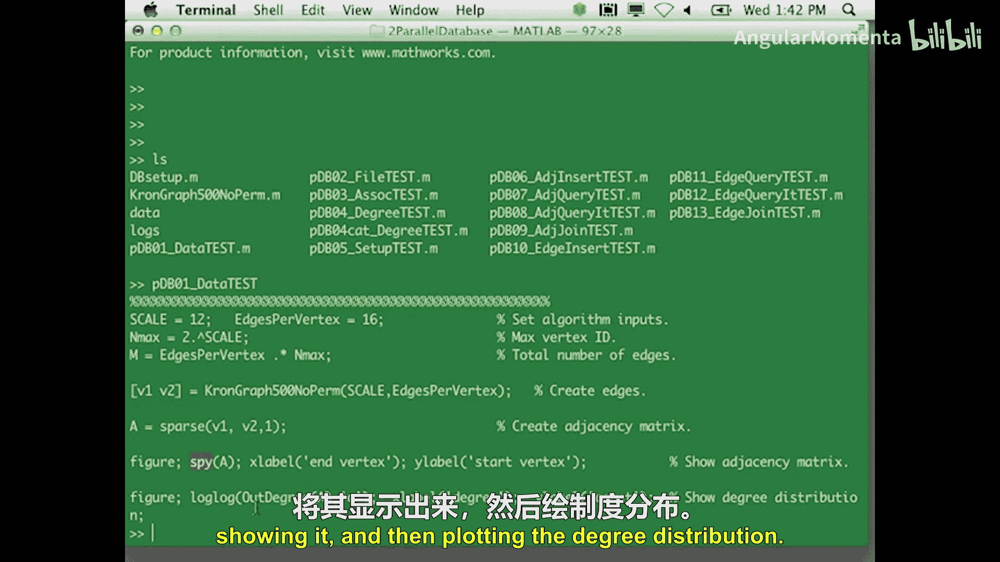

Figure。So this shows the adjacency matrix。Of this graph， start vertex and vertex。

 These chronicer graphs have this sort of。Recursive structure and if you kept zooming in you would see that the graph looked like itself sort of in a recursive way here。

 that's what gives us this power law distribution and this is a relatively small graph this particular data generator is chosen because you can make enormous graphs in parallel very easily which is something that if we had to pass around large data sets every single time we wanted to test our software it would be prohibitive because we'd be passing around you know gigabytes and terabytes and I think。

I think the largest this has ever been run on is is on a scale of 2 to the 37。So， that's。啊。

T trillions of vertices or certainly billions of vertices， almost trillions of vertices。嗯。

And then we do the degree distribution of this。 And you see here。

 it creates a power law distribution。 We have a few vertices with only one connection。

 and we always have a super node with a lot of connections。

 And you can see actually here the chronicer structure。In this in this in this data。

 which is it creates this characteristic sort of saw to a pattern and there's ways to get rid of that if you want。

 but for our purposes having that structure there there's no problem with that so this is kind of exactly what the degree distribution looks like。

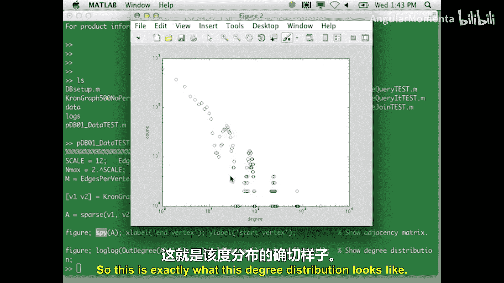

So that's just a small version。To show you kind of what the data looks like now we're going to create。

A bigger version。Mge。So， this。

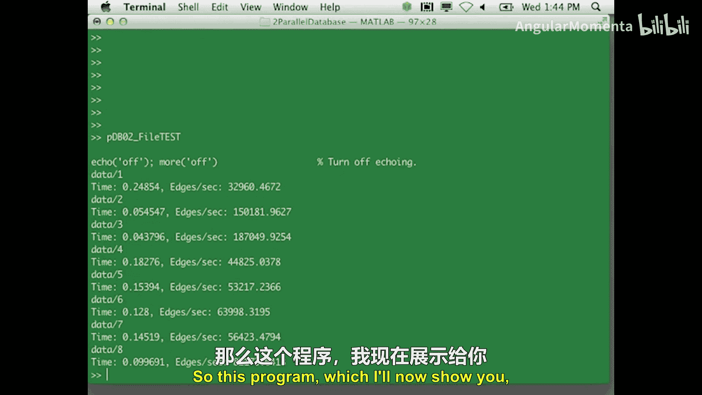

Program， which I'll now show you。So this program creates essentially the same chronicer graph。

 but it's going to do it eight times。And then right one of the nice things about this generator is。

Those will be you can if you just keep calling this。

 it gives you more independent samples from the same graph。

 so we're just sort of creating a graph that's got eight times as many edges as the previous one just by calling it over and over again just from the random number generator。

So I have eight， I'm going to do this eight times and I'm going to save each one of those to a separate file。

 so I create a file name， I'm actually setting the random number seed to be set by the file name so that I can do this if I want to you know the seventh file will always have essentially the same random sequence regardless of when I run it。

And so I create my vertices and I'm going to convert these to strings and then write these out to files and so that's all that does here。

 And one of the things I do throughout this process that you will see is I keep track of how many edges per second I'm generating things so here I'm generating you know about 150。

000 it varies in terms of the edges per second here but know between 30，000 and 150 or 180。

000 edges per second because when you're creating a whole data processing pipeline。

 that's essentially kind of the metric you're looking you know some steps might generate you know process your edges extremely quickly and other steps might process your edges more slowly and that's obviously the ones where you want to put toward energy and effort into it。

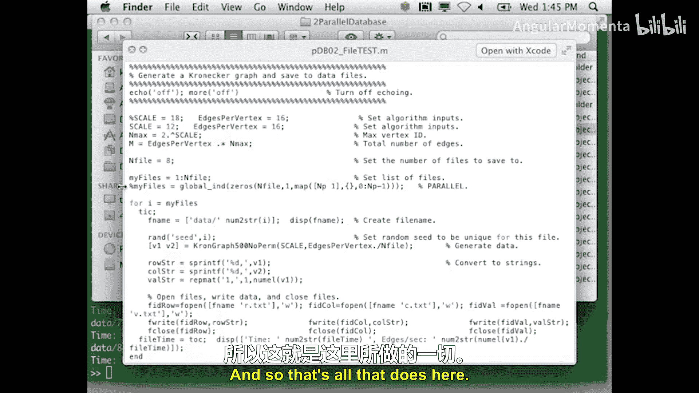

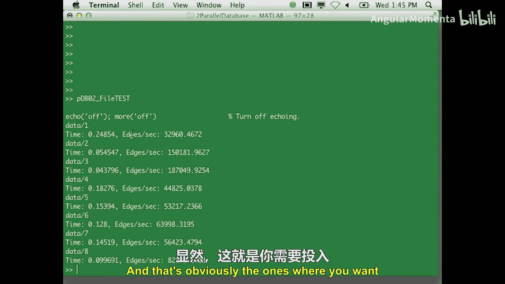

So we can actually now go and look it stuck it in this data directory here。And we just created that。

 and so basically we write it out on three files， essentially each one of these holds one part of a triple。

 so a column。A row， a column and a value。 So if we look at the。The row。

You can just see it's a sequence of strings separated by commas。

Same with a column just to separate a sequence of strings separated by by commas。

 And then in this case， the values， we just made all ones， nothing， nothing fancy there。

 So now we have eight files。 All right， that's great。 We generated those very quickly。

 And now we want to do a little processing on them。

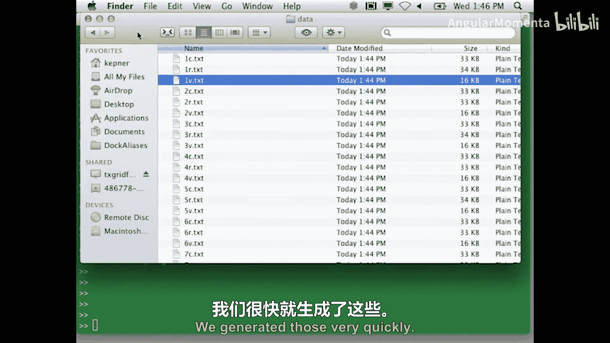

Seri go。嗯。3。The first thing we're to do is read those files back in and construct Associative arrays because the Associ array construction time takes a little time and we're going to want to use it over and over again so we might as well take those triples and construct them into associative arrays and save them out as MA of binary files and now that will be something that we can work with very quickly。

So we're going to do that。All right， So there you go。 it read them in。

 and it shows you at the rate at which it reads them in and then essentially writes them out and gives us another example of the edges per second。

 And now you see we have Matlab files for each one of those。 and not surprisingly。

 the Matlab file is smaller than。

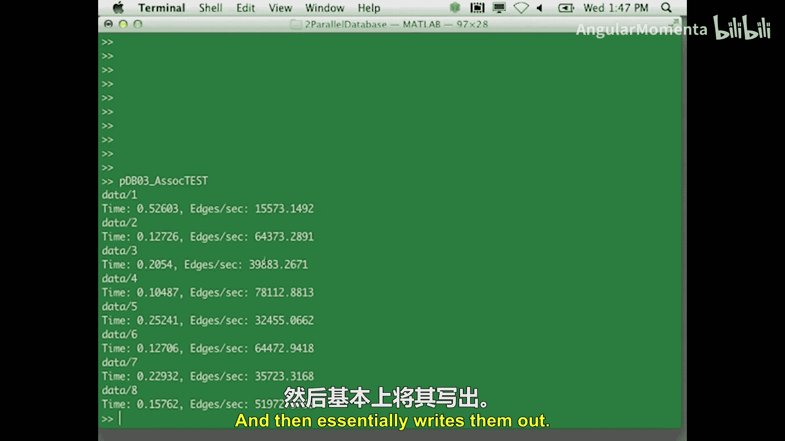

The three input。Tris that it gave， so this is a 24 kilobyte Matlab file and you know it was probably about 80 kilobytes of input data and that's just because you know we've compressed all the row keys into single vectors and we have the sparse adjacency matrix which stores things and so that makes it a little bit a little bit better there。

We actually look at that program here。So we can see we basically are reading it in。

 and then what we're doing is we're basically creating an associative array。

 we read in each set of triples。Okay， and then the constructor takes the list of row strings。

 column strings。 We just all want this since we knew they were all one。

 We're just letting that be one。 And then there's an optional fourth argument that tells us。

 what do we want to do if we put in to。Tris with the same row and column。You know what to do。

 The default is it will just do the min。So if I have a collision。

 it will just do them in if I give it this optional fourth argument at some。

 in fact you can put in essentially any binary operation there。

 but at some we'll just add them together so now we have at in the Associative array。

 a particular row and column we'll have how many that occurred and so we're summing up as we go here and then after we create the Associative array we save them out to a file and so we have that step done。

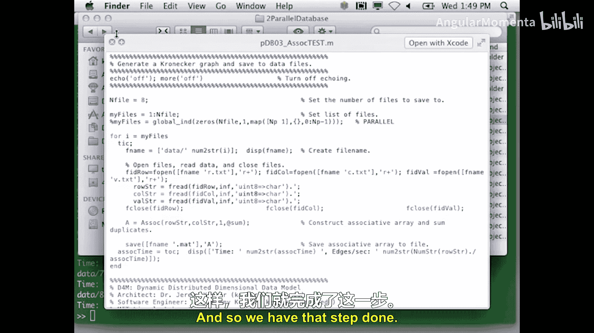

All right。Now the whole reason I showed you this process is because now I'm actually in a position I can start doing computation just on the files as I said before you don't have to use the database I can if I'm going to do any kind of calculation that's going involve traversing all the data。

 it's going to be faster just to read in those MALb files and do my processing on that it's also very easy to make parallel I have a lot of files you know I just have different if I launch a parallel job。

 I can just have different different processes reading separate files。

 it will scale very well the data read rates will be very fast you know reading these files in parallel will take much less time than trying to pull out all the data from the database again。

So we're going to do a little analytic here。Or。So I'm going to basically compute。

 I'm going to take those eight files， read them all in and accumulate the results as we go。

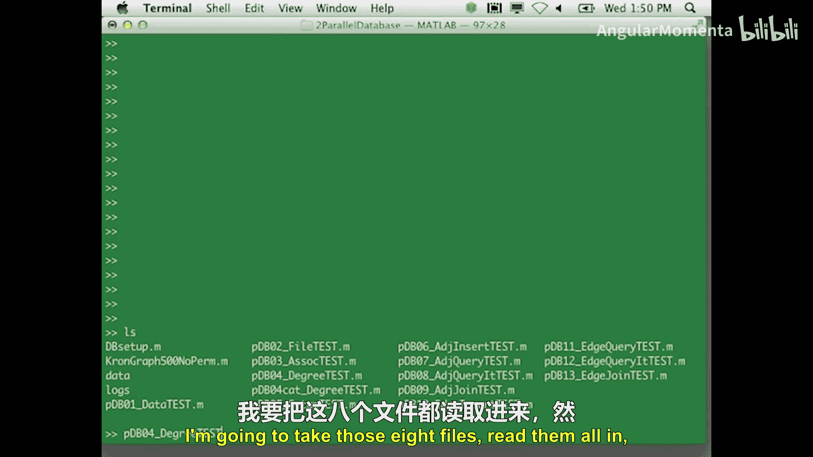

And there we go， we get the in degreegr distribution and the out degree distribution of this。

Of this result。You look at that program here。You can see all we did is we。Looped over all the files。

 just loaded them from in mat and Matla， and then basically summed the rows and added that to a temp variable and summed the columns and then plotted them out。

 So we just sort of accumulated them as we went。This actually。

 this method of just summing on top of an associate array is something that you can certainly do。

 It's a very convenient way to do it， I should say though。

 and you can kind of see it here a little bit。

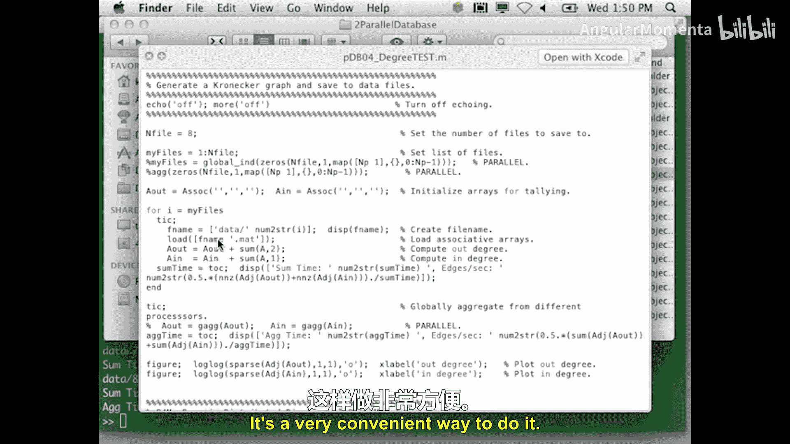

You notice that the time is beginning to， well it's not so clear here this takes a little time。

 but on another larger example， what you would see is that every single time we did that because we're building and then adding。

 we're basically redoing the construction process and so eventually this will become longer and longer and longer and so it's okay for small stuff to do that or if you're only going to do it a few times。

 if you're going to be accumulating an enormous amount of data， then。What we can actually do。

Is we have another version of this program。PD B，04。

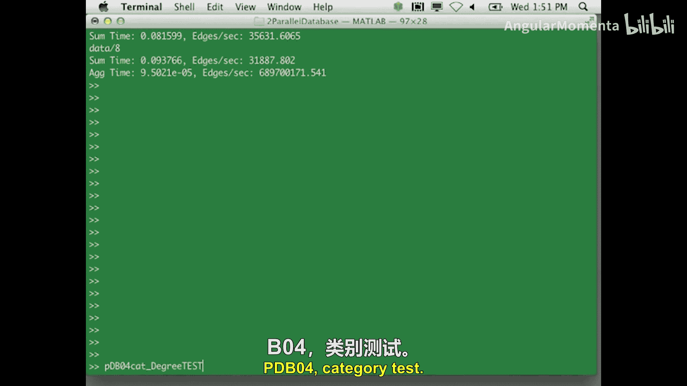

Capre test。And you could tell that was a little bit faster。

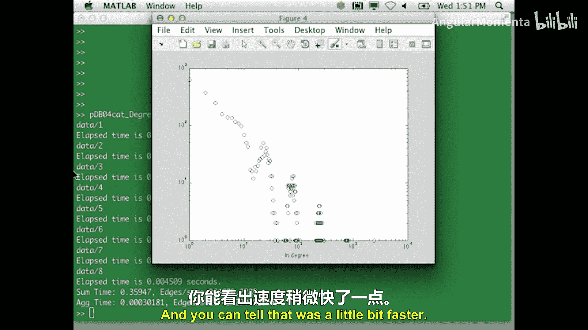

You see here it's all a milliseconds of time and so in the way we did that。

 and this is a little bit longer program。

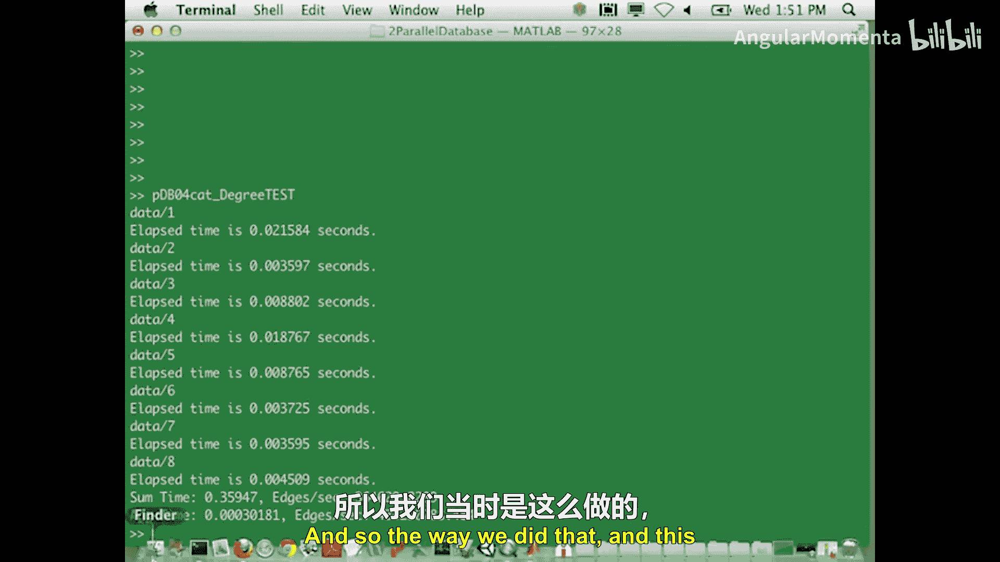

What we're doing here is。Basically。Were。Reading in doing the exact same thing。

 we're loading our MALb file。 we're reading， we're doing the sum， okay。

 and then since I know something about the structure of that that is basically I'm summing the rows。

 okay。I can just append that。To a longer list。Okay， and then at the end， do one。Large sum。

 and that's， and then， and that's， that's obviously much， much faster。

 And so these kind of tricks you just need to be aware of if you're trying to do very would you know。

 people typically want to do large amount of data， you just do the simple sum， that'll be okay。

 But if you're doing it a lot over a large。List that essentially becomes almost an n squared operation with the number of the loop loop variable。

 And this is one that will be be even faster。 You can make it even faster because we are doing this concatenation here。

 When you do a concatenation to Matlab， you're doing a malic。 If you want to make it even faster。

 you can preallocate a large buffer and then。Append into that buffer。 And then when you hit the edge。

You know do do a sum then and do it and do it that way and even that's even that's the fastest you can do So these are tricks doing very。

 very large sums you can do them very quickly and all with files you don't need a database and this is the way to go if you're going to be doing something where an analytic where you really want to traverse most of the data in the database in your data if you just need to get pieces of the data in the database in the database will be a better tool。

All right。All right， we we did that So those show how we worked with files。 All right。

 and that's always a good place to start even if you are working with the database。

 if you find that you're doing one query over and over again。

 that you're going to be then working with that data a lot of times better just do that query and then save those results to a file and then just work with that file while you're doing anything。

 and this is something that people often do in our business。

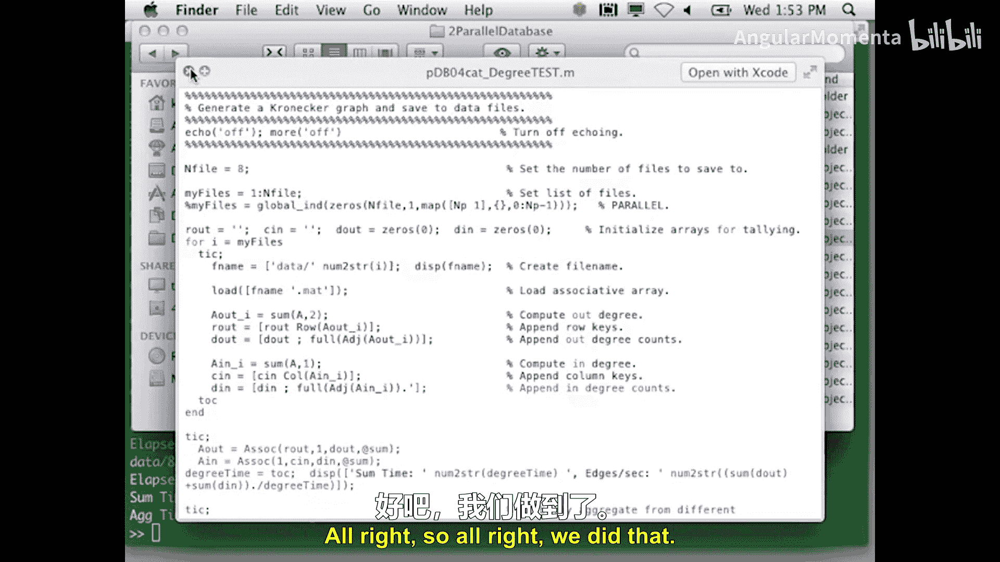

Alright， now。

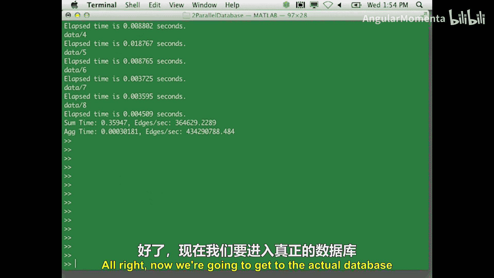

We're going to get to the actual database part of it。Okay。

 so first thing we were going to do is we have to set up our database。

 we're going to create some tables in a cumullo。And so we want to create those first。

 so they're created properly and so I'm going to show you the program。That does that。

 The first thing you're going to do it's going to call a Db setup command。

 And so let me this this program I'm going to now show you that。 And so when you run these examples。

 you will have to modify this Db setup program。Okay。

So the first thing you'll notice is that we're all using the same for each group。

with those databases is all using one user account。And you can say， well， that's not the。

The best way to do it well， it's very consistent with the group structure in that is basically all users。

 the database is there to share data amongst your group。

 and so it is not an uncommon practice to have a single user account in which you put that data So we have a bit of a namespace problem if you all just ran this example together you'd all create the exact same table and all you fill it up。

 So the first thing we're going to do is just prepen the tables and I would suggest you put your name you replace instead of having my name there you put your name there。

And then we have a special command here called DB setup Lgrid。

 which basically creates a binding to a database just using the name of the database。

 so it's a special function that's not a generic function。

 only works with our Lgrid system and it only works if you have mounted the Lgrid file system。So。

Hide all this stuff here。So as you see here， I have mounted the yellow grid file system， okay？

And and you need to do that because。The Db setup command， when it binds to the database。

 it actually goes get the keys。From the yellow grid file system。

And those keys are sitting in the group directory for that。 So basically。

 from a password management perspective。All we need to do is add you to the group and then you have access to the database or if we remove you from the group。

 you no longer have access to the database。 So that's how we do otherwise we'd have to distribute keys to every single user all the time。

 And so this is why we do that。 So this greatly simplifies it。

 but you will not be able to make a connection to the to one of these databases unless you are either logged into your Lgrid account or if you're on your computer you've mounted the file system and D4M knows where to look for the keys when you when you pass in that setup command。

All right here， so。So if we look at that again。So。And this is just a shorthand for the full DB server command。

 So if you were connecting some to some database directly other than one of these。

 or you could even do with these， you would have to pass in essentially a five argument thing。

 which is the。The host name of the computer and the port， the name of the instance， the name of the。

 I guess there's a couple instance names here， and then the name of the user and then an actual password。

 and so that's the generic way to connect in general。

 but for those of you connected it to Elgrid we can just use this shorthand which is very nice。

Then we're going to build。A couple of tables， so we have these first thing we're going to do is we're going to want to create a table that's going to hold out adjacency matrix that I just created。

In with the files and so we're going to do that with a database pair。

 So if we have our database object here and we give it two string names。

 it will know to create two tables。In in the database and return a binding to that table。

 that's a pair， it's a transpoposed pair。 so whenever we do an insert into that table。

 it will insert you know the row in the column and in one table and then flip those and insert the column in the row and the other table and then whenever you do a lookup it will know if it's doing a row lookup to look on one table and if it's doing a column lookup to do on the other table and this allows you to do fast lookups of both rows and columns and makes it all nice for you。

We're also going to want to take advantage of a cumulus built in ability to some as we insert。

 and so we're going to create something that's going to hold the degree as we go。

 very useful to have these statistics because a lot of times you want to look up something and then but the first thing you want to do is just see well。

 how many of there are in there and so if you create essentially a column vector with that information very helpful。

Later we're going to do something where we actually store the edges， the raw edges that were created。

 so when we create the adjacency matrix we actually lose a little bit of information and so when we create this edge matrix we'll be able to preserve that matrix。

 that information and likewise we'll be doing the tallies of the edges and that as well。

So that's what this does。That's the setup。 you'll need to modify that。 And this program here。

Actually basically in after the setup is done， it adds these accumulator things by designating certain columns to be what they call combiners。

 So in this adjacency degree table I've said， oh I want to create two new columns an out degree and in degree column and the operation that I want to be applied when there are collisions on those values is sum it will then sum the values and likewise with the edge I only have since since I only have one I'm going to have degree and sum there。

All right， so that's how we do that。So if we now go to our database page here。

So you can see Class DB3， it started， we can actually view the info。And this is what a nice。Fresh。

Never before used a cumullo instant looks like it has very little data。 It has one table。

 a metadata table and a trace table。 This is what and you know， there's no。

 no errors or anything like that。's a very clean instance。 And you can actually。And， and。

So that's when one looks like we're going to use one that we've already started though， which is。

Do you be one。And if we look at the tables here。There's already some tables。

 Michelle ran a practice run on this Ch of random a jack practice run。

 I'm going to now create those tables by。

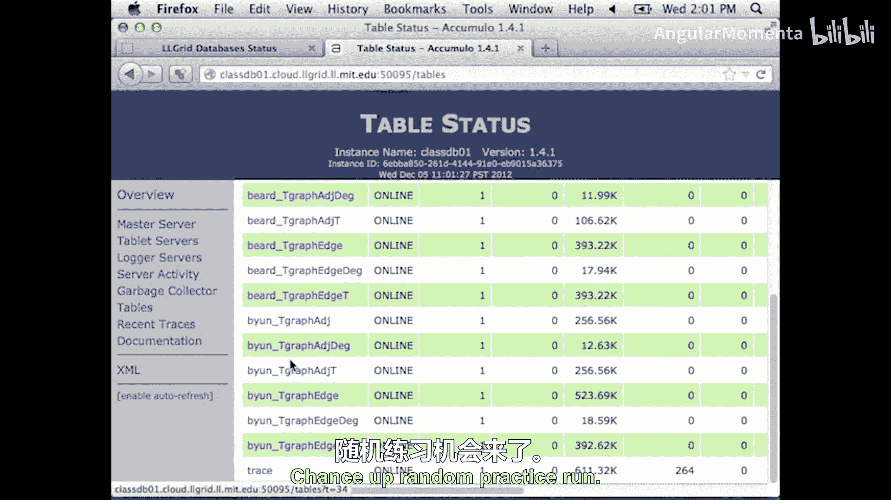

five。Said up test。And right there， I created all those tables。You can now see， did it actually work？

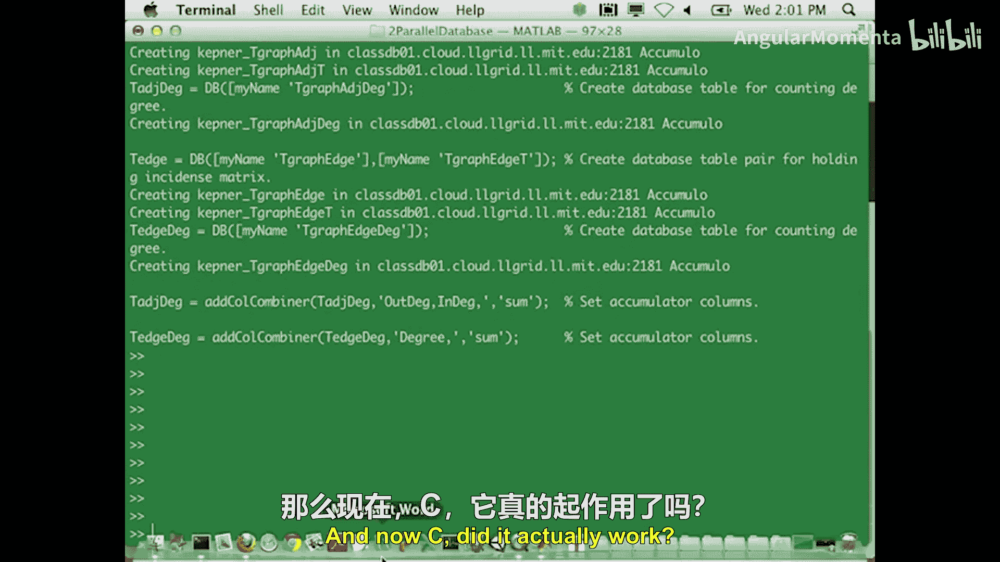

Here。So if I refresh that。And you can see it's now created these。Six tables， which are empty。

We do have abilities to set the write and read permissions of these tables。

 so right now everyone has the ability to read and write and delete。

Everyone else's tables in this class database in a project。

 that's not so a difficult thing to manage。 you all know that。

 but you could imagine in situation where everyone look， we had a big ingest。

 This is a corpus of data。 We don't want anybody， we can actually make the permissions。

 We can make it read only so that no， no one can delete or we can make it so it's still read and write。

 but it can't be deleted。 whole cloth。 Those permissions exist。

 A feature we will add to this database manager will also be a checkpoint feature。 So， for instance。

 if you did a big ingest。 have a bunch of data that you're very happy with， you can checkpoint it。

You know will you'll have to stop the database， then you can create a checkpoint of that stop database name checkpoint。

 and then you can restart from that if for some reason your database gets corrupted。

 as I like to say，Acccuummulator， like all other databases， is stable for production。

 but it can be unstable for development， new database users。

The database will train you in terms of the things that you should not do to it。

And so over time you will not do the things that destroy data or cause your database to be very unhappy。

 and then you will have a nice production database because you will only do things that make it happy。

 but in that phase where you're learning or you're experimenting with things as with all databases。

 any database it's easy to do commands that will put the database in a fairly unhappy state even to the point of corrupting or losing the data so。

Yeah， so， so， but for the most part， once it's up and running in production we have a database that's been running for almost two years。

Continuously using a very old version of this software。 So it just continues to hum away。

 It's got billions of entries in it， you know we're not really， but it's on a single。

 it's running on a single Mac， you know， And so it's so it definitely we've seen situations where it's like all other day。

 it has the same stability as just about any other database。

So now we've created these tables and let's。

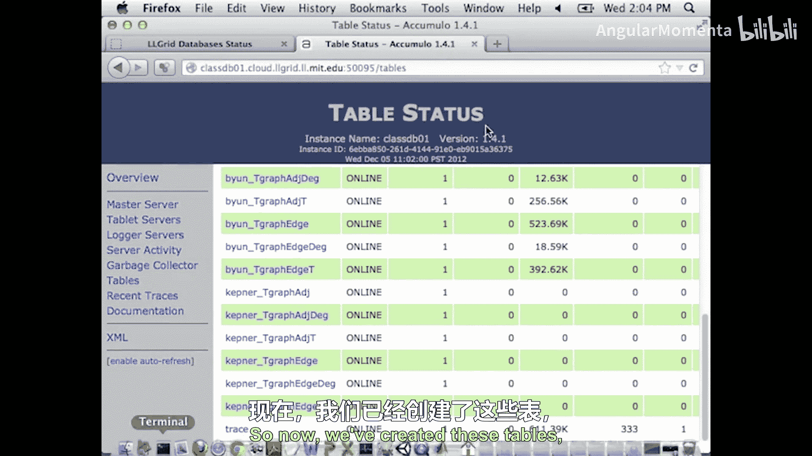

Inser some data into them。And so。I do。EDB6。 So I'm now going to insert the adjacency matrix。

And now it's basically。E readinging in each file and ingesting that data。

That's not a lot of data it doesn't take very long。And now， you can see。

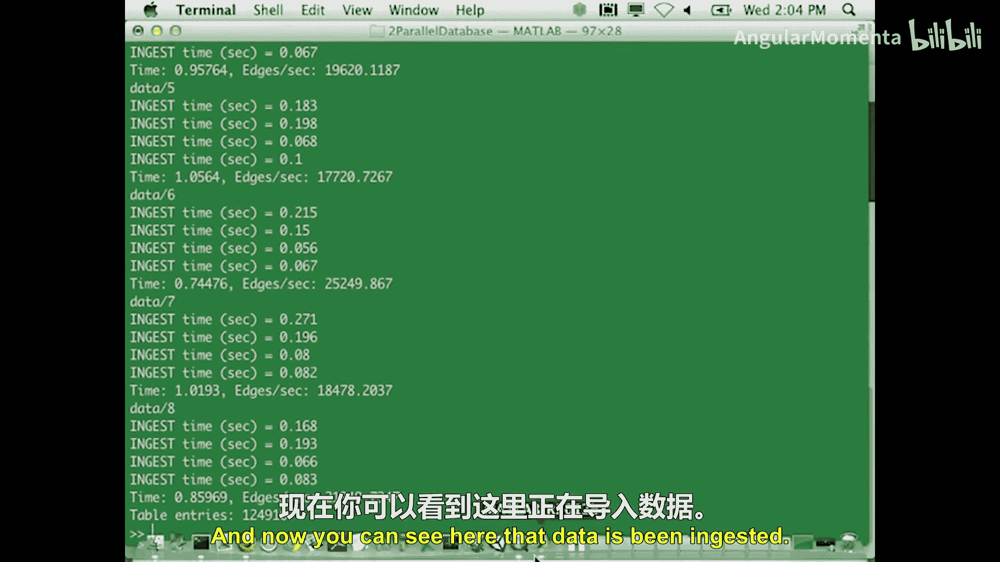

Here。That data。Ingeted。And you see there。 So we just inserted about。

62000 in each of those two tables and 25，000。Which for chlo is a trivial amount。You know。

 we just inserted 150，000 entries into a database， which is。Pretty impressive， you know。

 to be able to do that in， you know， essentially the blink of an eye。

 And that's really the real power of a cumulo is this， you know， a lot of other databases。

 150000 entries。 you're talking about a few minutes。 And here it's just。

 you wouldn't even think about doing that twice。嗯。All right。So we can take a look at that program。

So here we go。So we had eight files here and basically we loaded the data。And basically。

 one thing we have to remember is that our adjacency matrix has numeric values。

in the associative array and aummulo can only hold strings so we have to call the nu to string function。

 which will convert those numbers into strings to to be stored。

 So the first thing we do is we read we load our adjacency matrix A we convert it the numeric values to strings and then we just do a put so we can just insert the associative array directly into the adjacency matrix and it knows it pulls apart the triples and it knows how to you know take care of the fact that it recognize this is a transpose table pair and it does that in just for you and likewise same thing here now on these other things。

 we pulled it out we summed it convert it to strings to do the out degree and the same thing to do the in degree。

 And so this is actually where the adjacency matrix comes in very handy because when we're doing accumulating if we didn't first summit and then do it。

We would be if we put those raw triples into to insert。

 we're essentially redoing the complete insert and so this saves you know usually an order of magnitude and number of inserts by basically doing the sum in our D4M program first and then just inserting those sum values just a nice way to save the database a little bit of trouble and doing that and so we certainly recommend this type of approach for doing that。

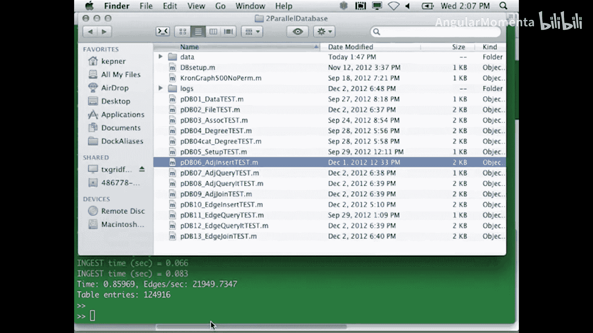

Right。next one7 now we're going to do a query， we're going to get some data out of that table。

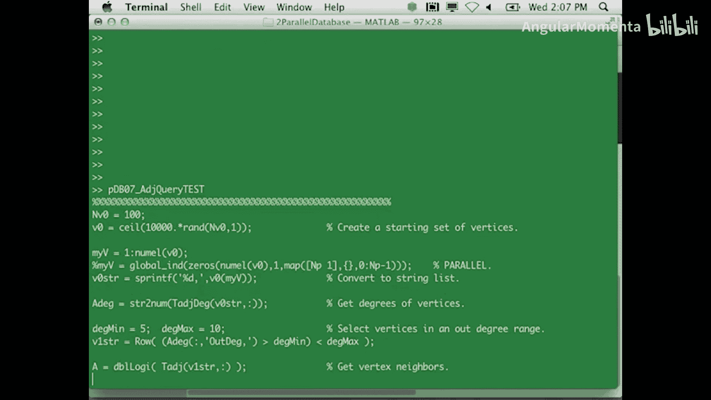

YeahYeah。

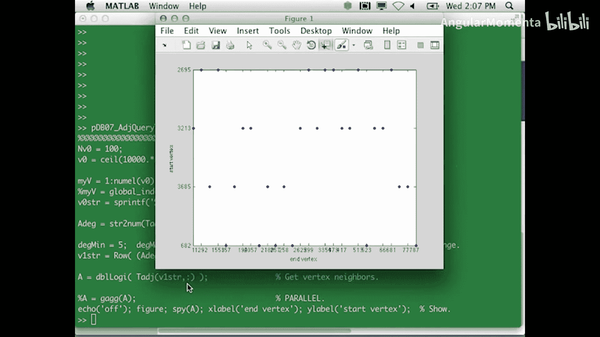

And so what we did here is we said， I want to pick 100 random vertices。Okay， so in this case。

 I randomly generate 100 random vertices over the range one to1000。Okay。

 and I then convert those to a string because these are no values。 and I' want to look up strings。

 And then the first thing I'm going to do is I want to look up the degrees essentially of those vertices。

 So I have my some table here called T adjacency degree。 I'm going to pass those strings in。

 and then I'm going to get just the degrees。 So that's just a big long skinny vector looking things up from that is it takes much less time than looking up whole rows and or columns and it stores all those values stream me。

 So that's a great place to start。 And then I want to say you know what I only care about degrees that have been a particular range。

 This is a very common thing to do They'll be vertices that are so common。

 you're like I don't care about those。 I have their tally and these are sometimes called super nodes and and doing anything with those is a waste of my time and forces me to end up traversing enormous swaths of the database。

 So I'll set a。An upper threshold here and a lower threshold。 So basically I take a degree。

 I'm just going look at the out degree and I say I want things that are greater than the min and less than the max and I want to get just those rows so that's this query a fairly complicated thing and a look here done in just a sort of one line and now a new set of vertices which are just the rows that satisfy this requirement and then I'm going to look those up again so I'm just going to look up the ones that satisfy those and I'm going to get the whole row of those things so before I was just in looking up their counts now I'm going to get the whole row and I know that there's none that have more than this certain value or or have two few and then I'm going to。

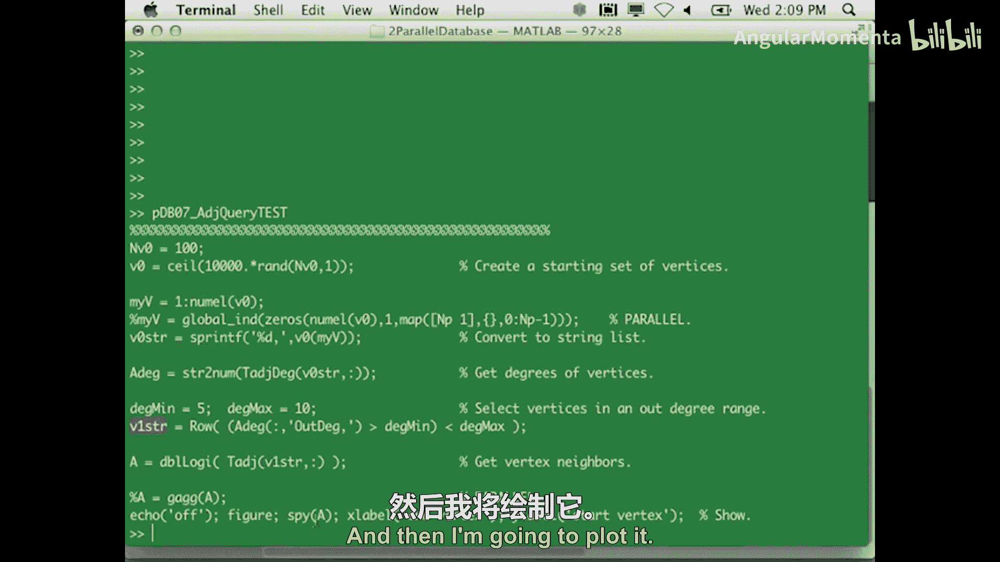

Blotted。AndSo if we look at the figure there we see。 So these are， we ended up finding one，2，3，4。

Rs that had between let's so these should all write，1，2，3，4，5，6，7， so that's between5 and 10。

 these should all be between5 and 10， and then this shows what their actual column was and so that's a very quick example of that kind of analytic。

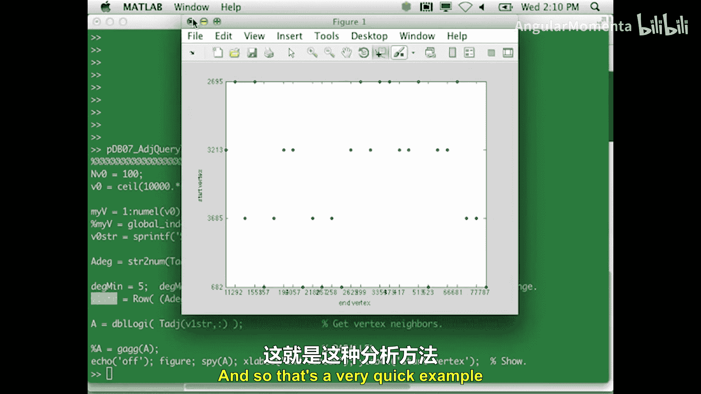

Very again， very real bread and butter and this is basically。

Standard from a signal processing perspective， the max is our clutter threshold。 We don't want that。

 It's too bright。 And then， you know， we'll have a noise threshold Like we don't care anything that's below a certain value。

 And this sort of narrows in on the signal。 same kind of processing and signal processing。

 We're doing it here on graphs and acumulula supports that very， very nicely for us。Alrighty。嗯。

So let's move on to the next example and actually if we look here。

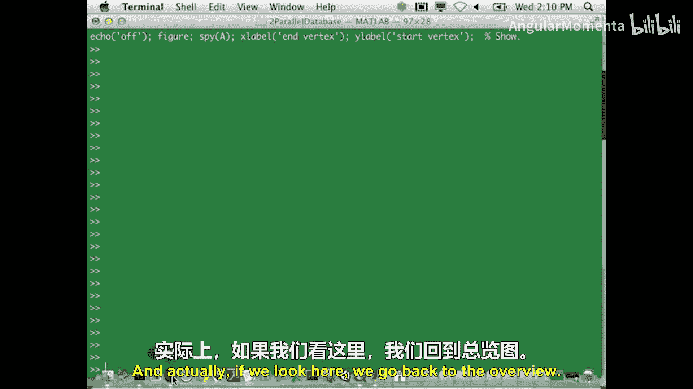

We go back to the overview。So you see here that was that ingest I did。

 This is the ingest So very quick it was getting about 5000 inserts a second for that was over a very short period of time。

 you can't even doesn't even have time to get reach its full rise time there and then you can see the scan rate and it was very small。

 It was a very tiny amount type of thing as we do larger data sets you'll really see that and this is a great tool here。

 you know it really kind of shows you what's really going on。嗯。Always。

 before you use the database is， always check this page。😡。

If you can't get to the page of the database， you're not going to be able to get to the database。

 There is no point in doing anything with Dform if this page is not responding。 likewise。

 if you look at this and you see this thing as just hammering and you're getting seeing hundreds of thousands or millions of inserts a second。

 It means guess what， someone is probably using your database and you might want to either pick a different database or find out who that is and say。

 hey when you're going to be done or something like that Likewise on the scan side。 know likewise。

 when you do inserts， you want to see well， you'll get some examples here of the kinds of rates you should be seeing。

 you want to make sure you're seeing those rates， if you're not seeing those rates。

 if you're basically just using the resource， but only inserting at a low rate。

 then you're actually doing yourself and everybody else's disservice you're using the database but you're using it inefficiently and it's much better to have your inserts go fast because then you're out of the way know your work gets done quicker and then you're out of everybody else's way quicker too So so there is a very I highly。

Recommend people look at this to see what's going on。

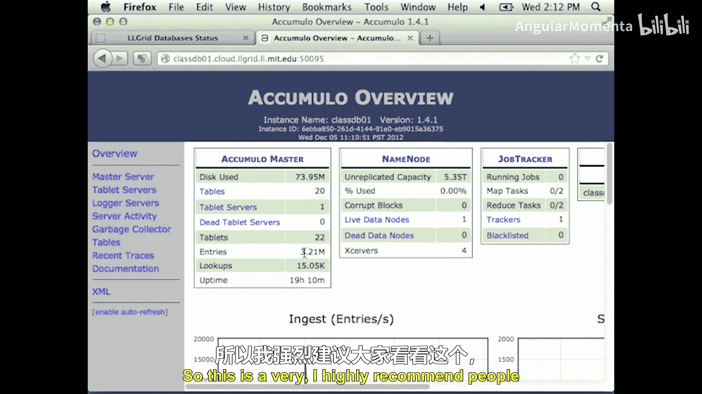

All right， so I think the last one was seven， so we'll move on to。E here。

 so now we're going to do another type of query， we're going to do a little bit more sophisticated query。

That query used the degree tables to sort of prune our query。 So we didn't have to get。

 you think about it like there was probably an edge in there that had like 100 entries， you know。

 and we just were able to avoid that never had to touch that edge。 but if we had had touched it。

 you know， that could have been a much bigger query you' like well100 doesn't sound bad。 Well。

 it's easy to get databases where you'll have some some rows with a million entries or columns with a million entries or a billion entries。

 And you really don't want to have to query those rows or columns because they will just you know send back so much data。

But you can still have situations where you're doing queries that are going to take。

 they're going to send back a lot of data， more data that you can really handle you know in your in your memory segment。

 So we have a thing called an iterator。 So we have created an iterator allows to set up a query and have it work through it。

 Now， this table is so small that you only won't really get to see the iteration happening but I'll show you the setup。

 So we'll do that。All right， so those very quick。 So essentially we're doing a similar thing。

 we're creating a random set of vertices here， about 100 getting creating。

 you know over the range one to 1000。And we're creating an iterator here called T adjacency iterator。

 So we do this function here iterator， we pass in the table， then we have a flag， which is element。

 which is how many entries do we want this iterator， It's the chunk size。

 How many entries do we want this iterator to return every single time we call it and here we've set max element to be a pretty small number to be 1 thousand00。

 Okay so we're saying is every single time we do this query we want you to return1 thousand at a time。

Now for those of you who are a MATlab of Ficionados。

 you should be an awe because a MATLb is supposed to be a stateless language。

And there's nothing more stateful than an iterator。

 and so we have tricked MatTlab with a combination of MatTlab on the surface and some hidden Java under the covers to make it look have the feel of MatTlab yet hold hold state so then what we're going to do is we're going this just creates the iterator we then initialize the query by actually passing in a query we now say。

 okay the query we want is over this set of rows here and so we're going run the query the first time and and since that thing returns string values and we want numbers。

 we have to do a string to nu and that's our first associative array that's the result of the first query we then initialize our tally here。

 and then we just do a while on this result so we're going to say oh if there's something there then we want to sum that and add it to our tally to our indieg tally and then we call it again so we do the next。

round the iteration by just calling the object with empty with no argument and it will just itll it'll just run it until the query is empty。

 if we put in an argument， it would reinitialize the iterator to that new query and so you don't have to create a new iterator every single time you want to put in a different query you can reuse the object but not that it really matters。

 but this is how you get it to do again。 So it's a pretty elegant syntax for basically doing an iterator and allows you to deal with things very nicely。

😡，And as we see here then we did the calculation here， which is all right。

 I wanted to then return the value with the largest maximum degree， so basically I compute the max。

 I get the adjacency matrix of the degree and I compute its maximum and then I set that equal to in degree and it tells me that the first。

Vertex had a degree of 14 in this query， which makes sense in the chronicroner matrix， that first 1。

1 is always the largest and densest densest。A value。So that's just how we use iterators。

Let us continue on here。All right， now I'm going to use iterators in a more complicated way to do a join。

 So a join is where I want to basically。Maybe there's a row in the table and I only want the rows that have one type of you know have both of a certain type of value in them so for instance。

 like if I had a table of network records I might like， look。

 please only return records that have this source IP and are talking to this domain name。Okay。

 so we have to figure out how we do joins in this technology， so I'm going to do that。

 so let me run that。

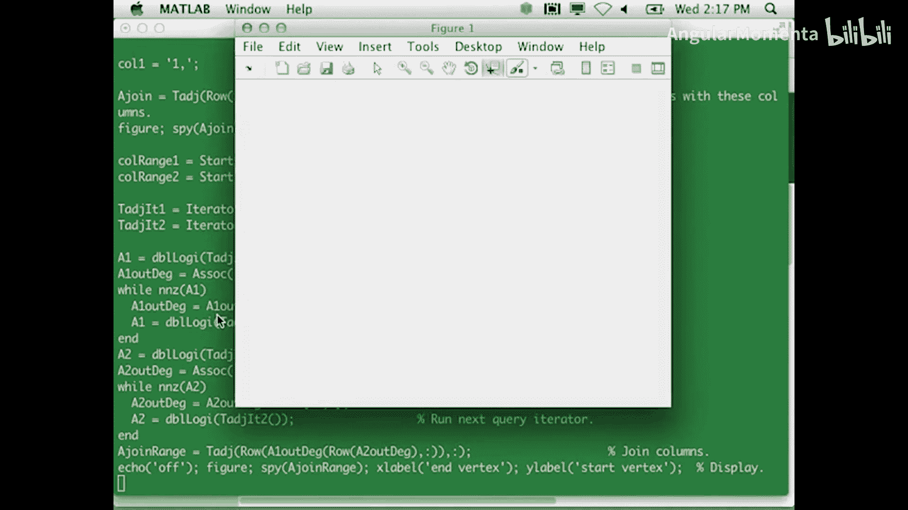

Al right。So so a little bit more complicated， obviously we're building up sort of fairly complicated analytics here。

So。I create my iterator limit here， and I'm going to pick two columns to join column1。Column 2。

And this just does a simple join over those columns。 So basically， what I'm doing is I'm getting。

 I'm saying， please return all the columns。That contain。This is an or。

 basically either column1 or two。I'm going to then convert those values。

 which would have been string values of numerics to just zeros or one。Then I'm going to sum that。

Som basically， I got the two columns， I converted all the values to one。

 and I'm going to sum them together， okay， and and then I'm going to ask the question。

Where were those equal to two？Those show me the records。 So that's what I'm doing here。

 I'm saying those equal to 2。 So that shows me all the records where that value is equal to 2。

 and I can then get the row。Of those things and then pass that back in to the original matrix。Okay。

 and now I know now I will get back those rows with those things。

 and so we can see that I think that's the first figure that we did here。

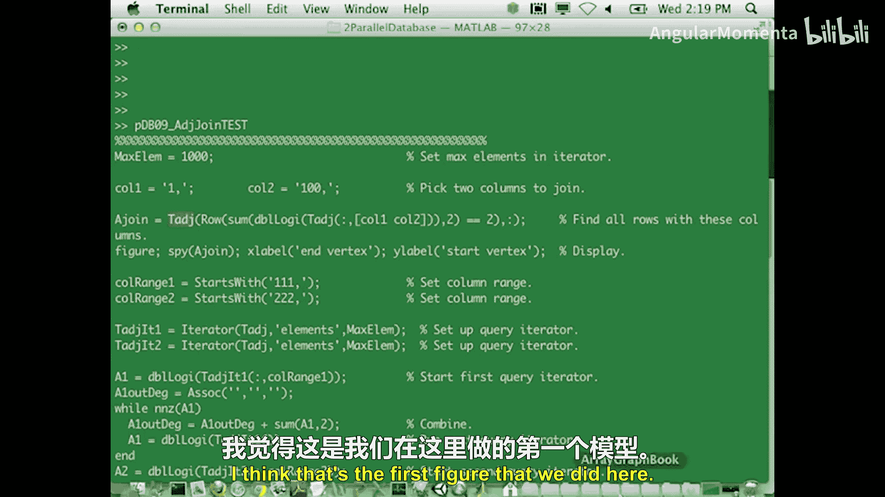

有啦。Figure one， and those show basically what did we do？

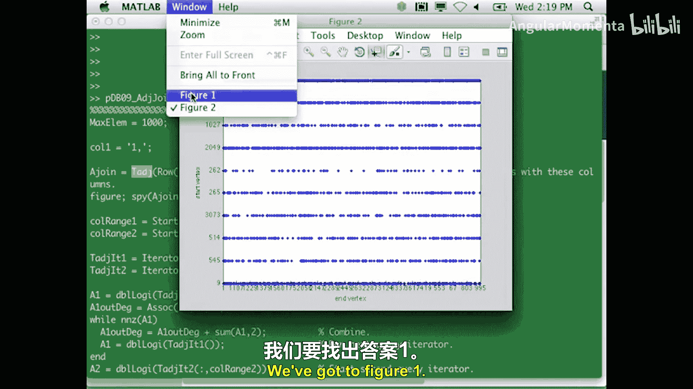

Right。是。This shows us the complete rows of all the records that had the value one。 So this is here。

 one。 And I think it was 100， which is somewhere right， like probably in there。 So there's， you know。

 basically every single one of these records had you know， one and 100 in it。

 and then it shows us all the rest of the values that are also in that in that record。

 We just wanted those columns and those values。 then we were done when we just sum them in equals z。

 we were done。 But this allowed us to then go back into the record and now into them into the full set and just get those record。

 So this is a way to do a join。 if you can hold。The complete results of both of those things like you know give me the whole column you know。

 one and the whole column two， and that's one way to do a join。

 perfectly reasonable way to do a join。I'm going to now do this again， but with a column range。

 so I'm going to say， you know I want all columns I want to do a join of all columns that begin with 1。

11 and all columns that begin with 22，2。 so that would return more。

 so I'm going to create two iterators now to do that。

 So I have an initialize my iterator iterator 1 and iterator 2。All right。

 and so now I'm going to start the first query iterator here by giving it its column range that initializes it and I get an A1。

And then I check to see if a1 is not empty， if it isn't empty。

 I'm going to then sum it and then call it again until it proceeds。

 And since it's such a small thing， it only went through that once， okay。

And then now I'm going to do the same thing again with the other iterator and sum them together again。

Okay。嗯。And now， I'm going to join。Those two。Those two those two columns。

 And that's a way of doing the join with essentially two nested iterators and doing doing the join that way。

 So that's something you can do if you couldn't hold the whole column in memory and you wanted to sort of build it up as you went。

 That's a way to do it with iterators。

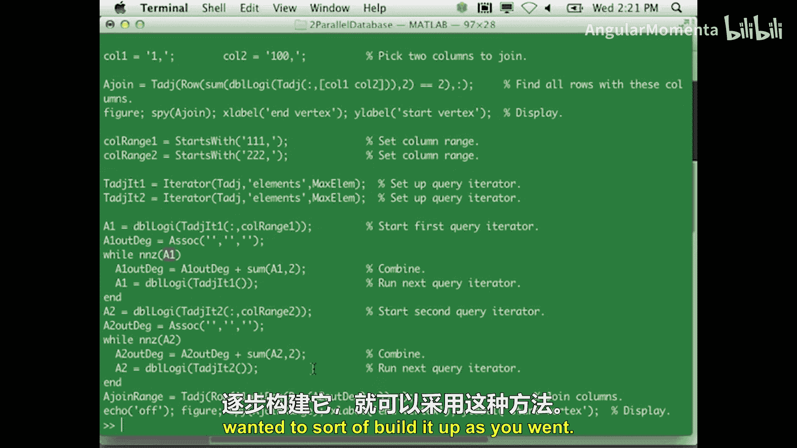

Then， you see here。There's an example of。

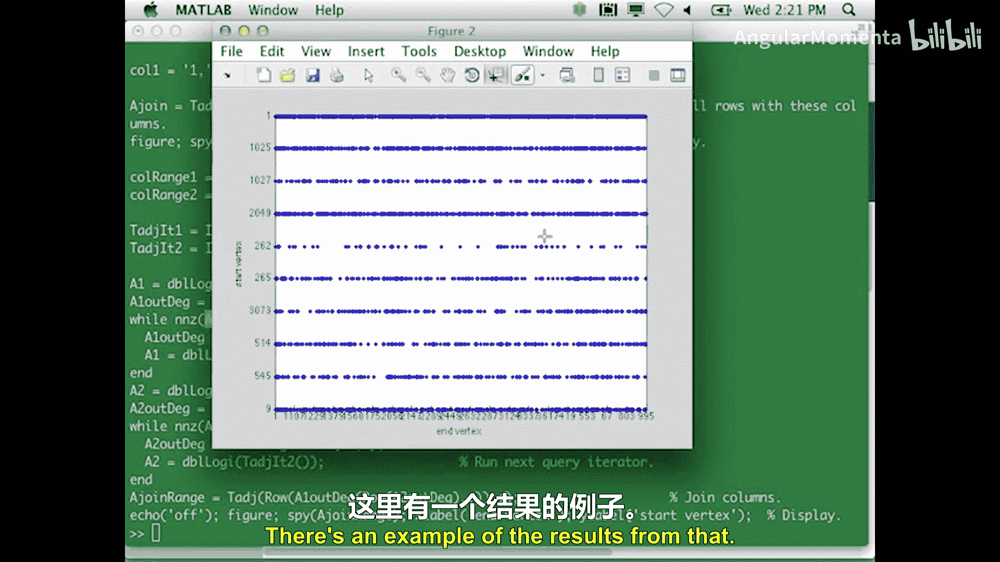

Of the results from that。Right。And just so you know， I mean。

 when you do an SQL query and an SQL database。This is what it's doing under the covers。

It's trying to do whatever information it can。 it will some lot of dahor hold a lot of internal statistical information。

 It's trying to figure out， can I hold the results in memory or can I not do I have to go through in chunks or do I not do I have information about oh。

 you know this query like you know do I have a sum table you know sitting around that will tell me oh。

 which which you know which column should I query first because it will return fewer results and then I can go from their type of thing So so this is sort of all going under the covers here you get the power to do that directly on the database and it's pretty easy to do。

😡，So you have， but you do have to understand these concepts。Alright， so now we'll move on。Okay。

 now we've done。 so that was all with the adjacency matrix。 And as I said before。

 when we formed the adjacency matrix， we threw away a little information， right。

 because if we had multiple fit a collision of any kind， right， we lost the distinctness of that。

That that record or that edge and a lot of times like no。

 we want to keep keep these edges because you know， yeah。

 we'll have other information about those edges and we want to keep things so so we want to store that。

So we're going to now。Reinsert the data in the table and use essentially instead of an adjacency matrix。

 an incidence matrix， an incidence matrix every single row。Is an edge and every single。

Colum is a vertice。 and so an edge can then connect multiple vertices。

 It also allows us to store essentially what we call hyper edges。

 So if you have an edge that connects multiple vertices at the same time， we can do that。

 so let's do that。This this is。Inserting about twice as much data。

 so it naturally takes a little bit longer there。And you see the edge insertion rates that we're getting there。

 you know，3030000 edges per second。 So let's go and see what it did to our。

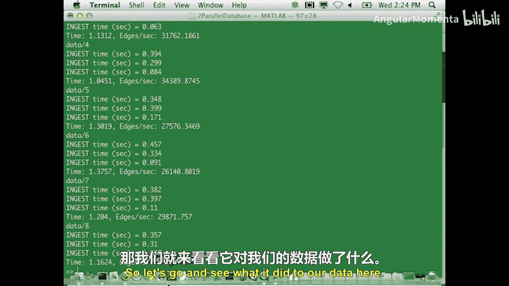

Our data here。So if we look at our tables。We can see now that our。There's our edge data set。

 And you see， weve inserted about 270000。Distinct entries in this data so there's the edge table and there's this trans pose and there's the degree count。

 and as you saw before， you know we had 53000 you know so that just shows you the additional information。

Let me， let's look at that。A program here。So again， we're looping over all our files here。

 we're reading them in， I should say this case， we are reading in the raw text files again we're not。

Reading in the Associative array， because we just want to insert those edges。

And then the only thing we've done is that basically to create our edge。

 we had to create this data didn't come with a record。Label， so we we don't have any。

 So were constructing a unique record label for each edge here just so that we have it for the row key。

 And then we're preending the word out and， you know。

 out into the row string and in into the column string so that we know。You know。

 when we create our record they'll be you know out is shows the direction it came from and in shows the direction it left and so that's a way of sort of creating the edge and then likewise we do the count degree and such to preserve that information so we can summing the total number of counts there。

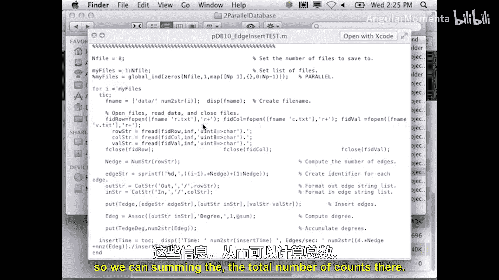

系。So let's do some queries on that。

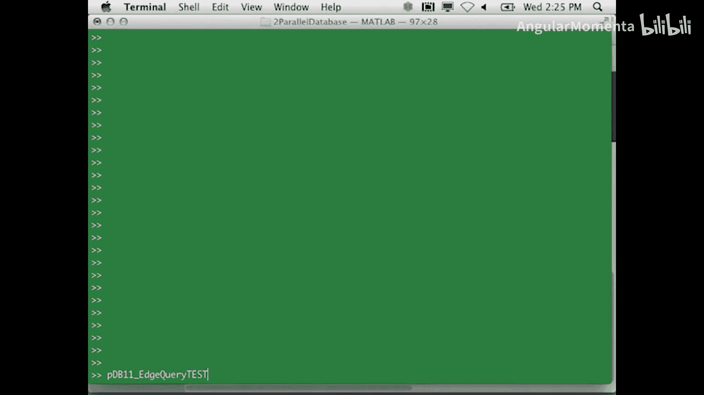

Alrighty， so I'm going to get， I'm going to ask for 100 random vertices here。

 so I get my random vertices， and then I'm going do my query of the strings。

 but I have to prepen this out slash then the value in it。

 So I know I'm looking for vertices from which the edges departing and I'm going to get those edges So I get those edge so I created the query I get the edges I'm going to do my thresholding again I want to certain min and max and then I'm going to do the the threshold。

 So this just gave me the degree counts and I threshold it so that know in this range and then now I then do the same thing back with with the。

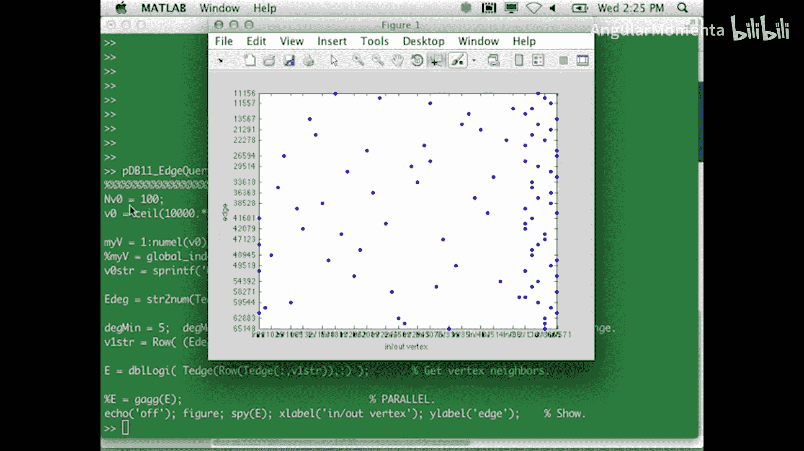

，I say give me everything greater than degree min and less than degree max， I get a new set of rows。

 so that will just return the edges that are a part of vertices with these degree range。

 and then I'm going to get all those all edges， all the records that contain those vertices through this nested query here。

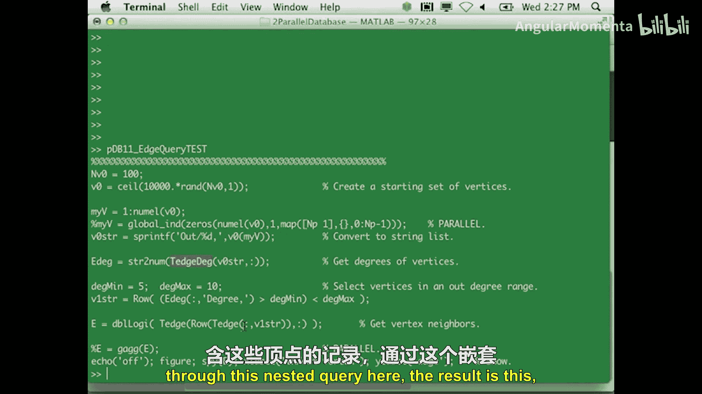

The result is this。 So basically this shows me all the edges that are our part of vertices。

 this random set of vertices that have a degree range between5 and 10。

This is a fairly sophisticated analytic in terms of we got a lot of。

 we're doing about seven or eight queries here， doing a lot of mathematics。

 and you see how dense it is， and hopefully from what we've learned prior has some intuition for you。

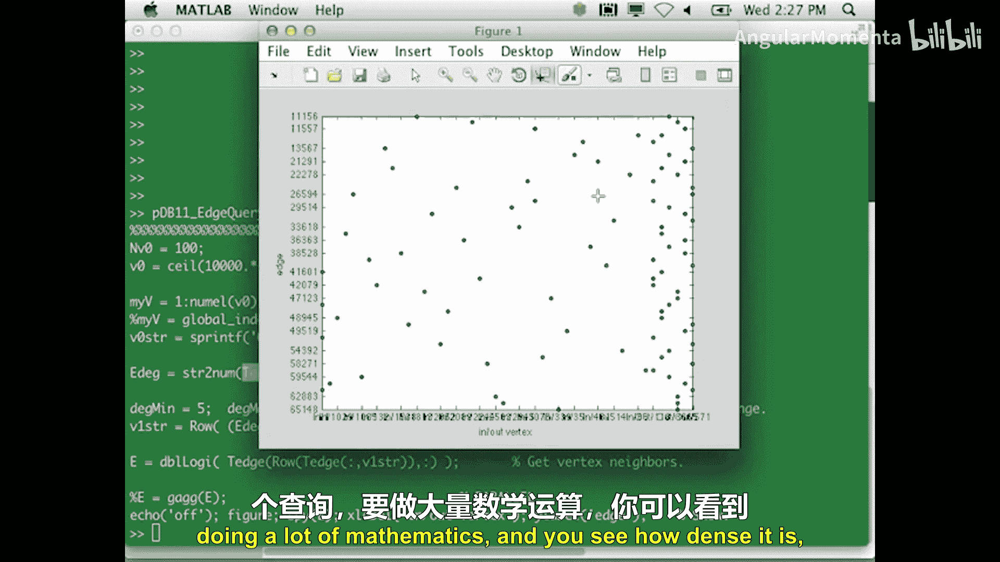

All right， we will continue on。All right， so now I'm going to do a query with the iterator again。

 same type of drill， I set the maximum of elements， the iterator， I get my random set of things。

 I create an iterator again setting the number of elements。

 I initialize the iterator to be over these vertices I then check to see if if it returned anything if it did I'm going to then actually pass the rows of that back into into it to get the edges containing those vertices and then do a sum to compute the in degree and so on and so forth and then I get here the maximum in degree of that set of vertices was 25 so that's just an example of that。

Yeah。That was 12 and I think 13 is our last one。

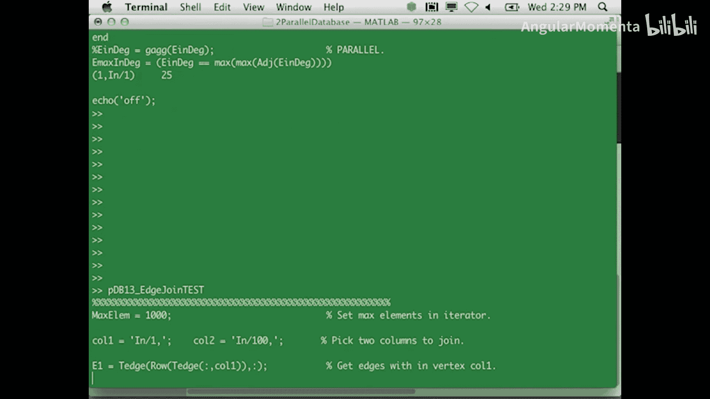

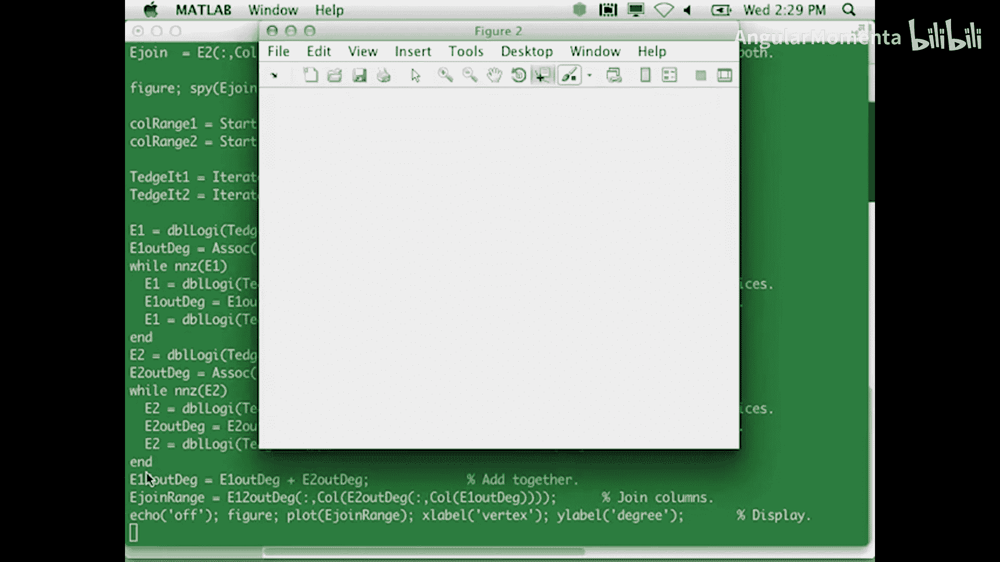

All right。again， a more complicated example showing basically a join over this space creating essentially a couple of of sets of edges。

 a couple of column ranges， iterators and so on and so forth and I won't belabor this point。

 but this just shows how you can combine between using the degree table and iterators you should have you have all the tools at your disposal that any type of query planning system would have inside it that it would use to make sure that you're not over taxing the results that you're returning to。

 and that's in a lot of times if you do a query on any database and you get the big spinning watch or whatever it's because the query you asked was simply too long It also gives a lot of nice places to if you're making a query。

ystem to interrupt it。 so if you do the query against the counts， you can quickly tell the user。

 look， you just did a query and this is going to return 10 million results。

Do you want to proceed you know， and so you of course could hold it or likewise you can set a maximum number of iterations。

 it's like it says， okay， I want to get them back in units of 100000 entries。

 but I only want to go up to a million and then I'm going to pause and you know get some kind of additional guidance from the user to continue so those are the same tools and tricks that are in any query planner you know very elegantly exposed to you here for managing managing these types of queries。

All with that， I want to do some stuff where we。Do a little bit of bigger data。

 So kind of walk through the examples。 I want to kind of show you what this is like running on a bigger bigger data set。

 So let's's close all that。

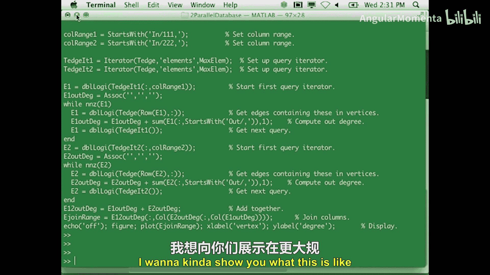

Right。Close。But。唔。see。

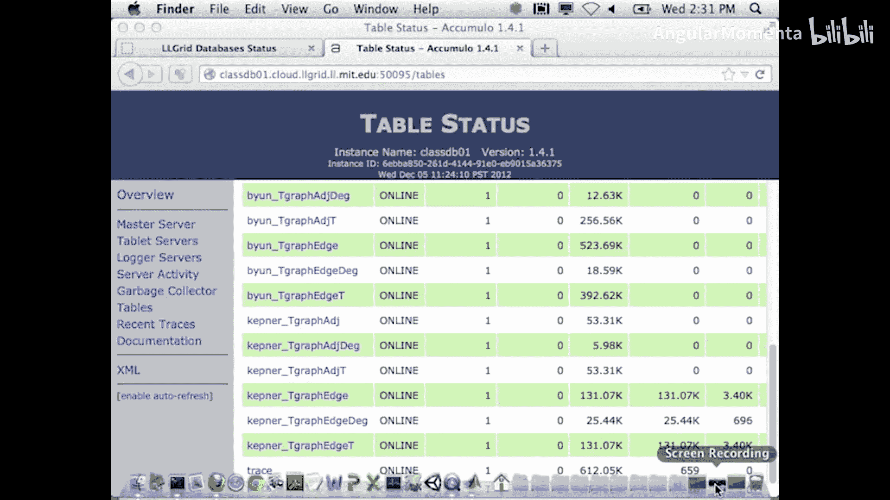

Not。Did， I want to do this one。 So now I'm logged into。I just SSsh into classdb2。cloud。llgrid。mtu。

 which happens， it tells you which node it's actually mapped to which is node F 15-11 in our cluster and this is a fairly powerful compute node。

 these are our next generation compute nodes for Lgrid so those who've been using Lgrid for all these past years may have noticed that we're getting a little long in the tooth these are the first set of the new nodes and we'll have about 500 of them total in various systems and so here I am doing something a little bit larger so let me see here。

ampSo I'm on my El account here。And I'm going to go to three and two。All right， and I do open。

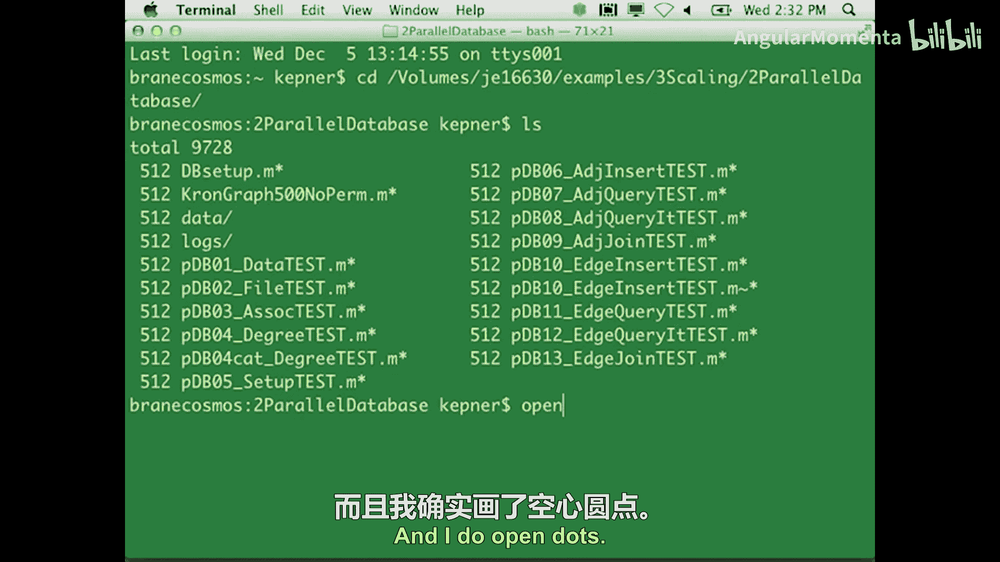

Dots。All right， so that's the directory。And so the first thing I did is in my DB setup here。

You'll notice that I have done。Class D B 0。Okay。And also， we don't need to do one。

 but I will do two here。I've made this bigger， So I've made this now，2 to the 18th。Vertices。

 instead of what I had before。

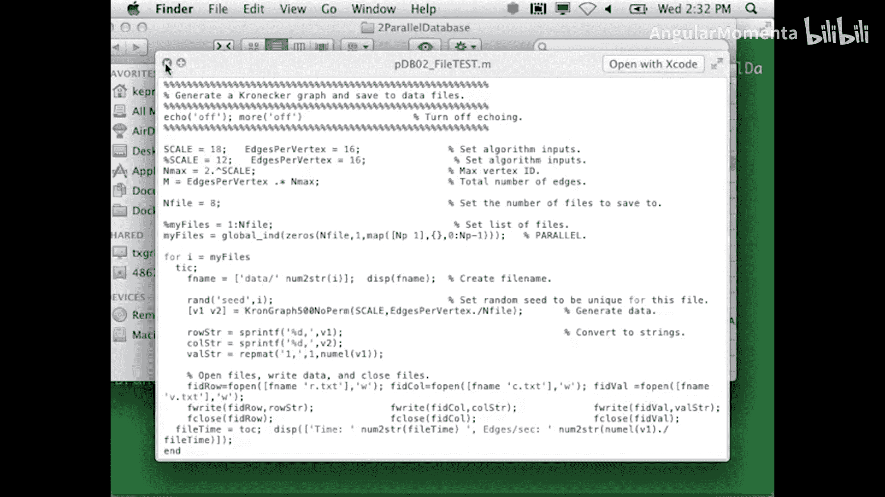

So， let's go。So if I do PdB。2。It's going now generate these things。

And so it's generating a lot more data and you see it's doing at about a couple hundred thousand for diseases per second just shows you a difference between the capability of。

My laptop and one of these one of these servers here okay and。This will also。

 I'm log under the system。 It has 32 cores。 I can do things in parallel。 And so， for instance。

 if I did。Eval P run， for those of you who have had the parallel MALb training。I can save you four。

And if I just， since I'm logging into this node and I just do curly brackets。

 it says just launch locally on that node， don't launch onto the grid。

And now it's launching that in parallel on this node。Data 1 did that。 Data 2， did that。

 Now it's done。 And the others finish their work to probably write about now。

 So that's just an example of being able to do things in parallel。 You know， we've created here。

 I mean， you look at it。 we did。You know what  eight times 300 do we did 2 and a half million edges in that in that essentially five seconds type of thing。

 so receive， you know， a state magic multiplies by four。

 you're doing like a million edges a second just in that one type of calculation there。Move on。

 T P B B03。And。Oh， I should say I did modify that program slightly。Let's see here。

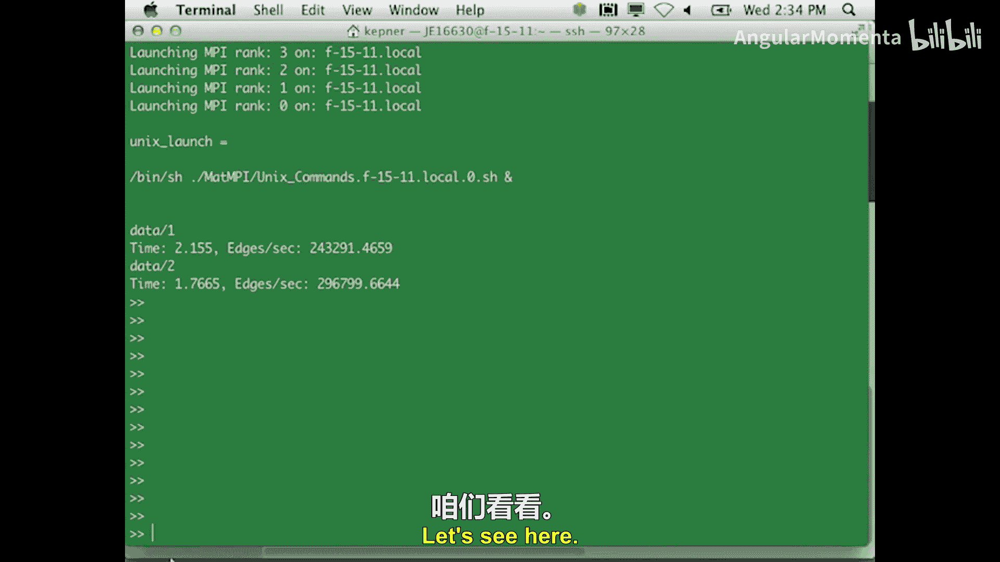

So if I look it。The the line enabled in big capital letters's parallel， I uncommented it。

That's what allows each one of the processors when they launch to then work on different files。

 Otherwise， they all would have worked on the same the same files。

 So by uncommoncoming that parallel， this is now becomes a parallel program that I can run with the ELP run command。

 Of course， you have to have parallel mal installed。

 which of course you all do since you're on yellowgrid， but for anyone seeing this on the Internet。

 they would need to to have that software installed too。

 which is also available on the web and and installable there。

 So that's all we needed to do is unment that one line to make that program parallel and did the right thing for us as well。

 and we're going to go on the next example。 and we did the same thing there。

 did we just uncommoncommented parallel and it's now going to know create these Associative array in parallel。

 So if I do。

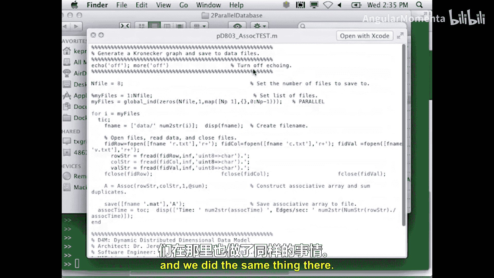

PDB3 OOS test is now actually constructing these associative arrays。

 you see it takes about four seconds to do each one of those it's doing them at about 120，30。

000 entries per second。So this thing will take about 25 seconds to do the whole thing。And again。

 we ran that in parallel。It automatically tries to kill the last job you ran if you were in the same directory so that you're not stoming on top of yourself。

And now you see it's doing that again。And now it's done so again， and the other ones。

Finished as well。You can actually check that you really want to。Control Z if I do more。out。

You can see those from the output files of each one of them， I'm not lying。

 they didn't take a ridiculous amount of time they all completed。

 you know always encourage people to check those dot out files in that MA MPI directory that's where it sends all the standard out from all the other nodes。

It'sBy the number one feedback we get from a user who says my job didn't run we're like what does it say in your dot out files and usually like。

 oh， there's an error on node 3 because this calculation is wrong on that particular node or something like that。

Just reminding folks of that。Moving on。So that was what do we just do， we did three， so we did PDDV4。

Retest。This is doing a little bit bigger calculation， and so you can see here。

 I told you it does begin to get bigger here， so it started out。

 you know the first iteration was about 0。6 seconds， and then it goes on to point。

8 seconds if we did that cat approach， it would do it faster。

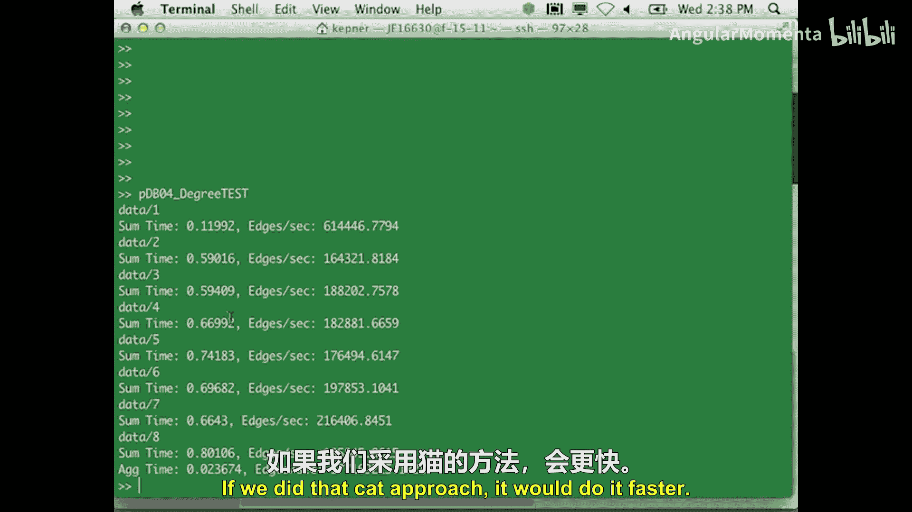

I'll show you a little neat trick with this is also a parallel program。When I run it， and。

Basically I loop over each files here， I'm just doing this little ag thing just to sync the processors just for fun so I don't have to wait for them to start and then it's going to go and they're going to do their sums and then when they're all done they're going to call this globe so each one will have a local sum and it needs to be pulled together so we have this function called gaAg which basically takes associatedso arrays and we'll just sum them all together and very nice tool for doing that and of course we had to uncomment that in order for that to work and so let's go give that a try。

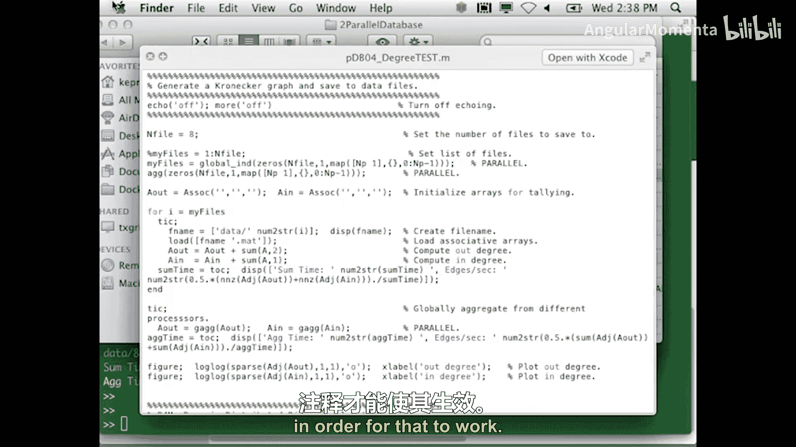

And so， if we do。You vow。So it's launching them。And's reading。

 and then I' was going to have to wait a second， Okay。

 so then it took about two seconds to pull them all together。and do the sum across those processors。

 so that's a parallel computation， you know a classic example of what people do with LOgrid and can do with the fors。

 they have a bunch of files， each processor processes them independently and at the end they pull something all together using this gag command。

All right， moving on。

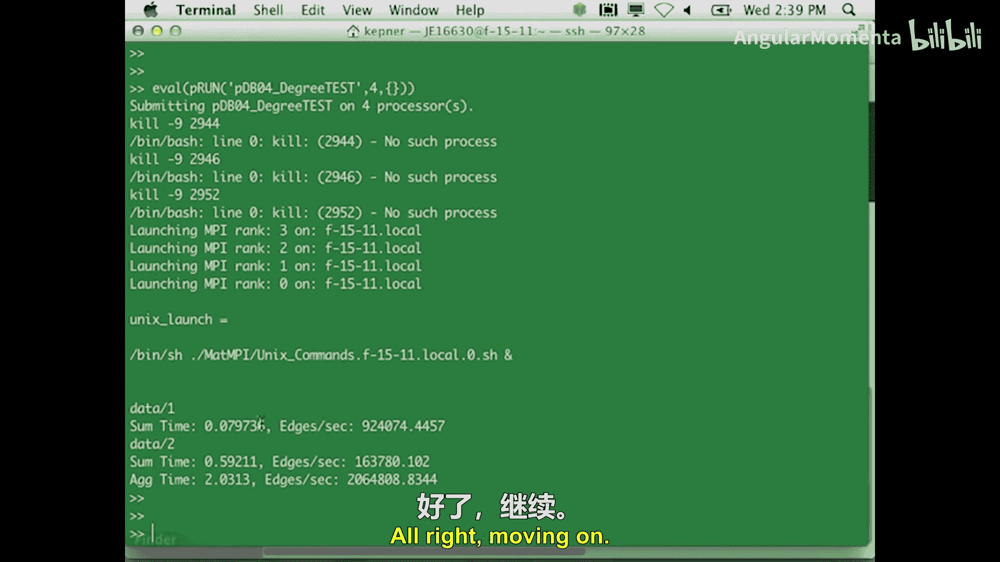

So now啊。Md database2 here。So I'm going to go to that and let's look at our tables。

Very little activity。 You see we have no tables there， so I have to create them。

 so I'm going to do PDd need set up。

， that's going to create those tables on that。

A database。Right。And we can now look。Xi。Vila created all art my table， so now I'm ready to go。

Now we're going to do the insert again， P DB。6ix。I'm going to sort the adjacency matrix。

And this obviously takes a little bit longer。Just each one of these。

 there's a parameter associated with the table， which is。

You would think normally it should just send all its data to the database at once。

 but it turns out one thing we found is that it actually it prefers the database prefers to receive the data in a smaller increment。

 typicallyy around half a megabyte chunk。 So every single time it's calling this it's sending half a megabyte waiting to get the all clear again and then setting the next one。

 And we've actually found that that makes a fairly significant So you can see here we're getting about 60000 inserts per second。

 This is from one one processor。And this takes a little while。

Let's see if we can go and look at it while it's going on， go here， we should begin to see some。

So there you go， see that's what a real inserts beginning any to look like。

 it just changes its axis for you dynamically here， but we're getting about 60。

000 inserts a second there， you just go along here。It'll start leveling off a little bit。

And I'll show you what's going。And just， I mean， you know。

 not too many of you are probably database ofic in autos but。

60000 inserts a second on a single node database is。Pretty darn amazing。 I mean。

 you would mostly have had to use a parallel database。

 And that's actually one of the great powers of acculators。 there's a lot of problem。

 even though it's a parallel database， there's a lot of problems you can now do with a single no database that you would have had to have a parallel system to do before。

 And that's really because， you know parallel computing is a real pain。 I mean， I should know。

 And And so one of the best， if you can make。😊，If you can make your parallel problem fast enough to now work on a single one。

 that's really a tremendously convenient capability。All right， so we inserted there what 8 million。

Enries， right， so pretty impressive， but that did take a while， you know。

 And so maybe I want to do that in parallel。 So if I just do e you run。Let's try， let's try for it。

Now， I'd expect actually this to begin to top this thing out。

 and so the individual insert search rates on each node probably go down a little bit。

And you'll see it'll get a little bit noisy here because now we have four separate processes all doing inserts。

 you see there was one it took a little bit of almost a second you can get this noise you to happen here。

But we're getting 50，000 edges per second on one node。Which means we should be getting， you know。

 like close to four times that。 So let's go check what's it's seeing here。

So if we update that。And there you see we're sort of now climbing the hill well over 100，00。

 that was our first insert there， and now we're entering the second one here。

don't want to check my email， do I。嗯。

Let's see here so are we doing there？Oh， it's done。

 so I don't even know if we got we may not even gotten the full rise time of that。

Yeah， so it basically finished before we could even hit the really hit the， you know。

 it has a little filter here。 has a certain resolution。

 You really need to do an insert for about 10 minutes before you can get really a sense of that， but。

You know there you see， you know， we probably got over 200。

000 inserts a second using four processes on one node and so again。

 and we could probably keep on going up this ramp， you know for this data set I'd expect we'd be able to get maybe 500。

000 inserts a second if I kept adding processors and stuff like that and again。So。

 and if you look at our data， right， you know， what do we got here？Oh， yeah like。

15 million entries now in our database again， one of the nice things is for typical databases a lot of times like you have to regest the whole database。

That's fine。 In our cyber program， we have a month of data and we can regest it in a couple hours。

 And that's a very powerful tool to be able to like， oh， you know what， I didn't like the ingestion。

 That's fine。 I'll just rewrite the ingestion and redo it。

 And this is gives you a very powerful tool for exploring your data here。

 So that's kind of what I want to do with that。 one of our students here very generously gave me some Twitter data。

 And so I wanted to show you a little bit with that Twitter data because it's probably maybe a hair more meaningful than this abstract chronicroner graph data。

 And by definition， Twitter data is about the most public。😊，Data that one could can imagine。

 I't think no one who posts to Twitter is expecting any sense of privacy there。

 so I think we can we can use that okay。So。

Let's see here。Out of that。あ。W。吓。Wwitter。All right， and so basically just a few examples here。

The first thing we did is construct the associative array。So let's start up here。

And I think it was like a million Twitter， is that right？A million a million entries and。

 how many tweets do you think that was？We should be able to find out， right。

 we should be able to find out。So。Yeah。So it's reading these in。

AndChed and writing them out to associatedsociative arrays。That's gonna be in mind isn。

The faster system。So this is running on the database system。And I broke it up into chunks of 10。

 I couldn't quite on my laptop fit the whole thing in one associative race。

 so I broke it up into chunks of 10。Yes， you were still choosing there。All right。

 so that just reads it all in， in fact， we can take a look at that file。

Yes。Just time。So I just took that exact same example and just put his data in。

 so just to take a look what that involved。Pretty much all the same。 I there was。

 it was one big file， but I couldn't。Process it。I mean。

 I could read it in each one of the row he did a great job of creating into triples and I can easily hold those triples。

 but I couldn't quite construct the associative array and so I basically just go through and find all the separators and then。

basically take them out of the vector in memory and so that's what I'm doing here is I'm looping over here so basically I get I read in all the data。

 I find all the separators and then I go through and it's a little bit of a messy calculation to basically do them in these particular blocks and then I can construct the associated array and save those out no problem。

And let's see here。 So what I'll do。You can do a little degree calculation from that data。

So it's now reading each one of those and computing the degrees。E。Same thing on this system。

Pretty fast。い？See then， too。Tables。

Ay， so I created a special class of tables for that。Modify that。Can go over here。Was on this one。No。

 I did it on。Yes。'One。Tables。Oh all right。 So all I was doing there was on the other one。

 spting the degree distribution。So， this shows us。You know。So for each tweet。你都会玩我。For each tweet。

Let's go to figure。One for each。All right。A' done，'s very Twitter like， no。

 no one has ever done in Twitter。so。Wow， what did I do。Yeahで。Don now。So weve got to figure one。

All right， you see for each tweet， this shows us how much information was in each tweet and you see that on average。

 this because he basically pars out each word。Uniquely， so this just shows that there's about 1000。

Pieces of information associated with each。Each tweet， which seems a little high。

So we should probably double check that。And then what did I do？So we loaded all them up。

 we sum the degrees， and then oh what I said， I show me all the locations greater than with crowns greater than 100。

And then all the words with at signs greater than 100 and all the hashtags greater than 50。

 so that's what these other guys are。So this was the essentially for each tweet。

 how many of you have。If we go to figure two。This shows the degree distribution of all the words and other things in there。

 so there's some guy here who's really really high， in fact。

 we can find him out and so but as of course most things you know occur only once。

 cited once like there's a lot of unique keys in like the there's the message ID。

 which of course is probably something that only appears once。If we go to figure three。

 so this just shows like the locations and this was tweets from the day before the hurricane or the week the Wednesday before the hurricanericane Sandy and so this shows us you know but in the limited to the kind of the New York area or something like that or yeah40 miles around 40 or miles around New York City though basically this shows us all the locations here and you see so this is a classic example。

 the kind of things you want to do because the first thing that we see is that we have。

Some problems with our data， which is New York City and New York City space。

Got to go in and correct all those right， So that's a classic example。 This is really what D4M。

It's the number one thing that people do with D4M is it's the first time that you really can like do sums and tallies over the entire data set。

 and these things just pop out。 They stick out like a sore thumb。 you know， like oh。

 got to correct that。 you can either correct in the database or correct it afterwards in the query。

 But that just immediately improves the quality of everything else you have。

 And then there's this clutter one， like location， none。 right， well， clearly。

 you'd want to just kind of get rid of that or do something with that。

 And then just plain old normal spelled New York。 So most people can spell correctly。

 And so we're we're good， but location iPhone。 I mean， what's that about， you know， Jersey City。

 Well， we don't care about that， you know， so South Jersey。 Well what。

South Jersey people don't know that they're 40 miles from New York， I guess， or。In their profile。

 so a lot of people in South Jersey who say they're from New York so。한겠어。What's your name。

From Jerseyers， sure。Snooky， right， Snooky says she's actually from New York City， not not Jerseys。

 not South Jersey。 So so so there's a great example of that。 And then let's see here， figure 4。

 So this just shows all the the at signs。 So you see basically。诶。Damn， it's true。Is like the most。

Was this like a retweeted thing or something or I don't know。

t know what what' does the ad sign mean again？To a new two years。

 so most people tweet the damnm it's true in New York， there you go， funny fact， relatable quotes。

And then Donald Trump， the real Donald Trump， and then just word at sign。

 So those is an another example。 you know， anything heres a hilarious idiot， bad gal V。

And Marilyn Monroe ID， I mean， so there you go。A lot of fun stuff there on Twitter。

But this is sort of he's going to establish his background and then go back and look at during the hurricane。

 so this is all basically the normal situation and then you know very clearly。

 and then the hashtags right so we can look at the hashtags so what have we got here。

 favoriteed movie quotes。嗯，对。And favorite movie quotes Mved right up there， the Kns。

 and then what I love the most and all this type team follow back。I don't know， team auto， no。

 what's this word， what's TfB？No one maybe we should don't want to know so。

You can always look that up in urban dictionary。It's a bad one。 All right， Okay， good。

 Well we'll leave it at that We't add that to the video。

So continuing on here。Let's see。Well， you get the idea and so all these examples they work in parallel too。

 you get a lot of speed up， lots of interesting stuff like that。

 but that's very classic the kind of thing you do， you get data。

 you parse it you maybe stick it in Matlab files to do your initial sweep through it but then if it gets really really big and you want to do sort more detailed things and you insert in the database can do queries there。

 leverage using your counts so that you don't accidentally。

 you know you can imagine if we put all the tweets in the world and you had location in New York City and you look that you had to like give me all this set of locations and one of them was New York City you'd be like oh my God I've just。

You know， had done a query that's going to give me 5% of all the data back。 Well。

 it's going to just flush your system。 But if you can just do the count and be like， oh。

 New York City's got a million entries， don't touch that one you know or put an iterator on that one right you know so that so that I only handle it in manageable chunks so I want to thank you So hopefully this was worth it we have one more class which deals with a little bit of wrapping up some of the theory kind of on this stuff and some stuff on performance metrics and then in two weeks for those of you who signed up we have thechimlo folks coming in showing you how to run your own database you know all day on just you know。

You knowWe're setting up a database for you for you guys on LOgrid。

 but you're definitely going to run in with your customers， acumullo instances。

 it's good to know some basics about that because a lot of times you're not going to have all the kind of nice nice stuff that we provided and it's good to know how to set up your own acumullo and interact with that in the field so with that that brings the lecture at the end and happy to stay for any questions if anybody has them。

