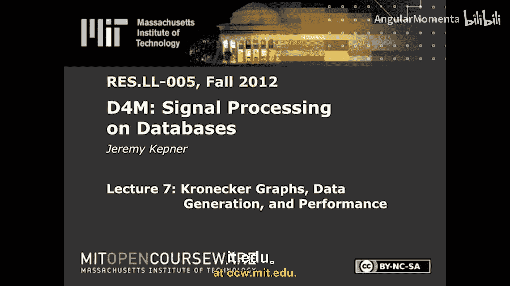
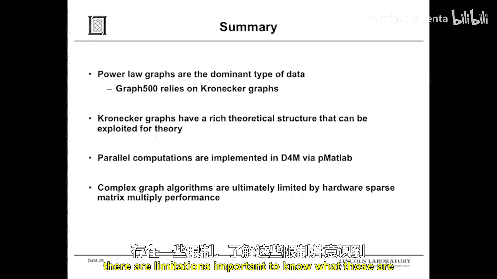
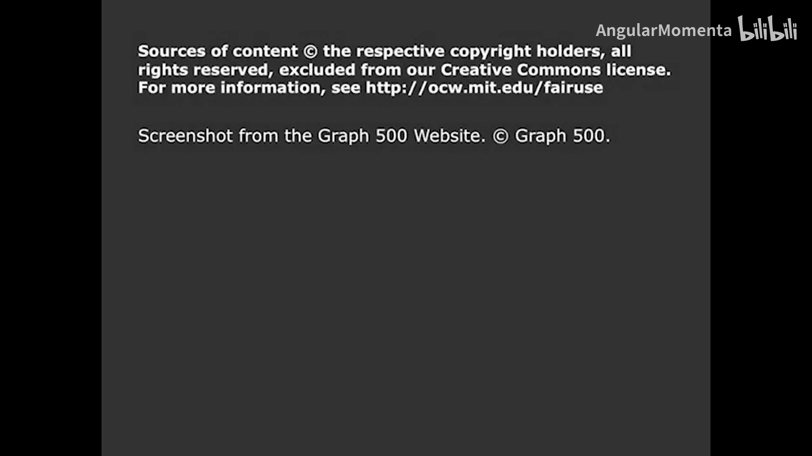

# 【麻省理工】大数据与机器学习数学-｜-MIT-RES.LL-005-D4M-Signal-Processing-on-Databases,-Fall-2012-p19-19-7.-克罗内克图、数据生成与性能--BV1eEtTzhE4F_p19-

The following content is provided under a Cative Commons license。

 Your support will help Mi T OpenCourseware continue to offer high quality educational resources for free to make a donation or to view additional materials from hundreds of Mit courses。

 Visit Mitopcourseseware at Ocw。 Mt Eduu。

What we're going to talk about today is in the previous class。

 we did a lot of examples on some data sets。啊。And they were artificially generated data sets。

 which is kind of a requirement in terms of if you want to do anything with big data and really show stuff。

It can be really difficult to pass around the terabytes and terabytes of data So having data generators that generate the statistics that you want or proing the statistics that you want are good to have We had a previous lecture on power law graphs and talked about a perfect power is very useful。

 and I encourage you to use that。 It's a useful analytic tool。

 This one we're going to talk about chronicer graphs and and generation chronicroner graphs are used in the largest。

Benchmark in the world for benchmarking graph systems。

 and then finally i'm going to talk a little bit about performance。

 you know what are the things you should be aware of。

When you're doing systems and building systems from a performance perspective。

 the kinds of things that are sort of essentially fundamental limits of the technology。

So moving forward， let's talk about。The graph。500 benchmark。

So the graph 500 benchmark was created to provide a mechanism for timing the world's most powerful computers and see how good they were on graph type operations。

 And so I was involved and actually wrote some of the initial code for this benchmark about。

five or 10 years ago， and it's now become a community effort and the code has changed and other types of things。

 and it's mainly meant for dealing with parallel in memory computations。

 but the benchmark is actually very useful for timing databases or any types of things you can do the exact same operations。

So it generates data and then it has you construct it in a graph and then it goes on to do some other operations and so we've actually found it to be a very useful tool for just it as a very fast high performance data generator and just if you want to time inserts of power law data。

 it's very useful for that。This is some older performance numbers。

 but this just shows essentially here the on a single core of computing capability。

 the number of entries that we're inserting into a table and the inserts per second that we're getting so the single core performance here for this data into a cumullo it's about 20 thousand inserts per second。

 So there's just a one core database very， very small。 as you've seen， we've even showed last week。

 you know on sort of modern servers where we' were getting several hundred thousand inserts per second on sort of a standard standard databases。

I'm comparing this also with just D4M without a database。

 If I just have triples and I construct an associative array， how fast does it do that。

 And so obviously， D4M is limited by how much memory that you have on your system。

 but it just just shows you that constructing an associative array and memory is is faster than inserting data into a database。

 by by a good amount。 And so again， if you can work with associative arrays and memory。

 you're going know that's going to be better for you， obviously。

 though the database allows you to go to very large sizes and one of the great things about amuls that this line stays。

Pretty fat flat。 I mean， you can go on out and out and out and out。 I mean。

 that's what it really prides itself on is just that。You knowAs you add data， I mean。

 it might degrade slightly， you know， but if you're inserting it right， that line stays pretty flat。

In the last class we did show how to do parallel inserts and parallel deform and it just shows you know parallel inserts here on a single node database。

 you know D4M itself， you know basically just taking this number and scaling it up and also into the database and so here you know single node database single node single core database we're getting like 100。

000 inserts a second with with that and so so you know that just shows you kind of some of the parallel expectations and when you should use a parallel you know parallel versions。

 databases again， if you can be in memory， you want to be in memory it's faster。

 if you can be in parallel memory， you probably want to be in parallel memory that's faster but if you have really large problems then obviously you need to go to the database and that's what that's for。

The data in。The top 500， I mean， the graph 500 benchmark is what we call a chronicroner graph。

It basically takes a little tiny matrix。Okay。Will seed matrix， in this case， g。

And you can imagine kind of what it looks like here。Sor of imagine this is a two by two matrix here。

 you can sort of see， you know maybe a little bit of the structure。

 and then it just does a chronicer product of that on out to create an adjacency matrix of you know by creating this adjacent that creates the graph。

And as a result it naturally produces this is a result。

 it produces something that naturally looks like a power law graph here。

 and this just shows you the dots， show you the power law degree distribution of that。

And you can see the sort of the slope there and from generated from this I should say one of the powerful things about this particular generator is you don't have to form the associated the adjacency matrix to construct the graph so it doesn't require you to build this gigantic matrix it generates the edges sort of atomically。

 if you have many， many processes all。Doing this as long as they set their random number seeds to different locations。

 they'll all be generating perfectly consistent edges in a larger graph。

 so it makes it very and thats so people have run this on computers with millions of course to do that because the graph generators completely a parallel allows you to essentially create a giant a giant graph。

And and also。The chronicronergraph though does generate the structure here， which is these。

 these bumps and wiggles。 and that actually corresponds to the power K。

So you can count the number of bumps， we have  one， two， three，4，5，6，7，8。

 so this would be a G to the eighth。Graph， so that structure is visible there。

 which is an artificial feature of the data。 and so。

One of the things that's actually occurred now is the people have been actually trying to use this generator because it's so fast and efficient to simulate graphs and we've basically said to people you know not really designed to simulate large graphs because it does create these artificial structures in there and that's kind of the reason we develop the perfect power law method because that's a much better method if you're actually trying to simulate graphs for doing that again。

 this method has these advantages in terms of being able to generate them。

Another advantage of these chronicer graphs。 And so in this case， B is my little。

Matrix here that I'm going to do a chronicer products of。

 in fact let me remind you about what a chronicer product is。

 so if I have here a matrix B that's Nb by Nb， although these don't have to be square and another matrix C that's NC by NC doesn't also have to be square and the Chroner product basically what you're doing is essentially taking C and multiplying by the first element and having essentially a block here and so it's a way of essentially expanding the matrix in both both dimensions and Ulakok who's now a professor at Stanford essentially develop this method back at 2005 for creating these matrices which allowed you to very naturally create sort of power law matrices。

 and they even had tools for fitting them to data which is a useful a useful thing again。

 it biggest impact has been on generating very large graphs。W grass very quickly。

The Chroner graph itself has several different types。So that I call here basically explicit。

 stochastic and an instance。So if I just set the coefficients。

Of the chronicroner graph to be like ones and zeros。 And I chronicer out。

 I will get structures that look like this。 So this is a chronicroner graph that essentially is a bipartite。

 essentially starting with a， you would call a star graph。 and then a diagonal。

 So that's kind of one。That's G1， then I chronic our product again G2 and G3。

 and I get these sort of different structure01 matrices。And so it's only zeros and ones。

 and so the structure and the connections are very obvious and this is actually useful。

For doing theory。So you can actually do a fair amount of theory on the structure of graphs using these01 matrices。

 in fact there's a famous paper by Van Lom on Chroner products and it's basically the paper is full of identities of chronicer products that you know the eigenvalues of the Chroner product of two matrices is the same as the Cher product of their eigenvalues and just a whole series of those things。

 and so what's nice is if you compute something on just the small matrix G。

 you can very quickly compute all the properties of the Chroner product matrix and that makes it very nice for doing theory and so there's times when you want to sort of understand the structure of these things。

 very useful theoretical tool for doing that。嗯。If instead of we use our little our C graph。

 instead of it being ones and zeros， it contains say numbers between0 and 1 that are probabilities。

 the probability of creating an edge between those two vertices。

 and we multiply that on again to get essentially a giant probability matrix。

Showing the probability of edges。 All right， these are the same。 but here we see we have differences。

 We don't just have zeros and ones。 We have values between zeros and ones。

 and then using the chronicer generation technique。

 we essentially draw instances from this probability matrix over here。

 So this allows us to search randomly sample。 So when you talked about chronicroner graphs。

 there's kind of three different types here。 This is kind of very easy to do theory on。

 you can do theory on this too， although it tends to you know be a little bit more worky。

 And then likewise， when you're doing simulations， usually you end up with with chronicroner graphs like this。

As an example of the kind of theory we can do。诶。One of the nicest graphs to work with are bipartite graphs。

 so a bipartite graph is a set of vertices， two sets of vertices that have and each vertex has a connection to every vertex in the other set。

 but they don't have any connections amongst themselves。

And so here I'm showing you a bipartid or star graph。

 so basically have one set of vertices here and another set of vertices here。

 and all the vertices have connection to the Vi vertex， but they have no connections to themselves。

 and this is the adjacency matrix of that graph。And here is another bipartid graph。

 that's sort of a 3， one set。 And if I chronic her product two bipartid graphs， the result is。

Two more bipartid graphs。So as we see here， we've created this one here and this one。Here。

And so in my notation， I'll say B5 comma 1 is at that's basically I'm saying I have a matrix that's it's a5。

 you know5， one bipartid graph，31 bipartid graph and within some permutation they produce a matrix that is the union of a 1501 and a 35 and this result is actually a result was first shown by a professor by the name of Weisel in 1962 you know and there was actually a little flurry of activity back in the 1960s with this whole algebraic view of graph theory and。

And then。And then which was very productive， but then it all died off。

And after the lecture I can tell you why that happened， but now it's all coming back， which is nice。

 so it took us 50 years to rediscover this work， but there's actually a whole book on it with lots of interesting results and so but then this just shows you kind of the general results here that you know for any two bipartite graphs by chronicer product together they are under some permutation equal to you know two other bipartite graphs and this sort of naturally shows you how the power law structure gets built up when you chronicer product these graphs so basically。

You know， you had this and this and there we basically add， you know， that's the super node。

Vertex here， this 11 vertex， and these are the lower degree pieces。

 and then these other vertices here are the singleleton vertices。

 So you can see as you naturally by you know product these bipartite graphs together。

 you naturally create these power law power law graphs。

And just an example and I won't really blabor the details here you can compute the degree distribution so this is and this is all there's like a long chapter on this in the book basically you can compute analytically the degree distributions of Chroner producting biparti graphs this shows you the formula for doing that and here is the actual degree distribution with the binomial coefficients for that and so a very useful thing you can a priori do that。

This shows you the results。 So if I have a chronicer product of a bipartite graph n equals 5 comma 1。

 and I take it out to the 10th power， is the This is the result is this blue line。

 And what you see is that you get。If you connect the last vertex and this vertex essentially did our poor man's alpha or connected any one of these other sets here。

 they have a constant slope of negative one。So that's a theoretical result is that they have this constant slope and that's true down here。

 you know K to the phi， other types of things， so we do get this Boeing effect。

 so it's not perfect with respect to that， but you can see how this power law is sort of baked into the chronic or generator。

 which is a very nice nice nice thing。This just shows a sample。

 we basically created aite4 by one bitre graph and then sampled it。

And so this shows the stochastic instance， there's about a million vertices here shows you that。

 and then these curves here show when we take the stochastic graph and analytically compute what the expected value of every single degree is assuming a Poisson distribution and you can see that we get a pretty much a perfect fit here。

Okay， all the way out。Except to the very end here。And this is where you get some pretty interesting statistics going on。

In theory， right？No one vertex， you know。this is your distribution right？

 No one vertex should actually be you know attracting this many nodes。

 but you have so many vertices with one of them that have this problem when you sum them all together。

 one of them gets to be chosen to be the winner。 and it's what pops it up here。

 So all the way out to the you know our fit is very good all the way out to the super node and we have this difference here。

 And this is where kind of the poisson statistics begin to fail。 So again。

 lots of opportunities for a very interesting very interesting theory there。

So that's just pure bipartid graphs， but bipartite graphs have no intergroup connections。

 so we can actually create something that looks like a power law graph and see all the community substructure in it very clearly。

 but those communities are not connected in a new way and so to create connections to the communities。

 we have to add the identity matrix down the diagonal and that will then now connect all our subbipartite graphs together。

So this just shows here so we basically take ourpartite graph a plus identity。

 and that's essentially this sort of this combinatorial sum here of the individual bipartite graphs there。

 again， wherein quotes means that there's a permutation you need to actually make this all work out。

We actually do the computation。All right。This shows the four comma one byparttype plus an identity bypart graph out to the fourth power。

 So you see here you're going to get one， two， you can compute it on out there。And。

What what you see is sort of this recursive structure， almost fractal like structure。

 So that's a nice way to view it。 You know， that's one way to kind of see it。

 But you don't really see the bipartite substructure in there。

 It's hard hard to see what's going on there。Well， since this is analytic。

 we can actually compute a permutation that says please recover all those bipartite substructures and so in the software actually we've distributed you have a way of basically computing a permutation of this that basically regroup。

 all our bipartid groups here， and then you can see the core sort of bipartid pieces and then all the interconnections between those core bipartidite pieces。

To give you a better sense of what that really means。 So here。basically， we have。

We have B to the I to the third power here。All right。 That's what it looks like。

 If we just subtract out the first and second order components。

 then we're left with these are the interconnecting pieces。

 You can see that much better when we permute it。 So here is the permutation of just the bipartid please。

 And that shows you these core。Bipartite chunks that are in the graph。We then do the second term。

 which is B， Chon B， Chron I。So this is the second。

 Now you can see that this creates connections between these groups。All right， and then likewise。

 if you do the the next one， So be， you know， B， Chron I B that shows you the connections between these groups and then I B。

 B shows you the different connections in these groups。 So each set of when we take。

B plus I and multiply it out and look at all those different combinations of the different multiplies there。

 you know there's the core piece， which is just B Chs the three and then all and that creates this core structure here。

 which is these densest pieces and then all the other polynomials are essentially creating interconnections between that So you can get really deep understanding of the core structure and how those things connect together。

 which can be very interesting。We can compute these interconnected structures fairly nicely。

 here's a higher order example going out to the fifth okay。

 but we can compute the structure this chi structure which is essentially a summary of these by just looking at。

A two by two。 so we can compute all the structures of the interconnections by just looking since as we have a bipartid thing。

 we can collapse all those pieces down and just have a two by two。

 So we have here a little tiny version of this structure here It shows you that Likewise this structure here is summarized by that and this structure here is summarized by that so you can get complete knowledge not just at the low level scale。

 but at all scales if you want to just say I want to look at the blocks and how the edges are connected in detail。

 or if I just want to consider things in big blocks and connect them。

 I can do that very nicely as well。And again， we can compute the degree distributions as well。

 so this just shows B Ch to the K and then B plus the second order terms and then moving on out and actually what you see is by adding this identity matrix。

 all it does is sort of slide the degree structure over。It also does change the slope。

A little bit here by adding this identity matrix along， so it's steeper than the original。

And you can do other types of things like here's something we did in Ioparametric ratios。

 I won't belabor that but it' is essentially a way of computing the surface to volume of subgraphs and we can compute this analytically and we see that the Ioparametric metro of a bipartite subgraph is constant。

But the half bipartite graph has this property here and just to summarize here and this has done a great deal in the chapter。

 this just shows different examples of the theoretical results。

 you know you can compute for bipartite graph or a bipartite plus an identity。

 the degree distribution， the between the centrality is a fairly complicated metric we actually haven't figured out for this one or I didn't bother to figure out for this one you can compute the diameter very nice you can compute the eigenvalues and the isobarometric ratios or just all examples of the kind of theoretical work you can do and again。

 I think it's very useful if you want to kind of really understand the substructure and how the different parts of a power law graph might interact with each other。

All right， so that just talks about kind of chronicer graphs and and literature are the basis of these benchmarks。

 and now I'm going to get into some benchmarks again themselves。So this just to remind folks。

 this just shows some examples when you're doing benchmarking of inserts into a database andNormally when do parallel computing。

 you have kind of one。Parameter。Which is， how many parallel processes are you running at the same time。

 And so most of your scaling curves will be with respect to in this case， the number of。

The number of concurrent processes that you're running at one time here。

 I think we're going up and up going up to 32 here。

 That's the standard parameter in parallel computing。 When you have parallel databases involved。

Now you have a couple of additional parameters which just make it sort of that much more stuff you have to keep in your head。

 which is essentially in this case， an acuullo calls its individual data servers， tablet servers。

 so you have to be aware of how many tablet servers you have。

So that's another parameter so you have to create separate curves here。

 this is our scaling curve with a number of ingest processes into one tablet server versus number of ingest processes into six tablet servers and as you can see。

 you know they don't not a huge difference here at the small end。

 but eventually the one tablet server database sort of levels off while the other one keeps on scaling。

And so this is very tricky， I mean， if you want to do these kind of results。

 you kind of have to be aware of both of these parameters， you know。

 in order to really understand what you're doing。There's also a third parameter which is generally true of most databases and aul is no exception。

 which is that if you're inserting a table into a parallel database。

 that table is going to be split amongst the different parallel servers in the database and。

That will have a big impact on performance。How many splits you have because you're not going to be able to take advantage of if you have fewer splits than the number of database server nodes than you're not taking advantage of those。

 And then how balanced those splits are are is the data going in uniformly into those into those things。

 And so this just shows you an example of an eight tablet server a chullo doing the inserts with no splits versus doing it in this case with 35 splits。

 And you see there's a rather large impact on the performance there。

 So a deform actually has tools we didn't really go into them。

 But if you look at the look at the documentation for allowing you to do splits the databases we've given you access to are all single node databases。

 So we've made your life in certain sense a little bit easier that you don't have to worry about splits。

 but it is something as you work on larger systems， you have to be very well where of the splits。

Another thing that's often very important is when you're inserting into a database is the chunks of the size。

 the chunks of data that you're handlinging to the database。

 this is sometimes called the block size there's a very important parameter blocking of programs is very important probably the key thing we do in optimizing any program is coming up finding out what the right block size is for system because it almost always has a peak around some number here and so this just shows the impact of block size on the performance rate here for a cumullo and nice thing about DraM there's actually a parameter you can set for the table which will say how many bytes I want to set I think the default is like 500 kilobytes which is a lot smaller than I what I thought。

 but it's a number that we found tends to be fairly optimal across a wide range of things typically when you do inserts into a database you're like well I want to give you。

estt chunk that I can and move on and in Kelo and probably a lot of data is actually like to get data in smaller chunks would than you would than you might think basically what's happening then is if you're giving it the right sizeized chunks then it all fits in cache and any sorting and other types of operation has to do on that data can be done much more efficiently so this just shows another parameter you have to be worried about if you do everything right and I showed this showed these results before these are the kind of results that you can get this shows essentially on an eight node system fairly powerful 24 cores per per node getting the 4 million inserts or entries per second that we saw which is to our knowledge that again the world record holder for this。

That talks about inserts， another thing that we also want to look at is queries。So as I said before。

 a cumullo is a rowbased store， which means if you give it a row key。

 it will return the result in constant time and so that's true So we've done a bunch of queries here lots of different concurrent processes all querying at the same time and you can see the response time is you know generally they say around 50 milliseconds which is great you know and this is the full round trip time。

 a lot of this could have been network lately you can see for all we know and so that's what you expect that's what a cumul divs if you do row queries then you get constant time Now as we've talked about before we do our special exploded transpose schema which essentially give this performance for both row and column queries。

 but if you have a table where you haven't done that and you are going to query a column。

It's a complete scan of the table。 And so you see here as you and just， you know。

When you want to do a column query， you know the performance is just going to go up and up and up and up because they're all just doing more and more scans and the system can only scan at a certain rate so that's again the main reason why we do these special schemas is to avoid this performance penalty。

So finally， in talking about performance。Let's talk a little bit about D4M performance itself。

If you write your Dform programs。Optimly。And this sometimes takes a while to get to because usually you don't quite have them。

 But I should say in the most elegant way possible。 again。

 this sometimes requires some understanding。 Most applications end up becoming a combination。

Of matrix multiplies on these associative arrays。Now it's usually not the first program I write。

 but usually it's the last one I write for this like it finally dawns on me to how to do the entire complicated analytic and all its queries as a series of special sparse matrix multiplies。

 which then allows us to maximally leverage the underlying libraries which have been very optimized to do know it's basically not calling any of my code。

 it's just calling the MaA Sprse matrix multiply routine which is further calling the Sprse Bs。

 which are heavily optimized by the vendor， the computing vendors and likewise recalling sort routines。

😡，So。The thing you have to understand， though， is its sparse matrix multiply as fundamental hardware limits。

Depending on the kinds of multiplies you're doing here so and we have a whole program that basically times all these and generates them so if you ever want to get what your fundamental limits are we have a set of programs that will run all these benchmarks for you and show you what you can expect。

youAnd this shows you basically the fraction of the theoretical peak performance of the processor as a function of the total memory of in that processor。

 so so this is all single core single processor benchmarks。

 so as you can see here this is dense matrix multiply。And it's like， 95% efficient。

If I was to build a piece of special purpose hardware。

And a memory subsystem for doing dense matrix multiply。

 it would be identical to the computers that you all have。

Your computers have been absolutely designed to do dense matrix multiply。 And for good or bad。

 that's just the way it is the caching structure， the matrix multiply units， the vectorization units。

 they're all designed to do。 They're identical to an you know， a custom built matrix multipied unit。

 And so we get enormously high performance here，95% peak on dense matrix multiply。 Unfortunately。

 that hardware architecture。And everything we do it for dense matrix multiply is the opposite of what we would do if we built a computer for doing sparse matrix multiply。

 And that's why we have when we go from dense matrix multiply to sparse matrix multiply。

 this thousand to x drop in performance。 Okay， and this is not getting better with time。

 This is getting。Worse with time。 And there's nothing you can do about it。

 That is just what the hardware does。 Now， it's still better to do sparse matrix multiply than to convert it to dense because you're still a net win by not storing computing all those zeros that you would have in a very sparse matrix。

 So it's still a significant win in in execution time to do your calculation on sparse matrices If they are sparse。

 but but not otherwise。And then。So that's that this shows sparse the the matrix multiply of an associative array。

 So the first one， the top one is Matlab dense Matlab Sprse Dform Associative array。

 and we worked very hard to make。The D forum Associative array just to be a constant you know factor below the core sparse。

 so you're really getting performance thats pretty darn close to that and so you know generally doing sparse matrix multiplies on the Associative arrays works out pretty well。

But again， these are' still like about 0。1% efficient of the hardware and then the final thing is we have these special sparse matrix multiplies where we cancatenate the keys together。

 if you remember way back when we did the bioinformatics example we could do special matrix multiplies that essentially preserve where the data came from if we correlated to DNA sequences we would have a matrix that would show the Is of the DNA sequence and if we did these special matrix multiplies the values within whole the exact DNA sequences themselves that were the matches well。

 there's a performance hit that comes with holding that additional information just all this string information and maybe one day we'll be able to optimize this further。

 although we've actually optimize it a fair bit already。

 and so there's another sort of factor of 100 and it looks like this is just again。

 fundamentally limited by the speed at which we the hardware will dors。

Matrix multiply and the speed at which it can do string sorting。

That's essentially the two routines that these all these functions boil down to is sparse matrix multiply and string sorting。

 and those are essentially hardware limited， those are very optimized functions。So。

This just gives you way。 I think it's always。 and this the first thing we do when we run a program is。

You know。If we want to optimize it。We''ll write the program and run it at a time。

 and then we'll try and figure out you know， based on this type of data， well。

 what's the theoretical best we could do。You know what's given the kind of what this calculation is dominated by。

 what is the best we can do？Because if the best we could do， the theoretical peak was， I mean。

 for what we were doing was。A thousand times better than what we're doing， that tells us。

 you know what？If we have to invest time in optimization， it probably is time well spent。

Going from being 1000 x below whatever the best you can do。

 getting to 100 x usually doesn't take too much trouble。

 usually you can find what that issue is and you can correct it， okay。Likewise。

Going from 100 x to 10 x is still usually a worthwhile thing to do if you。

If you're at like 10 per cent of the best that you can do， then you begin to think hard about， well。

 do I really want to chase。I'm never going to probably do better than 50% of what the best is。

 you know， or maybe even 30 or 40%， Usually there's a lot of effort that goes into going from 10% of peak performance to 50% of peak performance。

 but going from 0。1% of peak performance to 1% of peak performance is usually profile the code。 Aha。

 I'm doing something wrong here， fix it。Done。 And so this is something that's a part of our philosophy in doing optimization and why we spend so much time running benchmarks and understanding where we where we because it tells us when to stop。

IfSomeone says， well， will this be faster。 You can say， no， it won't be faster。 You're done or no。

 we， we think in a few weeks times， we really can， you know， we can really make it a lot better。

 So very useful thing。 And that's why benchmarking is a big part of what we do。So finally。

 I want to wrap up here。This was one of the first charts I showed you and hopefully now it makes a lot more sense。

This shows you the easy path towards solving your problems and signal processing on databases。

 All right， and if you look at your problem as one of。How much data I want to process and how much。

 you know what the granularity of access is， well， if I don't have a lot of data and I'm accessing it at a very small granularity。

 well， then I should just do it。In the memory of my computer， don't mess around with files。

 don't mess around with databases， keep your life simple， work it there。

If the data request gets high， memory is still the best。

 whether you're doing little bits or big vets， you know。

 working out a main memory on a single processor generally for the most part is where you want to be。

If you're going to be getting to larger amounts of data， but having a fairly large request size。

 then using files。😡，Reading those files in and out。

 so basically you know if I have a lot of data I want to process it won't fit into serial memory。

 we write it out into a bunch of files， just read them in， process them。

 move on to the next file is the right thing to do。Or spread it out in parallel。

 run a bunch of nodes and use the Ram in each one of those。 that's still the best way to do it。

You can also do that in parallel。 you can have parallel programs reading。Paraallllel files， too。

 so if you have really enormous amounts of data and you're going to be reading the data in large chunks。

Then you want to use parallel files， parallel computing。 That's going to give you better performance。

 And it's going to be easy。 I mean， you know， have a lot of files。

 Each program reads in a sets of files， processes it set very easy to do。

 And we have lots of support on our Lgri system for doing those types of problems。

 it's the thing that most people do。 However， if you have a large amount of data。

And you want to be accessing small fractions of it。Randomly。That's when you want to use the database。

 That is the use case for the database。And there are definitely times when we have that case where we want to do that。

But you want to kind of build towards it a lot of times when you're doing analytics or algorithm development。

 you tend to be in these cases first。And so rather than bite off the complexity associated with dealing with the database。

 use these tools first， but then eventually there may be a time where we actually have to use the database。

 and hopefully one thing you get out of this course is understanding this nuanced type of thing because a lot of people say we need a parallel database。

😡，Why we' have a lot of data。 All right， that's great。 Well what do you want to do it。

 Well we want to scan over the whole thing。Well， that's just going to be a lot of data really slow。

 you know， other than so people will do that toll load a bunch of data into the system like， well。

 but nothing's faster。You know， it's like， well， yeah。

 if you're going to scan over a significant fraction in the database， it will be slower。

 Certainly slower than loading it into the memories of a bunch of computers and and even slower than just having a bunch of files and reading them into memory。

 So and increasingly， nowadays。You know， I mean， so what you know， you're talking about。

This is like millions of entries。😡，You know。There's a lot of things that were databases that we have。

 like the lab's LDap server。It's like 30，000 entries。We have a database for it。

 You could send it around an Excel spreadsheet and you know。

 pretty much do everything with that or the entire release review query or the phone book or whatever these are all now by today's standards。

 microscopic data sets that can trivially be stored in a single associative array in something like this and manipulated to your heart's content。

 So there's a lot of data sets that are big to the human but are microscopic to the technology nowadays。

 So this is usually millions of entries， you know this might be hundreds of millions of entries。

 definitely when you really need， you know often you're talking about billions of entries when you're getting here to the point where you really need Davis。

The exception to this being， if you're in a program that requires。

 you know many of our customers say the database is being used， this is where the data is。

 it's in no other place。😡，So for integration purposes， then you throw all this out the window， right。

 if they say， look， this is where the data is and you have。 That's the only way you can get it。 then。

 of course。But that still doesn't mean you might be like， yeah， well。

 you're going to store in the database， but I'm going to store it in slash temp and work on it and then put my results back in the database because I know that what I'm doing is is going to be better。

 There's there's no， you know， don't， as I we say， you know。

 we don't want to be too proud to win know just because some people like。

 we have a database and everything must be purely done in the database where some people like。

 we have a file system and everything must be purely done in the file system or we we have this language and everything。

The right tool for the job， you know， the right tool for the job pulling them together totally fine。

 it's a quick way to get this work done without driving yourself crazy So with that I'll come to the end。

 I have one code example which is relatively short to show you but again you know parallel graphs are the dominant type of data that we see know G 500 relies on this Ch product Chroner graph theory is a great theoretical framework for looking at stuff you get all the identity benefits that come with with the chronicroner product eigenvalues if you're into that I' certainly suggest you to read the van Loam paper。

 which is also the seminal work on Chroner products and I don't think anyone's written a follow-up because everyone's like covered it there it's about 1215 pages covered to all the properties of Chroner products。

We can do parallel computing in deformum via PAT lab and again， the fundamentally。

 if you've implemented your algorithms correctly， they're limited by hardware。

By fundamental aspects of the hardware， there are limitations。

 it's important to know what those are and to be aware of them。

