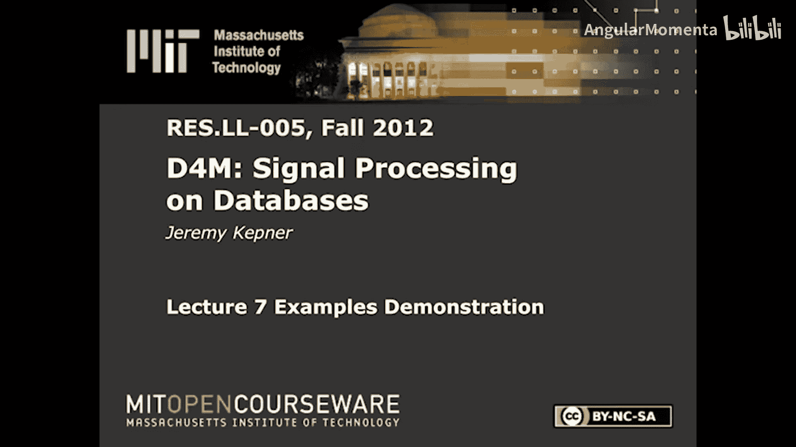
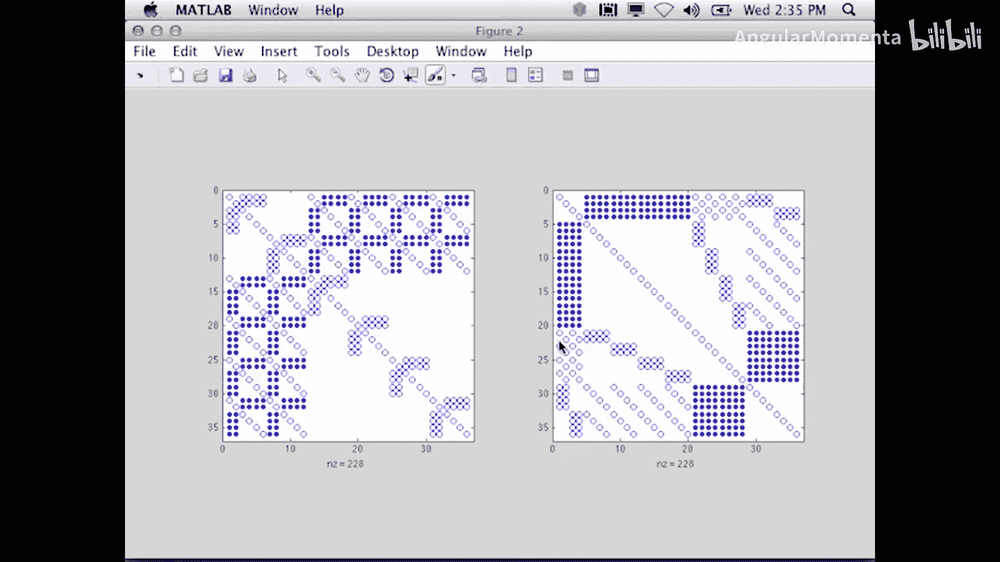
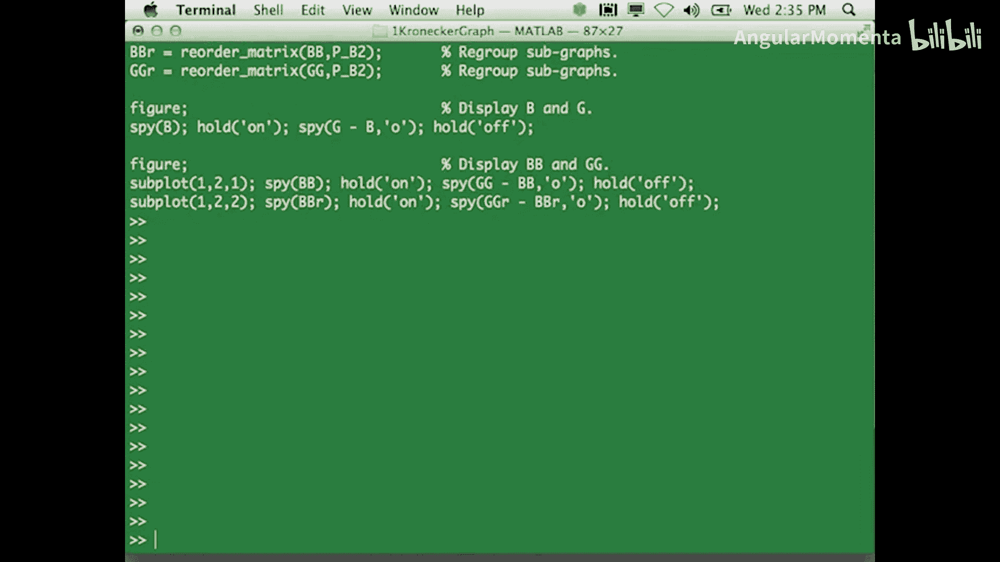
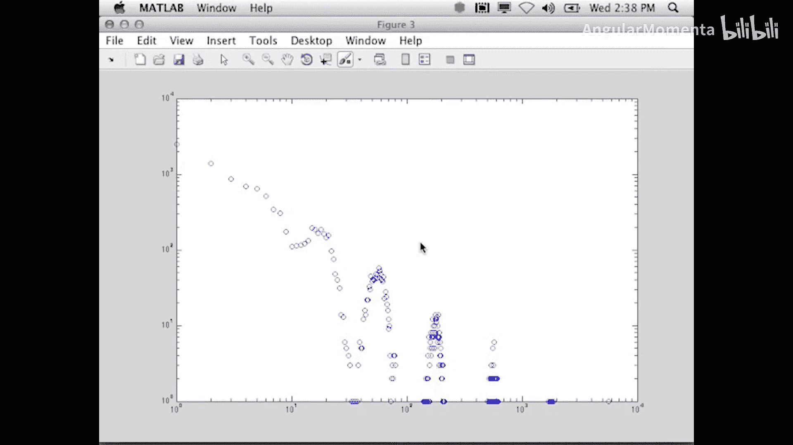
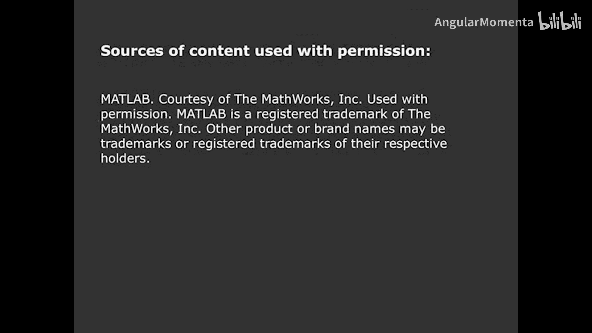

# 【麻省理工】大数据与机器学习数学-｜-MIT-RES.LL-005-D4M-Signal-Processing-on-Databases,-Fall-2012-p20-20-7.-示例演示--BV1eEtTzhE4F_p20-

The following content is provided under a Cative Commons license。

 Your support will help Mi T Opencourseourseware continue to offer high quality educational resources for free to make a donation or to view additional materials from hundreds of Mit courses。

 Visit Mit Opencourseseware at Ocw。 Mt Eduu。

