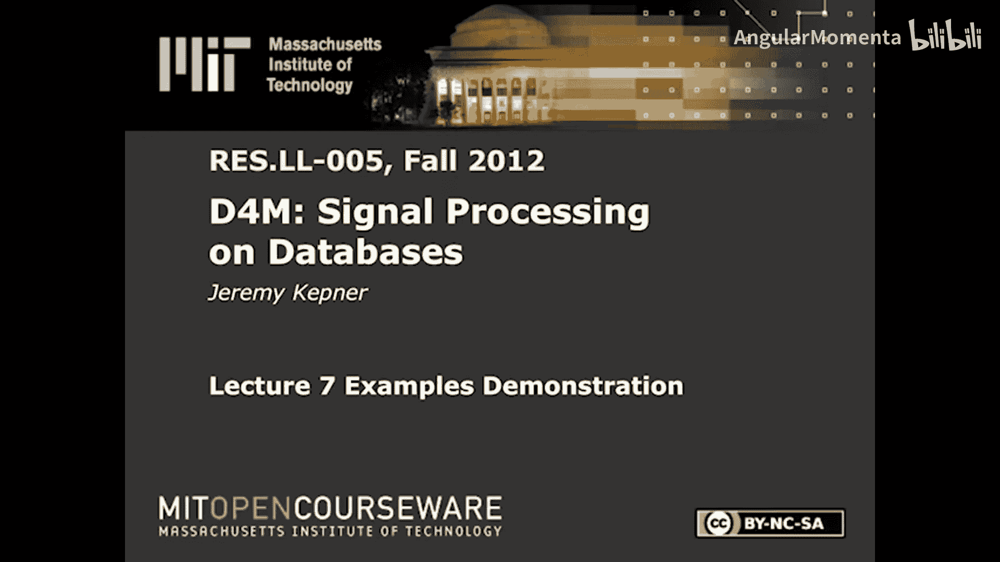
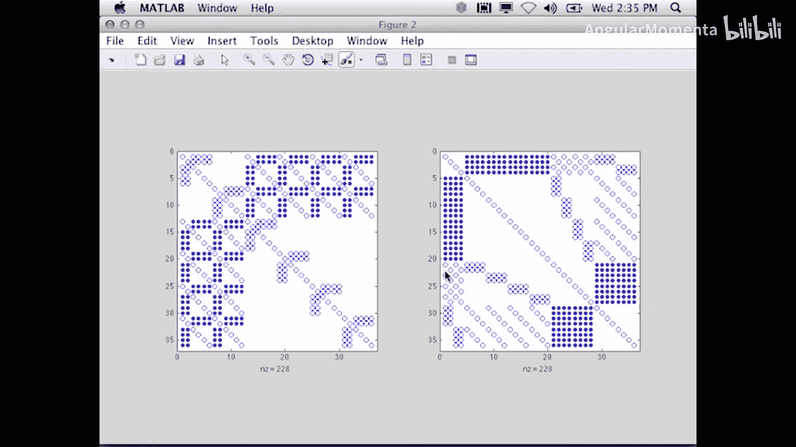
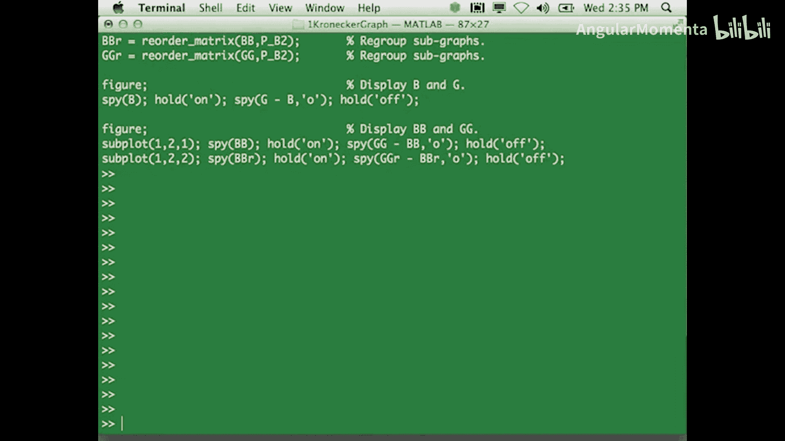
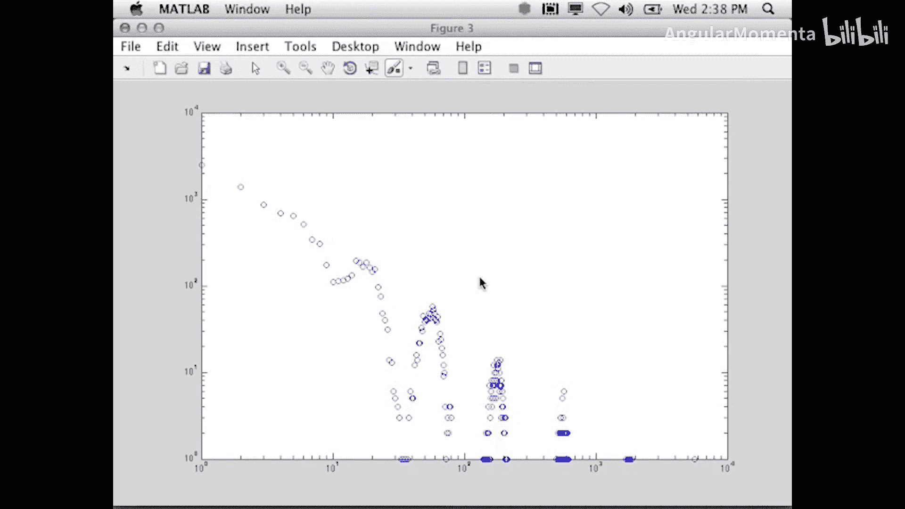
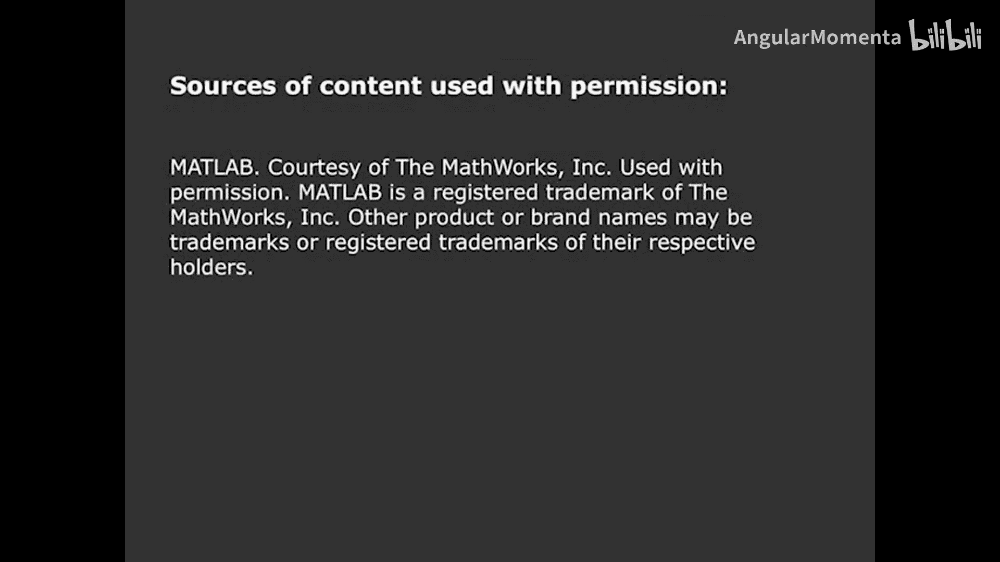

# 大数据与机器学习数学：20：示例演示 🧮

在本节课中，我们将通过一个具体的示例演示，学习如何将信号处理技术应用于数据库。我们将看到如何利用矩阵运算和关联数组来高效地处理和分析大规模数据。

以下内容采用知识共享许可协议提供。您的支持将帮助麻省理工学院开放课程持续提供高质量的免费教育资源。如需捐款或查看来自数百门麻省理工学院课程的其他材料，请访问麻省理工学院开放课程网站 ocw.mit.edu。

上一节我们介绍了信号处理与数据库结合的基本概念，本节中我们来看看一个具体的操作示例。

以下是演示中使用的关键数据矩阵图示：

这些图示展示了在数据库上进行信号处理操作时，数据如何被结构化为矩阵。核心操作通常可以表示为矩阵乘法或求和。例如，一个常见的聚合查询可以表示为：

**公式：** `Result = A * B`

其中 `A` 和 `B` 是代表数据库表和查询条件的矩阵。

通过将数据库操作映射为线性代数运算，我们可以利用为数值计算优化的高性能数学库，从而显著提升处理海量数据的效率。

本节课中我们一起学习了如何通过一个具体示例，将信号处理的矩阵运算方法应用于数据库查询与分析。这种方法为处理大数据提供了强大的数学基础和计算效率。