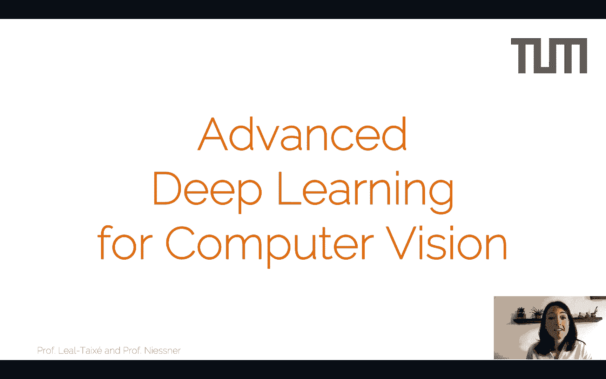

# 1：L1 - 深度学习计算机视觉介绍 🧠

欢迎来到高级深度学习计算机视觉课程的第一讲。这是一节导论课。鉴于当前的特殊情况，我们决定以录制所有课程的形式开始。这是第一讲，欢迎各位。

首先，让我介绍教学团队。我们由两位教授组成，我和Nisner教授。我们将共同讲授这门课程，以便在讲授的主题上提供一些多样性，这些多样性源于我们在计算机视觉和深度学习领域的研究。

我们还有一组多元化的助教，Dave G、Tim和Maxim将协助我们，并指导你们完成研究项目。正如今天将看到的，研究项目是本课程非常重要的一部分。

那么，这门课程是关于什么的呢？理论课程将重点介绍高级深度学习方法，并着重关注计算机视觉任务。你们已经完成了深度学习导论课程，具备了扎实的理论基础，并在深度学习基础方面进行了大量实践。现在，我们将把这些技术向前推进一大步，深入计算机视觉领域。

我们将重点关注新方法，这是一门研究导向的课程。我们将介绍一些已被发明的方法，其中一些甚至是今年才出现的，内容非常新。课程中将提供大量参考文献。如果你们希望阅读我们推荐的研究论文，或者想扩展知识，这门课程非常适合你们。

正如所说，这是一门非常注重研究的课程。在理论课中，我们将介绍这些新方法，但你们实际上需要提出自己的想法来解决一个特定的视觉问题。因此，这本质上是一门实践课程，理论课将为你们提供解决感兴趣的视觉问题所需的工具。课程非常强调实践方面。

实践部分将以一个贯穿整个学期的项目形式进行。你们可以将深度学习导论课程，特别是高级深度学习课程中学到的知识付诸实践。你们可以编写这些方法的代码，训练自己的第一个大型神经网络来解决一个真实的、具体的计算机视觉问题。

投入时间到这些项目中非常重要。我们每学期都被告知这个项目非常耗时，我们完全清楚这一点。但我们认为这种实践经验非常有价值。这个项目将为你们的未来和职业生涯带来很多收获，但它也确实非常耗时。

项目将以两人小组的形式完成。这意味着，如果一开始你们组队并承诺与另一人共同完成项目直到结束，而中途有人退出，这对团队中突然被留下的另一位学生来说非常不利。因此，我们非常希望避免学生中途退出。我们从一开始就告知你们这个项目非常耗时。所以，如果你们决定继续学习这门课程，请确保本学期课程负担较轻，能够为ADL4 CV投入大量时间。如果不能，请考虑在下个学期再选修这门课程，如果你们本学期符合条件，下个学期很可能仍会被接受。

好的，接下来谈谈课程组织。最初我们计划大约有12次讲座，但本学期可能会减少到大约8次，这有待确定。本学期我们将引入一个变化，即压缩这些讲座。我们希望在课程初期，以一种紧凑的方式向你们介绍所有这些理论和高级学习工具。这样，你们就能学习并掌握所有这些工具，然后通过项目应用它们。否则，有些人可能会遇到这样的情况：例如，他们有一个基于GAN的项目，但GAN的介绍要到第一讲之后五周才进行，而那时项目已经开始了，他们就没有足够时间充分利用GAN的介绍。

我们将在每周一和每周五进行讲座。我们会将讲座上传到网上，所有讲座都会被录制。每周一和每周五，会有一节讲座上传。请关注Moodle平台，查看每周初和周末发布的新讲座。

从实践方面来看，项目将以两人小组的形式完成，这是不可协商的。除非学生人数不是偶数，否则不允许单人组或三人组。原则上，项目必须由两人小组完成。学期中会有关于项目进展的汇报，我们需要确定是以线上还是线下形式进行，可能会在周五的研讨室进行实体汇报。

最后，将有一个最终的海报展示环节，你们将有机会向我和Matta的研究小组展示你们的成果。

课程将有一次考试，考试成绩占总成绩的三分之一。考试日期尚未确定。将会有两次经典的复习课，你们可以查看自己在考试中做得好和不好的地方。但再次强调，课程最重要的部分是实践部分，它占总成绩的三分之二。

现在谈谈项目的截止日期。下周五我们将有一个项目介绍会。这意味着我们将向你们介绍我们和助教们感兴趣的可能项目。这些项目与助教们正在进行的博士研究相关。之后，你们可以查看这些项目，阅读相关文献，并确定是否喜欢其中任何一个项目。

在5月4日星期一，我们将进行项目分配。这很可能会以现场形式进行，即使可能需要在线上完成，我们也会尽力实现现场分配。

在5月11日，你们需要提交一份一页的项目构想摘要。在项目分配和助教们于24日介绍项目描述之后，你们需要制定一个研究计划，即这份一页摘要。截止到15日，我们将评估这个项目。

关于实际项目有两点说明。第一，这当然是高级深度学习计算机视觉课程，因此项目主要围绕计算机视觉展开。这并不意味着我们对自然语言处理项目或你们仍使用深度学习的相关领域项目不感兴趣。但当然，那样我们就无法提供我们在计算机视觉领域的专业指导。如果你们有自己的项目想法，请向我们提出，请与助教们沟通。我们仍然可以让这些项目实现，并评估它们是否适合在一个学期的ADL4 CV课程中完成。但当然，我们更倾向于我们提出的项目以及计算机视觉领域的项目。尽管如此，如果你们有任何想法，请发挥创意，向我们提出，给我们发邮件即可。

好的，项目评估将分为汇报和海报展示两部分。我们将有两轮汇报。在6月8日和12日，我们将进行汇报，分为两组。我们会告知你们属于哪一组。对于第一次汇报，你们只需要展示初步结果、遇到的初步挑战、为挑战找到了哪些数据集、如何设置这些数据集等内容，可能还包括你们已经训练的第一个神经网络或第一个基线模型。

参加这些汇报是强制性的。每个人都需要参加，并且我们欢迎小组其他成员提问。我们希望每个人都参与到这些汇报中，希望每个人都提问，我们需要从彼此的项目中学习。

第二次汇报将在7月进行。从第一次汇报到第二次汇报，你们有一个月的时间。在这里，你们需要展示几乎最终的结果：尝试了哪些方法、哪些有效、哪些无效，以及到目前为止取得的成果。

我说“几乎最终”，因为在7月24日，将有一个海报展示，这是你们项目的绝对最终展示。所以，你们大约从7月6日或10日到24日，有大约两周时间来最终确定代码、报告和结果，并在24日进行展示。

所有结果必须在20日之前完成，这是报告提交的最终截止日期。在7月20日中午，你们需要提交一份报告，最多四页，包括图片、所有结果以及你们尝试过的所有内容，使用我们将提供的模板。然后，你们基本上有四天时间来准备最终的海报展示。

关于评分，正如所说，考试将占总成绩的三分之一，它将基于本学期我们将进行的讲座内容。但实践部分将占成绩的大部分，即三分之二。学期中的两次汇报和海报展示占实践部分的三分之一，最终报告占另一个三分之一，代码提交以及对项目质量的总体评估占剩下的三分之一。

为了跟进项目进展，你们将被分配给一位助教，即四位助教（Dave G、Tim和Maxim）中的一位。他们将帮助你们并监督你们的进展。请确保每周或每两周与他们进行一次办公时间会议，讨论项目进展。他们不是来帮助你们编写无法解决的代码的，但如果你们遇到问题，例如某些东西不工作或网络无法训练，你们应该联系他们，与他们沟通，以确保每周都在取得进展。

助教分配将在项目分配后公布。届时，你们将准备好开始与他们沟通，并组织整个学期的项目。

目前，讲座将完全在线进行。这是录制所有讲座的计划。Moodle平台应该已经设置好，幻灯片将发布在那里，也会发布在你们在这里看到的网站上，以及这些讲座的视频录制链接。

关于课程组织的任何问题，请使用专用的电子邮件地址。很遗憾，我们无法回复发送到我们个人地址的邮件，因为那样邮件会太多且杂乱无章。因此，对于有关课程的任何问题，请使用官方的ADL4 CV邮箱。

项目必须以两人小组形式进行，这一点非常重要。如果你们已经知道合作伙伴，那很好。否则，请使用Moodle平台。在听完这些导论课并查看了周五介绍的项目之后，你们可以讨论喜欢哪个项目，然后在Moodle上发布你们的偏好，例如“我倾向于做这类项目，谁有兴趣？谁还没有团队？”请尝试在Moodle上促成这些小组的形成。

这是项目时间线的概述，让你们了解项目大约在五月的第二周开始。然后，你们大约有三到四周的时间进行第一次汇报，再有三到四周进行第二次汇报，最后大约有10到15天的时间完成报告和课程展示的截止日期。

非常感谢大家参加这第一讲。我们非常期待这种新的在线授课模式。我们将努力应对录制讲座和几乎全部在线教学带来的新挑战。我们还会在Moodle上为每节课开设提问区，你们可以在那里提出所有问题，我们会尽力及时回答，以便你们获得这种实时反馈。

请关注新讲座的发布。再次强调，请确保为这门课程留出时间。这门课程相当耗时，但也充满乐趣。

好的，下节课见。

