# 2：L2 - 可视化与模型可解释性 🧠

在本节课中，我们将学习如何可视化卷积神经网络（CNN）的内部工作机制，并理解其决策过程。可视化是分析和调试CNN的强大工具，能帮助我们洞察这个常被视为“黑箱”的模型。

## 为什么需要可视化？

上一节我们提到了可视化的必要性，本节中我们来看看具体原因。可视化CNN有多种方式，它们都是调试网络的有效手段。你可以可视化训练后CNN得到的特征、激活值以及梯度。某些可视化方法还能帮助你判断神经网络是否做出了准确且合理的预测，例如热力图可视化。这为理解CNN内部如何决策迈出了重要一步。

## 图像空间可视化

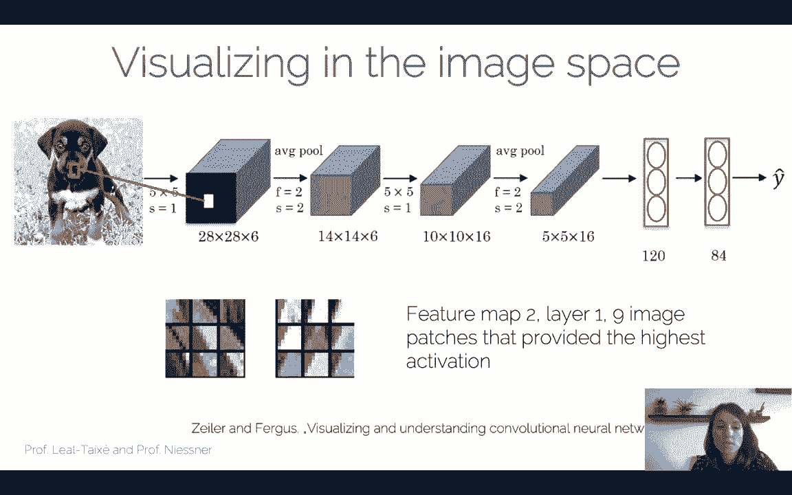

为了可视化和理解CNN，我们可以从图像空间开始。以下是一个简单的卷积神经网络示例：输入图像经过第一层（5x5卷积，步长为1）得到28x28x6的输出，接着是平均池化、另一个5x5卷积等操作，最终经过全连接层进行分类。

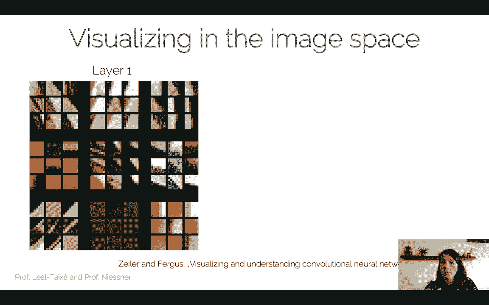

为了在图像空间可视化，你可以选择第一层中的一个单元。具体做法是，在训练数据集中找出能最大化该单元激活值的九个图像块。例如，选择一个5x5卷积滤波器，观察能最大化激活该滤波器的所有图像块。这里展示了最大响应，我们可以将这个响应映射回原图像，定位出导致该单元最大激活的具体图像区域。

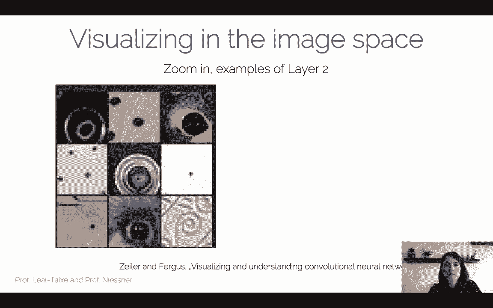

通过这种方式，我们可以在图像空间进行可视化。例如，对于第一层的某个特征图，提供最高激活的九个图像块如图所示。可以看到它们都描绘了某种对角线趋势，这意味着该特定滤波器被这种对角线形状激活。

观察第一层的第二个特征时，形状发生了变化，表明该滤波器关注的是另一种几何形状。

当我们观察第二层时，开始看到更有趣的现象。第一层的卷积滤波器主要负责检测几何形状和边缘（垂直、水平），而第二层则开始出现更复杂的模式。例如，某个滤波器被眼睛或圆形形状最大程度激活，也出现了一些有趣的水平纹理。这里展示了这些眼睛形状或圆形如何最大激活该滤波器。

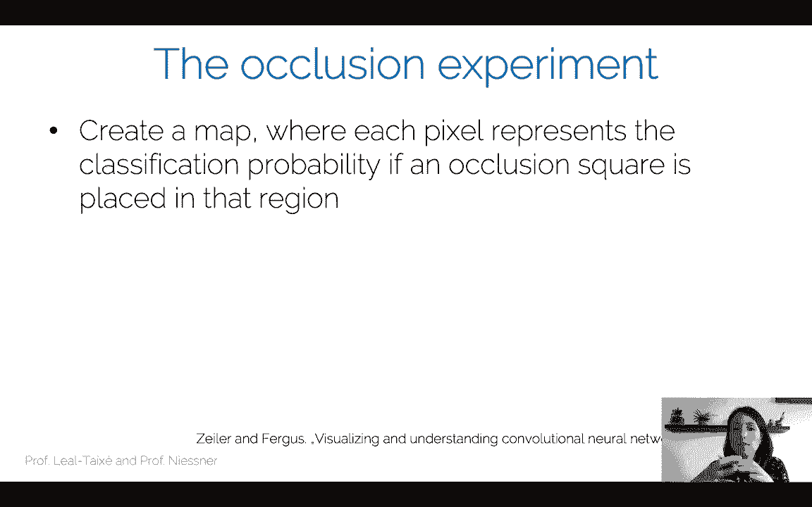

或者，是这种激活第二层滤波器的垂直条纹和重复结构。

在第五层，情况变得更加有趣，因为我们开始看到物体的部件。例如，有滤波器负责检测键盘或咖啡机中的形状，而另一个滤波器则负责检测Logo。随着网络加深，滤波器变得越来越专业化，有的专注于花朵，有的专注于狗。

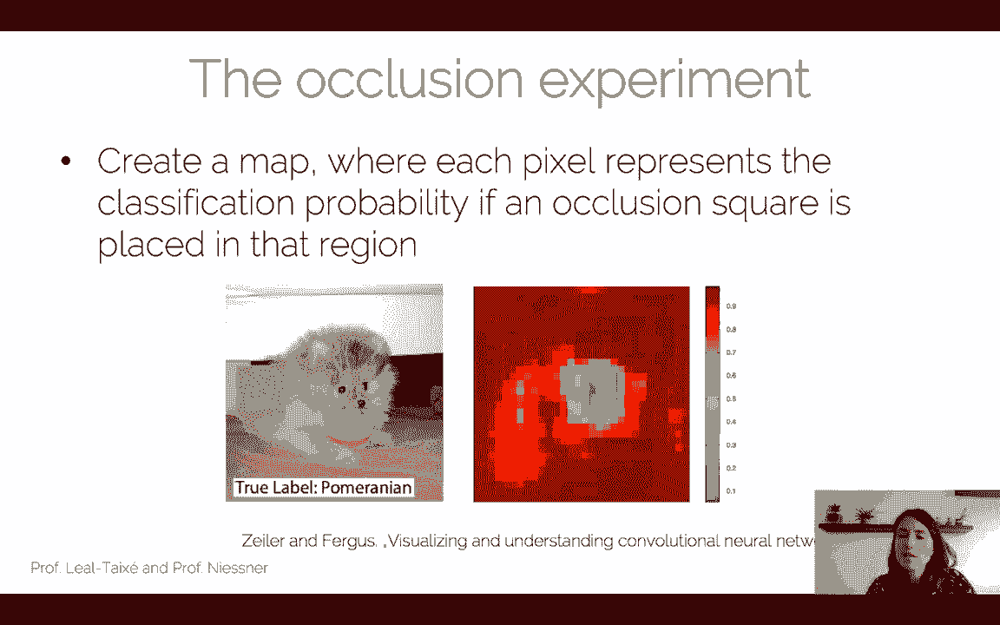

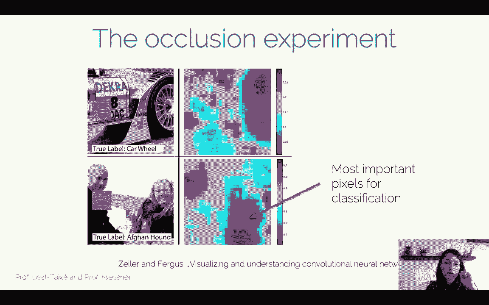

## 遮挡实验与特征重要性

我们也可以可视化图像中某些部分的重要性。ECCV 2014论文的作者提出了遮挡实验。在这个实验中，我们使用训练好的CNN进行分类（例如，以0.96的置信度分类为狗）。实验过程是遮挡图像的不同部分，观察分类得分如何变化。

以下是具体步骤：
1.  在图像左下角放置一个灰色块（主要遮挡草地），分类得分变化不大，网络仍能以高置信度判断为狗。
2.  遮挡狗的脸部（鼻子、眼睛、部分耳朵），网络判断为狗的置信度从0.95显著下降到0.35。

这表明，狗的脸部对于分类比草地更重要。通过这个实验，我们可以创建一张图（热力图），其中每个像素值代表在该像素中心放置遮挡块时的分类概率。

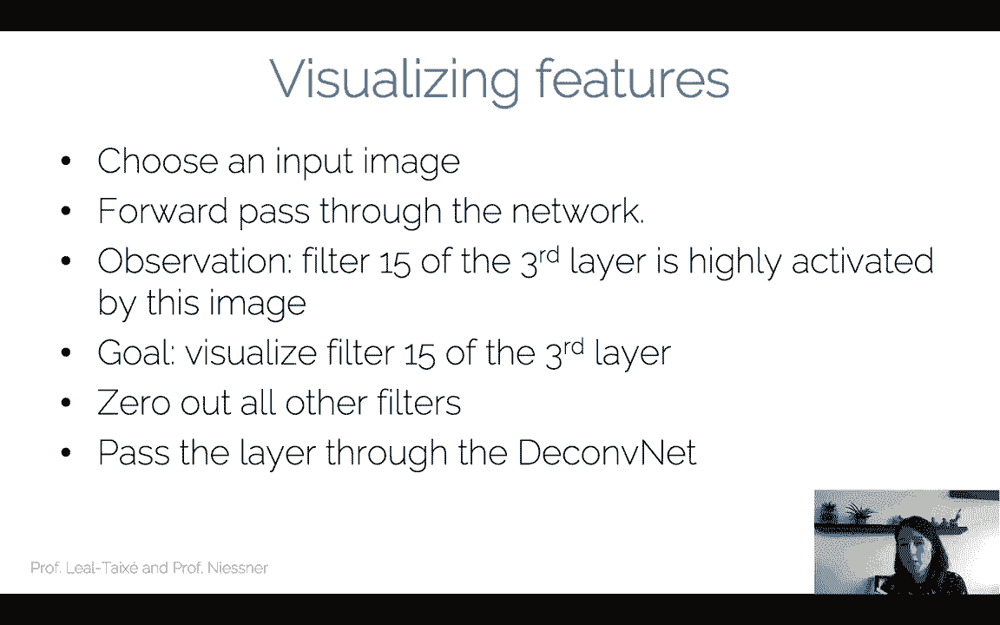

这张图显示了图像各部分的重要性。例如，与狗脸重合的区域对网络分类更为重要，因为该区域的像素值非常低，意味着在此处放置遮挡块会显著降低分类得分。

这提供了关于图像内容以及神经网络如何看待图像的大量信息。需要注意的是，这张图是针对特定图像和特定分类标签的，选择不同的分类标签会得到不同的图。

图中，对于该图像和类别，像素值最低的区域实际上是最重要的分类像素。

## 使用反卷积网络可视化特征

现在，我们转向可视化实际的特征，即卷积核在图像中关注的内容。实现方法之一是反卷积网络。其主要思想是将神经网络激活映射回图像空间，观察结果。

工作原理如下：顶行是经典的卷积网络，图像通过CNN（橙色部分）得到特征表示（如一个向量），用于图像分类。反卷积网络则相反，它从特征表示出发，一路回到图像空间，目的是进行特征可视化。

首先，我们需要决定可视化CNN的哪一层、哪一个滤波器。流程概述：图像通过CNN前向传播到我们想要可视化的特定层，然后跳转到反卷积网络，将特征带回图像空间。

具体操作：首先选择一张输入图像，前向传播通过网络。假设我们想观察第三卷积层的第15个滤波器（已知它被该图像高度激活）。我们将该层其他所有滤波器的特征置零，只保留第15个滤波器的特征。然后，将这个特征块（仅第15个滤波器有值，其余为零）输入反卷积网络，将其“放大”回图像空间。

让我们更详细地了解反卷积网络如何工作。图中右侧描绘了卷积网络的操作，左侧描绘了反卷积网络的操作。流程是：取图像，通过卷积网络向上处理，然后切换到反卷积网络，通过反卷积操作向下回到图像空间。

卷积网络的典型操作包括卷积滤波、非线性激活、残差连接、池化等。反卷积网络则包含镜像操作。首先是**反池化**操作。卷积网络中的关键操作之一是最大池化，它将特征图尺寸减小（例如从4x4到2x2）。反池化则需要将这个2x2表示恢复到4x4。在反卷积网络中，反池化操作会将最大值放回其在原始池化操作中来源的位置（记录在最大位置图中）。

第二个操作是**ReLU**。在卷积网络中，我们通常使用ReLU激活函数。在反卷积网络中，我们仍然可以使用ReLU，因为我们希望可视化正特征，抑制负值。

第三个重要操作是**反卷积**，它镜像了卷积网络中的卷积操作。在实践中，我们使用在卷积网络中学习到的滤波器的**转置版本**（即水平和垂直翻转的版本）。重要的是，反卷积网络中使用的卷积滤波器不是重新学习的，仅仅是学习到的卷积滤波器的转置。

为什么需要转置？因为我们希望找出哪些输入像素对输出有影响，以及影响程度。通过一个例子可以理解：一个卷积操作将7x7输入通过3x3滤波器得到5x5输出，再通过另一个3x3滤波器得到3x3输出。输出中的一个像素与输入中的九个像素相连。在反卷积中，我们希望保持这种贡献关系。为了在反卷积操作中保持卷积操作中像素间的关系（例如，红色像素与黑色输出像素的关系），我们需要使用转置滤波器。这个转置滤波器是通过将原始卷积核水平和垂直翻转得到的。

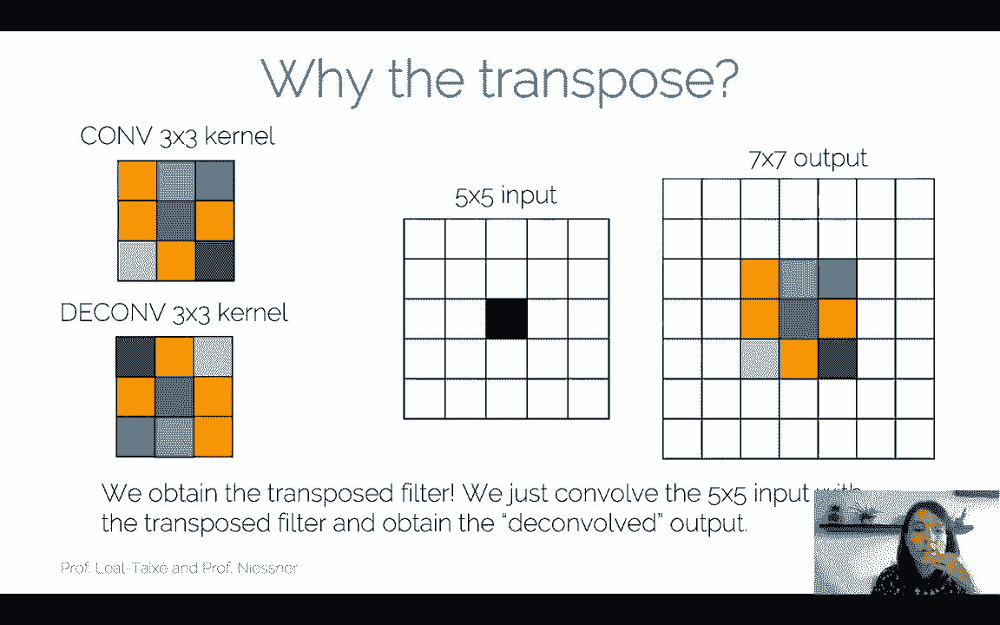

关键点在于，我们不是在反卷积网络中学习这些卷积，而仅仅是镜像卷积网络中的操作。

现在，当我们执行这个操作（先卷积，再切换到反卷积网络回到图像空间），会得到类似下图的表示。底部是之前可视化中的图像块，顶部是这些特征的可视化。可以看到很好的相关性，例如这个方向的边缘与图像块中这个方向的边缘对应。

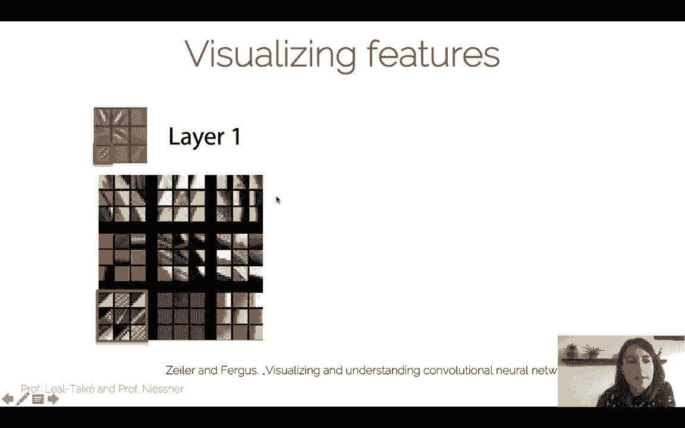

可视化第一层的所有特征时，可以看到一些有趣的几何形状，如圆形、垂直条纹等。这正是我们所期望的，也印证了卷积神经网络在浅层关注几何特征、边缘和斑块的发现。

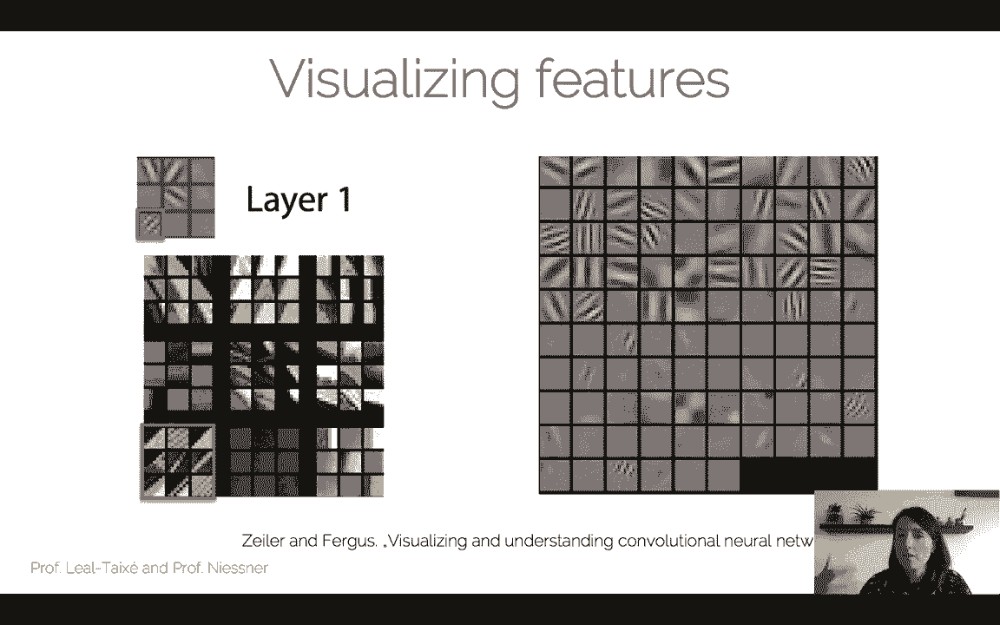

当我们进入更深的层（例如第三层），开始看到更复杂的模式，如车轮、面孔、昆虫、猫和狗。另一个有趣的做法是可视化这些特征随训练时间延长的演变过程。在第三层，训练初期特征模糊，随着训练进行，特征变得越来越专业化和显著，这显示了网络是如何学习的。例如，它可能从专注于狗的脸部，变得更通用以涵盖其他类型的狗。通过这个，你可以判断神经网络是否在正常训练。

关于ReLU，我们提到在反卷积网络中同样使用ReLU。实际上，文献中提出了几种反转ReLU的方法，具体效果可参考相关论文。

最重要的是，可视化有助于训练神经网络。例如，在AlexNet中，通过可视化发现第一层包含不健康的高低频信息混合，中频信息被忽略。因此，他们提出将11x11卷积改为7x7卷积。如今，神经网络大多使用3x3或5x5卷积，很少见到如此大的卷积核。

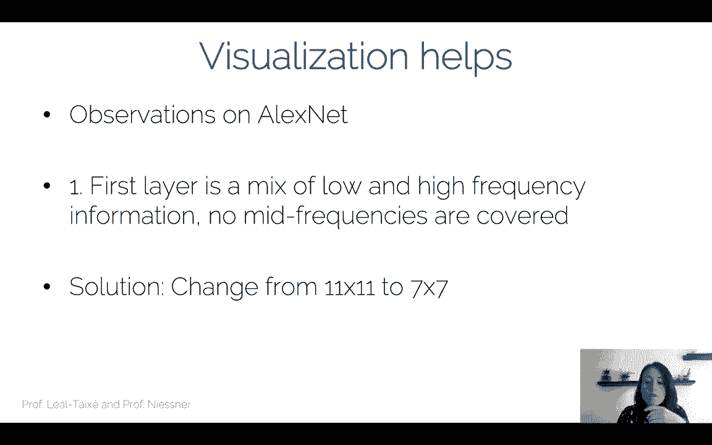

如果可视化使用11x11滤波器训练的神经网络，会发现许多滤波器不活跃（没有清晰的边缘或斑块响应）。而切换到7x7滤波器后，所有滤波器都变得活跃，清晰显示了对不同方向边缘、斑块和颜色的响应，不活跃滤波器大大减少。因此，通过可视化可以选择神经网络的最佳配置。

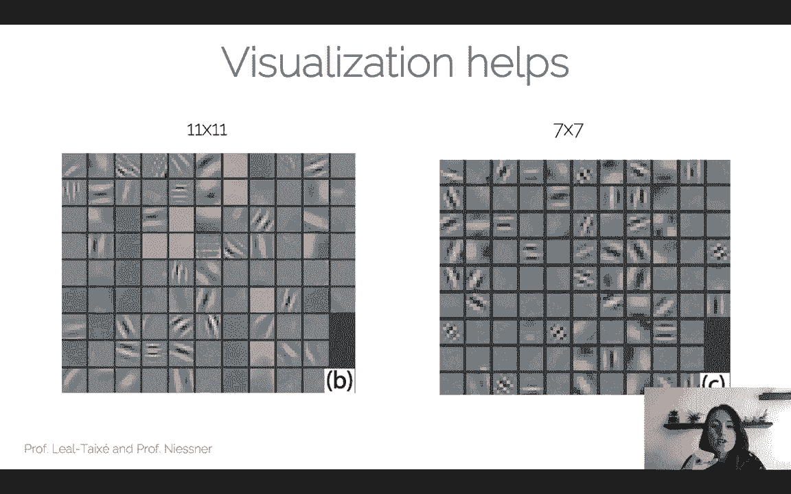

在AlexNet上的第二个观察是，第二层存在混叠伪影，这主要是由大步长（stride=4）引起的。如今使用步长4的情况也很少见。通过可视化可以看到，将步长从4改为2后，滤波器响应变得更加自然，分类得分也提高了两个百分点。

请积极使用可视化来调试你的CNN。这是一个非常强大的工具，不仅能帮助你理解CNN内部工作原理，也是调试CNN的有效手段。

## 通过梯度上升可视化特征

我们已介绍了使用反卷积网络可视化特定层特征的方法。现在来看第二种可视化特征的方法：**梯度上升**。其目标是生成能最大化激活某个滤波器的合成图像，使用与训练神经网络相反的操作——梯度上升。

具体过程如下：目标是找到一张图像 `I`，使其能最大化特定类别 `C` 的得分 `S_c(I)`。这里的得分取自softmax层之前，是全连接层的直接输出。我们希望通过优化图像 `I` 来最大化 `S_c(I)`，同时添加L2正则化以避免出现少数大像素值。

操作步骤：
1.  需要一个预训练的CNN。
2.  将一个零图像（如果训练时对图像减去了均值，则零图像代表均值）输入CNN，得到类别 `C` 的得分。
3.  不改变CNN的权重，而是通过梯度上升来改变初始图像 `I`。我们计算得分 `S_c(I)` 相对于图像 `I` 的梯度，并沿梯度方向更新图像。
4.  这是一个迭代过程：更新图像 -> 前向传播 -> 计算梯度 -> 再次更新图像。

经过多次迭代，我们可以得到最大化特定类别得分的图像。例如，最大化“甜椒”得分生成的图像中隐约可见甜椒，最大化“柠檬”或“哈士奇”得分也是如此。

这些图像看起来尚可，但仍有改进空间。我们可以使用更好的正则化方法来改善可视化效果，例如应用高斯模糊、将小像素值裁剪为0、同时将小梯度值裁剪为0。这样做的目的是夸大特征，使生成的图像中物体更加突出。可以看到，处理后火烈鸟、鹈鹕、甲虫和印度眼镜蛇等特征变得更加显著。

欢迎访问相关网站进行交互式可视化，在不同层观察效果，这有助于理解神经网络如何看待不同图像和类别。

## DeepDream

2015年提出的DeepDream与上述可视化技术相关。之前我们是合成图像以最大化特定特征或类别，而DeepDream则是**放大**网络中某一层的特征激活。

工作原理：
1.  将任意图像输入网络。
2.  选择某一层，要求网络增强该层检测到的任何内容。例如，如果该层检测到狗（因为图像中有狗），并且负责检测狗的滤波器被高度激活，那么我们就要求网络放大这些激活。
3.  具体操作：将图像前向传播到第 `L` 层，然后**将该层的梯度设置为等于其激活值**。直观上，如果我的“狗”滤波器有较大的激活，那么梯度也会很大。在反向传播时，使用这些梯度更新图像，图像就会被修改以显示更多的狗。
4.  迭代此过程，根据特定层对图像进行微小修改。

如果只在前几层（负责检测基本几何特征）进行此操作，图像中的几何特征（如边缘）会被增强。如果针对深层（负责检测物体部件或完整物体）进行此操作，则会在图像中开始看到完整的物体出现。例如，对天空图像进行DeepDream优化，可能会开始出现许多物体（如眼睛、鸟头），这很大程度上取决于神经网络的训练数据（如果网络偏向于动物，就会出现很多动物特征）。当然，也可以用DeepDream创作艺术图像或处理视频。

## t-SNE降维可视化

另一个流行的可视化技术是t-SNE。它使我们能够可视化高维特征空间，例如最后一个全连接层（在AlexNet中是4096维）。我们需要一种技术将其降至可绘制的低维空间（如2D）。

首先，我们需要对图像进行前向传播，获取它们的4096维表示。

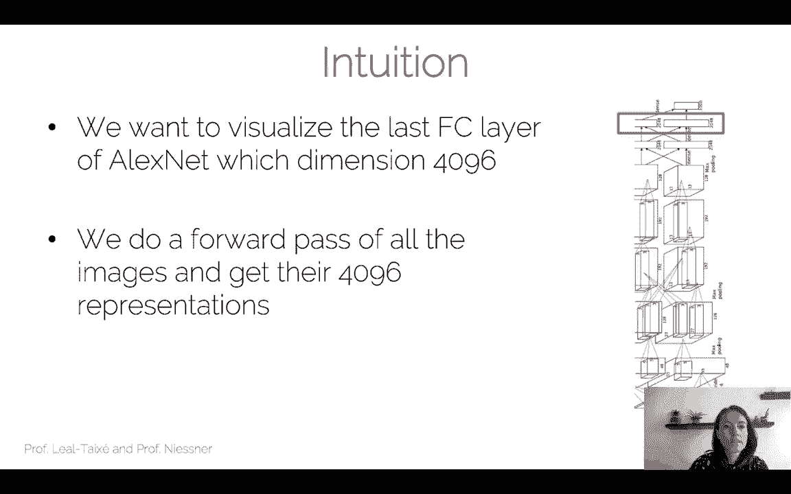

一种方法是**最近邻可视化**：计算这些4096维表示之间的L2距离，然后观察在特征空间中与测试图像最接近的图像。对于一个训练好的网络，这通常效果很好。

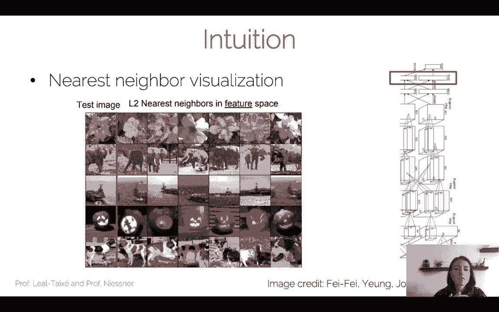

但我们更希望可视化所有这些**聚类**。我们希望将高维嵌入（4096维）映射到2D图，同时保持点之间的相似性关系（例如，大象图像和花朵图像在特征空间中距离远，在2D图中也应距离远）。t-SNE正是实现这种映射的方法。

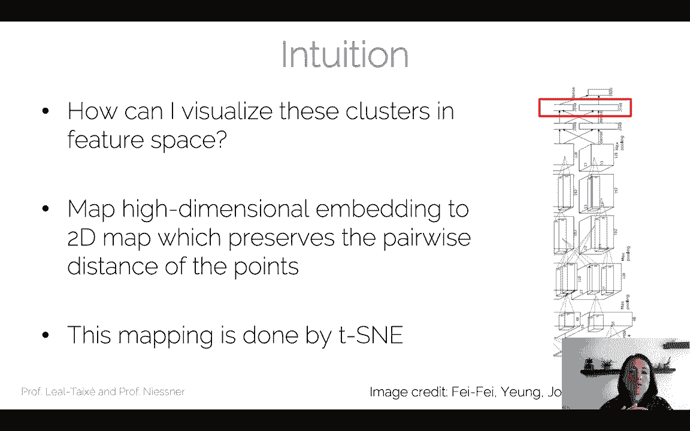

例如，在MNIST数据集（手写数字0-9）上训练神经网络后应用t-SNE，可以清晰地看到不同数字类别的聚类。

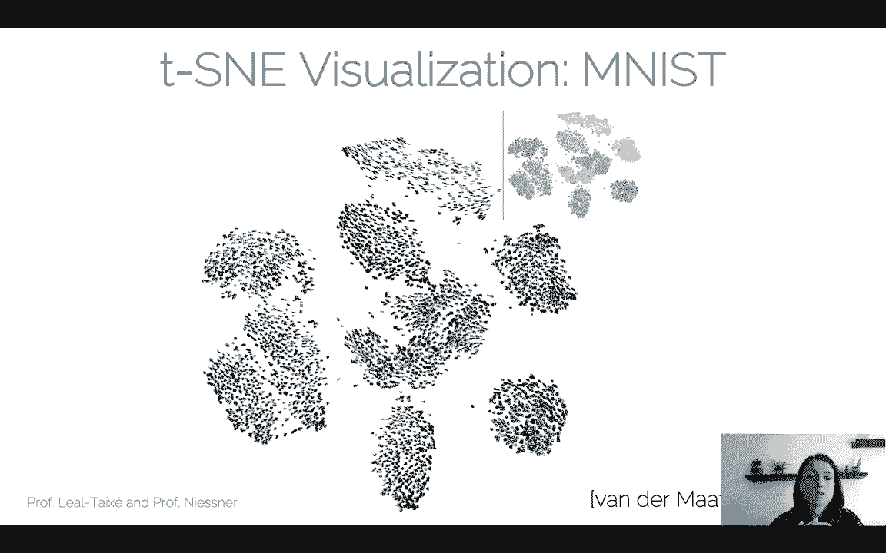

在更复杂的ImageNet上可视化时，我们可以看到一些粗略的聚类，例如天空图像、动物（尤其是狗）、键盘、食物等。t-SNE对于调试神经网络很有价值，你可以观察特征空间中的聚类是否合理，这对于可视化孪生网络创建的聚类尤其有用。

## 总结与推荐阅读

本节课中，我们一起学习了多种CNN可视化与可解释性技术：
1.  **图像空间可视化**：通过最大化激活观察滤波器响应的图像块。
2.  **遮挡实验**：通过遮挡部分图像评估区域重要性，生成热力图。
3.  **反卷积网络**：将特征激活映射回图像空间，可视化滤波器关注的内容。
4.  **梯度上升**：生成最大化特定类别或滤波器得分的合成图像。
5.  **DeepDream**：放大网络中间层的激活，生成充满特定模式的图像。
6.  **t-SNE**：将高维特征空间降维至2D/3D，观察数据聚类情况。

这些技术是理解和调试神经网络的强大工具。它们不仅能帮助你洞察模型内部，还能指导你改进网络架构和训练过程（如调整滤波器大小、步长）。建议阅读相关论文以深入了解不同类型的可视化方法。

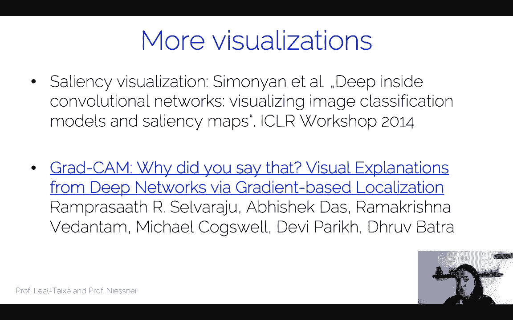

希望本课程能为你提供使用可视化技术调试神经网络、理解其工作方式的实用技巧。感谢学习，我们下节课再见。

