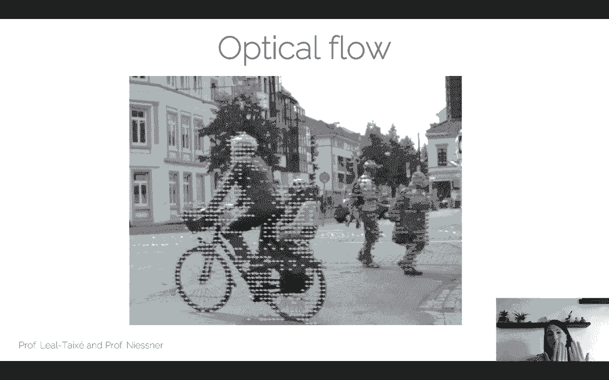
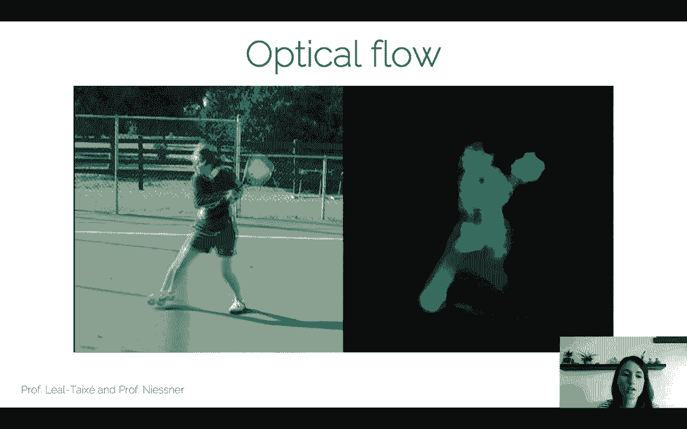
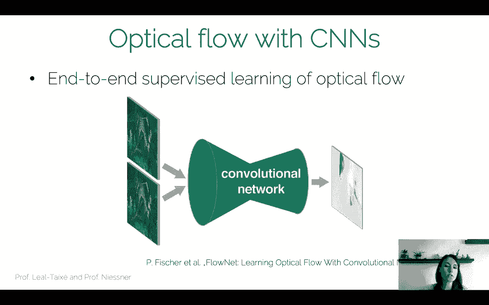
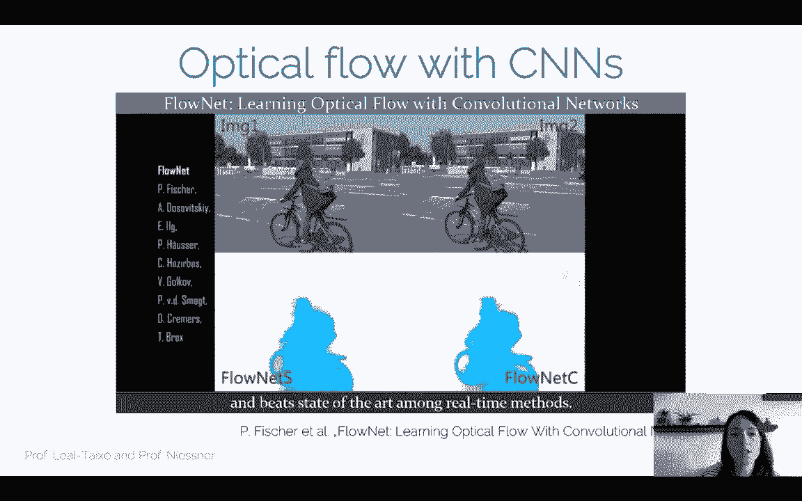
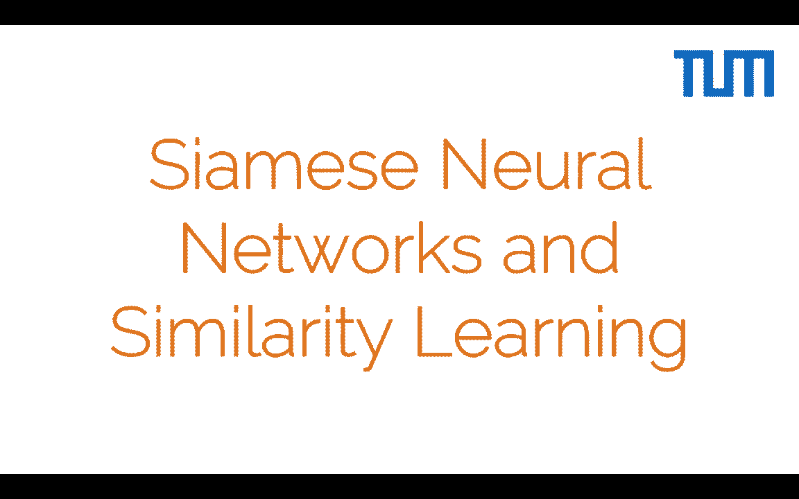

# 3：L3 - 孪生网络与相似度学习 🧠

在本节课中，我们将要学习孪生神经网络和相似度学习。我们将探讨如何训练神经网络来比较和排序图像，而不是进行传统的分类或回归。

## 概述

到目前为止，我们已经看到机器学习，特别是深度神经网络，可以解决分类和回归问题。然而，还存在一类比较问题，例如判断两张图片是否属于同一个人。这类问题无法直接用分类器解决，因为类别数量可能无限或动态变化。本节课将介绍如何使用孪生网络和相似度学习来解决这类问题。

## 从分类与回归到比较问题

上一节我们介绍了分类和回归问题，本节中我们来看看第三类问题：比较问题。

分类问题中，神经网络接收一张图片（例如一只猫的图片），经过处理后输出一个类别标签（如“猫”）。神经网络在大量类别（如ImageNet的数千个类别）上表现优异。

回归问题中，神经网络的输出是连续值。例如，在相机姿态估计中，输入一张图片，网络输出相机的位置和方向（一个四元数）。网络可以看作由特征提取部分（生成图像嵌入）和回归部分（将嵌入映射到目标输出空间）组成。

比较问题则不同。假设有两张图片A和B，分别是我和Nisner教授。分类网络可以分析出它们都是“人”、“脸部”、“女性/男性”等，但无法直接回答“这是同一个人吗？”这个问题。我们需要训练网络直接学习比较和排序图像的能力。

## 相似度学习的应用场景

以下是相似度学习的两个典型应用场景：

*   **人脸解锁手机**：这可以视为一个二分类问题（“是机主” vs “不是机主”）。需要收集机主在不同条件下的面部图片进行训练。测试时，网络判断输入图像是否与训练集相似。
*   **考场人脸识别**：需要识别多名学生。如果将其视为多分类问题（每个学生一个类别），那么每新增一名学生都需要重新收集数据并训练整个网络，这缺乏可扩展性。

因此，我们需要一种方法，能够训练一个通用模型，用于识别任何人的面孔，而无需为每个新个体重新训练。这就是相似度学习要解决的问题。

## 孪生网络与对比损失

为了解决上述问题，我们将问题重新定义为相似度学习：训练一个神经网络，使其为两张输入图像输出一个相似度分数。如果图像描绘的是不同的人，则输出低分；如果是同一个人，则输出高分。

**孪生网络**是实现这一目标的经典架构。其核心思想是：
1.  使用**同一个**卷积神经网络（CNN）并行处理两张输入图像（A和B），得到它们的嵌入表示：`f(A)` 和 `f(B)`。
2.  然后，定义一个距离函数 `D` 来比较这两个嵌入。例如，使用L2范数（欧氏距离）：`D(A, B) = ||f(A) - f(B)||₂`。

训练目标是：
*   对于**正样本对**（同一人），最小化距离 `D`。
*   对于**负样本对**（不同人），最大化距离 `D`，但不超过一个边界值 `m`。

这可以通过**对比损失**来实现：

`L = y * D² + (1 - y) * max(0, m - D)²`

其中，`y=1` 表示正样本对，`y=0` 表示负样本对。对于负样本对，我们使用合页损失，当距离 `D` 大于边界 `m` 时，损失为零，避免无限制地推开样本。

## 三元组损失与难例挖掘

对比损失只考虑样本对的绝对距离。**三元组损失**则能学习相对排序，效果通常更好。

三元组包含三张图片：**锚点**、**正样本**（与锚点同类）、**负样本**（与锚点不同类）。目标是让锚点与正样本的距离，小于锚点与负样本的距离，并至少相差一个边界值 `m`。

三元组损失公式为：

`L = max(0, ||f(A) - f(P)||₂² - ||f(A) - f(N)||₂² + m)`

直接使用随机三元组训练效率低下，因为大多数三元组很容易满足条件，对训练贡献不大。因此，需要**难例挖掘**：先进行初步训练，然后重点关注那些锚点-正样本距离与锚点-负样本距离相近的“难”三元组，用它们进一步优化网络。

在测试阶段，我们可以进行最近邻搜索：给定查询图像，计算其嵌入，然后在数据库所有图像的嵌入中，找到距离最近的图像。

## 改进相似度学习的方法

除了损失函数，还有其他方法可以提升相似度学习的性能：

*   **采样策略**：如何智能地选择用于训练的三元组，例如**分层三元组损失**，它通过构建类别层次树，在批次中同时保证类别多样性和选择难例。
*   **集成方法**：使用多个网络（集成）来处理问题。例如，**分而治之**策略：先将所有类别聚类成K组，为每组训练一个特定的“学习者”（共享主干网络，但具有不同的全连接层），最后再联合微调。
*   **使用分类损失**：一些最新研究表明，使用简单的分类损失（如交叉熵）训练网络，得到的嵌入特征也适用于相似度学习任务，这提供了另一种简洁有效的思路。

## 孪生网络的应用

孪生网络和相似度学习在计算机视觉中有广泛应用：

*   **图像聚类**：学习到的嵌入空间可以自然地将同类样本聚集在一起。
*   **图像匹配与对应**：这是计算机视觉的基础问题，用于图像拼接、3D重建等。传统方法使用手工特征（如SIFT），而孪生网络可以学习更鲁棒的匹配描述符。
*   **图像检索**：输入一张查询图片，从大型数据库中找出相似图片。
*   **无监督学习**：利用视频中目标跟踪产生的连续帧作为“正样本对”，来自动生成训练数据。
*   **光流估计**：预测视频帧之间每个像素的运动位移。**FlowNet**等工作使用孪生或类孪生架构，并引入了**相关层**这一关键操作。

**相关层**是一个无参数的固定操作，用于计算两个特征图所有位置特征向量之间的点积，生成一个匹配分数图，非常高效且强大。

## 总结

本节课我们一起学习了孪生神经网络和相似度学习。我们首先了解了比较问题与分类、回归问题的区别。然后，深入探讨了如何使用孪生网络架构，以及对比损失和三元组损失来训练模型学习图像间的相似性。我们还介绍了提升性能的多种策略，如难例挖掘、智能采样、集成学习等。最后，我们看到了相似度学习在图像匹配、检索、光流估计等多个重要计算机视觉任务中的应用。通过本节课，你应该对如何训练一个模型来理解和比较图像内容有了坚实的基础。

