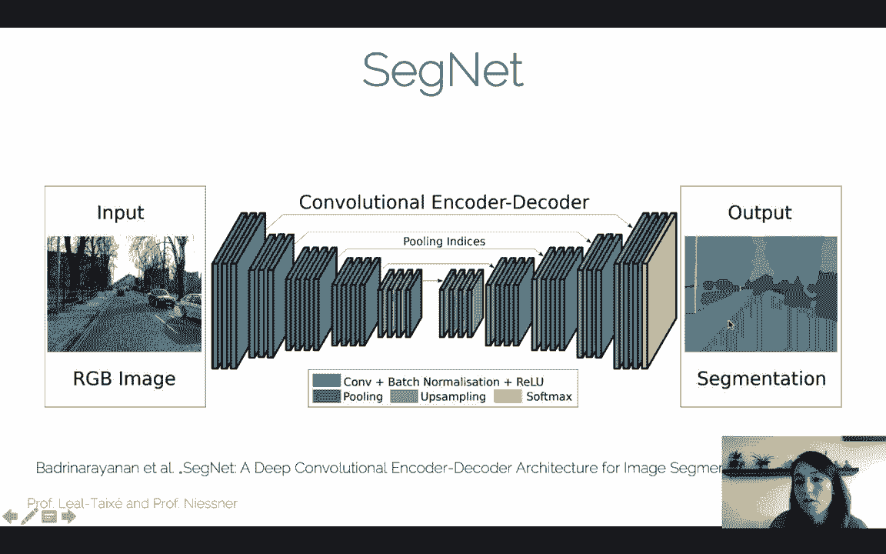
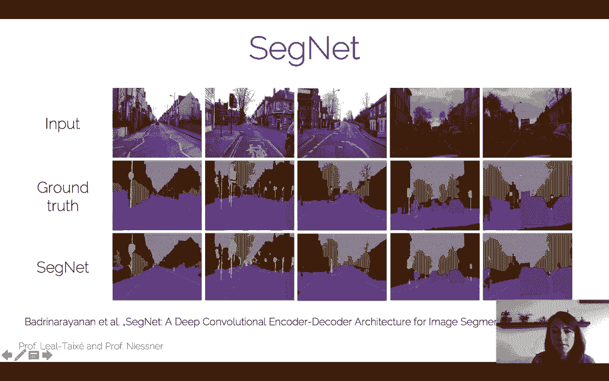
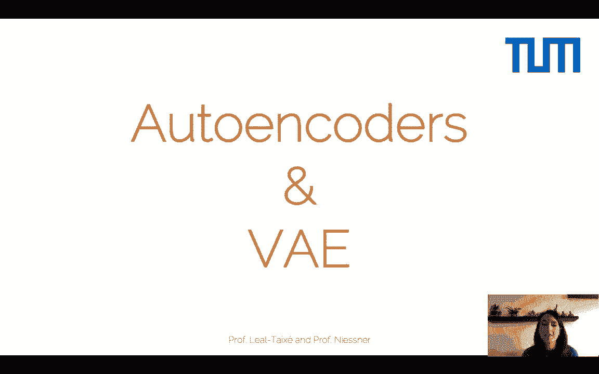

# 4：L4 - 自编码器、VAE与视觉风格迁移 🧠

在本节课中，我们将学习自编码器（Autoencoders）和变分自编码器（Variational Autoencoders, VAE）的基本原理，并简要讨论视觉风格迁移（Style Transfer）。我们将从机器学习的两种范式开始，逐步深入到这些模型的具体结构、应用场景以及它们如何帮助我们进行无监督学习、特征提取和图像生成。

---

## 🧩 机器学习范式：监督学习与无监督学习

我们首先回顾机器学习的两种主要范式。

### 监督学习

监督学习是你最熟悉的范式，也是我们在I2DL和ADL4CV课程中主要讨论的。在这种范式中，你拥有特定任务的标签或目标类别，你的目标是学习从输入（例如图像）到标签的映射。无论这些标签是用于检测或分类的语义类别，还是用于回归问题的连续值，都属于监督学习范畴。

例如，在图像分类任务中，我们有猫和狗的图片，目标是为它们打上正确的标签。

### 无监督学习

在无监督学习中，我们无法访问目标类别标签，只能访问输入图像。因此，我们无法直接处理像图像分类这样的任务，因为我们没有标签来建立图像与标签之间的映射。

在无监督学习中，我们所能做的是发现数据结构的属性，例如执行聚类。你可能在其他课程中讨论过K均值或主成分分析等聚类方法，这些都是发现数据结构的途径。

完成聚类后，我们可能会得到两个独立的图像簇。然而，这些图像簇没有语义含义，例如，不是猫与狗的区别，而可能是紫色圆圈与橙色十字的区别。我们在这里丢失的只是标签赋予的语义含义。

在深度学习中，我们可以使用自编码器进行无监督学习，这也是今天课程的起点。

---

## 🤖 自编码器（Autoencoders）的动机

我们希望自编码器能够提供一种方法，从所有训练数据中学习一个低维特征表示，而我们只能访问图像，无法访问标签。这是我们进行无监督学习的方法。

为了实现这一目标，自编码器的使用方式如下：你取一张输入图像，然后将其通过所谓的**编码器**（Encoder）。编码器由一系列卷积层和池化操作组成，即基本的CNN架构，直到达到一个称为**瓶颈层**（Bottleneck Layer）的特征表示嵌入。

有趣的是，我们如何到达这个瓶颈层？编码器只是我们神经网络的第一部分，另一部分则是相反的操作——**解码器**（Decoder）。解码器从瓶颈层开始，一直上采样到输出图像，其分辨率与输入图像完全相同。

你可以将这个操作视为一种重建操作：我们获取输入图像，将其压缩到瓶颈层，然后尝试用解码器在输出端重建完全相同的图像。这里的关键在于，我们不需要任何标签来执行此操作，因为重建损失只是输入图像的L1或L2损失，不需要额外的标签。

从幻灯片右上角的输入图像中，我们可以看到，当我们执行自编码器操作时，我们将输入图像X压缩到瓶颈层。瓶颈层有一个潜在空间Z，其维度当然低于图像的维度，否则就不是降维。因此，当你用解码器从瓶颈层重建图像时，得到如重建图像集中所示的模糊图像是合理的。

再次强调，这里重要的是，这是完全无监督的训练，不需要任何标签，因为你只想重建输入。因此，你可以使用L1或L2损失作为重建损失，除此之外不需要任何标签。

这使你能够对数据进行聚类，发现我们之前讨论的数据中的模式。

---

## 📊 自编码器的应用：聚类与预训练

让我们想象一下，我们使用自编码器对MNIST数据集进行自重建。这是一个包含0到9数字的数据集，我在这里尝试做的唯一事情是：如果输入一个4，我希望我的自编码器重建完全相同的4。

当你以这种无监督的方式（例如使用L2损失）训练自编码器时，如果你绘制瓶颈层，你会得到所有数字的漂亮聚类。数字由图例中所示的不同颜色表示。

我们可以看到，数字被相当好地聚类了。例如，零在图表的左下角聚集得很好，与靠近三和九的数字非常分离。当然，这里有一些异常值，但总的来说，即使是在没有任何标签的无监督训练中，我们也得到了相当不错的聚类。

因此，自编码器可以用于所谓的**预训练**（Pre-training）。这在例如医学应用中非常有用。

在医学应用中，假设我们不使用自然图像，而是使用CT图像。通常，在医学应用中，你拥有大量未标记的数据，即来自不同患者的一堆CT图像，但只有一小部分数据被实际标记。这是因为让训练有素的医生为你标记数据（例如标记疾病或在CT图像中定位器官的某部分）非常昂贵。因此，医学数据中的标签实际上非常昂贵。

问题是，我们能否使用自编码器来利用这些大量未标记的数据进行无监督训练？有人可能会说，为什么我们不能像处理任何计算机视觉应用那样，使用在ImageNet上预训练的网络呢？这就是在CT图像上使用未标记数据的动机。问题在于，自然图像（ImageNet数据中的图像）的统计特性与CT图像的统计特性非常不同。如果我们取一个在ImageNet上预训练的网络，并想将其用于医学应用来分析CT图像，预训练对我们帮助不大。

那么，问题来了：我们能否使用自编码器专门为CT图像进行预训练？本质上，我们可以使用自编码器进行预训练，该自编码器仅学习我们在CT图像中看到的特征类型。我们想利用大量未标记数据进行预训练，类似于我们在许多计算机视觉应用中使用的ImageNet预训练，但在这种情况下，是为了学习CT图像中存在的特定特征。

因此，我们将利用自编码器的能力进行无监督训练。我们将获取CT图像输入，并使用自编码器学习输入图像的重建。同样，这完全是无监督的，我们不需要任何标签。

一旦完成，我们就进入第二步：使用监督训练。我们使用标记数据，可能只有少量训练样本，因为我们没有大量标记数据。但现在，我的网络已经知道了CT图像的特征，它已经学习了CT图像需要学习哪种特征、哪种边缘检测器。因此，现在它可以将这些特征用于监督训练，用于你实际想要训练的任务。

对于第二步，当然，现在你想要一个像素级的输出。例如，如果你想进行分类（从CT图像中判断疾病与非疾病），你需要做的就是丢弃解码器，然后创建任何你需要的架构来获得你想要的标签作为输出。

你将从输入图像X到瓶颈层，再到降维表示Z，然后从Z得到标签Y。利用你拥有的极少量训练样本的真实标签，你可以使用任何你需要的损失函数进行经典的监督训练。

这里有趣的是，编码器不需要从这些极少的标签中学习所有的特征提取和CT图像的统计特性，这些已经在无监督训练的第一步中学习了。当然，像往常一样，你可以进行反向传播，即你迄今为止一直在做的经典监督训练。

因此，自编码器首先对预训练非常有用。你可以对任何类型的图像或任何类型的信号进行预训练，而且非常便宜，因为你不需要任何标签，只是输入图像和输出图像，你希望输出图像与输入图像完全相同，所以你可以使用L2或L1损失。这实际上非常有用，可以教会编码器在该图像模态中可以找到哪种特征。

这是自编码器的第一个用途。但还有另一个用途，即我们实际上不丢弃解码器，而是保留它以获得像素级的预测输出。

---

## 🎨 自编码器用于像素级预测

例如，我想从图像到语义分割，即对于每个像素，我希望有其代表的语义标签（例如，是汽车、道路还是树）。或者，我想从低分辨率图像到高分辨率图像，或者从图像到深度图。

到目前为止，我们讨论了很多关于获得比输入图像维度低得多的标签作为输出。例如，你有输入图像，现在我想输出1000个类的分类分数，你从一个非常高维的图像到1000个类的输出。

但在自编码器中，我们将有一个具有某种维度的输入表示，并且我希望获得完全相同的维度作为输出。

让我们看看如何使用自编码器进行像素级预测。

我们在I2DL中看到了用于语义分割的全卷积网络（FCN）。语义分割的任务是为输入图像上的每个像素分配一个语义类别。例如，在这种情况下，我们会有狗、猫和沙发的语义类别，我们实际上想找出哪些像素描绘了猫，哪些像素描绘了狗，哪些像素描绘了沙发。

在2015年，研究人员提出这样做的方法是：获取一个用于图像分类的基本CNN网络，在CNN结束时，一旦你的空间分辨率降低了很多（通过卷积和池化），我们会直接上采样这个表示。当然，这并不完美，导致了平滑的边界，但这已经是第一个很好的近似。

问题是，我们能否做得更好，能否以更好的方式进行上采样以获得更精确的预测？实际上，我们可以使用自编码器类型的架构来实现。我们将有经典的编码器来减少空间尺寸并增加深度，然后有一个解码器执行完全相反的操作。

但不是从具有极小空间分辨率的瓶颈表示直接跳到输出图像分辨率，而是逐步进行，在不同的步骤中上采样分辨率。你可以在这里看到这种架构的描述：你有卷积和池化操作来减小图像尺寸，直到达到瓶颈表示。之后，你基本上会有一系列上采样层，以及之后的一系列卷积层。

因此，你会对表示进行上采样，然后通过一系列卷积进行校正，再上采样，再校正，直到最后，你只需为每个像素使用一个softmax来获得输出语义分割。

这是2016年SegNet中提出的卷积编码器-解码器架构。正如我所说，SegNet由两部分组成：编码器（具有正常的卷积滤波器和减少空间尺寸的池化）和解码器（解码器正好相反，是上采样加卷积滤波器）。

重要的是要注意，解码器部分不仅有上采样，还有这些卷积滤波器。本质上，这里的直觉是：我们将对特征图进行粗略的上采样，然后通过一系列卷积层有机会对其进行校正。这些卷积层像编码器的卷积层一样，使用反向传播进行训练，因此它们是常规的卷积滤波器。再次强调，这些卷积滤波器的目标是训练它们，以便它们实际上细化我们所做的上采样。

---

## 🔄 转置卷积与上采样方法

回忆一下我们之前看到的转置卷积（Transposed Convolution）的概念，这正是这个想法。你想从3x3的输入（这里由底部的蓝色样本表示）一直得到5x5的输出。

你实际上的做法是：首先对输入进行**反池化**（Unpooling），你可以看到如何将这里3x3输入的样本展开。然后，你会取这个卷积滤波器，并将其滑动到这个展开的反池化输入上，以产生5x5的输出。整个操作（反池化加上通过反向传播学习的卷积滤波器）被称为转置卷积。

这也可以称为上卷积（Up Convolution），但记住永远不要称之为反卷积（Deconvolution）。我们在这个系列讲座中已经看到，反卷积实际上是什么。

问题是，我们能否比仅仅反池化和展开样本做得更好？事实证明，使用反池化时，你做的正是这里的操作：将绿色样本展开到一个更宽的特征图上，但将所有其他值（所有其他白色方块）留空，基本上在那里放零。

处理这些空白的其他方法本质上是归结为：我将在这些空白处放什么值？一种解决方案是**插值**（Interpolation）。有几种插值图像的方法，例如，如果你想将这个微小图像插值10倍，你可以使用最近邻插值，这本质上是为每个空白像素查看最近的空间邻居，并简单地复制其值。当然，这会产生这种块状效果。

如果你进行双线性插值，可以做得更好一点，这意味着不仅取最近邻居的值，还查看周围的所有邻居，然后对它们的值进行加权求和。你甚至可以继续进行双三次插值。无论如何，对于任何这些插值，你都会对在这个分辨率下想要什么样的输出有更好的估计，相比于仅仅进行反池化（其中所有中间值实际上都是零）。

因此，这当然比仅仅反池化有更柔和的输出，所以你往往在输出中会有更少的伪影。

另一种方法是使用固定的反池化，然后在上面加上一系列卷积层。起初，人们认为插值是更好的方法，但在2017年，他们表明，如果你有足够的数据，实际上你只需要做转置卷积（固定的反池化加上一系列卷积层）。这也很高效，因为你不需要为白色方块计算任何插值。

还有第三种方法，即反池化加反卷积。

如果你记得反卷积网络（DeconvNet）如何进行反池化，它保留了最大值来自的位置。一旦我们进行最大池化操作，我们就有这四个最大值，它们将被传递到下一层的池化图中。这四个位置将被保存在这些最大位置开关中，并将在以后用于反池化操作，以实际知道在哪里放置你的值。地图的其余部分保持为零。

因此，这也是你可以做的事情：你可以实际进行池化操作，保存位置，并进行反池化，保留最大值来自的位置。

记住，在反卷积网络中，我们是用学习到的滤波器的转置进行卷积的，因此完整的反卷积网络架构与我们在这里提出的完全不同，我们实际上是在学习卷积滤波器。因此，区分完整的反卷积网络架构和仅仅进行反卷积类型的反池化非常重要。

正如我们已经在反卷积网络中说过的，这种反池化有助于保持结构的细节，保持边缘在原始位置的正确定位，因此当我们在自编码器内部使用它进行反池化时，情况将完全相同。

---

## 🔗 跳跃连接（Skip Connections）

自编码器中另一个对获得良好结果、良好的像素级预测至关重要的元素是**跳跃连接**（Skip Connections）。

跳跃连接是所谓的**U-Net架构**的一部分，该架构于2015年针对医学应用提出。这种架构本质上是一个编码器-解码器架构，你可以在这里以略有不同的方式看到它：左边是所有的编码器，你到达瓶颈层，然后右边是解码器，因此得名U-Net。

这个编码器再次是一系列卷积加池化操作，解码器是上卷积（转置卷积）操作。但有一个有趣的元素，即中间这些灰色箭头，它们本质上代表了跳跃连接。

这里的想法是：你希望拥有在解码器中解码的所有高级信息，这本质上来自瓶颈层。在编码器中实际发生的是，你将空间分辨率降低到一个非常小的表示，但实际上你正在压缩所有信息，真正理解整个图像，并将所有这些信息放入深度通道中。因此，瓶颈层中确实有很多高级信息。

当你通过解码器向上移动时，你正在尝试创建越来越多的细节。尽管来自瓶颈层的高级信息非常重要，但你还需要低级信息，你需要知道边缘的位置，因为你需要知道在哪里放置，例如，在语义分割输出的情况下，你的掩码的末端，你需要确切地知道猫在哪里结束，狗在哪里开始，为此你需要低级信息。

如果高级信息被编码在瓶颈层中，低级信息往往会在我们进行卷积和池化时丢失，这正是进行卷积和池化的整个想法。

因此，跳跃连接的作用本质上是将来自瓶颈层的高级信息与来自初始层的低级信息（这些层仍然保持高空间分辨率）结合起来。本质上，我们做的是将它们结合起来，连接低级信息特征图和高级信息特征图，并进行一系列卷积以共同处理这两种信息。

回想一下ResNet的想法，这有类似的直觉：你希望有一些残差连接，允许你直接发送信息，而不必通过整个网络。你可以做几件事，有几种方法可以结合这种低级信息和高级信息。在这种情况下，我们做的是连接，这里他们称之为复制和裁剪。

他们称之为裁剪，实际上是因为编码器和解码器在两个维度上不匹配，因此他们必须在那里进行一点裁剪。通常，你会在编码器和解码器的同一层具有完全相同的空间维度。

我们可以看一个放大的版本，在这里我们可以看到瓶颈层和其中一个跳跃连接，我们实际上如何将这种低级信息与通过瓶颈层一直向下传递的高级信息结合起来。这里发生的是，我们简单地连接这两个特征图，这意味着空间维度保持不变，只有深度变大了。

既然我们要在这些连接的特征图上应用卷积，我们可以使用第一个卷积将表示从512（在这种情况下，两个特征图一起的大小）再次减少到256（在这种情况下，我们想要在这个架构中具有的深度）。所以，这里有256个通道，256个通道放在一起，然后一个卷积再次将其减少到256。

因此，跳跃连接实际上在许多架构中使用，例如，对于深度预测，拥有跳跃连接对于获取细节、真正获取物体结束的边缘以及因此深度相对于背景发生变化的位置至关重要。你可以在多个层中放置这些跳跃连接，例如，这里描绘了三个不同层中的三种跳跃连接。

这三个不同层是不同类型的低级信息。当然，你走得越低（例如CC1），将比如果你走到CC3拥有更多的低级信息（真正关注边缘类型的信息）。

跳跃连接在你使用这种编码器-解码器类型的架构时几乎无处不在，如果你想获得真正像素级精确的输出，你需要这些跳跃连接。但是，在哪个级别需要这些跳跃连接实际上取决于你的问题，因此这需要一些试验和错误。

---

## 🖼️ 自编码器在计算机视觉中的实际应用

让我们看看自编码器如何在计算机视觉应用中实际使用。

我们看到的第一个自编码器架构SegNet实际上是用于语义分割的。正如我所说，语义分割的任务是：对于每个输入图像像素，我们得到一个标签，告诉我们这个像素是代表道路、汽车、树木、建筑等。它为图像中的像素赋予语义含义。

当然，你可以想象，这种自编码器架构非常适合首先在瓶颈层捕获高级场景描述。我们需要大致知道这是室外场景（因此我会看到道路、汽车、树木）还是室内场景（我会看到桌子、沙发等）。然后，我们将使用这些跳跃连接（这里他们称之为池化索引）来为我们提供细节，为我们提供我们在道路情况下看到的非常精确的边界。

SegNet实际上给出了相当好的结果。你可以在第一行看到输入图像，第二行是真实标签，第三行是SegNet输出。当然，即使有跳跃连接，也有一些细节丢失，例如这里的交通标志在真实标签中没有明确定义。但总的来说，类别相当正确，细节也保存得相当好。

另一个有趣的任务是单目深度预测任务。传统上，在计算机视觉中，为了估计一个点的深度，你实际上需要两个摄像头，因为你需要从两个不同的视角看到那个点以进行三角测量深度。否则，如果你只有一个摄像头，你无法真正知道物体的真实深度，这也是为什么我们有两只眼睛，以便通过从两只眼睛三角测量来感知深度。

但是，当然，如果一个人大致知道场景的典型深度，就可以进行单目深度估计，即对场景的典型深度有一些先验知识，因此这非常适合用深度卷积神经网络来处理。

这里的想法是，我们首先获取看起来非常相似的场景。我必须说，通常单目深度估计方法非常针对特定场景，在这种情况下是自动驾驶场景。你已经可以想象，自动驾驶场景具有这种深度，总是朝向图像中心，比如道路朝这个方向延伸，变得越来越深，然后你周围有所有这些物体，通常是汽车或可能是行人，因此深度图的结构非常相似。

因此，我们可以通过用CNN学习这种先验结构来利用这一点。这项工作的有趣之处在于，他们实际上提出使用经典的计算机视觉、经典的立体视觉，以完全无监督的方式训练这个网络。

因此，你实际上确实需要两个摄像头，并且需要知道两个摄像头之间的变换。在训练时，你会获取你的图像，通过CNN传递它，并预测你的深度图。在测试时你也会这样做，但在训练时，你会使用右图像作为深度预测的监督。本质上，你会查看预测深度图中的像素，并检查它是否实际上与右图像上的像素匹配。

在经典计算机视觉中，如果我们知道一个点的深度，我们可以将其反投影到右