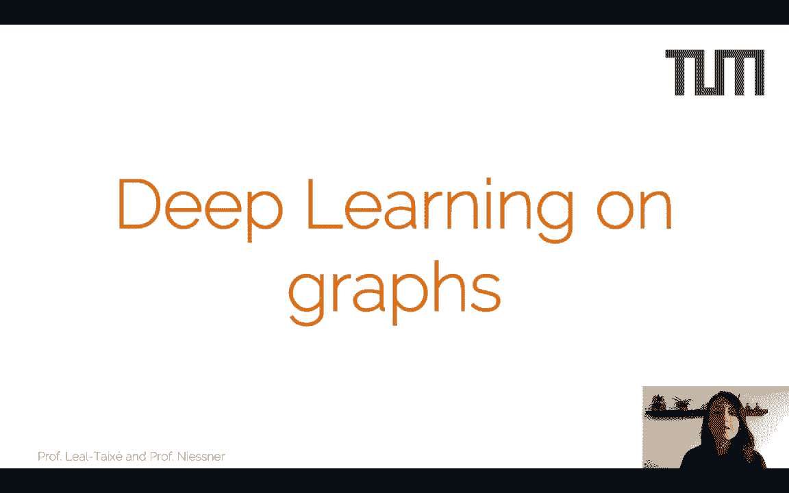

# 5：L5 - 图神经网络与注意力机制 📚

## 📖 概述

在本节课中，我们将学习图神经网络与注意力机制。我们将从图像处理的规则领域出发，探讨如何将深度学习技术应用于图、点云等不规则结构的数据。我们将介绍图神经网络的基本概念、核心操作，并展示其在计算机视觉任务（如多目标跟踪、视频对象分割）中的应用。最后，我们会将注意力机制与图神经网络联系起来，并简要介绍Transformer模型。

---

## 🧠 从规则域到不规则域

上一节我们回顾了图像处理的规则性。在图像中，像素的顺序和邻居的位置是固定且重要的。卷积神经网络通过滑动固定形状的卷积核来捕捉这种空间关系。

本节中，我们来看看当数据域变得不规则时，例如点云或图结构，我们面临哪些新的挑战。

点云包含丰富的三维位置信息，甚至可以附加语义或RGB信息。然而，点云是不规则的。对点云进行旋转等变换后，点的位置会完全改变，但物体本身（如兔子）并未改变。同时，点的顺序并不重要，我们希望任何对点云的操作都具有**排列不变性**。

另一个不规则域的典型例子是**图**，例如社交网络或论文引用网络。图中的节点代表概念（如朋友、论文），边代表概念间的连接。图同样是不规则的，我们无法直接在其上应用传统的卷积操作。

因此，为了在这些不规则域上进行深度学习，我们需要新的工具。

---

## 🏗️ 图神经网络基础

上一节我们介绍了图作为不规则域的代表。本节中，我们来看看图神经网络的基本思想和核心挑战。

图神经网络的核心思想是处理**可变大小的输入**并保持**节点排列不变性**。一个社交网络可能有10个节点，也可能有100个节点，我们的操作需要能处理任意数量的节点和边，并且无论先分析哪个节点，处理方式都应相同。

图神经网络的工作流程通常分为两步：
1.  **构建图**：为节点和边分配特征向量（嵌入），这些嵌入可以包含任何我们感兴趣的信息。
2.  **信息传播**：进行多轮信息传播迭代，每一轮可以看作神经网络的一层。

在每一轮信息传播中，节点会从其邻居节点收集信息。随着层数的增加，节点能接收到来自更远节点的信息，从而获得更全局的上下文。最终，我们得到一个更新后的图，其中节点和边的特征向量包含了来自其邻居的上下文信息。

---

## 🔄 神经消息传递步骤

上一节我们概述了图神经网络的信息传播过程。本节中，我们深入探讨其核心操作：**神经消息传递**。

神经消息传递的关键在于定义一个能处理任意数量邻居、且具有排列不变性的聚合操作，同时这个操作还应包含可学习的部分。

神经消息传递可以分为两个具体步骤：

**步骤一：创建消息**
节点 `v` 查看其所有邻居节点 `u`，聚合邻居节点在上一步的嵌入 `h_u^l`、自身嵌入 `h_v^l` 以及连接边的嵌入 `h_{vu}`。这个聚合信息会通过一个可学习的函数 `M`（例如一个MLP）进行处理。最后，通过一个**排列不变**的操作（如求和）将所有邻居处理后的信息聚合成一个单一的消息 `m_v^{l+1}`。

**步骤二：更新节点嵌入**
节点 `v` 将上一步得到的消息 `m_v^{l+1}` 与其自身在上一步的嵌入 `h_v^l` 结合，并再次通过一个可学习的更新函数 `U`（例如另一个MLP），得到节点 `v` 在新的步骤 `l+1` 的嵌入 `h_v^{l+1}`。

这两个步骤中使用的可学习函数 `M` 和 `U` 在整个图的所有节点和边上都是**共享权重**的，这类似于一个巨大的孪生网络。

---

## 📊 图神经网络实例：图卷积网络

上一节我们介绍了通用的神经消息传递框架。本节中，我们来看一个具体的实例：**图卷积网络**，并展示它如何被纳入上述框架。

在GCN的消息创建步骤中，节点 `v` 不仅聚合邻居节点 `u` 的嵌入，还会考虑**自身节点**的嵌入（即添加自环）。聚合操作通常采用归一化的求和，例如根据节点度进行平均。

在更新步骤中，由于自身信息已在消息中，我们只需要一个可学习的权重矩阵 `W` 来处理聚合后的消息，然后通过一个非线性激活函数，得到新的节点嵌入。

用公式可以表示为：
`h_v^{l+1} = σ( W * AGGREGATE({h_u^l, ∀u ∈ N(v) ∪ {v}}) )`

其中 `σ` 是非线性激活函数，`AGGREGATE` 是聚合函数（如归一化求和）。这与传统卷积的思想类似：先聚合信息，再通过可学习的权重进行变换。

---

## ⚙️ 更新节点与边嵌入

到目前为止，我们只讨论了更新节点嵌入。但有时我们同样关心边的特征。本节中，我们介绍一种更通用的框架，可以交替更新节点和边的嵌入。

这个框架将信息传播过程分为两个明确的步骤：

**步骤一：节点到边的更新**
对于连接节点 `i` 和 `j` 的边 `(i, j)`，我们收集节点 `i`、节点 `j` 在上一步的嵌入以及边 `(i, j)` 自身的嵌入。将这些信息通过一个可学习的函数，更新边 `(i, j)` 的嵌入。这一步完成后，边嵌入了其连接的两个节点的信息。

**步骤二：边到节点的更新**
对于节点 `i`，我们收集所有与其相连的边的更新后嵌入。由于连接边的数量可变，我们需要一个排列不变的聚合操作（如求和）来创建消息。然后，将此消息与节点 `i` 自身的上一轮嵌入结合，通过另一个可学习函数，更新节点 `i` 的嵌入。

通过交替进行这两步，节点和边的嵌入都得到了更新，并融合了图中的上下文信息。

---

## 💡 核心要点与特性

上一节我们介绍了交替更新节点和边的框架。现在，我们来总结一下图神经网络的一些核心特性和要点。

*   **目标**：通过消息传递，获得包含图拓扑结构和邻居特征信息的上下文感知节点/边嵌入。
*   **层与感受野**：每个消息传递步骤相当于一层。进行 `L` 步后，节点能接收到 `L` 跳距离之外节点的信息。
*   **可微分性**：所有操作都是可微分的，因此可以通过反向传播进行端到端训练。
*   **模型多样性**：存在许多不同的图神经网络模型（如GCN、GAT、MPNN），它们主要区别在于消息函数和更新函数的具体形式。

---

## 🎯 应用一：多目标跟踪

了解了图神经网络的基本原理后，本节我们来看它在计算机视觉中的一个具体应用：**多目标跟踪**。

多目标跟踪旨在检测视频序列中的多个物体（如行人）并持续跟踪它们。传统方法通常分为两步：1) 目标检测，2) 数据关联（将不同帧的检测框关联起来形成轨迹）。

我们可以用**图**来建模数据关联问题：图中每个节点代表一个检测框，每条边代表两个检测框可能属于同一物体的假设。找到图中的一条路径就相当于找到一条物体轨迹。

我们的方法是将学习引入数据关联步骤：
1.  **图构建与特征编码**：节点特征来自检测框的CNN外观特征，边特征编码了检测框之间的时空几何信息（如时间差、位置距离）。
2.  **神经消息传递**：在图上进行多轮消息传递（使用我们之前介绍的节点-边交替更新框架），让信息在整个图中传播。我们还引入了**时间感知的消息传递**，将来自过去帧和未来帧的连接分开处理。
3.  **边分类**：消息传递后，我们在每条更新后的边嵌入上应用一个MLP进行分类，判断该边是“激活”（属于同一轨迹）还是“非激活”。

这种方法将可学习的数据关联操作整合进了端到端的训练框架，在标准基准上取得了优异性能。

---

## 🎯 应用二：视频对象分割

本节我们探讨图神经网络在另一个视觉任务中的应用：**视频对象分割**，其目标是为视频中的物体生成准确且时序一致的像素级掩码。

在这个工作中，我们将视频的每一帧表示为一个图节点。每个节点的初始嵌入通过一个强大的CNN（如DeepLabv3）提取的整帧特征得到。

消息传递步骤被设计为**卷积循环网络**的形式，以保留帧内的空间信息，从而最终能输出像素级的掩码。此外，该方法还引入了**注意力机制**，让网络能够关注每帧中对于分割任务更重要的区域。

这个例子展示了图神经网络的灵活性：节点可以代表整个帧，消息传递函数可以根据任务需求定制（如使用卷积操作保留空间结构）。

---

## 🧲 注意力机制简介

上一节的应用提到了注意力。本节中，我们正式介绍**注意力机制**，它最初是为解决机器翻译中长序列依赖问题而提出的。

循环神经网络在处理长序列时，存在**长期依赖问题**，容易遗忘序列开头的信-息。注意力机制通过允许解码器在生成每个词时，直接“查看”编码器所有时间步的隐藏状态，并为它们分配不同的重要性权重（注意力权重），从而解决了这个问题。

注意力机制的核心是计算一个**上下文向量**，它是编码器所有隐藏状态的加权和，权重由注意力分数决定。注意力分数通常通过一个小型神经网络计算，该网络以解码器上一时刻的隐藏状态和编码器某一时刻的隐藏状态为输入。

这种允许直接访问序列任何部分的能力，显著提升了长序列任务（如机器翻译）的性能。

---

## 🔗 注意力、Transformer与图神经网络

上一节我们介绍了基于RNN的注意力模型。本节中，我们探讨一个更激进的思路：**完全基于注意力**的模型——Transformer，并建立其与图神经网络的联系。

Transformer摒弃了RNN的循环结构，完全依赖注意力机制来建模序列中所有元素之间的关系。在Transformer中，序列的每个元素（如单词）都通过注意力直接与所有其他元素相连。

这让我们联想到图神经网络：如果将每个单词视为图中的一个节点，将注意力权重视为节点之间的连接强度，那么Transformer本质上就是一种**图注意力网络**。在GNN中，聚合操作（如求和）被替换为**加权和**，而这个权重正是通过注意力机制学习得到的。

因此，Transformer可以看作是图神经网络在序列数据上的一种特例和应用。

---

## 👁️ 注意力在计算机视觉中的应用

最后，我们看看注意力机制在计算机视觉中的典型应用：**图像描述生成**。

在图像描述任务中，我们需要为输入图像生成一句描述性文本。传统方法使用CNN编码图像，再用RNN解码生成句子。问题在于，生成句子中不同单词时，应该关注图像的不同区域。

**注意力机制**在此非常有用。在解码器（RNN）生成每个单词时，它会计算一个对编码器（CNN）输出的特征图所有空间位置的注意力分布。这个分布决定了在生成当前单词时，模型应该“看”图像的哪一部分。然后，模型根据注意力权重对特征图进行加权求和，得到上下文向量，再用于预测当前单词。

这分为两种：
*   **软注意力**：上下文向量是所有特征的加权和，可微分，易于训练。
*   **硬注意力**：根据注意力分布随机采样一个特征位置，是随机过程，训练更复杂。

可视化显示，在生成“鸟”、“水”、“树”等不同单词时，注意力会聚焦在图像中相应的区域上，这大大提升了图像描述的准确性和可解释性。

---

## 📝 总结

本节课我们一起学习了图神经网络与注意力机制。我们从处理不规则数据域的挑战出发，深入探讨了图神经网络的核心——神经消息传递框架，并介绍了图卷积网络等具体实例。我们看到了GNN在多目标跟踪和视频对象分割等视觉任务中的强大应用。最后，我们引入了注意力机制，解释了其如何解决长序列依赖问题，并建立了Transformer模型与图注意力网络之间的联系，还展示了注意力在图像描述生成中的关键作用。这些技术为我们处理超越规则图像的结构化数据提供了强大的工具。