# 7：L7 - 生成对抗网络（下） 🎓

## 📖 概述

在本节课中，我们将继续深入探讨生成对抗网络。我们将学习如何构建更复杂的GAN架构以生成高分辨率图像，并探索如何为GAN添加条件控制，使其能够根据特定输入（如草图或标签）生成目标图像。课程将涵盖多尺度训练、渐进式增长、条件GAN以及循环一致性等核心概念。

---

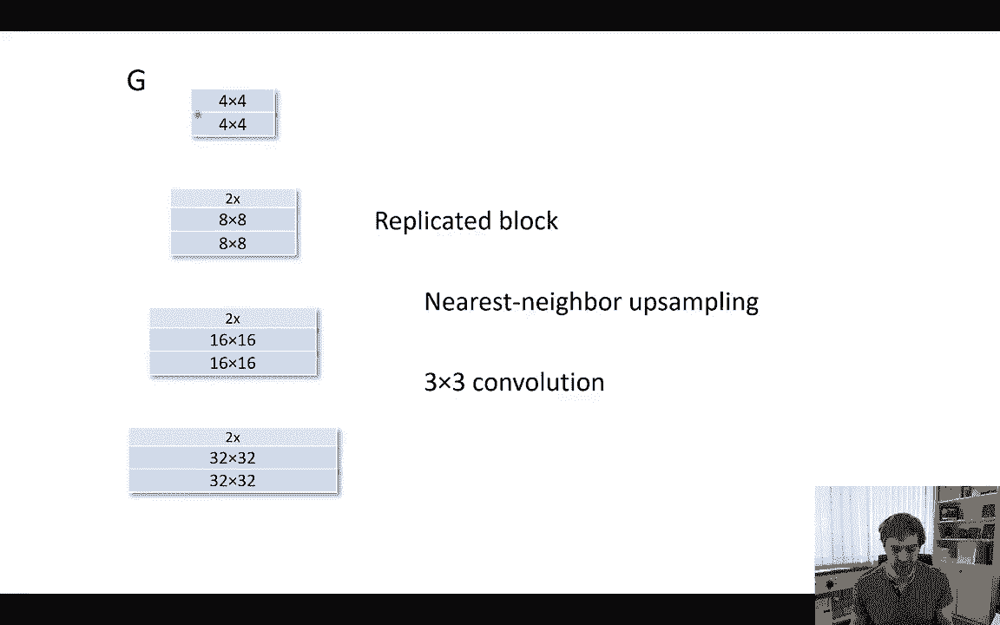

## 🏗️ 常见的GAN架构与多尺度训练

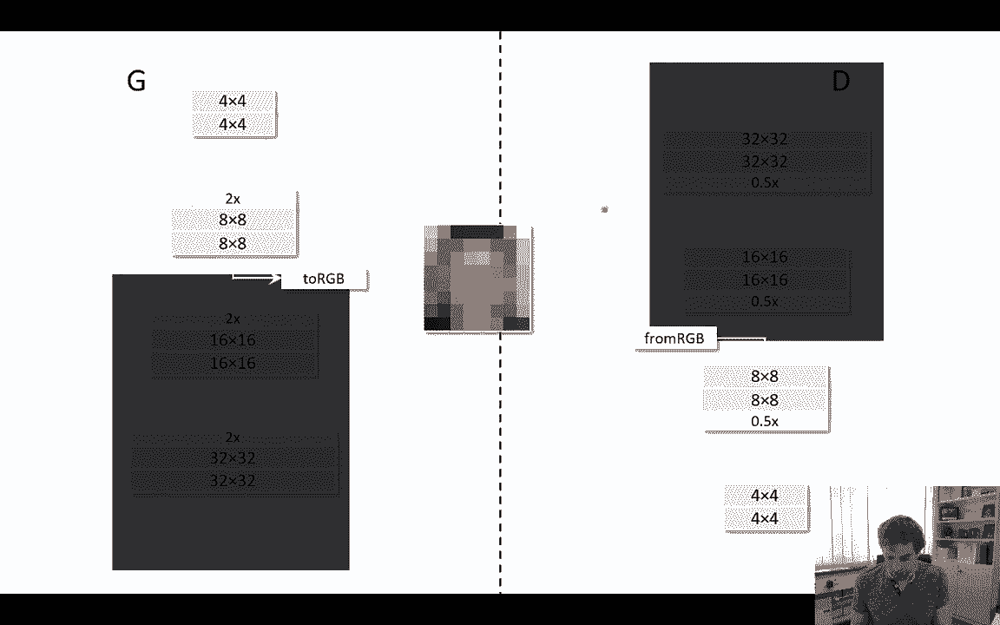

上一节我们介绍了生成对抗网络的基本原理。本节中，我们来看看如何构建更强大的GAN架构。

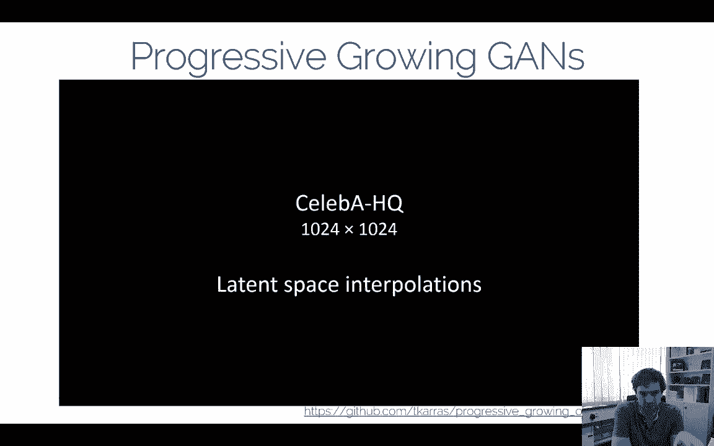

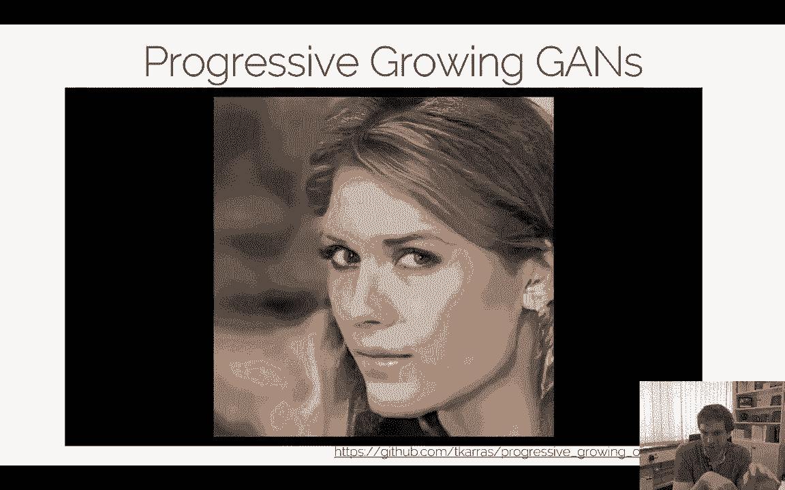

GAN面临的一个核心挑战是生成高分辨率图像。卷积核的感受野是局部的，因此GAN擅长生成局部细节，但构建全局结构则非常困难。图像分辨率越高，这个问题就越具挑战性。

为了解决这个问题，研究人员借鉴了多尺度优化的思想。基本思路是在不同尺度上优化问题，并使用当前尺度的结果作为下一尺度的初始化。

以下是其工作原理：
*   首先，一个生成器 `G3` 接收随机向量 `Z`，生成一张低分辨率图像。
*   接着，对该图像进行上采样。
*   然后，另一个生成器 `G2` 接收上采样后的图像，并添加细节，生成稍高分辨率的图像。
*   这个过程不断重复，通过 `G1` 和 `G0` 等生成器逐级增加细节，最终得到高分辨率图像。

这种方法的优势在于，低层级的生成器负责把握全局结构，而高层级的生成器则专注于添加精细的细节。

为了训练这样的多尺度架构，我们同样需要在每个尺度上配备一个判别器。例如，判别器 `D3` 评估 `G3` 生成的低分辨率图像，判别器 `D2` 评估 `G2` 生成的中等分辨率图像，依此类推。这样，不同层级的判别器可以分别关注图像的整体结构和局部细节。

---

## 🌱 渐进式增长生成对抗网络

基于多尺度的思想，一项非常重要的工作是**渐进式增长生成对抗网络**。它的核心概念与上述方法类似，但训练过程更加精巧和稳定。

其训练流程如下：
1.  首先，训练一个非常小的生成器和判别器来生成 `4x4` 像素的图像。由于分辨率极低，学习其数据分布相对容易。
2.  当 `4x4` 的生成器和判别器训练稳定后，我们同时为两者添加新的网络层。此时，生成器能够生成 `8x8` 的图像，判别器也能判别 `8x8` 的图像。
3.  关键的一步是，新增的网络层不是随机初始化的，而是以预训练的 `4x4` 网络权重为基础进行初始化。然后，对整个扩展后的网络进行微调。
4.  重复这个过程，逐步将分辨率提高到 `16x16`、`32x32`，直至 `1024x1024`。

这种方法极大地稳定了训练过程，因为网络在低分辨率下已经学会了生成合理的全局结构，新增的层只需专注于学习添加更精细的细节。

在实现上有两个关键细节：
1.  **特征图传递**：生成器不是直接生成RGB图像然后上采样，而是生成特征图。在每一级，通过一个 `toRGB` 层（通常是 `1x1` 卷积）将特征图转换为该分辨率的RGB图像。这样可以在不同尺度间保持和传递丰富的特征信息。
2.  **平滑过渡**：当新增网络层时，不是立即切换到新尺度进行训练，而是采用**线性混合**。在训练初期，损失函数主要来自低分辨率部分；随着训练进行，逐渐增加来自新增高分辨率层的损失权重。这避免了训练过程的剧烈波动。

通过渐进式增长，GAN能够生成质量非常高的高分辨率人脸图像。训练完成后，我们可以在潜在空间中进行线性插值，观察人脸特征的平滑过渡，这证明了模型学习到了一个连续且有意义的流形。

---

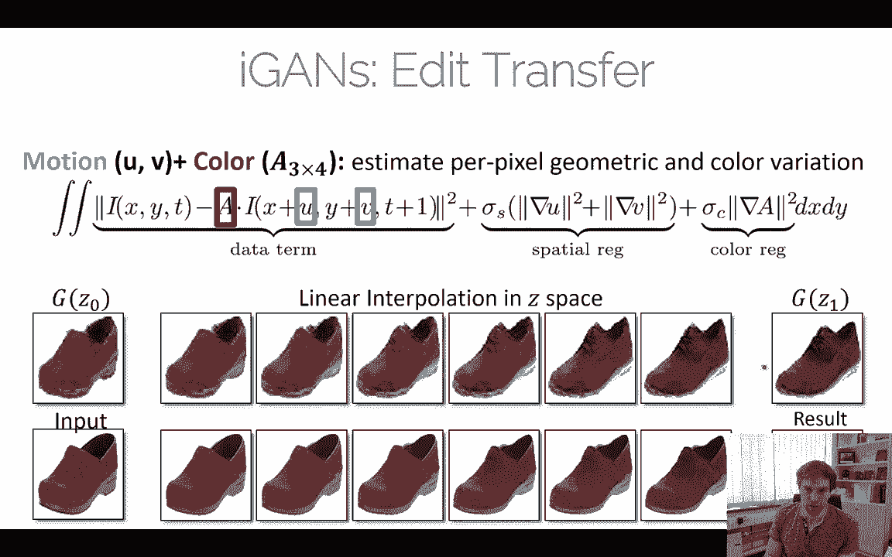

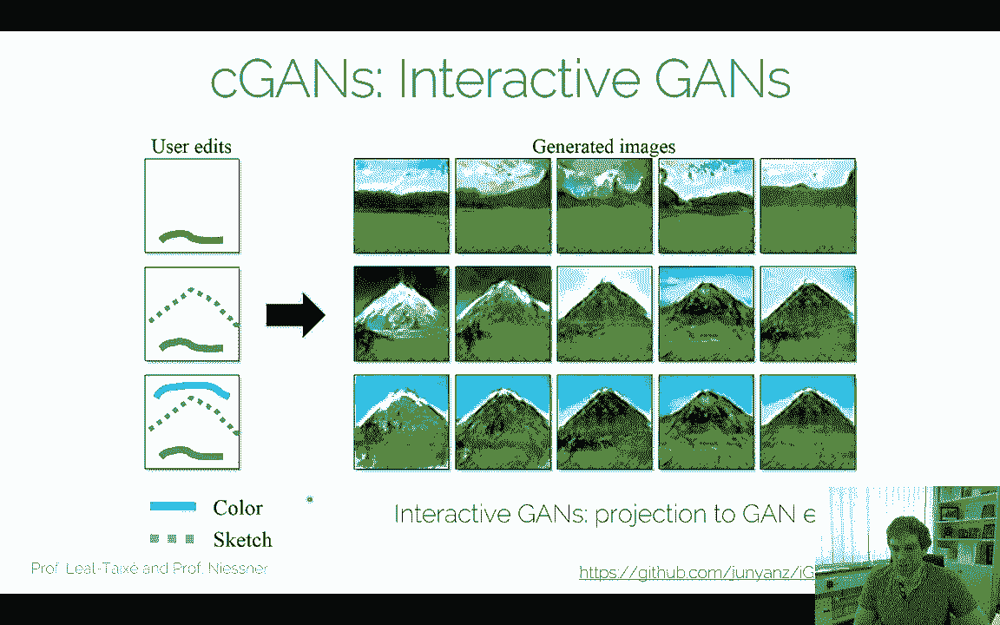

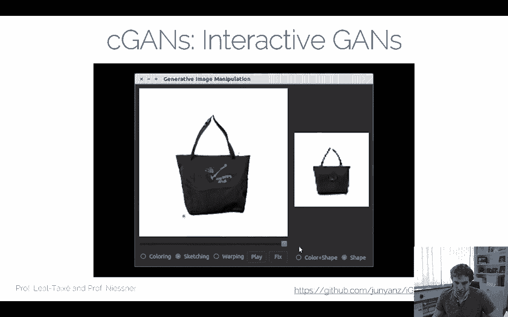

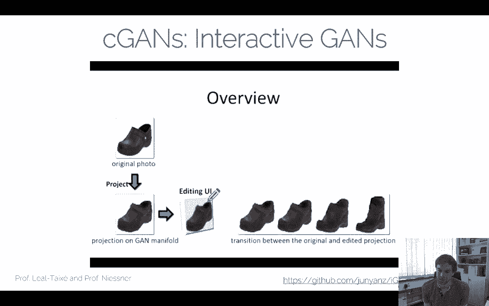

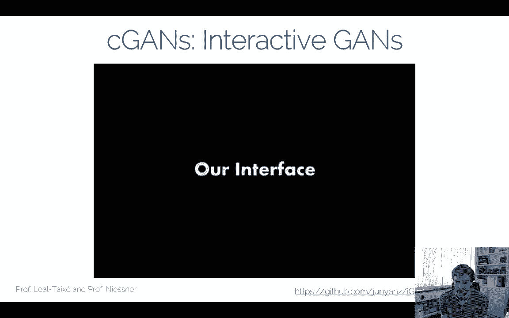

## 🎯 条件生成对抗网络

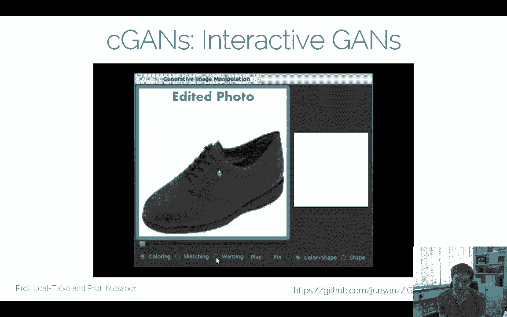

到目前为止，我们讨论的GAN都是完全生成式的：输入一个随机向量 `Z`，输出一张图像。然而，对于实际应用，我们通常希望控制生成过程，例如根据草图生成真实图像，或者生成具有特定属性（如金发、微笑）的人脸。这就需要**条件生成对抗网络**。

一个朴素的想法是：将条件信息（如图像或标签）和随机噪声 `Z` 一起输入生成器 `G`，生成图像，然后用判别器 `D` 判断生成图像的真伪。但这样做有一个问题：判别器只评估生成的图像是否真实，并不关心它是否与输入条件相关。生成器可能会学会忽略输入条件，只利用 `Z` 来生成逼真的图像。

解决方案是让判别器也知晓条件信息。在**配对数据**设置下，我们同时向判别器输入条件图像 `X` 和对应的图像 `Y`（或生成图像 `G(X, Z)`）。此时，判别器的任务不再是“图像是否真实”，而是“`(X, Y)` 这个图像对是否匹配且真实”。这样，生成器就被迫学习生成与给定条件 `X` 相匹配的真实图像 `Y`。

**Pix2Pix** 是条件GAN的一个经典框架。它使用U-Net作为生成器以保留输入的结构信息，并使用PatchGAN作为判别器（判别器对图像的每个局部块进行真伪判断，专注于提升局部细节的真实性）。其损失函数结合了GAN的对抗损失和生成图像与目标图像之间的 `L1` 重建损失：
`L = L_GAN + λ * L_L1`
其中 `λ` 控制重建损失的权重。

---

## 🔄 图像到图像的翻译：配对与未配对设置

条件GAN在图像到图像翻译任务中表现出色，例如将语义标签图转换为街景照片、将黑白图像着色、将地图转换为卫星图像等。这些任务通常属于**配对数据**设置，即对于每个输入 `X`，都有一个明确对应的真实输出 `Y`。这些配对数据通常可以通过算法自动生成（如将彩色图转为灰度图作为 `X`，原图作为 `Y`）。

然而，许多有趣的翻译任务没有现成的配对数据，例如将马翻译成斑马，或将莫奈的画风转移到真实照片上。这属于**未配对数据**设置：我们有一个源域图像集合 `X`（马）和一个目标域图像集合 `Y`（斑马），但不知道哪匹马对应哪只斑马。

对于未配对数据，直接使用条件GAN会导致**模式崩溃**：所有不同的输入马都可能被映射到同一只输出斑马上，因为只要输出看起来像斑马，就能骗过判别器。

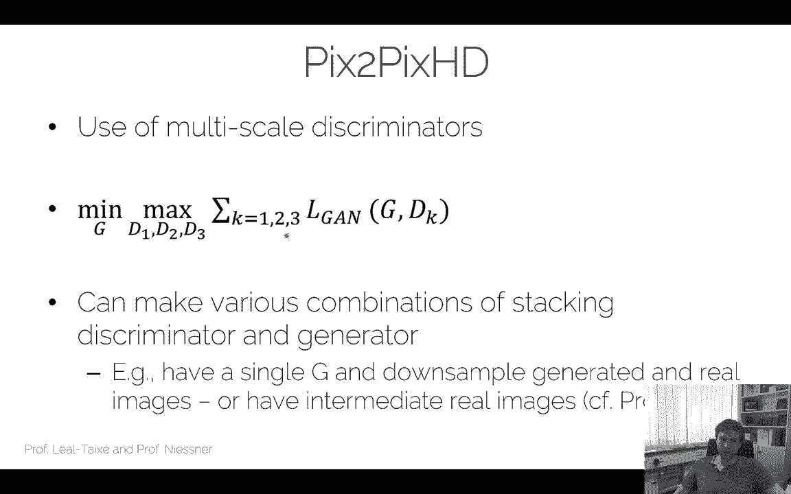

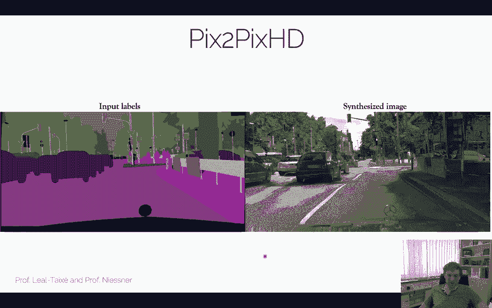

为了解决这个问题，**CycleGAN** 引入了**循环一致性**的概念。它使用两个生成器：`G: X -> Y`（马变斑马）和 `F: Y -> X`（斑马变马），以及两个对应的判别器 `D_Y` 和 `D_X`。其核心思想是，翻译应该具有循环一致性：将一匹马 `x` 通过 `G` 变成斑马 `G(x)`，再通过 `F` 变回马 `F(G(x))`，应该得到与原始输入 `x` 非常接近的图像。同样，对于斑马 `y`，也应有 `G(F(y)) ≈ y`。

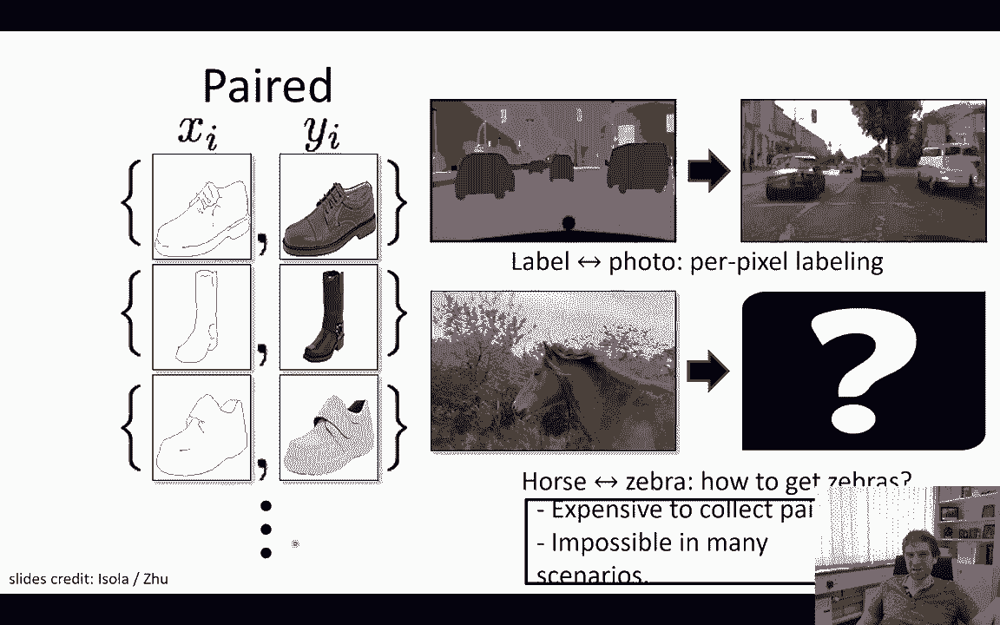

循环一致性损失定义为：
`L_cycle = E_x~p_data(x)[||F(G(x)) - x||_1] + E_y~p_data(y)[||G(F(y)) - y||_1]`
这个损失强制要求翻译过程是双向可逆的，从而避免了模式崩溃，并鼓励生成器学习有意义的、一对一的跨域映射。

---

## 📝 总结

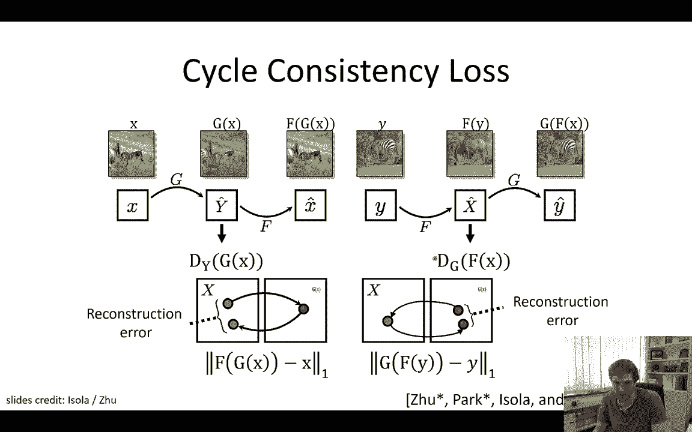

本节课我们一起深入学习了生成对抗网络的高级主题。
*   我们探讨了通过**多尺度训练**和**渐进式增长**策略来生成高分辨率、高质量图像的方法。
*   我们介绍了**条件生成对抗网络**，它允许我们根据特定输入控制生成内容，并在**配对数据**设置下通过让判别器感知条件信息来实现。
*   对于缺乏配对数据的场景，我们学习了**CycleGAN**及其**循环一致性**损失，它能够在未配对数据上实现有效的跨域图像翻译。

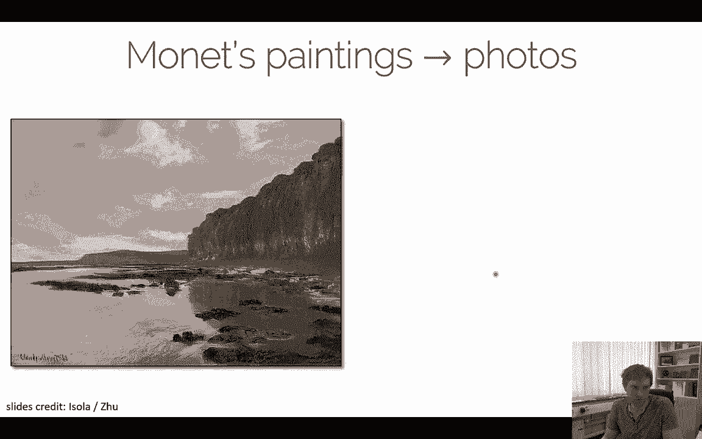

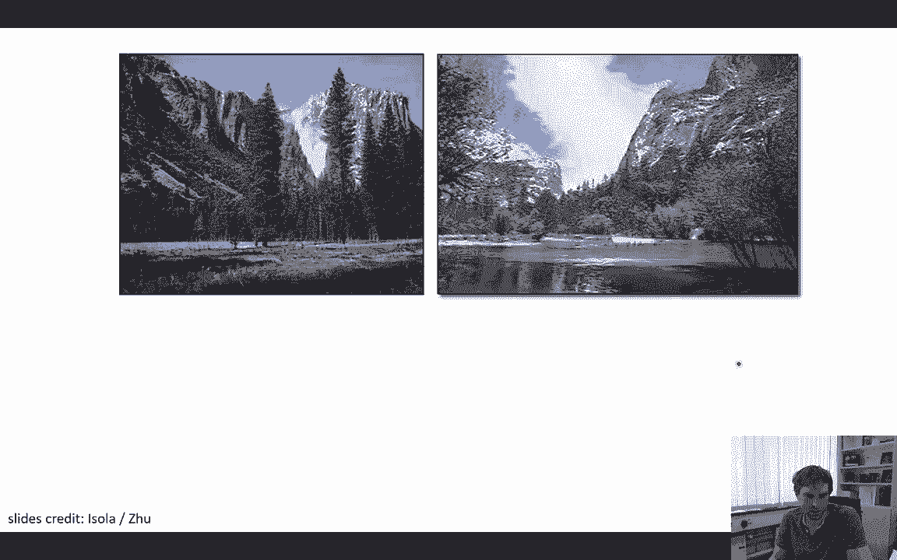

这些技术极大地扩展了GAN的应用范围，使其从完全随机的图像生成，发展到可控的、有针对性的图像合成与编辑，为计算机视觉和图形学领域带来了强大的工具。