# 9：L9 - 神经网络图像与视频渲染 🎨

在本节课中，我们将学习**神经渲染**这一前沿概念。我们将探讨如何利用神经网络来生成或合成图像与视频，从而弥合传统计算机图形学与计算机视觉之间的鸿沟。

## 概述：什么是渲染？ 🤔

上一节我们介绍了多种生成模型。本节中，我们来看看**渲染**这一核心概念。渲染主要源于计算机图形学，其本质是从一个**合成场景描述**中创建图像或视频的过程，广泛应用于电影和电子游戏制作。

一个典型的渲染流程包含三个核心部分：
1.  **场景描述**：一个3D描述，定义了环境中的物体、形状、材质、光照和几何结构（通常是三角网格）。
2.  **相机参数**：
    *   **内参**：定义了投影矩阵，例如焦距和主点，用于将3D点映射到2D图像平面。
    *   **外参**：定义了相机的位置和朝向，包含旋转和平移共6个自由度。
3.  **渲染过程**：将3D场景描述通过相机参数投影到2D图像平面，生成最终图像。

这个过程在计算机图形学中已研究数十年，通过**渲染方程**等理论可以合成出非常逼真的图像。

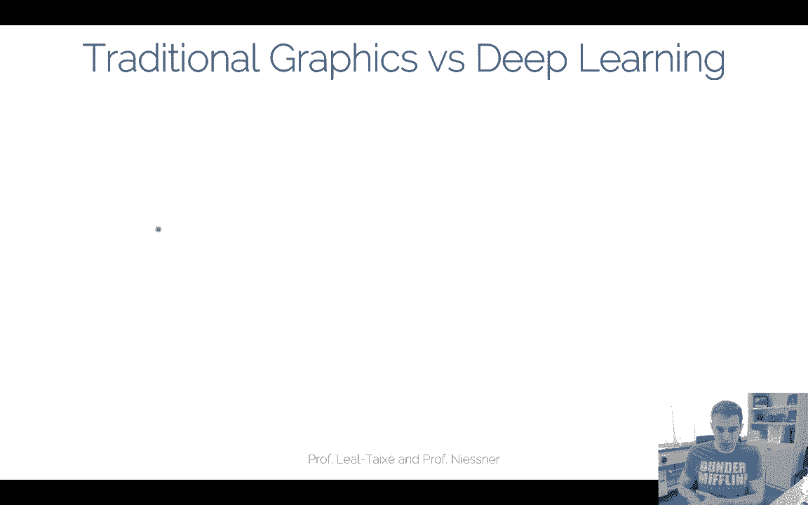

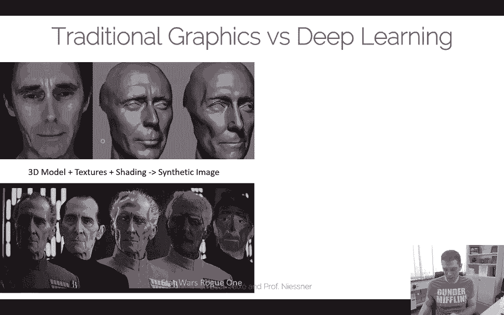

## 图形学与视觉的鸿沟 🏔️

传统图形学流程虽然能生成高质量图像，但最大的挑战在于**3D内容的创建**（几何、纹理、光照、材质等）需要大量人工。相反，计算机视觉的目标是从2D图像**逆向重建**出3D表示，例如通过运动恢复结构（SfM）方法。

然而，视觉方法的重建结果（如稀疏点云）在视觉质量上远不及精心制作的图形学模型。这就引出了核心问题：**如何让视觉重建的结果看起来像图形学渲染的那样逼真？**

神经渲染正是为了解决这一鸿沟而出现的关键思路。

## 神经渲染的核心思想 💡

神经渲染的核心思想是：**用神经网络替代或增强传统的图形学渲染管线**。我们不再需要完美的手工3D模型，而是训练一个神经网络，让它学会从某种输入（如相机姿态、草图、人体骨架）生成逼真的图像。

我们已经在前几讲中见过类似思想的应用，例如Pix2Pix、vid2vid和Everybody Dance Now。这些方法可以看作神经渲染的早期形式，它们用条件生成网络替代了部分图形学流程。

以下是几种常见的条件输入：
*   **相机姿态**：用于新视角合成。
*   **人脸关键点**：用于面部重演。
*   **人体骨架**：用于动作迁移。

## 迈向3D：DIB-R 体素渲染 🧊

上一节我们看到了基于2D卷积的神经渲染。本节中我们来看看如何引入**显式的3D操作**来提升效果。以新视角合成为例，仅使用2D卷积网络学习3D变换非常困难，容易产生闪烁伪影。

**DIB-R** 方法的关键改进在于，它将**可微分的3D操作**（如投影、旋转）直接编码到网络架构中。其简化流程如下：
1.  使用2D网络从源图像提取特征。
2.  利用已知相机姿态，通过投影层将2D特征**提升**到3D体素网格中。
3.  在3D空间中使用3D卷积进行处理。
4.  针对目标相机姿态，将3D特征重新**投影**回2D。
5.  通过2D卷积生成最终图像。

整个系统可以端到端训练。网络无需从头学习3D几何变换，因为它已被显式编码，从而能更高效地学习材质、光照等未知部分，生成质量更高、时序更连贯的结果。

## 场景表示与可微渲染器 🧩

神经渲染系统通常包含两部分：**场景表示**和**可微渲染器**。DIB-R使用了体素网格作为场景表示。除此之外，还有多种其他表示方法，各有优劣：

以下是不同场景表示的对比：
*   **多平面图像**：渲染快、质量高，但灵活性有限（2.5D）。
*   **体素网格**：真正的3D控制，但内存消耗大。
*   **基于光栅化**：高质量，需要对光栅化过程求导。
*   **点云**：高质量，但对输入点云质量要求高，缺失点难以补全。
*   **隐式函数**：非常紧凑，无需显式结构，但渲染慢。

可微渲染器负责将这些表示转换为2D图像，并允许梯度反向传播以优化场景表示。

## 前沿：隐式神经表示（NeRF） ✨

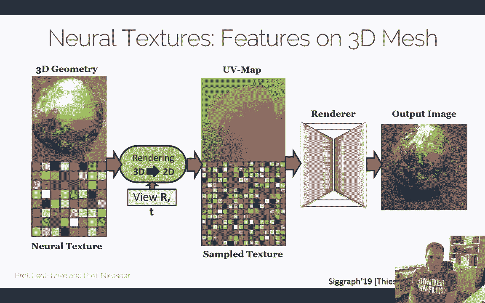

近期一个非常热门的趋势是**完全隐式的场景表示**，例如 **NeRF**。它摒弃了所有显式结构（体素、网格、点云），仅用一个多层感知机来表示场景。

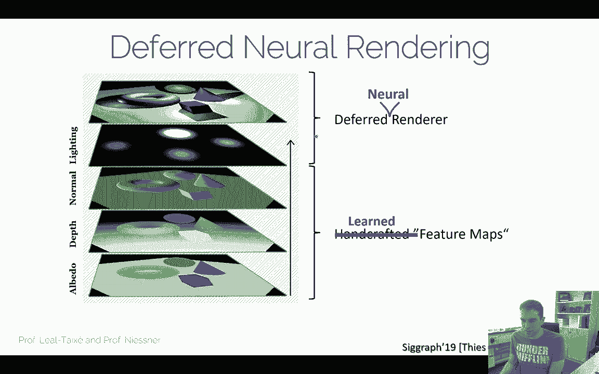

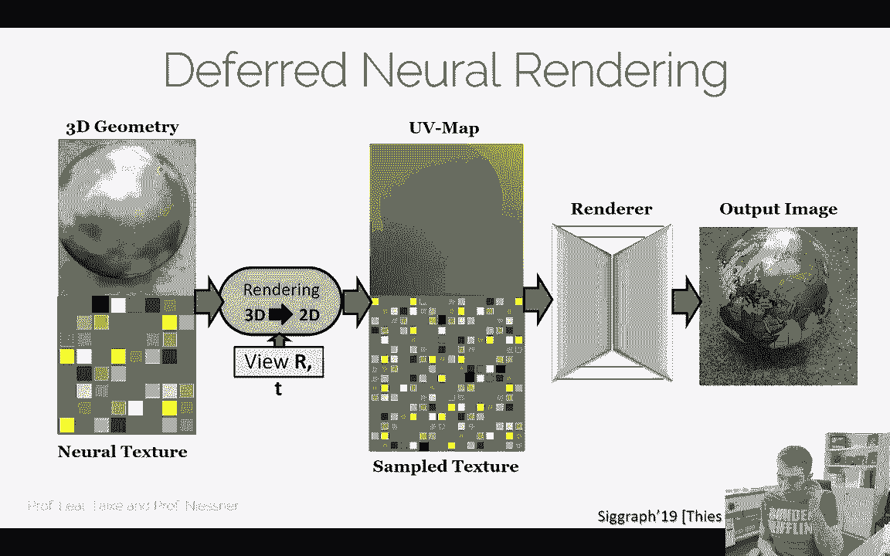

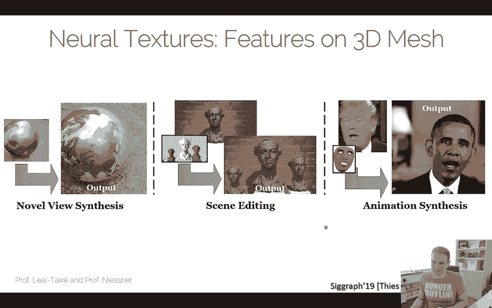

NeRF的核心思想是：
*   输入一个3D空间位置 `(x, y, z)` 和观察方向 `(θ, φ)`。
*   MLP直接输出该位置的颜色 `(r, g, b)` 和体密度 `σ`。
*   渲染时，对相机射线上的点进行采样，通过经典的体渲染公式合成像素颜色。

其渲染公式可简化为：
`C(r) = Σ Ti * αi * c_i`
其中 `Ti` 是透射率，`αi` 是alpha值，`c_i` 是颜色。

这种方法仅需多视角图像作为监督，就能学习到极其精细的几何与外观，在新视角合成上效果惊艳。缺点是训练和渲染速度较慢。

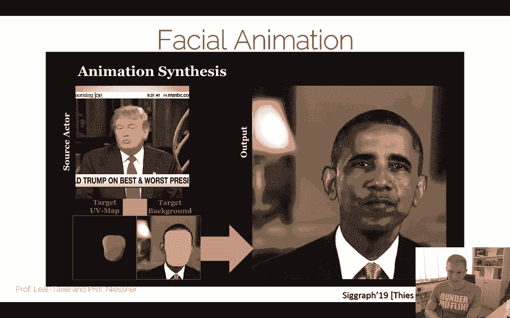

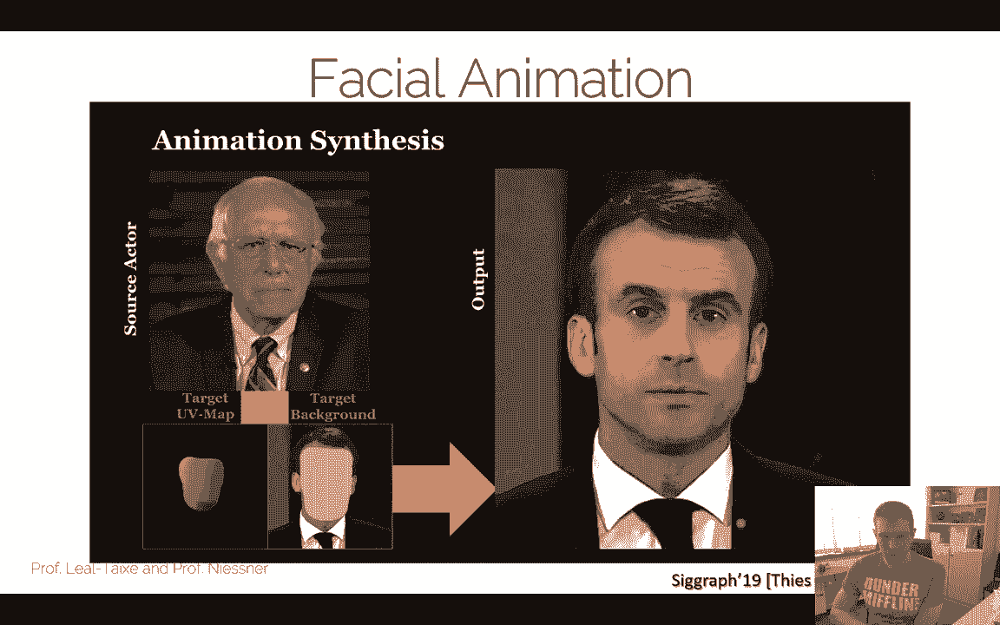

## 应用实例：神经纹理与语音驱动面部动画 🎭

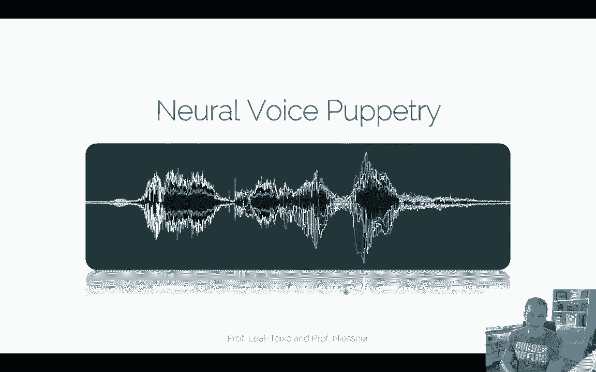

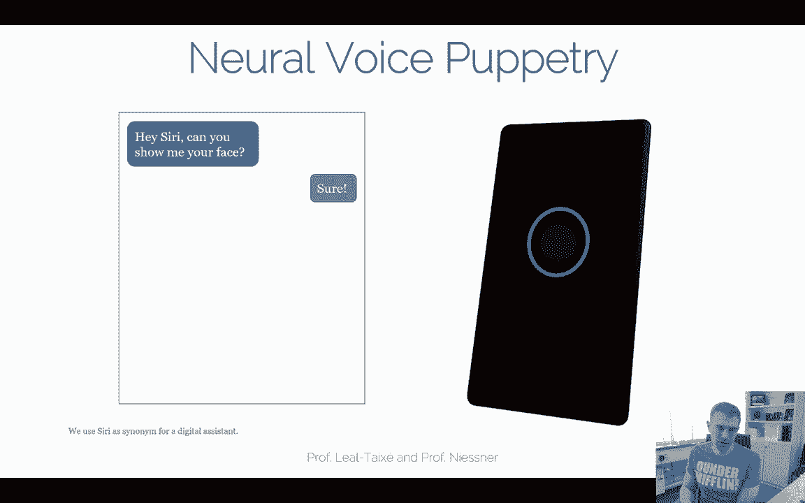

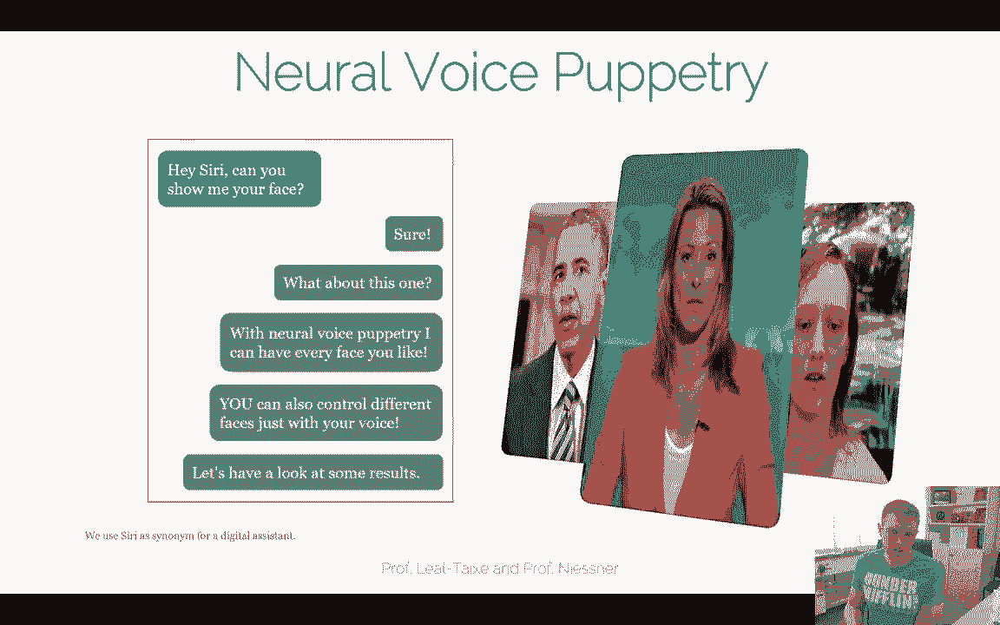

最后，我们看一个结合了显式3D与神经渲染的实用工作：**神经纹理**。

其流程是：
1.  从视频中重建一个粗糙的3D人脸网格。
2.  不在网格上存储RGB纹理，而是存储**神经特征纹理**。
3.  训练一个**神经渲染器**，它读取这些特征和当前视图，生成逼真的2D人脸图像。
4.  系统端到端训练，优化特征纹理和渲染器。

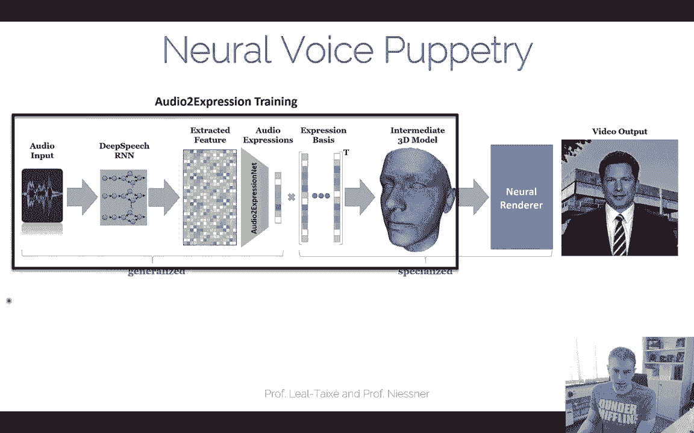

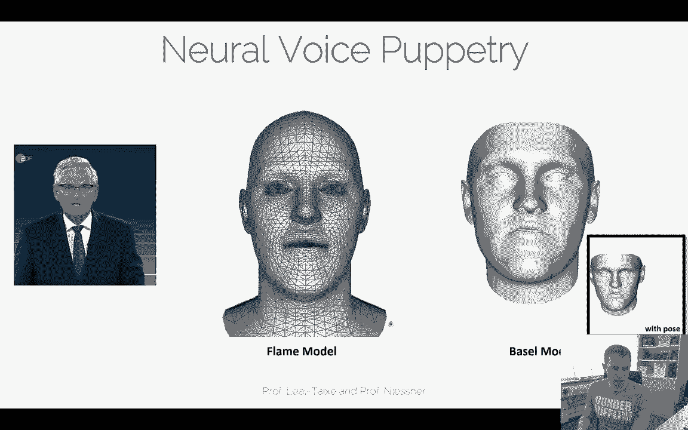

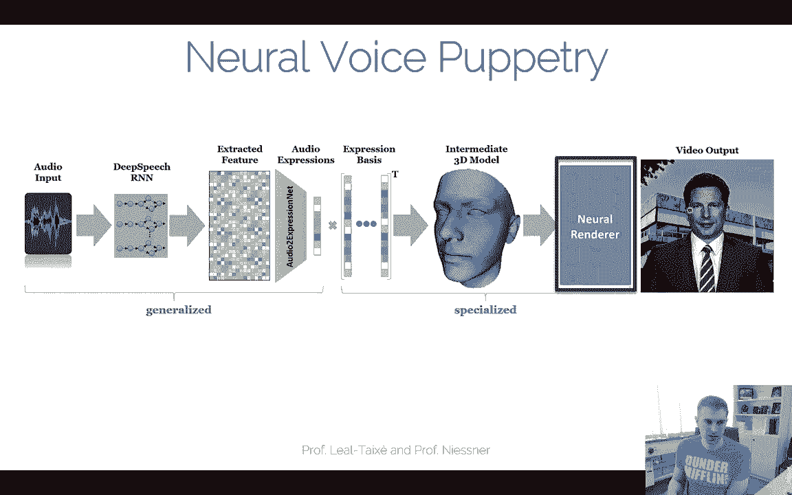

这种方法优势明显：3D网格提供了时序一致性，神经渲染器负责补全细节、纠正重建错误，因此只需少量数据即可训练。

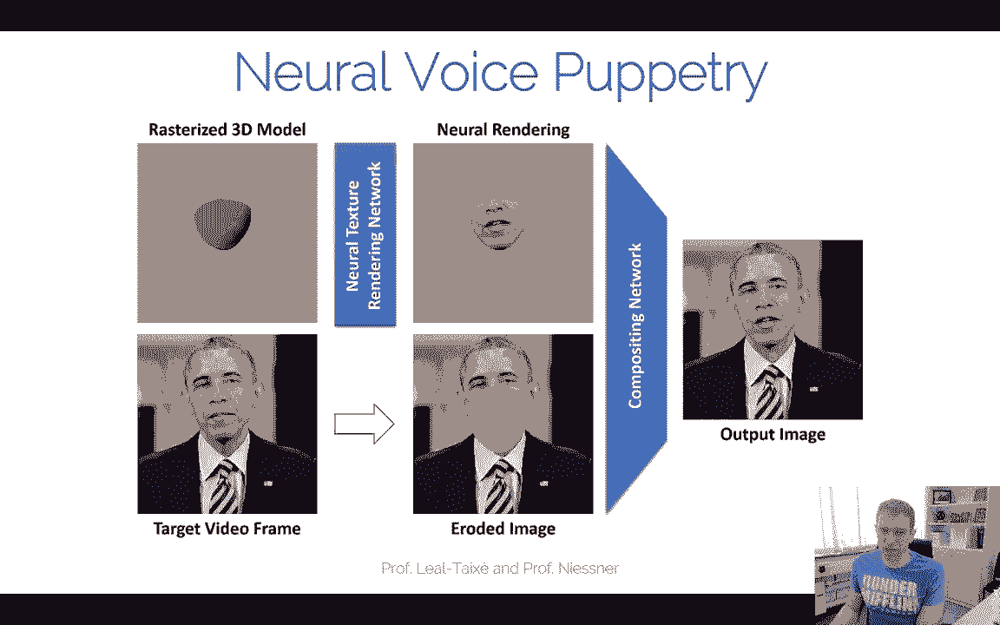

基于此，可以构建**语音驱动面部动画**系统：
1.  使用DeepSpeech从音频中提取特征。
2.  用一个网络将音频特征映射到3D人脸模型的**混合形状参数**（控制表情）。
3.  驱动带神经纹理的人脸模型。
4.  用训练好的神经渲染器生成最终视频。

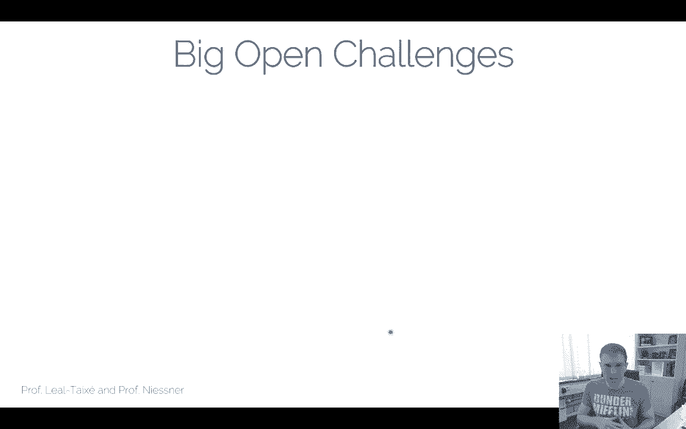

这样，只需输入文本或语音，就能生成高质量、口型同步的虚拟人视频，在虚拟助手、游戏等领域有巨大应用潜力。

## 挑战与未来方向 🚀

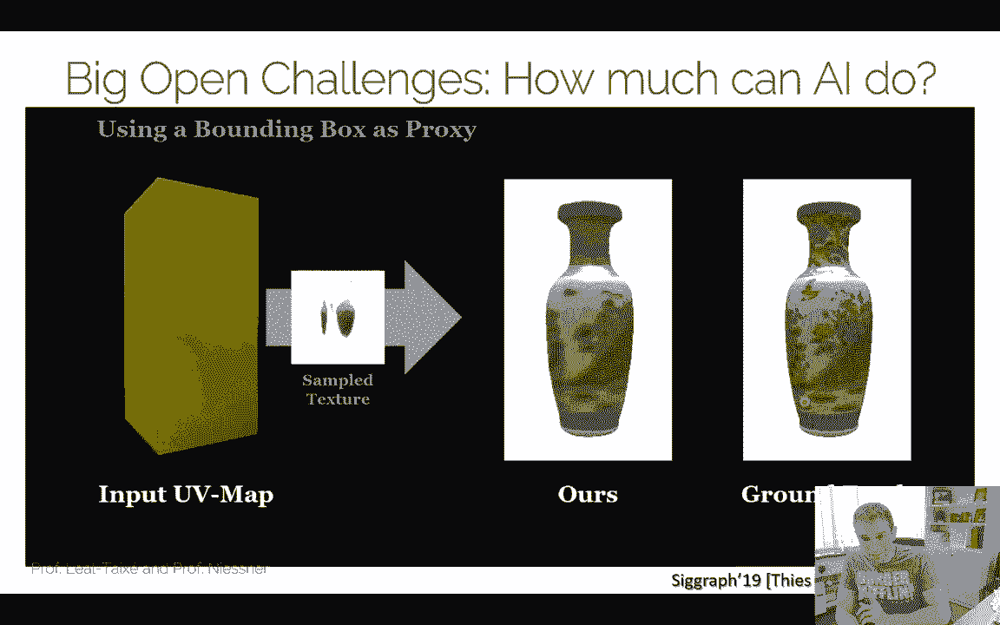

神经渲染仍面临许多开放挑战：
1.  **分工边界**：神经网络能在多大程度上弥补不完美的3D重建？重建质量的下限在哪里？这是一个需要权衡的根本问题。
2.  **3D感知网络**：如何将3D先验和可微分的3D算子更好地融入神经网络架构，是未来架构设计的重要方向。
3.  **伦理问题**：像深度伪造这样的技术带来了严重的伦理和社会挑战，需要在技术发展的同时积极应对。

## 总结 📚

本节课我们一起学习了神经渲染。我们从传统渲染流程出发，探讨了如何用神经网络替代图形学管线来生成图像和视频。我们介绍了从2D条件生成网络到引入显式3D操作的DIB-R，再到完全隐式表示的NeRF等多种方法。最后，我们通过神经纹理和语音驱动动画的实例，看到了神经渲染在连接计算机视觉与图形学、实现高保真内容生成方面的强大能力与潜力。这是一个快速发展、充满机遇的研究领域。