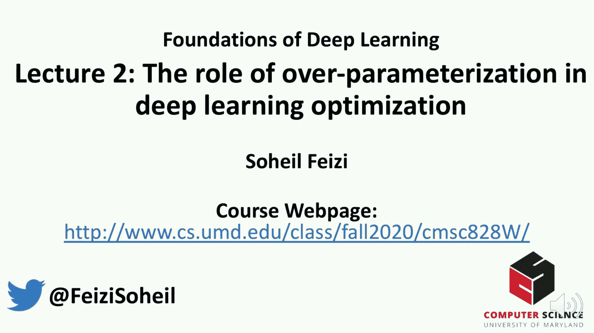
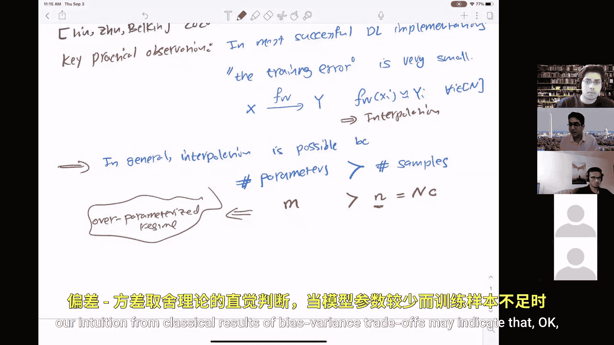

# 002：优化问题与过参数化的作用 🧠

在本节课中，我们将探讨深度学习中的优化问题，并聚焦于一个核心概念：**过参数化**。我们将了解为什么在非凸优化问题中，梯度下降等方法依然能有效工作，以及过参数化在其中扮演的关键角色。

上一讲我们介绍了经验风险最小化问题。本节中，我们来看看在非凸的神经网络优化中，实践观察到了哪些有趣的现象。

---

## 优化问题的挑战

我们从一个标准的经验风险最小化问题开始：

**公式**：
`min_w (1/N) * Σ_{i=1 to N} loss( f_w(x_i), y_i )`

其中：
*   `x_i` 是 D 维输入。
*   `y_i` 是标签（例如，在 C 类分类问题中，`y_i` 是 C 维向量）。
*   `f_w` 是我们的模型（如神经网络），由参数 `w` 参数化。
*   `loss` 是损失函数。

对于神经网络，`f_w` 是一个非线性函数，因此整个优化目标通常是一个**非凸**问题。

在凸优化中，损失函数形状“友好”，梯度下降可以保证收敛到全局最优解 `w*`。然而，在非凸情况下，损失函数可能非常复杂，存在**不良的局部极小值**和**鞍点**（其海森矩阵同时具有正负特征值）。理论上，这些点会阻碍优化算法找到好的解。

但有趣的是，在实践中，**梯度下降**或**随机梯度下降** 在优化深度学习问题时通常表现得相当好，能够收敛到不错的解。这就引出了核心问题：**为什么？**

---

## 一个关键的实践观察 🧐

一个关键的实践观察是：在大多数成功的深度学习实现中，**训练误差可以变得非常小，几乎为零**。

这意味着我们的模型 `f_w` 能够几乎完美地拟合训练集中的每一个 `(x, y)` 对。这种现象被称为**插值**。

为什么能够实现插值？主要原因在于，我们使用的深度模型通常拥有**大量参数**，这使得模型在拟合训练数据关系时具有极大的灵活性。

---

## 过参数化机制

更具体地说，当模型的参数数量 `m` 大于训练样本数量 `n` 时，我们通常能够实现（近似）零训练误差。这种情形被称为**过参数化**。

**公式**：
`m > n`

其中：
*   `m`：模型参数的数量。
*   `n`：训练样本的数量（注意：对于多分类问题，每个样本 `y_i` 有 C 个分量，要精确插值需要满足 `m > n * C`，但核心思想是参数多于需要拟合的“约束”）。

以下是关于过参数化的几点说明：

*   **直觉**：想象你有 10 个样本（10 个方程），但你的模型有 100 个可调参数（100 个自由度）。你通常有足够的灵活性来精确满足这 10 个方程。
*   **关于过拟合的疑问**：一个很自然的问题是：参数远多于样本，难道不会导致巨大的过拟合吗？根据经典的偏差-方差权衡理论，这确实可能是个问题。**然而，现代深度学习的实践和理论研究表明，在过参数化机制下，模型不仅能够完美拟合训练数据，有时还能保持良好的泛化能力**。我们将在后续关于泛化的课程中深入探讨这个看似矛盾的现象。

---

## 过参数化如何帮助优化？🔧

上一节我们提到了非凸优化的困难，本节我们来看看过参数化如何缓解这些困难。

过参数化通过改变损失函数的**景观**来帮助优化。在过参数化机制下：

1.  **局部极小值可能变少或“更优”**：由于模型容量极大，许多参数配置都能实现零训练误差。这意味着全局最小值（零损失点）的集合可能非常大，而非孤立的点。优化算法更容易“落入”这个广阔的零损失区域，而不是被困在某个糟糕的局部极小点。
2.  **鞍点问题可能被减轻**：在高维过参数化空间中，严格的鞍点（所有方向都平坦的点）可能变得罕见。梯度下降的噪声（特别是SGD中的随机性）有助于逃离那些不稳定的鞍点区域。
3.  **优化路径更顺畅**：有理论工作表明，对于过参数化的神经网络，在训练初期，其行为可能近似于一个线性模型，这使得优化景观更加可预测和易于处理。

简单来说，过参数化将优化问题从一个充满“陷阱”（坏局部极小值）的复杂地形，转变为一个目标（零训练误差）更容易达到的广阔盆地。

---

## 总结

本节课中，我们一起学习了深度学习优化中的核心现象——**过参数化**。

*   我们回顾了非凸优化带来的挑战，如局部极小值和鞍点。
*   我们观察到一个关键事实：成功的深度学习模型通常能实现近乎零的**训练误差**，即达到**插值**。
*   这通常发生在**过参数化**机制下，即模型参数数量 `m` 大于训练样本数量 `n`。
*   过参数化通过扩大最优解的集合、改变损失函数景观，从而帮助梯度下降等算法更有效地进行优化，部分解释了为什么这些简单算法在深度学习中行之有效。

过参数化是连接优化与泛化的重要桥梁。在下一讲中，我们将继续探讨过参数化模型的**泛化**能力，即为什么一个能完美记住训练数据的模型，依然能在未见过的数据上表现良好。