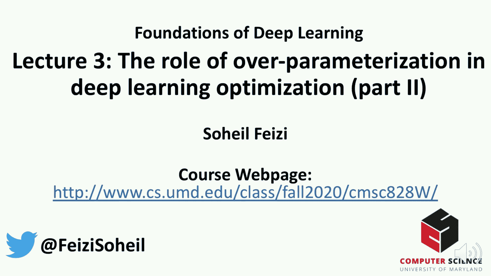
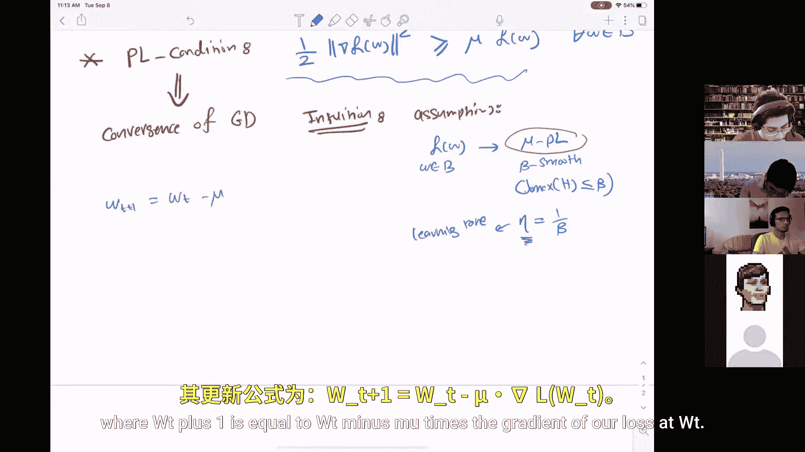

# 003：过参数化的作用

在本节课中，我们将学习过参数化在深度学习中的核心作用。我们将从回顾上一讲的内容开始，深入探讨当训练误差为零时的情况，并引入一个关键的数学条件——Polyak-Lojasiewicz条件，来分析梯度下降在非凸优化中的收敛性。

## 回顾：插值区域与过参数化

上一讲我们考虑了训练误差非常小的情况。在许多实际的深度学习实现中，训练误差几乎为零。当训练误差为零时，我们基本上处于**插值区域**。

这意味着，对于训练集 `{(X_i, Y_i)}_{i=1}^n`，我们希望学习一个带参数 `w` 的函数 `f`，使得该函数应用于所有输入 `X_i` 时，都能精确地输出对应的标签 `Y_i`。

我们可以稍微简化一下符号，将这个方程组写成 `F(w) = y` 的形式，其中 `x` 是隐含的。`w` 是 `m` 维的参数向量，`y` 假设位于 `n` 维空间。当我们说系统是**过参数化**的，意味着参数数量 `m` 大于样本数量 `n`。在多标签分类或回归问题中，这个 `n` 等于样本数乘以类别数，即我们希望插值的方程总数。

我们看到，插值问题的解可能不是唯一的。例如，在三维空间中，满足第一个方程 `F(w) = y1` 的参数 `w` 构成一个流形，满足第二个方程 `F(w) = y2` 的参数构成另一个流形，它们的交集就是所有最优解 `w*` 构成的流形。这些解不是孤立的，这是过参数化与欠参数化区域的一个区别。

为了找到这些解，我们定义一个损失函数。通常我们使用二次损失，因为它更容易分析，但所涵盖的许多论点也可以应用于其他损失函数。我们使用梯度下降（或其随机版本）来最小化这个损失函数。我们的目标是理解为什么梯度下降在这个区域能够找到一个好的解 `w*`，使其能够精确地插值输入输出关系。这就是上一讲和今天讲座的核心思想。

## 理解收敛的关键：PL条件

为了理解这一点，我们必须认识到这个损失函数可能是非凸的。如果它是凸的，我们就没有任何问题。但这个损失函数是非凸的，我们甚至证明了它在局部区域内，其Hessian矩阵的特征值也可能有正有负，因此即使在局部也不是凸的。

为了证明收敛性，我们讨论了一个非常重要的条件：**Polyak-Lojasiewicz条件**。

如果一个损失函数（或任何函数）满足PL条件，那么对于所考虑区域内所有的 `w`，其梯度大小的平方大于或等于一个常数 `μ` 乘以损失函数的值。用公式表示如下：

`||∇L(w)||² ≥ μ * L(w)`

如果我的损失函数满足这个不等式，我们就说该损失函数满足 `μ-PL` 条件。在上一讲的结尾，我陈述了一个定理：当损失函数满足PL条件时，在一定的假设下，梯度下降能够收敛。

## PL条件的直观理解

今天，我首先将给出一些关于PL条件的直观解释。这个条件要求梯度大小的平方大于等于损失值乘以一个常数。这背后的逻辑是什么？为什么我们需要这个条件来保证梯度下降的收敛性？

实际上，尽管这个条件初看起来有些奇怪，但它是一个非常直观且简单的条件，能够直接导致梯度下降在非凸情况下的收敛。

以下是我们的基本假设：
1.  **PL条件**：损失函数在包含梯度下降轨迹的一个球体内满足 `μ-PL` 条件。
2.  **β-平滑性**：损失函数是 β-平滑的。这意味着其Hessian矩阵的特征值被某个常数 `β` 所界定。Hessian矩阵不必是半正定的，我们只需要曲率值有界。
3.  **学习率**：学习率 `α` 必须足够小。显然，学习率不能太大，即使在凸优化中，过大的学习率也无法保证收敛。我们假设学习率 `α ≤ 1/β`。

在凸优化的梯度下降收敛性证明中，我们同样对Hessian矩阵的特征值有约束，并假设学习率足够小。这里额外的假设是，我们用满足 `μ-PL` 条件替代了凸性假设。

接下来，我们将分析梯度下降的动态过程，其更新规则为：

`w_{t+1} = w_t - α * ∇L(w_t)`

## 总结

本节课中，我们一起学习了过参数化在深度学习优化中的核心作用。我们从零训练误差的插值区域出发，认识到过参数化会导致解不唯一。为了分析梯度下降在这种非凸情况下的收敛性，我们引入了关键的Polyak-Lojasiewicz条件。该条件与函数的平滑性及适当的学习率相结合，为梯度下降找到良好解提供了理论保证。下一节，我们将深入探讨PL条件的证明及其具体应用。