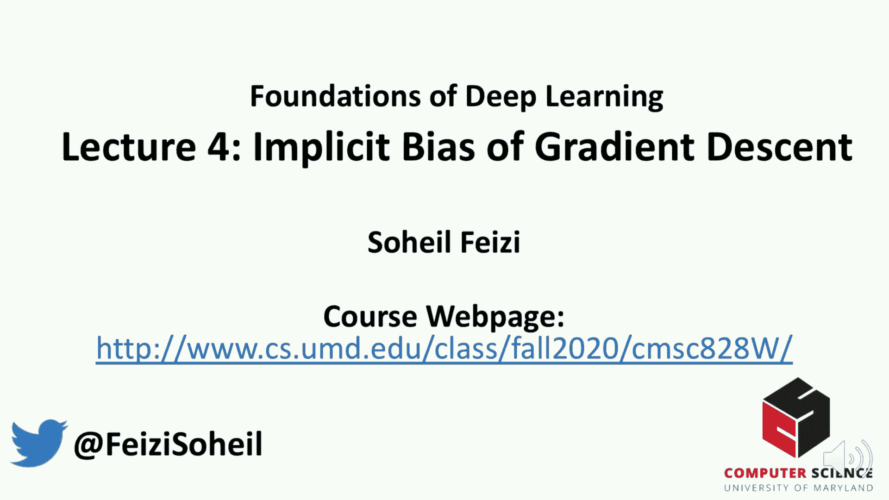
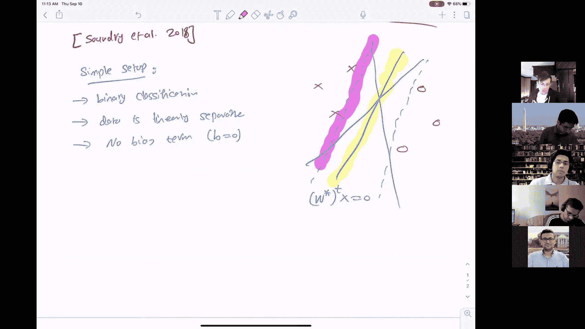

# 004：梯度下降的隐式偏置

在本节课中，我们将要学习梯度下降和随机梯度下降的隐式偏置。首先，让我们快速回顾一下前两节关于深度学习优化的内容。

## 回顾与问题引入

上一节我们介绍了在插值区域（即训练误差非常小）的优化问题。我们最终得到了一个非线性方程组：**F(W) = y**。这里 W 是 M 维参数，y 是 N 维输出，我们处于过参数化状态，即参数数量 M 大于样本数量 N。

我们考虑了不同的损失函数，其中最常用的是二次损失函数。我们的目标是通过梯度下降来最小化这个二次损失。我们证明了，在过参数化状态下，尽管优化问题是非凸的，但在某些条件下，我们仍然可以为这个非线性方程组找到一个最优解，或者说一个最小化损失的最优解。

例如，如果一个模型有三个参数，但只有两个二维空间的样本，那么满足第一个方程 **F(W, x1) = y1** 的解构成一个流形，满足第二个方程 **F(W, x2) = y2** 的解构成另一个流形。这两个流形的交集就是所有最优解 **W*** 构成的流形。

可以看到，在过参数化状态下，我们通常没有唯一解，而是有无穷多个 **W*** 可以完美拟合训练集中的 X-Y 关系。

这就引出了一个关键问题：关于泛化能力的问题。理论上，当模型参数远多于样本时，即使训练误差很小，也可能导致糟糕的泛化能力，即在测试集上误差很大。然而在实践中，对于许多复杂数据集上的过参数化深度模型，这种情况并不常见。

原因之一可能就是梯度下降或随机梯度下降的“隐式偏置”。尽管我们在目标函数中没有添加任何显式的正则化项（例如 L2 正则化）来限制参数空间以帮助泛化，但梯度下降的动态过程可能会在所有可能的解中找到一个“好”的解——一个具有良好泛化特性的解。这个解本身可能就带有某种隐式的偏置。这就是今天讲座的核心思想，也是我们过渡到后续讨论深度模型泛化性质讲座的良好桥梁。

## 一个简单的研究案例

为了深入理解这个问题，我们将聚焦于一篇2018年的论文及其后续研究。这篇论文的出发点非常简单，有助于我们建立关于此问题的直觉。

论文考虑了一个简单的设置：**二元分类**问题。

我们假设数据是**线性可分**的，并且最初不涉及神经网络，仅使用线性模型。此外，我们假设模型没有偏置项 **b**，即 **b = 0**。

用图像表示，我们有一些线性可分的二元分类数据。任何满足 **W*^T x = 0** 的直线（或超平面）都能正确分类所有样本。但这样的直线有无穷多条。

那么，我们应该选择哪一条直线作为分类器呢？例如，是选择这条，还是那条？

答案是：选择**最大间隔**平面。这就是支持向量机（SVM）的解。

为什么我们要在所有可能的平面中选择最大间隔平面呢？因为它具有更好的泛化能力、对扰动的稳定性、防止过拟合以及更高的置信度等优良性质。特别是，当测试样本与训练样本接近但不完全相同时，最大间隔分类器能提供更好的泛化性能。

本节课中，我们一起学习了梯度下降隐式偏置的基本概念，并通过一个简单的线性可分二元分类案例，引出了最大间隔解的重要性。在接下来的章节中，我们将继续探讨梯度下降如何隐式地趋向于这类具有良好泛化性质的解。