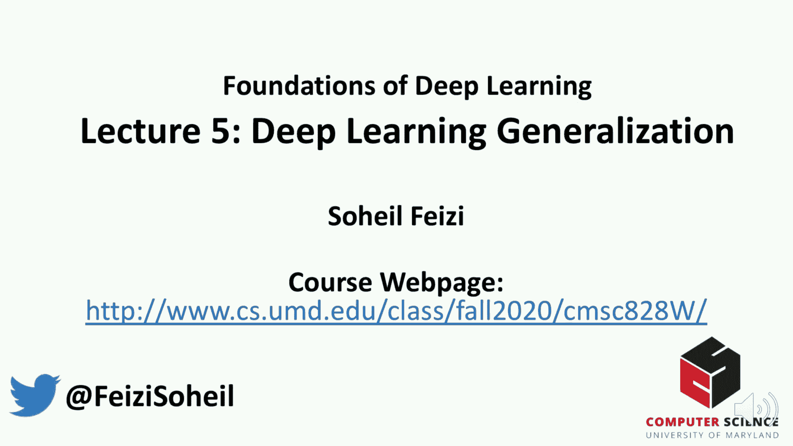
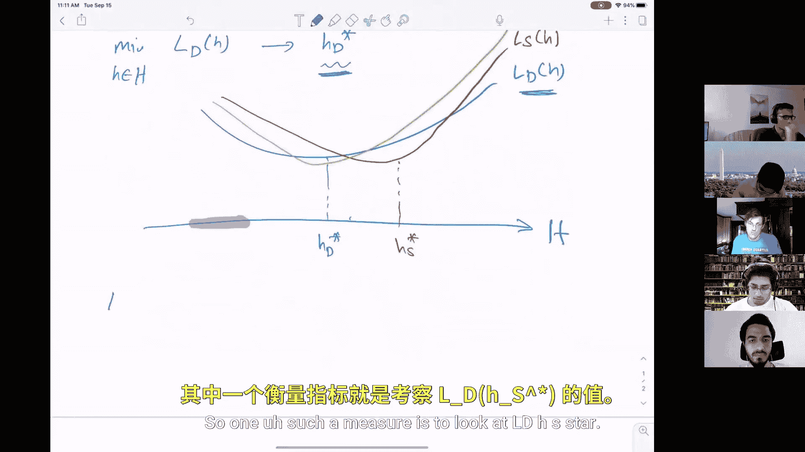

# 005：深度学习泛化

在本节课中，我们将要学习深度学习中的泛化问题。我们将首先概述一些经典的机器学习泛化理论结果，然后探讨这些结果中哪些适用于深度学习，哪些不适用。

## 问题设定

我们首先来设定问题。假设我们有一个训练集 `S`，包含 `n` 个样本。每个样本 `Z_i` 由特征 `X_i` 和标签 `Y_i` 组成，记作 `Z_i = (X_i, Y_i)`。

这些样本来自于一个未知的联合分布 `P_{XY}`。我们无法获知这个分布的具体形式，只能观察到从该分布中抽取的有限样本。

我们的目标是从一个假设类（函数类）`H` 中，找到一个函数 `h`，使其能够根据 `X` 预测 `Y`。为了衡量函数 `h` 在训练集上的表现，我们定义一个经验损失函数 `L_S(h)`：

`L_S(h) = (1/n) * Σ_{i=1}^{n} l(h(X_i), Y_i)`

其中 `l` 是损失函数（例如均方误差或交叉熵）。`L_S(h)` 也被称为经验风险。

由于我们无法直接计算在真实分布上的损失，我们通常的做法是**最小化经验损失**。我们选择在训练集上表现最好的函数 `h_S^*`：

`h_S^* = arg min_{h ∈ H} L_S(h)`

然而，我们真正关心的是函数在未知数据（测试集）上的表现，即**总体损失** `L_D(h)`：

`L_D(h) = E_{(X,Y) ~ P_{XY}} [l(h(X), Y)]`

如果我们知道真实分布 `P_{XY}`，我们就能直接找到最小化总体损失的理想函数 `h_D^*`：

`h_D^* = arg min_{h ∈ H} L_D(h)`

我们的最终目标是，通过最小化经验损失找到的函数 `h_S^*`，其总体损失 `L_D(h_S^*)` 也能接近最优值 `L_D(h_D^*)`。这就是泛化问题的核心。

## 直观理解

为了更直观地理解，我们可以想象一个一维的假设类 `H`。

总体损失 `L_D(h)` 是一个确定的函数（一旦分布给定），其最小值点对应着 `h_D^*`。

而经验损失 `L_S(h)` 则依赖于随机抽取的训练集 `S`。每次抽取不同的训练集，我们都会得到一条略有不同的经验损失曲线。其最小值点对应着 `h_S^*`。

学习理论的目标是确保，对于大多数训练集 `S`，由它找到的 `h_S^*` 在总体分布上也有良好的性能。换句话说，我们希望经验损失曲线和总体损失曲线在最优解附近足够接近。

## 衡量泛化性能

为了量化一个学习算法（如通过经验风险最小化找到的 `h_S^*`）的泛化能力，我们可以关注以下两个关键量：

1.  **估计误差**：这衡量了我们找到的解 `h_S^*` 与理论最优解 `h_D^*` 之间的差距。
    `L_D(h_S^*) - L_D(h_D^*)`

2.  **泛化差距**：这衡量了我们的解在训练集上的表现与在总体分布上表现的差距。
    `L_D(h_S^*) - L_S(h_S^*)`

如果泛化差距很小，则说明模型没有过拟合，其在训练集上的性能可以很好地代表其在未知数据上的性能。

在接下来的章节中，我们将探讨经典理论如何界定这些差距，并分析这些理论在深度神经网络这一高度复杂的假设类中面临的挑战。

---

本节课中，我们一起学习了深度学习泛化问题的基本设定。我们定义了经验损失 `L_S(h)` 和总体损失 `L_D(h)`，并明确了学习的目标是使经验风险最小化得到的解 `h_S^*` 具有较小的泛化差距。我们还介绍了估计误差和泛化差距这两个核心概念，为后续深入探讨泛化理论奠定了基础。