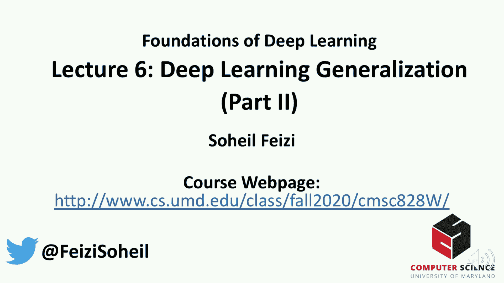
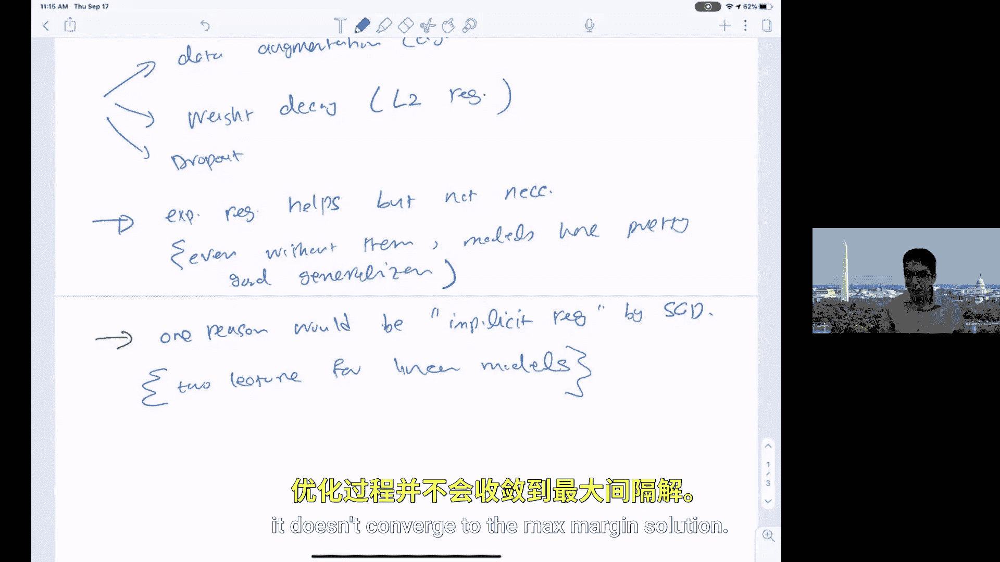

# 006：深度学习泛化能力（第二部分）

在本节课中，我们将继续探讨深度学习中的泛化问题。我们将回顾一项重要研究的关键发现，并分析这些发现对我们理解神经网络泛化能力的意义。

## 回顾：随机标签实验

上一节我们开始讨论《理解深度学习需要重新思考泛化》这篇论文。这是一篇非常出色的论文，建议大家都去阅读。

现在，我们来简要回顾一下论文中涉及的核心结果。他们进行了一系列随机化测试。假设我们有一个训练集 `{X_i, Y_i}`，包含 `n` 个训练样本。他们的做法是随机打乱标签（或在其他实验中部分打乱标签）。我们主要关注完全随机的情况，即标签被完全随机化。

在这种情况下，模型将表现出非常差的泛化能力。在二分类任务中，测试误差会接近50%，因为 `X` 和 `y` 之间不存在任何结构性的关系。然而，令人惊讶的是，训练误差会变得非常小。这表明神经网络拥有足够的容量和复杂度，能够完全拟合随机标签。这基本上意味着，尽管此时泛化差距（训练误差与测试误差之差）高达50%，但我们之前讨论过的一些复杂度度量，例如 **Rademacher复杂度** 或 **VC维**，并不足以解释深度学习中的泛化行为。

我强调“不足以”，是因为这些复杂度度量仍然非常有用，但在训练深度模型时，可能还有其他因素在起作用。例如，可能存在一些**隐式正则化**或其他因素，共同促成了我们在深度学习中经常观察到的良好泛化表现。

## 优化难度与泛化

接下来，我们看看论文中另一个有趣的观察。

你可能会认为，如果使用随机标签，神经网络的优化过程会遇到困难，难以收敛到一个好的解。也许我们可以利用随机梯度下降（SGD）的收敛速度或轨迹特性来解释神经网络的泛化行为。

然而，他们观察到的现象是：事实上，**在收敛速度方面，使用随机标签训练神经网络的优化过程并没有困难太多**。平均而言，它可能只比使用真实标签训练慢两到三倍，但并非显著更慢。

让我总结一下这个观察：**神经网络的优化过程在训练随机标签时，并没有变得困难太多**。这至少就**收敛速度**而言是成立的。

因此，我们不能仅仅通过观察神经网络的训练优化行为（例如收敛速度）来解释其泛化能力。这个指标本身也是不充分的。

## 显式正则化的作用

以上结果表明，我们既不能仅依赖于假设类本身的复杂度度量（如Rademacher复杂度或VC维），也不能仅依赖于训练优化行为来解释泛化。

论文还探讨了**显式正则化**的作用。到目前为止，我们训练神经网络使用的是经验风险最小化（ERM），没有加入正则化。但在实践中，人们会使用各种正则化方法。

以下是几种常见的显式正则化技术：

*   **数据增强**：例如，对训练图像进行随机裁剪、调整光照等，这相当于增加了训练数据的多样性。
*   **L2正则化/权重衰减**：对模型参数施加L2范数惩罚。
*   **Dropout**：在训练过程中随机丢弃部分神经元或连接。

论文尝试了这些显式正则化方法。显然，他们观察到添加这些正则化有助于提升泛化能力，因为它限制了搜索空间，从而缩小了训练损失和测试损失之间的差距。

但关键点在于：**即使没有这些显式正则化，模型仍然表现出相当好的泛化能力**。

总结一下：**显式正则化有助于提升泛化，但并非必要**。即使没有它们，模型也已经具备了不错的泛化能力。

## 隐式正则化的猜想

现在你可能会想，即使没有显式正则化，当我们使用随机梯度下降（SGD）来解决经验风险最小化（ERM）问题时，SGD本身可能会给优化过程添加一些**隐式正则化**，也许这就是我们获得良好泛化的原因。

因此，一个合理的猜想是：**SGD可能引入了某种隐式正则化**。

我们在两节课前研究过线性模型的情况。对于线性模型，我们证明了使用逻辑损失函数的SGD会收敛到**最大间隔解**，这本质上相当于对参数施加了L2正则化，从而带来了良好的泛化。

然而，对于更一般的神经网络模型，SGD会引入何种隐式正则化仍不明确。显然，对于更通用的神经网络，它并不会收敛到最大间隔解。我们将在后续关于鲁棒性的课程中讨论这个问题。

## 总结

本节课我们一起学习了深度学习泛化研究的进一步发现。我们回顾了随机标签实验，它表明传统的复杂度度量不足以完全解释泛化；我们发现优化过程对随机标签并不特别困难，因此优化行为本身也不是充分的解释；我们还看到显式正则化虽有助于泛化但非必需。最后，我们探讨了SGD可能引入隐式正则化这一重要猜想，作为理解神经网络强大泛化能力的一个潜在方向。这些观察共同推动我们超越经典理论，去探寻深度学习泛化背后的新原理。