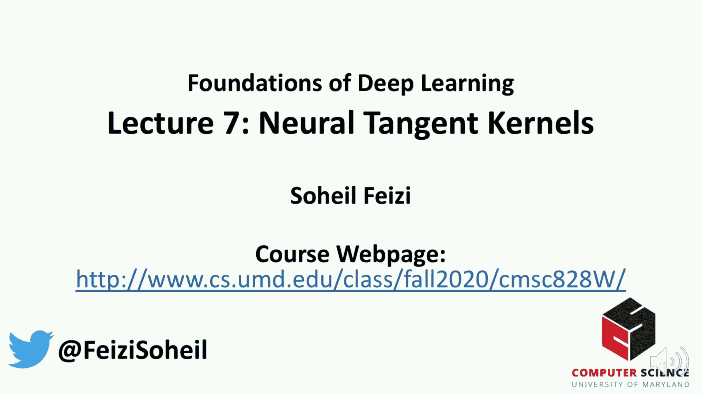

# 007：神经正切核

在本节课中，我们将学习神经正切核。首先，我们将简要概述机器学习中的核方法与核技巧。然后，我们将具体讨论神经正切核，以及它们的成功与不足之处。

## 从线性回归开始

让我们从最熟悉的线性回归方法开始。线性回归中的一切都相对简单。

我们有一个包含 `n` 个数据点的数据集，每个数据点由特征 `X_i` 和标签 `y_i` 组成。为简化起见，假设标签是实数，特征 `X_i` 位于 `d` 维空间中。

我们考虑一个线性模型，用函数 `f_w(x)` 表示，其中 `w` 代表模型参数，`x` 是输入。为简化，我们忽略偏置项，你可以将其作为特征之一并入 `x` 中。

这是一个简单的线性模型：

`f_w(x) = w^T x`

我们通常使用的损失函数是二次损失函数：

`L(w) = (1/2) * Σ (y_i - f_w(x_i))^2`

目标是找到最小化此损失的模型参数 `w`。这是一个无约束的凸优化问题，我们知道如何求解。我们使用梯度下降法来解决这个优化问题。

在迭代 `t` 时，权重更新规则如下：

`w_{t+1} = w_t - η * ∇L(w_t)`

其中 `η` 是学习率。损失函数的梯度为：

`∇L(w_t) = Σ (y_i - f_{w_t}(x_i)) * ∇_w f_{w_t}(x_i)`

对于线性模型 `f_w(x) = w^T x`，其关于 `w` 的梯度就是 `x`。因此，梯度项 `∇_w f_{w_t}(x_i)` 等于 `x_i`。

这里有趣的一点是，这个梯度项是静态的，它不依赖于当前的权重 `w_t`，因为 `x_i` 是固定的训练样本。对于足够小的学习率，我们已经证明过，梯度下降会收敛到这个优化问题的全局最优解。

## 引入核方法

现在，我想在模型中引入一些非线性。我们不再直接使用原始的 `d` 维特征 `x_i`，而是考虑它们的变换 `φ(x_i)`，变换后的空间维度 `D` 可能远大于原始的 `d`。

例如，假设原始特征 `x` 是三维的：`[x1, x2, x3]`。我们可以使用二阶多项式进行特征变换，得到新的特征向量：`[x1, x2, x3, x1*x2, x1*x3, x2*x3, x1^2, x2^2, x3^2]`。这样，我们就通过非线性函数扩展了特征空间。

这里符号有点滥用，`x1` 表示 `x` 的第一个特征，不要与第一个样本 `X_1` 混淆。

我们可以将这个变换应用到模型中。模型形式仍然是：

`f_w(x) = w^T φ(x)`

**问题**：这个模型在参数 `w` 上是线性的吗？是的。因为 `φ(x)` 是固定的变换，不随优化过程改变，所以模型关于 `w` 是线性的。

**问题**：这个模型在输入 `x` 上是线性的吗？不是。由于 `φ(x)` 是非线性变换，所以模型关于 `x` 是非线性的。

这有点像结合了两个世界的优点：我们在优化的参数空间 `w` 上保持了线性（从而优化问题是凸的），同时在输入 `x` 的映射中引入了非线性。

此时的优化问题变为：

`L(w) = (1/2) * Σ (y_i - w^T φ(x_i))^2`

这仍然是一个凸优化问题。使用足够小的学习率，梯度下降仍将收敛到全局最优解。

## 核方法的挑战

既然这结合了线性的易优化性和非线性的表达能力，为什么我们不广泛使用这种方法，而是转向深度模型呢？

以下是核方法面临的主要挑战：

*   **固定的特征变换 `φ`**：我们如何知道应该使用哪种非线性变换来处理我们的数据？`φ` 是预先设定且固定的，缺乏从数据中学习合适表示的能力。
*   **计算与维度灾难**：变换后的特征空间维度 `D` 可能非常高（例如，高阶多项式）。这会导致两个问题：一是存储和计算 `w`（一个 `D` 维向量）的成本很高；二是在高维空间中计算内积 `φ(x_i)^T φ(x_j)` 可能非常低效。

固定的变换并不总是令人满意，因为它无法适应数据的具体结构。

## 核技巧

为了解决高维内积计算效率低下的问题，我们引入了**核技巧**。

核心思想是：对于许多特征变换 `φ`，我们不需要显式地计算变换后的高维向量 `φ(x)` 和 `φ(z)`，然后再做内积。相反，我们可以直接通过一个在原空间定义的、更高效的**核函数** `K(x, z)` 来计算它们在高维空间的内积。

`K(x, z) = φ(x)^T φ(z)`

例如，对于上面提到的二阶多项式变换，存在一个对应的核函数（多项式核），可以直接计算 `(x^T z + c)^2` 来等价于在高维空间做内积，从而避免了显式构造高维特征。

这使得我们能够在极高维（甚至是无限维）的特征空间中工作，而计算成本仅与原始输入维度相关。

## 从核方法到神经正切核

上一节我们回顾了经典的核方法。现在，我们来看看它与深度学习的联系，即**神经正切核**。

NTK 的核心思想是：在特定条件下（例如无限宽的神经网络、使用梯度下降训练），深度神经网络的训练动态可以近似由一个确定的核函数来描述，这个核函数就是 NTK。

具体来说，考虑一个参数为 `θ` 的神经网络 `f(x; θ)`。在训练初期，当网络宽度足够大时，参数 `θ` 的变化很小。此时，网络输出 `f(x; θ)` 的变化可以近似为其关于初始参数 `θ_0` 的一阶泰勒展开：

`f(x; θ) ≈ f(x; θ_0) + ∇_θ f(x; θ_0)^T (θ - θ_0)`

在这个近似下，网络的行为类似于一个线性模型（在参数变化上）。那么，这个“线性模型”对应的核函数就是 NTK，定义为：

`Θ(x, z) = ∇_θ f(x; θ_0)^T ∇_θ f(z; θ_0)`

在训练过程中，使用梯度下降更新参数时，网络输出的演化方程可以由这个 NTK 核函数主导。

## NTK 的成功与局限

神经正切核理论取得了一些显著的成功：

*   **理论解释**：它为理解超参数化（非常宽）神经网络的优化和泛化行为提供了一个清晰的理论框架。它解释了为什么随机梯度下降可以找到全局最小值（在无限宽极限下，优化景观是凸的）。
*   **连接经典**：它在现代深度学习和经典核方法之间建立了桥梁。
*   **预测性能**：对于足够宽的神经网络，NTK 可以相当准确地预测网络在训练过程中的行为。

然而，NTK 也有其局限性：

*   **有限宽度的现实**：实际使用的神经网络宽度是有限的，NTK 的严格理论结果在无限宽极限下成立，对有限宽网络的近似程度可能不足。
*   **特征学习**：在 NTK 机制中，特征表示 `∇_θ f(x; θ_0)` 在训练开始时是固定的（由随机初始化决定），网络主要学习这些特征的线性组合。这与实践中深度网络能够进行深刻的**特征学习**的能力不同，在特征学习中，网络内部表示会随着训练发生重大变化。
*   **实践性能差距**：由 NTK 定义的核机器，其性能通常无法与经过端到端训练、能够进行特征学习的深度网络相媲美，尤其是在复杂的视觉或语言任务上。

## 总结

本节课我们一起学习了神经正切核。我们从基础的线性回归和核方法出发，理解了核技巧如何高效处理高维非线性特征。然后，我们探讨了神经正切核的核心思想：在无限宽神经网络极限下，其梯度下降训练动态可由一个确定的核函数（NTK）描述。NTK 成功地将深度学习与核方法联系起来，为理解网络优化提供了理论工具，但它也存在着对有限宽度网络近似不足、无法完全解释深度网络特征学习能力等局限。理解 NTK 有助于我们更全面地认识深度学习模型的工作原理及其与经典机器学习理论的联系。