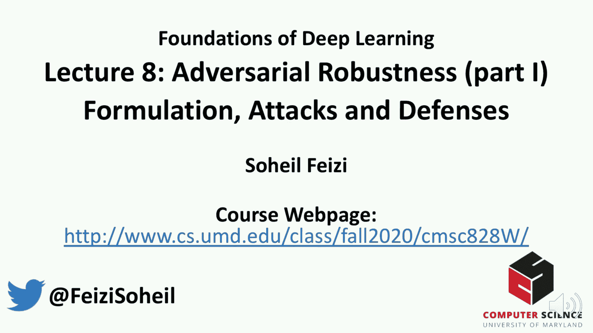
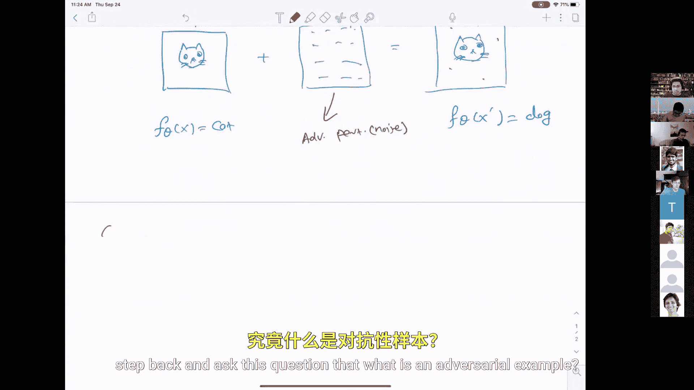
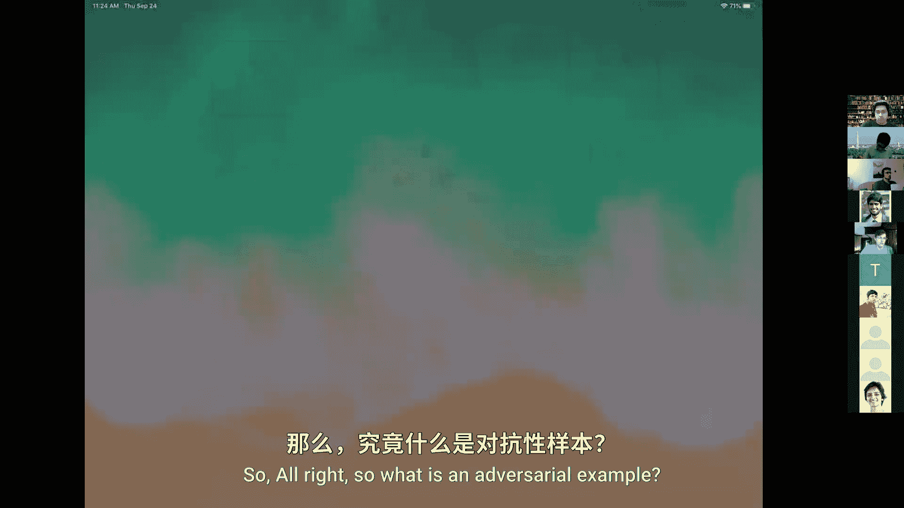

# 008：定义与动机

在本节课中，我们将学习深度学习模型的一个关键特性：对抗鲁棒性。我们将探讨什么是对抗样本，为什么模型会对其敏感，以及如何形式化地定义这个问题。

---

## 概述

在标准的经验风险最小化框架中，我们通过最小化训练集上的平均损失来学习模型参数。模型的目标是在未见过的测试数据上也能表现良好。例如，在ImageNet数据集上，现代模型的分类错误率已降至2-3%，接近甚至优于人类的5%错误率。

然而，高测试精度并不足以保证模型在实际应用中是可靠的。模型还需要具备鲁棒性，即应对数据中自然变化或恶意干扰的能力。本节课我们将聚焦于一种特定的鲁棒性——对抗鲁棒性。

## 对抗样本：一个直观例子

假设我们有一个在ImageNet上表现良好的分类器。它能够正确地将一张猫的图片分类为“猫”。

但是，如果我们对这张图片添加一个非常微小、人眼难以察觉的扰动 **δ**，得到一张新图片 **x' = x + δ**。对于人类而言，**x'** 看起来仍然是一只猫。

然而，这个精心设计的扰动 **δ** 可能导致我们的模型对 **x'** 做出完全错误的预测，例如将其分类为“狗”。

这个微小的扰动向量 **δ** 被称为**对抗扰动**，而生成的样本 **x'** 则被称为原始样本 **x** 的**对抗样本**。

## 形式化定义与问题

上一节我们介绍了对抗样本的直观概念，本节中我们来看看如何形式化地定义这个问题。

首先，回顾标准监督学习设定。我们有一个包含 **n** 个样本的数据集，每个样本由特征 **x_i** 和标签 **y_i** 组成，其中 **x_i ∈ ℝ^d**。我们考虑一个 **C** 类的分类问题。

在标准经验风险最小化中，我们求解以下优化问题：

**公式：**
`min_θ (1/n) Σ_{i=1}^n L(f_θ(x_i), y_i)`

其中：
*   `θ` 是模型参数。
*   `f_θ` 是参数化的模型。
*   `L` 是损失函数。

模型的目标是最小化训练集上的平均损失，并期望在来自相同分布的测试集上也能获得良好的性能（即高精度）。

然而，对抗鲁棒性关注的是模型在受到有界扰动时的性能。我们不仅希望模型对原始样本 **x** 预测正确，还希望它在一个围绕 **x** 的局部区域内保持预测一致。

以下是核心的问题设定：

1.  **干净样本**：一个被模型正确分类的输入 **x**（例如，标签为“猫”的图片）。
2.  **扰动约束**：我们允许一个攻击者向 **x** 添加一个扰动 **δ**。但这个扰动必须很小，通常被限制在一个范数球内，例如 `||δ||_p ≤ ε`。`ε` 是一个很小的常数，确保扰动对人眼是“不可感知的”。
3.  **对抗样本**：在扰动约束下生成的样本 **x' = x + δ**。
4.  **攻击目标**：攻击者的目标是找到一个 **δ**，使得模型对 **x'** 的预测出错（例如，预测为“狗”）。
5.  **防御目标**：我们的目标是训练一个模型，使得对于所有满足 `||δ||_p ≤ ε` 的扰动，模型对 **x + δ** 的预测都与对 **x** 的预测相同（即保持为“猫”）。

关于“人类难以察觉”的定义，通常通过限制扰动的 `L_p` 范数（如 `L_∞`， `L_2`）来实现，这为扰动幅度提供了一个可量化的、与人类视觉感知大致相关的上限。

## 为何对抗鲁棒性至关重要

高测试精度表明模型捕捉到了数据中的主要统计规律。但对对抗样本的脆弱性揭示了模型决策边界的一个深刻问题：它们虽然在高维空间中划出了复杂的分离曲面，但这些边界在输入空间的许多方向上可能非常接近数据点，且不平滑。

这意味着：
*   **安全风险**：在安全关键应用（如自动驾驶、医疗诊断）中，对抗样本可能被恶意利用，导致严重后果。
*   **理解模型**：研究对抗鲁棒性帮助我们更深入地理解神经网络究竟学到了什么，以及它们的决策依据是否与人类相似。
*   **迈向可靠AI**：构建能够抵抗微小扰动的模型，是迈向更稳定、更可信赖的人工智能系统的重要一步。

---

## 总结

本节课中我们一起学习了对抗鲁棒性的基本概念。我们从标准经验风险最小化框架出发，指出了高测试精度并非模型可靠性的唯一指标。通过猫图片的例子，我们直观地理解了什么是微小、人眼难察的对抗扰动以及它如何导致模型预测失败。最后，我们形式化地定义了对抗攻击与防御的问题设定，并讨论了研究对抗鲁棒性对于构建安全、可靠深度学习系统的重要意义。在接下来的课程中，我们将深入探讨生成对抗样本的具体方法以及提高模型对抗鲁棒性的防御策略。