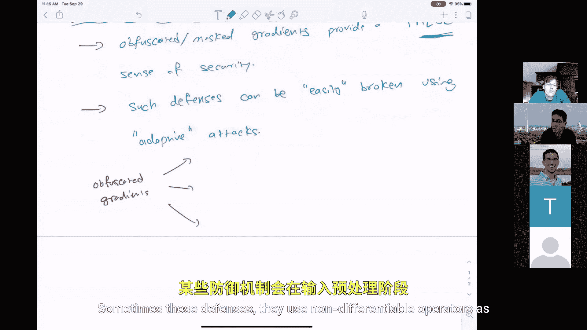

# 009：攻击、防御与梯度混淆

在本节课中，我们将继续学习对抗性鲁棒性。我们将回顾上一讲的内容，包括对抗性攻击的公式化定义和防御方法，并深入探讨一种名为“梯度混淆”的现象，它可能导致防御措施产生虚假的安全感。

## 对抗性鲁棒性回顾

上一节我们介绍了对抗性鲁棒性的基本概念。本节中，我们来看看攻击与防御问题的具体形式化定义。

### 攻击问题

攻击的目标是构造一个对抗样本 **x'**，使得模型 **f_θ(x')** 在给定真实标签下的分类损失最大化，同时要求 **x'** 位于原始样本 **x** 的一个特定威胁模型范围内。

**公式**：`max_{x'} L(f_θ(x'), y_true)`，约束条件为 `||x' - x||_p ≤ ρ`。

其中，`||·||_p` 表示 Lp 范数（如 L2、L∞）。我们通常使用基于梯度的方法（如梯度下降）来近似求解这个最大化问题。

### 防御方法：对抗训练

一种有效的防御方法是**对抗训练**。与最小化经验风险（ERM）不同，对抗训练最小化的是每个训练样本在其最坏扰动下的平均损失。

**公式**：`min_θ E_{(x,y)} [ max_{x'∈S(x)} L(f_θ(x'), y) ]`。

其中，`S(x)` 表示在威胁模型约束下 **x** 的邻域。我们通过交替执行随机梯度下降（SGD）来优化模型参数 **θ**，并使用投影梯度下降（PGD）来近似求解内部的最大化问题。对抗训练的优点在于它能针对任何定义的威胁模型进行鲁棒化。

## 启发式防御与梯度混淆

除了对抗训练，文献中还提出了许多启发式或经验性的防御方法。以下是这类方法的一些常见思路：

*   在输入进入网络前添加编码或离散化步骤。
*   随机改变网络结构。
*   为网络引入随机性。

例如，在 ICLR 2018 会议上，就有六七篇论文提出了此类防御，并在 MNIST 或 CIFAR 数据集上针对 L2 或 L∞ 威胁模型报告了良好的鲁棒性结果。

然而，后续由 Athalye 等人在 ICML 2018 发表的一篇重要论文指出，**大多数这类经验性防御都属于“梯度混淆”或“梯度掩蔽”的范畴**。

### 梯度混淆的本质

这些防御并非真正增强了模型的鲁棒性，而是**使得攻击者更难可靠地计算损失函数的梯度**。由于大多数攻击算法（如 PGD、FGSM）都依赖于梯度计算，梯度不可靠会导致攻击在这些防御上失败，从而产生高鲁棒精度的假象。

**核心观点**：梯度混淆会提供一种**虚假的安全感**。你以为模型通过量化、编码或随机化变得鲁棒了，但实际上，攻击者一旦了解了防御机制，就可以设计出针对性的攻击来绕过它。

### 梯度混淆的来源

根据该论文，梯度混淆可能来自多个方面：

1.  **使用不可微算子进行预处理**：在输入进入网络前，进行非可微的操作（如某些编码）。
2.  **梯度数值不稳定**：防御导致梯度计算在数值上不稳定或具有爆炸性。
3.  **随机性导致梯度方向不一致**：网络中的随机性使得在不同评估点上计算的梯度方向差异很大。

### 自适应攻击

这类依赖梯度混淆的防御可以被**自适应攻击**轻易破解。自适应攻击是指，攻击者在知晓防御机制具体细节后，为其量身定制的攻击方法。例如，攻击者可能会使用可微的近似来替代防御中的不可微操作，或者通过多次采样来平滑随机性，从而获得有效的梯度估计。

## 总结

本节课我们一起学习了对抗性鲁棒性中的关键议题。我们回顾了对抗攻击的形式化定义和对抗训练这一核心防御方法。更重要的是，我们深入探讨了“梯度混淆”现象，了解到许多启发式防御通过增加梯度计算的难度来“欺骗”基于梯度的攻击，但这并不能提供真正的安全性，反而可能产生虚假的安全感，并且容易被自适应攻击所破解。这一认识对于设计和评估可靠的对抗性防御至关重要。