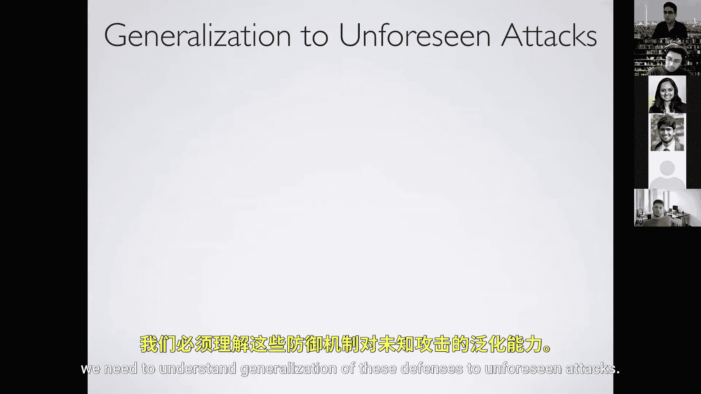

# 010：可证明与可泛化的对抗防御 🛡️

在本节课中，我们将学习对抗性防御的两个重要方向：**可证明的防御**和**可泛化的防御**。我们将首先回顾对抗性攻击与防御的基本概念，然后深入探讨如何构建能够提供理论保证的防御方法，以及如何使防御能力能够泛化到未见过的攻击类型上。

## 攻击与防御回顾

上一节我们介绍了对抗性攻击的基本概念。本节中，我们来简要回顾一下攻击与防御的核心思想。

### 对抗性攻击

对抗性样本是指如 `X‘` 这样的样本，人类会将其与原始样本 `X` 归为同一类，但机器学习模型却会对它们做出不同的预测。

对抗性鲁棒性的一个关键挑战在于，我们缺乏对人类感知的良好数学描述。这甚至在对抗性样本的定义中也是一个重要问题。

在对抗性攻击中，我们通过一个优化问题来绕过这个挑战。攻击的目标是在一个特定的**威胁模型**约束下，最大化分类损失，从而生成误导分类器的对抗样本。通过施加这个约束，我们试图确保人类会将 `X` 和 `X‘` 视为同一类。

这个优化问题通常是非凸的，我们常使用**投影梯度下降**或其变体来解决。因此，一个攻击由**攻击算法**和攻击优化问题中使用的**威胁模型**共同定义。

以下是常见的威胁模型类型：

*   **LP 威胁模型**： 最常见的是 L1、L2 和 L∞ 范数。它要求扰动 `X‘ - X` 的 LP 范数小于某个阈值 `ρ`。
    *   **公式**: `||X‘ - X||_p ≤ ρ`
*   **非 LP 威胁模型**： 仅保证对 LP 攻击的鲁棒性是不充分的，因为存在许多非 LP 攻击可以突破针对 LP 模型的防御。
    *   **稀疏攻击**： 攻击者只能改变图像中至多 `ρ` 个像素。
    *   **Wasserstein 攻击**： 扰动通过 Wasserstein 距离来衡量，它将图像视为分布。即使像素有微小平移或旋转（这会导致很大的 LP 距离），Wasserstein 距离也可能很小。
    *   **函数式对抗攻击**： 扰动被定义为输入特征的函数。例如，图像中所有红色像素会以相似的方式改变，所有灰色像素也会以相似的方式改变，这引入了全局约束。

在实践中，结合不同类型的攻击（如空间攻击、重着色攻击和加性攻击）可以构成非常强大的攻击，即使面对像对抗训练这样的防御手段。

### 对抗性防御

现在，让我们简要回顾一下防御方法。

一种非常流行的防御方法是**对抗训练**。在标准的经验风险最小化中，目标是选择最小化平均训练损失的模型参数。而在对抗训练中，我们最小化的不是训练样本上的平均损失，而是训练样本的**最坏情况扰动**上的平均损失。

对抗训练的一个优点是，你可以为内部的最大化问题插入不同的威胁模型。我们通常使用交替随机梯度下降来求解外部的最小化问题，并使用投影梯度下降来求解内部的最大化（即攻击）问题。

然而，对抗训练与用于解决内部最大化的特定攻击算法和威胁模型是耦合的。

除了对抗训练，还有许多其他启发式防御方法。但研究表明，当攻击者采用**自适应攻击**时，即使攻击者“友好地”使用与防御相同的威胁模型，只是改变攻击算法，几乎所有这些经验性防御都可能被攻破。这通常源于梯度掩码或梯度混淆。

更重要的是，攻击者本质上并不“友好”。他们完全可以使用不同的、防御未考虑到的威胁模型来发起攻击。这就引出了防御的**泛化性**问题：我们需要理解防御方法对未预见攻击的抵抗能力。

## 可证明的防御

上一节我们回顾了现有防御方法的局限性。本节中，我们来看看如何构建具有理论保证的、**可证明的**防御。

可证明防御的核心思想是，对于给定的输入和威胁模型，我们能够**严格证明**模型不会在该威胁模型定义的扰动范围内被欺骗。这提供了确定性的安全保证。

实现可证明防御的一种常见思路是通过设计模型结构或训练过程，使得我们可以**高效地计算**出模型在扰动球内的最坏情况行为。例如，对于某些特定结构的网络（如带有特定激活函数的网络），我们可以使用**区间界传播**或**线性松弛**等技术，来计算出网络输出在输入扰动下的变化范围。

如果这个变化范围足够小，以至于不会跨越决策边界，那么我们就证明了模型对该输入和扰动是鲁棒的。

以下是构建可证明防御的关键步骤：

1.  **定义威胁模型**： 明确要防御的扰动类型和范围（例如，L∞ 球，ε=8/255）。
2.  **设计可验证的模型**： 使用特殊的网络结构、激活函数或训练方法，使得模型在最坏情况下的行为可以被形式化地分析和计算。
3.  **进行可证明的训练**： 在训练过程中，不仅最小化标准损失，还最小化经过验证的**最坏情况损失上界**。这鼓励模型在可证明的范围内保持稳定。
4.  **在测试时提供证明**： 对于测试样本，运行验证算法来计算鲁棒性证明。如果验证通过，则输出“鲁棒”的预测及其证明；否则，输出“无法验证”或放弃预测。

可证明防御的优势在于其提供的**确定性保证**。但其挑战在于，目前的验证方法通常计算成本较高，并且为了可验证性，可能需要对模型能力做出妥协，导致在干净样本上的标准准确率有所下降。

## 可泛化的防御

上一节我们探讨了为特定威胁模型提供保证的可证明防御。本节中，我们来看看如何使防御能力能够**泛化**到更广泛、甚至未预见到的攻击类型上。

可泛化防御的目标是训练出的模型不仅对训练时使用的特定攻击类型鲁棒，而且对未知的、不同范数的、甚至非LP的威胁模型也表现出一定的鲁棒性。这更接近现实世界中部署模型的需求。

实现泛化的一种思路是进行**多威胁模型对抗训练**。即在训练时，不仅仅针对一种LP范数（如L∞）进行优化，而是同时或交替地针对多种威胁模型（如L1、L2、L∞，甚至稀疏攻击、空间变换等）生成对抗样本并进行训练。

另一种思路是设计**威胁模型不可知**的防御。例如，通过**数据增强**引入多种类型的自然扰动（如颜色抖动、旋转、裁剪），或者使用**自监督学习**来学习对多种变换不变的表示，从而隐式地提升模型的泛化鲁棒性。

此外，**可证明防御本身也可能带来泛化好处**。因为可证明的方法通常强制模型学习更平滑、更稳定的决策边界，这种平滑性可能对抵御其他类型的扰动也有帮助，尽管这种泛化是经验性的而非有证明的。

然而，实现真正的、强大的泛化鲁棒性仍然是一个开放的研究难题。目前的方法通常需要在鲁棒性、泛化性和标准准确率之间进行权衡。

## 总结

本节课中，我们一起学习了对抗性防御的两个前沿方向。

我们首先回顾了对抗性攻击与防御的基本概念，指出了经验性防御在面对自适应攻击或新威胁模型时的脆弱性。接着，我们深入探讨了**可证明的防御**，这类方法能为特定威胁模型提供确定性的鲁棒性保证，但其计算成本和模型设计存在限制。最后，我们讨论了**可泛化的防御**，其目标是使模型对多种未预见攻击具备抵抗力，这通常通过多威胁模型训练或学习更通用的稳健特征来实现。

构建既高效可证明又能广泛泛化的防御体系，是当前对抗性机器学习领域持续追求的目标。