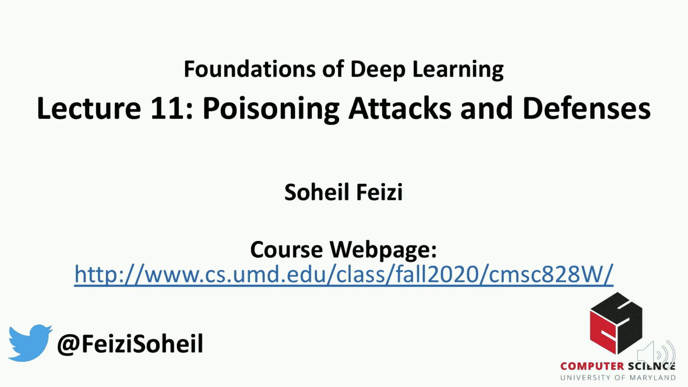
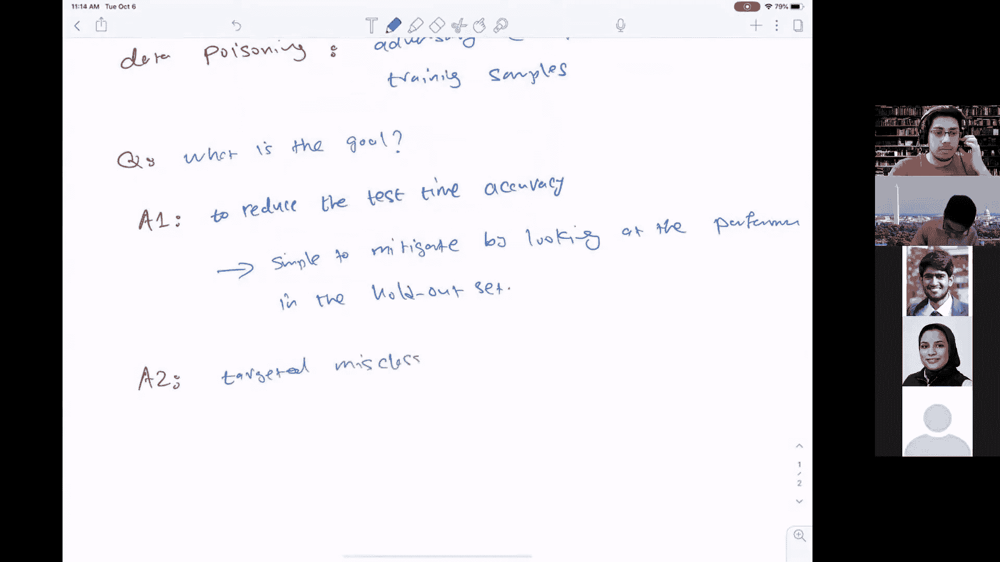

# 011：数据投毒攻击与防御 🧪

在本节课中，我们将要学习一种不同于测试时攻击的模型安全威胁：**数据投毒攻击**。我们将探讨攻击者如何通过污染训练数据来影响模型，并了解一些基础的防御思路。

## 概述

上一节我们介绍了测试时的对抗性攻击，攻击者在模型部署后对输入样本进行扰动以误导模型。本节中我们来看看另一种攻击面：**训练时攻击**，也称为数据投毒攻击。

深度模型通常需要大量数据进行训练。在实践中，我们可能无法完全信任所有训练样本的来源。因此，攻击者有机会污染部分训练数据，使得训练出的模型在特定测试样本上表现出预期的错误行为。

## 数据投毒的目标是什么？

理解攻击目标是关键。与测试时攻击（目标是让特定样本被误分类）不同，数据投毒的目标可能更为多样。

以下是几种可能的数据投毒攻击目标：

1.  **降低整体测试准确率**：通过污染训练数据，使模型在整体测试集上的性能下降。然而，这通常可以通过在干净的验证集上监控性能来轻易发现和缓解，因此并非最令人担忧的情况。
2.  **导致有针对性的误分类**：这是更值得关注的目标。攻击者希望模型在训练后，**对某些特定的、干净的测试样本**做出错误的预测，而模型在其他样本上的整体性能保持正常。这使得攻击更隐蔽、更具针对性。

## 攻击场景与分类

数据投毒攻击可以根据攻击者的知识和能力进行大致分类。

以下是两种主要的攻击场景：

*   **白盒攻击**：攻击者完全了解训练数据集、模型架构和训练算法。他们可以精确计算如何修改数据以达到目标。
*   **黑盒攻击**：攻击者不了解训练过程的内部细节，只能通过向训练集提交样本并观察最终模型的行为来进行攻击。这更贴近许多现实场景。

## 一个简单的投毒攻击思想

一种直观的攻击思路是直接针对训练过程进行破坏。

攻击者可以尝试修改训练数据，以**最大化训练损失**。理论上，这会使模型难以从数据中学习有效的模式。其目标函数可以抽象表示为：
`最大化 ∑ L(fθ(x_i), y_i)`
其中 `L` 是损失函数，`fθ` 是模型，`(x_i, y_i)` 是（可能被污染的）训练样本。

然而，现代优化器（如SGD）对此类随机噪声或恶意扰动具有一定的鲁棒性。单纯增加损失可能不足以实现精准的定向攻击，因此需要更精巧的方法。

## 总结

本节课中我们一起学习了数据投毒攻击的基本概念。我们了解到，攻击者可以通过污染训练数据来在模型内部植入后门或导致特定故障，这种威胁因其隐蔽性而备受关注。与测试时攻击不同，数据投毒发生在模型诞生之初。下一节，我们将深入探讨几种具体的投毒攻击算法及其防御策略。