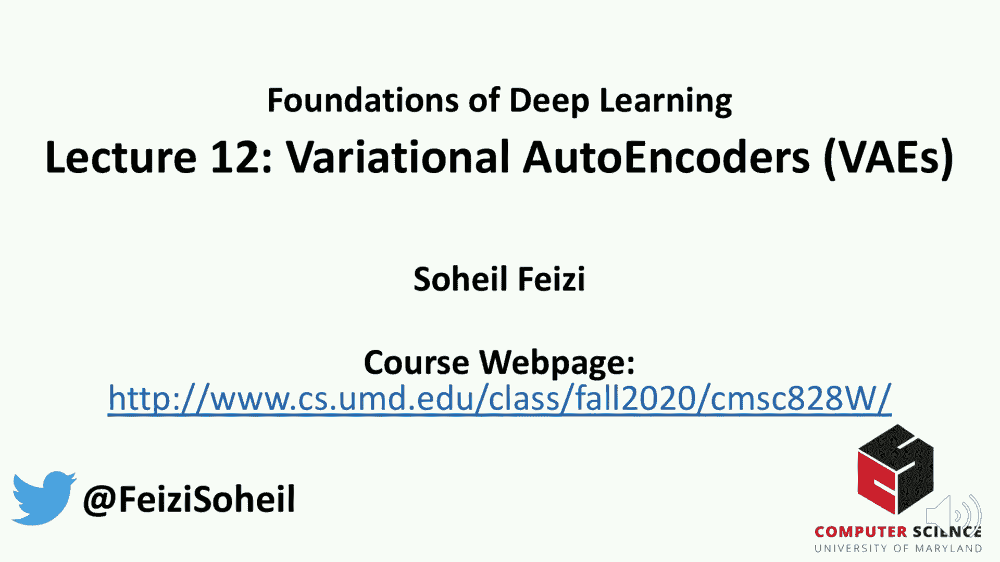
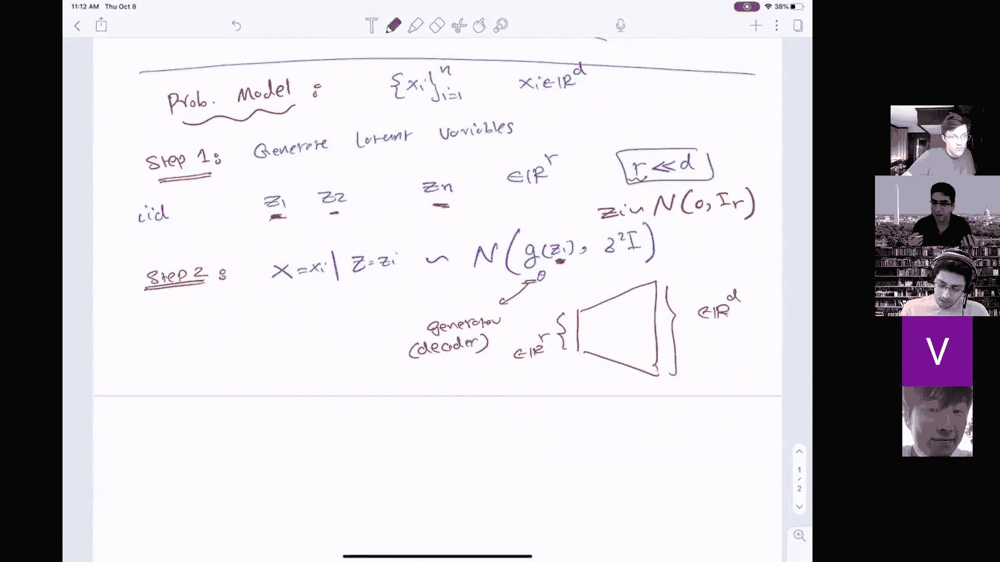

# 012：变分自编码器 (VAE) 入门

在本节课中，我们将开始学习深度生成模型。我们将从变分自编码器开始，并介绍其几种变体，如 Beta-VAE、层次化 VAE 和 VQ-VAE。

## 概述

生成模型的目标是学习一个函数，使其能够根据给定的训练数据集生成逼真但全新的合成样本。这不仅仅是生成新数据，其核心在于学习数据集的底层概率分布。一旦掌握了这个分布，我们就能解决许多其他机器学习问题，例如图像去噪、修复、风格迁移等。因此，深度生成模型是一个基础且重要的研究方向。

## 生成模型的基本思想

为了生成类似数据集的样本，我们需要一个概率模型来描述数据是如何产生的。一个常用且有效的思路是采用两步生成过程。

### 第一步：生成隐变量

首先，我们从一个已知且易于采样的分布（例如标准高斯分布）中生成一些隐变量样本。假设我们的训练数据有 N 个样本，我们以独立同分布的方式生成 N 个隐变量样本：`z_1, z_2, ..., z_n`。这些隐变量通常位于一个比原始数据维度更低的潜在空间中，因为自然数据（如图像）通常位于一个低维流形上。

我们假设这些隐变量服从标准正态分布：
`z_i ~ N(0, I)`

### 第二步：从隐变量生成数据

接下来，我们需要一个函数（生成器或解码器）将隐变量映射回数据空间。我们使用一个参数为 `θ` 的函数 `G_θ` 来建模这个映射。具体来说，我们假设在给定隐变量 `z_i` 的条件下，数据 `x_i` 服从一个以 `G_θ(z_i)` 为均值的高斯分布。

条件分布建模为：
`p_θ(x_i | z_i) = N(G_θ(z_i), σ^2 I)`

这里的 `G_θ` 就是我们的生成器，它将低维的隐变量 `z` 映射到高维的数据空间 `x`。`σ^2` 是预设的方差参数，通常为了简化可以设为常数。

因此，整个生成过程是：先从标准正态分布采样得到隐变量 `z`，然后通过生成器 `G_θ` 得到均值，最后从以该均值为中心的高斯分布中采样得到数据 `x`。

我们的目标是学习到一组好的参数 `θ`，使得通过这个过程生成的样本 `x` 尽可能逼真，即与训练数据分布一致。

## 总结

本节课我们一起学习了深度生成模型的基本目标及其重要性。我们重点介绍了一种基于隐变量的两步生成模型框架：首先从简单分布（如高斯分布）中采样隐变量，然后通过一个参数化的生成器网络将隐变量转换为数据样本。这个框架是变分自编码器等模型的核心思想。在接下来的课程中，我们将深入探讨如何训练这样的模型。