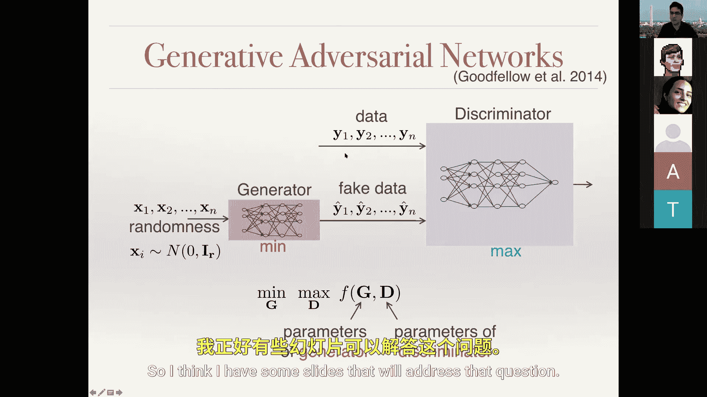

# 013：生成对抗网络 (GANs) 📊

在本节课中，我们将要学习另一种生成模型——生成对抗网络。我们将探讨其核心思想、工作原理、应用场景以及它与之前学习的变分自编码器的区别。

## 概述

上一节我们介绍了基于最大似然估计的生成模型及其面临的挑战。本节中，我们来看看另一种无需显式概率模型的生成方法：生成对抗网络。它的目标同样是学习一个函数，以便从有限的实际数据点中，生成无限多的、逼真但虚假的数据点。

## GANs 的核心思想与应用


生成对抗网络由 Ian Goodfellow 等人在 2014 年提出。其核心思想是通过一个**生成器**和一个**判别器**的对抗博弈来学习数据分布。


以下是 GANs 的一些主要应用场景：

*   **生成逼真样本**：例如，在 CelebA 人脸数据集上训练后，模型可以生成不在训练集中的、逼真的人脸图像。
*   **域适应与域迁移**：例如，将夏季风景图像转换为冬季风格，或将斑马图像转换为马的图像。理解底层数据分布对于解决这类问题至关重要。
*   **图像修复**：如果已知数据的生成流形，可以将有缺失的图像投影回该流形，从而进行修复或去噪。
*   **文本生成**：在自然语言处理中，可用于“完形填空”等任务，根据学习到的生成模型来填充空白。尽管处理的是离散变量，但优化的本质是相似的。

## GANs 的工作原理

让我们深入理解 GANs 是如何工作的。其基本框架包含两个关键组件：


1.  **生成器 (G)**：输入是一个从简单分布（如高斯分布）中采样的随机噪声向量 `z`。生成器是一个函数 `G(z; θ_g)`，目标是将其映射为逼真的假数据 `y_hat`。
2.  **判别器 (D)**：输入是数据（可以是真实数据或生成器产生的假数据）。判别器是一个函数 `D(x; θ_d)`，目标是判断输入数据是来自真实分布还是生成器分布。


整个训练过程是一个极小极大博弈。生成器试图生成足以“欺骗”判别器的假数据，而判别器则努力区分真假。这可以形式化为以下优化问题：

```python
min_G max_D V(D, G) = E_{x~p_data(x)}[log D(x)] + E_{z~p_z(z)}[log(1 - D(G(z)))]
```

其中，`p_data` 是真实数据分布，`p_z` 是噪声先验分布。

需要明确的是，判别器并非“对抗性攻击”中的对手，而是为生成器提供有价值的反馈，指导其生成更逼真的样本。通常，生成器和判别器都由深度神经网络参数化，以利用其强大的表达能力。

## 与显式模型的对比

现在，我们来回答之前提到的问题：为什么不直接最小化真实数据与生成数据之间的均方误差（MSE）来训练生成器？

关键在于，对于图像等高维复杂数据，简单的逐像素 MSE 损失通常会导致生成模糊、缺乏细节的图像。这是因为 MSE 本质上是在鼓励生成所有可能真实图像的平均，而这个平均图像往往是模糊的。相反，GANs 的对抗性损失迫使生成器学习数据分布的整体结构和细节，以生成在判别器看来与真实数据无法区分的样本，从而通常能产生更清晰、更逼真的结果。

此外，与变分自编码器不同，标准的 GAN 框架没有为数据提供显式的概率模型 `p(x)`。然而，在今天的课程后续部分，我们将讨论如何在 GAN 的框架内利用一些隐式的概率模型来计算样本的似然等统计量。

## 总结



本节课中我们一起学习了生成对抗网络的基本原理。我们了解到 GAN 通过生成器和判别器的对抗性训练，能够学习复杂的数据分布并生成高质量的样本。我们探讨了它的多种应用，并理解了其对抗性训练机制相比传统基于重建误差的方法的优势。下一节，我们将继续深入，探讨 GAN 训练中的挑战、变体及其与概率模型的联系。