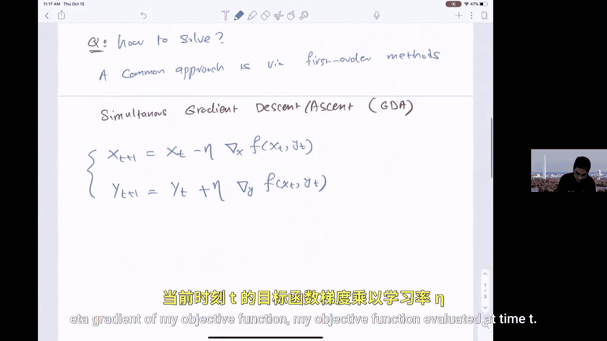

# 014：极小极大优化

在本节课中，我们将要学习极小极大优化问题。我们已经看到这类问题出现在多种应用和表述中，例如对抗学习中的对抗训练，以及上节课中训练生成对抗网络等生成模型。此外，在多智能体强化学习等许多其他问题中，极小极大优化也至关重要。

本节课将首先介绍该领域的基础和经典结果，然后讨论一些非常新的研究成果。部分内容将引用我的好友Constantinos Daskalakis的讲义和论文，他从计算复杂度的角度提供了非常有趣的理论观点。

## 问题定义

我们考虑的问题形式如下：在变量 **x** 属于集合 **𝒳** 上进行最小化，同时在变量 **y** 上进行最大化。目标函数的形式为 **F(x, y)**。

这被称为零和博弈。之所以称为“零和”，是因为可以视为两个玩家在竞争：玩家 **y** 试图最大化 **F**，而玩家 **x** 试图最大化 **-F**，因此他们的收益总和为零。通常，**x** 和 **y** 可以存在于高维空间中。本节课的一个基本假设是函数 **F** 是平滑且连续可微的。

## 目标：全局解

极小极大优化的目标是找到一个全局解，有时也称为全局鞍点或全局均衡点。记作 **(x\*, y\*)**。

这个全局解需要满足什么性质呢？对于 **y** 玩家（最大化玩家），当 **x** 固定为 **x\*** 时，**y\*** 应是目标函数 **F(x\*, y)** 关于 **y** 的极大值点。这意味着最大化玩家没有动机将 **y\*** 更改为其他值。

同理，对于 **x** 玩家（最小化玩家），当 **y** 固定为 **y\*** 时，**x\*** 应是目标函数 **F(x, y\*)** 关于 **x** 的极小值点。这意味着最小化玩家也没有动机改变 **x\***。

将这两个条件合并，可以用一个公式表示：对于所有可行的 **(x, y)** 对，都有：
**F(x\*, y) ≤ F(x\*, y\*) ≤ F(x, y\*)**

## 如何求解？

那么，我们如何计算这个全局解 **(x\*, y\*)** 呢？在实践中，例如在GANs或对抗鲁棒性训练中，我们已经见过一些求解器。

一个常见的方法是使用一阶优化方法。一种流行的一阶方法是**交替梯度下降上升法**，或者其简化版本——**同步梯度下降上升法**。

在同步梯度下降上升法中，我们同时更新 **x** 和 **y**。更新规则如下：

*   **x** 的更新（最小化）：**x_{t+1} = x_t - η ∇_x F(x_t, y_t)**
*   **y** 的更新（最大化）：**y_{t+1} = y_t + η ∇_y F(x_t, y_t)**

其中 **η** 是学习率。之所以称为“同步”，是因为两个梯度都在同一时间点 **t** 计算。

## 总结

本节课我们一起学习了极小极大优化问题。我们首先定义了问题的数学形式，即最小化玩家和最大化玩家在零和博弈框架下的目标。接着，我们明确了寻找全局鞍点解的目标及其需要满足的条件。最后，我们介绍了实践中常用的一阶求解方法——同步梯度下降上升法的基本更新步骤。理解这些基础概念是分析更复杂优化行为和算法收敛性的前提。