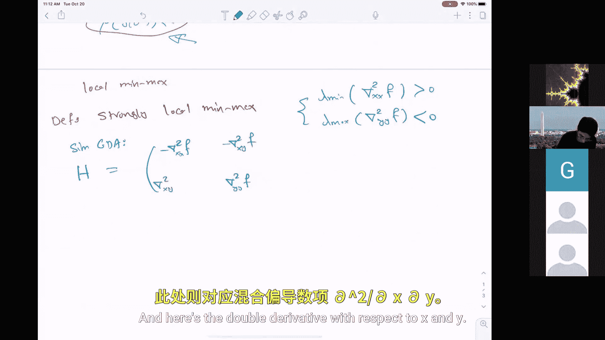

# 015：极小极大优化


在本节课中，我们将要学习非凸凹的极小极大优化问题。首先，让我们快速回顾一下上一讲的内容。

我们开始讨论非凸凹的极小极大优化，并首先设定了目标。我们的目标是找到一些局部极小极大解，其定义如下。

我们定义局部极小极大解。假设存在点 `x*` 和 `y*`，我们的优化问题是关于 `x` 求极小、关于 `y` 求极大。我们有一个平滑且可微的目标函数。在局部极小极大的定义中，我们有：

`F(x*, y*) <= F(x, y*)` 对于所有 `x` 成立。

如果我们考虑全局极小极大，这个不等式应对所有 `x` 成立。但在局部极小极大中，我们希望这个不等式至少在 `x*` 和 `y*` 的某个局部邻域内成立。类似地，我们也有不等式的另一侧。

如果对于 `x*` 和 `y*` 的某个局部邻域内的所有 `x` 和 `y`，上述条件都成立，我们则称其为局部极小极大解。

接着，我们讨论了动力学的稳定性。我们讨论了渐近稳定性。当我们从点 `x*` 和 `y*` 附近开始时，动力学不会将我们推离，因此我们保持在该点附近。如果它实际上收敛到 `x*` 和 `y*`，我们称其为局部渐近稳定。

稳定性的另一个定义是线性稳定性。如果我们仅使用“稳定性”一词，通常指的就是线性稳定性。在线性稳定性中，例如，观察梯度下降-上升的动力学，我们得到以下动态：

`θ_{t+1} = θ_t + η * g(θ_t)`

这里，`θ` 是 `(x, y)` 的向量。梯度向量 `g(θ)` 是 `[-∇_x F(x, y), ∇_y F(x, y)]`。注意，对于 `x` 我们有一个负号，因为我们在最小化 `x`；对于 `y` 我们有一个正号，因为我们在最大化 `y`。

我们讨论了该动态的雅可比矩阵，它是 `F` 关于 `θ` 的梯度。雅可比矩阵可以简单地写为：

`J = I + η * H`

其中，`I` 是单位矩阵，`H` 是海森矩阵。海森矩阵 `H` 的形式如下：

```
H = [ -∇²_xx F,  -∇²_xy F ]
    [  ∇²_yx F,   ∇²_yy F ]
```

在线性稳定性中，我们希望雅可比矩阵的谱半径小于或等于1。需要注意的是，这里的海森矩阵 `H` 不是对称矩阵，因此雅可比矩阵 `J` 也不是对称矩阵，其特征值将同时具有实部和虚部。但我们关心的是特征值的模长。如果最大特征值的模长小于或等于1，我们称其为线性稳定。

我们有一个引理：如果动力学是线性稳定的，即谱半径严格小于1（`ρ(J) < 1`），那么它也意味着渐近稳定性。因此，这是我们关心的主要条件之一：我们希望雅可比矩阵的谱半径严格小于1。

接下来，让我们再引入一个定义：强局部极小极大解。

在强局部极小极大解中，我们希望 `x*` 是一个局部极小值点。这意味着关于 `x` 的海森矩阵 `∇²_xx F` 在局部应该是半正定的。在强局部极小极大解中，我们希望它是正定的，即其特征值严格大于0，有下界。类似地，对于 `y`，我们在最大化，因此希望函数在局部是凹的，关于 `y` 的海森矩阵 `∇²_yy F` 应该是半负定的。在强局部极小极大解中，我们希望它的最大特征值严格小于0，有上界。我们将会看到为什么需要这个定义。

为了更好地理解这一点，为了拥有渐近稳定性或线性稳定性，我们希望雅可比矩阵的谱半径严格小于1。我们知道雅可比矩阵是单位矩阵加上步长 `η` 乘以海森矩阵 `H`。因此，让我们更深入地了解一下海森矩阵。

对于同时梯度下降-上升，海森矩阵 `H` 具有以下形式：

```
H = [ -H_xx,  -H_xy ]
    [  H_yx,   H_yy ]
```

其中，`H_xx = ∇²_xx F`，`H_yy = ∇²_yy F`，`H_xy = ∇²_xy F`，`H_yx = ∇²_yx F`。




本节课中，我们一起学习了局部极小极大解和强局部极小极大解的定义，并探讨了通过分析同时梯度下降-上升动力学的雅可比矩阵谱半径来判断稳定性的方法。理解这些概念是分析复杂优化问题收敛性的基础。