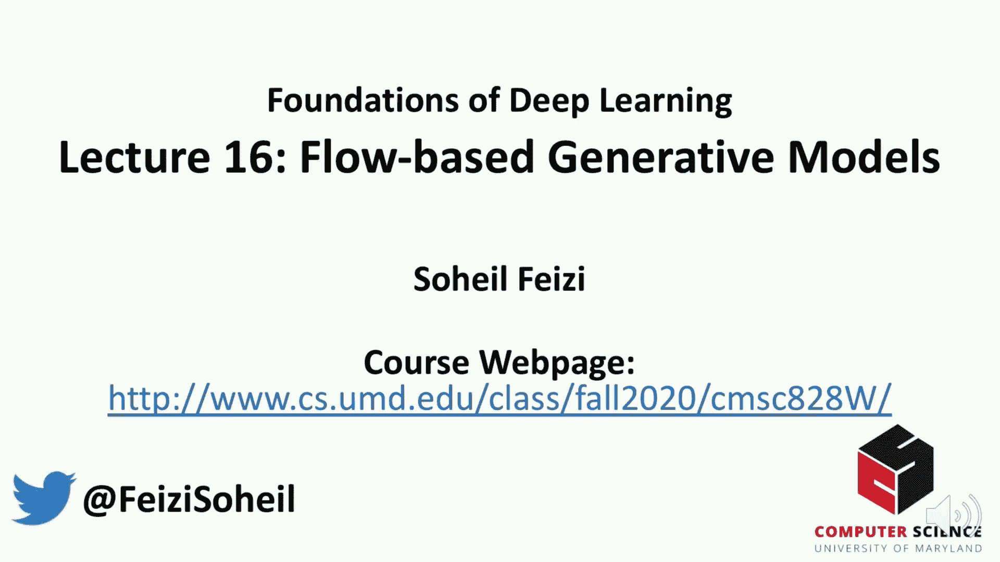
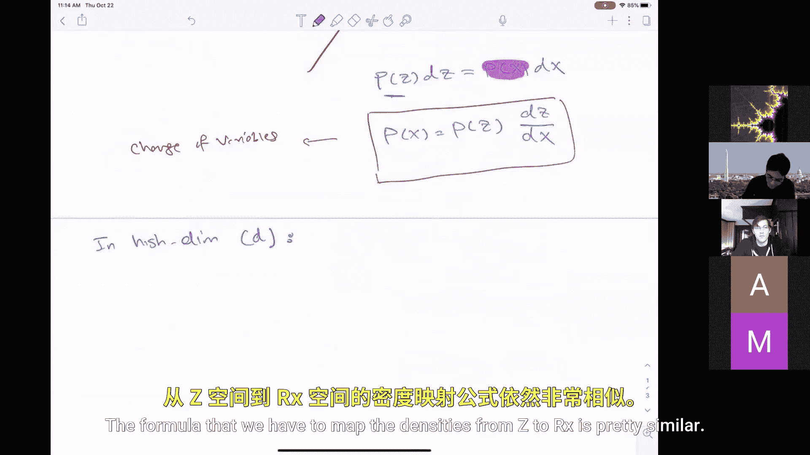

# 016：基于流的生成模型

在本节课中，我们将要学习另一类深度生成模型，即基于流的生成模型。我们将从基本概念出发，解释其工作原理、核心公式，并讨论其优势与挑战。

## 概述

与之前一样，我们有一个包含 N 个样本的数据集，例如 N 张图像。每个样本 `x` 位于一个 `d` 维空间中。基于流的模型是一种概率模型，它从一个简单的潜在分布（如高斯分布）开始，通过一个可逆且可微的变换函数，将其映射到复杂的数据分布（如图像分布）。本节课我们将详细探讨这一过程。

## 模型定义

上一节我们回顾了生成模型的基本目标。本节中，我们来看看基于流模型的具体定义。

我们从一个潜在变量 `z` 开始，它通常服从一个简单的先验分布，例如标准正态分布：
`z ~ p_z(z) = N(0, I)`

这里的关键是，`z` 的维度与数据 `x` 的维度相同，这与变分自编码器（VAE）不同。

接下来，我们使用一个由参数 `θ` 参数化的可逆函数 `g_θ`，将 `z` 映射到数据空间 `x`：
`x = g_θ(z)`

由于函数 `g_θ` 是双射的（一一对应且满射），因此它是可逆的。这意味着对于每个 `z`，有唯一对应的 `x`；反之，对于每个 `x`，也有唯一对应的 `z`。因此，我们可以在潜在空间和数据空间之间建立双向映射。

*   **生成/采样过程**：从 `z` 空间到 `x` 空间，使用函数 `g_θ`。
*   **推断过程**：从 `x` 空间到 `z` 空间，使用 `g_θ` 的逆函数。为简便起见，我们记逆函数为 `f_θ`，即 `f_θ = g_θ^{-1}`，因此 `z = f_θ(x)`。

我们假设函数 `f_θ` 和 `g_θ` 都是可微分的，这是为了后续使用基于梯度的优化方法进行训练。

这个模型定义了一个关于 `x` 的概率分布，我们称之为 `p_θ(x)`。由于 `z` 是随机变量，且 `g_θ` 是一个（可能是复杂的）神经网络，`p_θ(x)` 可以表示非常复杂的数据分布，如图像分布。

## 核心挑战与变量变换公式

这个模型听起来很理想，但它面临一个核心瓶颈：我们如何精确地计算或评估由变换 `g_θ` 定义的数据分布 `p_θ(x)` 呢？

上一节我们定义了模型，本节中我们来看看计算数据似然的核心数学工具。

答案在于**变量变换公式**。我们先从一维情况来直观理解。

假设我们有一个一维的潜在变量 `z` 和一维的数据 `x`，且 `x = g(z)`。`z` 有一个已知的概率密度函数 `p_z(z)`。考虑 `z` 空间中的一个微小区间 `[z, z+dz]`，`z` 落在这个区间内的概率近似为 `p_z(z) * dz`。

由于 `g` 是可逆的，这个区间会被映射到 `x` 空间中的一个对应区间 `[x, x+dx]`。概率质量在变换过程中必须守恒，因此有：
`p_z(z) * dz = p_x(x) * dx`

由此，我们可以解出数据空间中的密度 `p_x(x)`：
`p_x(x) = p_z(z) * |dz/dx|`

其中 `|dz/dx|` 是变换 `z = f(x)`（即 `g` 的逆）的导数的绝对值，它衡量了变换对局部“体积”的拉伸或压缩程度。

在高维空间中，原理类似，但导数被替换为**雅可比矩阵的行列式**。变换公式变为：
`p_x(x) = p_z(f_θ(x)) * |det( J_f_θ(x) )|`

其中：
*   `f_θ(x)` 是将 `x` 映射回 `z` 的逆变换函数。
*   `J_f_θ(x)` 是函数 `f_θ` 在 `x` 处的雅可比矩阵（即其所有一阶偏导数构成的矩阵）。
*   `det(·)` 表示行列式。行列式的绝对值 `|det(J)|` 衡量了变换 `f_θ` 在点 `x` 处对无穷小体积元的缩放因子。

这个公式是流模型的核心。它允许我们精确地计算任何数据点 `x` 在模型下的似然值 `p_θ(x)`，前提是我们可以高效地计算逆变换 `f_θ` 及其雅可比矩阵的行列式。

## 模型训练目标

有了计算似然的能力，我们就可以定义训练目标。模型的目标是最大化训练数据在该模型分布下的对数似然。

给定数据集 `{x_1, x_2, ..., x_N}`，我们希望最大化：
`max_θ (1/N) Σ_{i=1}^{N} log p_θ(x_i)`

将变量变换公式代入，我们的目标函数变为：
`max_θ (1/N) Σ_{i=1}^{N} [ log p_z(f_θ(x_i)) + log |det( J_f_θ(x_i) )| ]`

以下是训练流程的关键步骤：

1.  **前向传播（计算损失）**：对于每个数据点 `x_i`，使用逆变换 `f_θ` 计算其对应的潜在变量 `z_i = f_θ(x_i)`。
2.  **计算似然**：
    *   计算先验分布的对数似然 `log p_z(z_i)`（例如，高斯分布的对数概率密度）。
    *   计算雅可比矩阵行列式的对数 `log |det(J_f_θ(x_i))|`。
3.  **构建损失**：损失函数是负对数似然的平均值：`L(θ) = - (1/N) Σ [ log p_z(f_θ(x_i)) + log |det( J_f_θ(x_i) )| ]`。
4.  **反向传播与优化**：通过梯度下降法（如SGD、Adam）最小化损失函数 `L(θ)`，更新模型参数 `θ`。

## 设计流模型的关键考量

为了使得这个框架可行，我们设计的变换函数 `f_θ`（及其逆 `g_θ`）必须满足以下两个关键性质：

1.  **可逆性**：函数必须可逆，才能进行双向的生成和推断。
2.  **高效行列式计算**：计算雅可比矩阵的行列式必须高效，因为这在训练和评估中需要为每个数据点执行。对于 `d` 维数据，普通行列式计算复杂度为 `O(d^3)`，这对于高维数据是不可行的。

因此，流模型的研究核心在于设计特殊的神经网络结构，使其既是可逆的，又能让雅可比行列式易于计算。常见的结构包括耦合层、自回归流等，它们通过设计使得雅可比矩阵是三角阵或分块三角阵，从而将其行列式计算简化为对角元素乘积的 `O(d)` 复杂度操作。

## 总结

本节课中，我们一起学习了基于流的生成模型。

*   其核心思想是通过一个可逆、可微的变换，将一个简单的先验分布（如高斯分布）映射到复杂的数据分布。
*   模型的关键在于**变量变换公式**：`p_x(x) = p_z(f_θ(x)) * |det( J_f_θ(x) )|`，它允许我们精确计算数据似然。
*   训练通过**最大似然估计**进行，直接优化数据的对数似然。
*   构建实用流模型的主要挑战和设计重点是创造**可逆且雅可比行列式易于计算**的神经网络架构。

基于流的模型具有能精确计算似然、隐变量与数据一一对应便于推断等理论优势，但其模型设计通常比GAN或VAE更为复杂，且变换的可逆性要求有时会限制模型的表达能力。