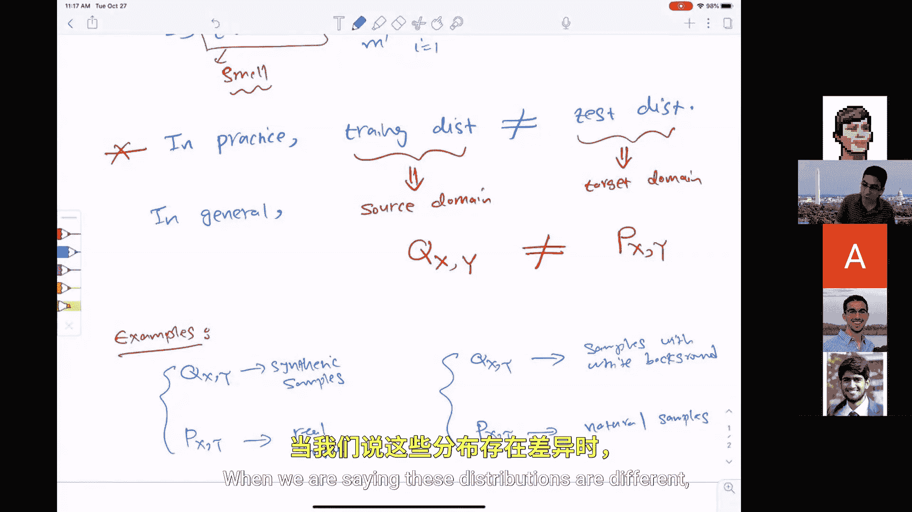

# 017：领域适应

## 概述

在本节课中，我们将要学习**领域适应**问题。我们将探讨当训练数据（源域）和测试数据（目标域）来自不同分布时，如何让模型在目标域上依然表现良好。

## 回顾标准学习问题

首先，让我们回顾一下之前已经学习过的标准问题设置。

到目前为止，我们研究的学习问题是：给定一个训练集。假设我们有 **M** 个样本，即训练特征 **X_train** 和对应的标签 **Y_train**。这些样本可能来自一个联合分布 **Q(X, Y)**，我们称之为训练分布。

学习过程是找到一个函数 **f**，将 **X** 映射到 **Y**。我们通过定义一个损失函数，并最小化在训练集上的平均误差来实现这一点。

具体来说，我们通过最小化以下目标来选取模型参数 **θ**：
`θ* = argmin_θ (1/M) Σ L(f_θ(X_i_train), Y_i_train)`

但这并非最终目标。在泛化性讲座中我们了解到，最终目标是将在训练集上学到的函数 **f_θ*** 应用到测试集上时，也能获得良好的性能。

假设我们有一个测试集 **X_test** 和 **Y_test**，包含 **M‘** 个样本。标准假设是：测试样本与训练样本来自**相同的分布**。例如，在ImageNet数据集中，我们划分一部分图像用于训练，另一部分用于测试和验证。

我们在测试集上计算测试误差，即评估在训练过程中未使用过的测试样本上的性能：
`Test Error = (1/M') Σ L(f_θ*(X_i_test), Y_i_test)`

我们之前关于优化和泛化性的讨论，其核心目标就是学习一个函数，使得这个测试误差尽可能小。我们了解到，如果有足够的样本，训练误差和测试误差之间的泛化差距会很小。即使在过参数化模型中，尽管参数数量可能多于样本数量，训练和测试误差的差异也可能很小。

## 问题：标准设置是否现实？

那么，问题来了：这种标准设置是否现实？

答案通常是：**不**。原因在于，我们假设训练和测试数据来自**相同分布**，但在实践中，这个假设往往不成立。

在实践中，训练数据的分布可能与测试数据的分布不同。为了考虑更一般的情况，我们将用于训练的数据集称为**源域**，将最终用于测试的数据集称为**目标域**。

源域样本的分布记为 **Q(X, Y)**，目标域样本的分布记为 **P(X, Y)**。这两个分布可能是不同的。

## 领域差异的实例

接下来，我们来看一些具体的例子，说明源域和目标域可能如何不同。

*   **合成数据 vs. 真实数据**：你的源域 **Q(X, Y)** 可能代表一些合成样本。在许多应用中，合成数据更容易生成。你希望在这些合成样本上训练模型。但最终，你希望将模型部署到真实世界的应用中，而真实样本可能存在自然变化（如光照、纹理等），这些是合成样本中没有的。
*   **特定背景 vs. 自然背景**：你的源域样本可能具有特定背景（例如纯白背景）。你训练模型时，背景可能不应该影响分类，因为主要物体仍在图像中。但当你将模型应用于真实场景时，需要在具有各种不同自然背景的样本上评估性能。

基于这些例子（你还可以想出无数其他例子），理解我们何时可以在一个特定样本分布上训练模型，并将其部署到来自另一个分布的样本上，就成为一个非常重要的问题。

这里需要强调一点：当我们说这些分布不同时，并不意味着它们毫无关系。

它们之间**存在某种关联**。例如，合成数据和真实数据描绘的是同一类物体；白背景图像和自然背景图像包含的是相同的目标类别。领域适应的核心就是利用这种关联性，将源域的知识迁移到目标域。

## 总结

本节课中，我们一起学习了领域适应问题的基本概念。我们首先回顾了标准机器学习中训练与测试数据同分布的假设，然后指出了这一假设在实践中常常不成立，从而引出了源域与目标域分布不同的现实挑战。我们通过实例说明了领域差异的常见形式，并强调了尽管分布不同，但源域和目标域之间通常存在内在关联，这正是领域适应研究的基础。在接下来的章节中，我们将深入探讨解决这一问题的具体方法。