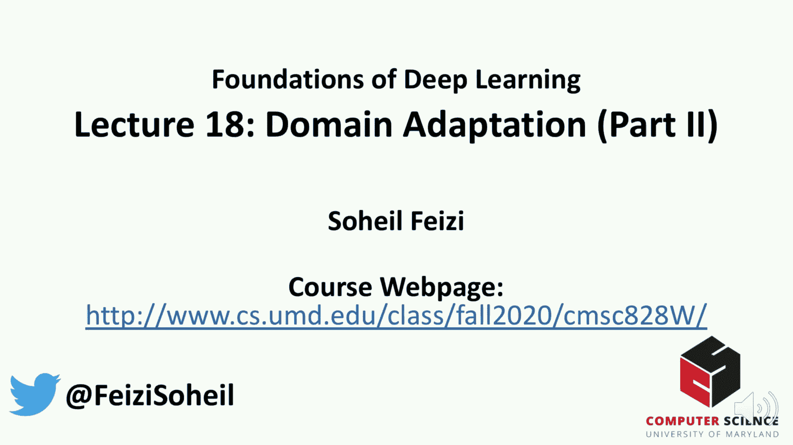

# 018：领域自适应

在本节课中，我们将继续探讨领域自适应问题。我们将首先回顾上一讲的核心概念，然后深入分析实现领域自适应的关键假设，并介绍一个量化目标域误差的理论框架。

## 概述

上一讲我们介绍了领域自适应问题的基本设定。我们有一个源域和一个目标域。源域数据有标签，目标域数据无标签。我们的目标是利用有标签的源域数据和无标签的目标域数据，学习一个分类函数，使其在目标域上表现良好。

具体来说，我们有以下设定：
*   源域分布：`Q(X, Y)`
*   源域观测样本：`M_s` 个，形式为 `(X_i^s, Y_i^s)`
*   目标域分布：`P(X, Y)`
*   目标域观测样本：`M_t` 个，形式为 `(X_i^t)`（无标签）
*   目标：从假设空间 `H` 中学习一个函数 `h`，最小化其在目标域上的期望误差。

## 领域自适应的关键假设

为了实现上述目标，我们需要一些假设。以下是三个核心假设：

1.  **协变量偏移**：源域和目标域的条件分布相同，即 `Q(Y|X) = P(Y|X)`。这意味着给定特征 `X`，标签 `Y` 的分布在两个域中是一致的。
2.  **联合误差小**：存在一个假设 `h`，使其在源域和目标域上的误差都很小。如果不存在这样的假设，问题将非常困难。
3.  **域间分布关系**：源域和目标域的边缘分布 `Q(X)` 和 `P(X)` 需要通过某种度量关联起来。我们使用 **H-散度** 来刻画这种关系。

### H-散度详解

H-散度衡量了两个分布（此处是 `Q(X)` 和 `P(X)`）在假设空间 `H` 下的差异。其定义如下：

`d_H(Q, P) = 2 * sup_{h in H} | Pr_{x~Q}[h(x)=1] - Pr_{x~P}[h(x)=1] |`

直观理解是：寻找一个分类器 `h`，它能最大程度地区分来自源域和目标域的样本。`h(x)=1` 的概率在源域和目标域下的差值，经过上确界和两倍缩放后，即为 H-散度。

一个重要的结论是，H-散度可以通过训练一个二分类器来近似估计。该分类器的任务是区分样本来自源域还是目标域。具体关系为：

`d_H(Q, P) ≈ 2 * (1 - 分类器准确率)`

## 对称差假设空间

为了陈述核心定理，我们需要引入 **对称差假设空间** 的概念。

对于给定的假设空间 `H`，其对称差假设空间 `H Δ H` 定义如下：

`H Δ H = { g | g(x) = h(x) ⊕ h'(x), 其中 h, h' ∈ H }`

其中 `⊕` 表示异或运算。简单来说，`H Δ H` 包含了 `H` 中任意两个假设函数所有预测不一致的区域。

以下是一个直观示例：
假设 `h` 将右侧区域预测为1，`h'` 将上方区域预测为1。那么函数 `g = h ⊕ h'` 在 `h` 和 `h'` 预测不一致的区域（即图中高亮区域）输出1，在预测一致的区域输出0。所有这样的函数 `g` 构成的集合就是 `H Δ H`。

## 核心理论：目标误差上界

基于以上定义，我们可以给出目标域误差的上界。这个定理将我们在训练时可以计算的量（源域误差、H-散度）与最终关心的目标域误差联系起来。

**定理**：对于任意假设 `h ∈ H`，其目标域误差 `ε_T(h)` 满足以下不等式：

`ε_T(h) ≤ ε_S(h) + d_{HΔH}(Q, P) + λ`

其中：
*   `ε_S(h)` 是假设 `h` 在**源域**上的误差。
*   `d_{HΔH}(Q, P)` 是源域和目标域边缘分布在对称差假设空间 `H Δ H` 下的 H-散度。
*   `λ` 是一个常数，表示在 `H` 中，源域和目标域上同时表现最优的假设所对应的联合误差的最小值，即 `λ = min_{h' ∈ H} [ε_S(h') + ε_T(h')]`。

### 定理含义解读

这个定理为我们提供了设计领域自适应算法的清晰指导：

1.  **最小化源域误差**：我们需要确保学到的假设 `h` 在源域上表现良好。这通过标准的有监督学习在源域数据上实现。
2.  **最小化域间差异**：我们需要让学到的模型能够对齐源域和目标域的特征分布，从而减小 `d_{HΔH}(Q, P)`。这正是利用无标签目标域数据的关键所在。实践中，这通常通过对抗训练、域混淆损失等技术来实现。
3.  **假设空间的能力**：常数 `λ` 代表了问题本身的难度。如果存在一个假设能同时在源域和目标域上取得低误差，那么领域自适应就是可行的。这呼应了我们之前的第二个核心假设。

## 总结

本节课我们一起学习了领域自适应的理论基础。我们首先回顾了问题的设定，然后明确了成功进行领域自适应所需的三个关键假设：协变量偏移、小的联合误差以及通过 H-散度度量的域间关联。

接着，我们引入了对称差假设空间 `H Δ H` 的概念。最后，我们介绍并解读了核心定理，该定理给出了目标域误差的上界，由源域误差、域间分布差异和一个与假设空间能力相关的常数项组成。这个理论框架为理解和设计实际的领域自适应算法（如基于对抗训练的方法）奠定了坚实的基础。