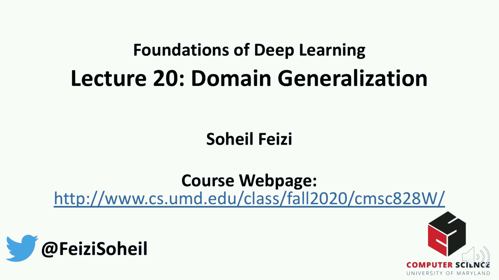
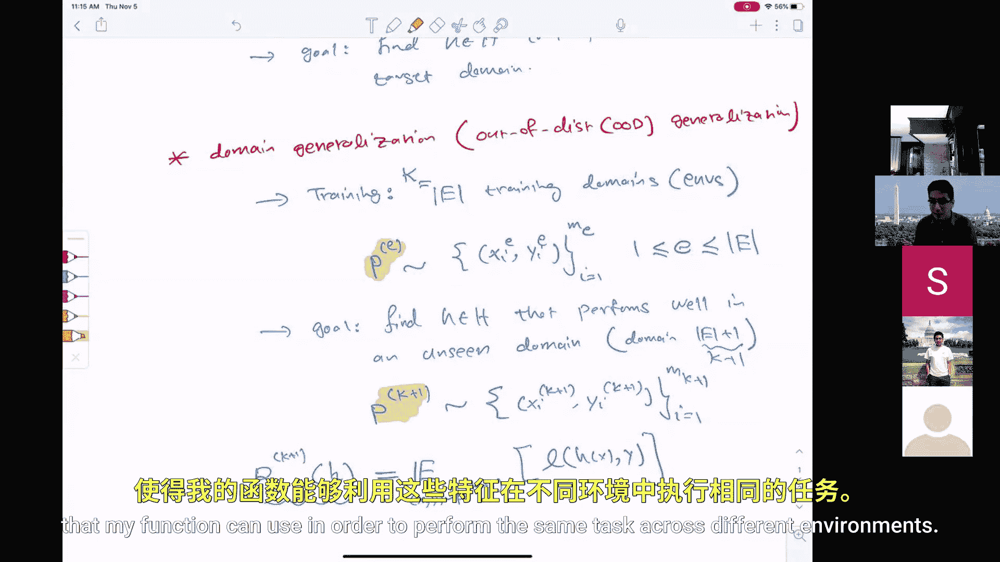

# 019：领域泛化

在本节课中，我们将学习一个与领域自适应相关的问题——领域泛化，有时也被称为分布外泛化。我们将探讨其问题设定、核心假设以及它与领域自适应的区别。

## 问题设定 🎯

上一节课我们介绍了领域自适应问题。在训练中，我们拥有来自源域的**带标签**样本，以及来自目标域的**无标签**样本。目标是找到一个假设函数，使其在目标域上表现良好。

本节中，我们来看看领域泛化。在领域泛化的训练设置中，我们将拥有来自**多个**不同领域或环境的带标签样本。

假设我们有 **E** 个训练领域。每个领域 **e** 由一个分布 **P^e** 表示。我们从每个领域 **e** 中接收一定数量（例如 **n_e**）的带标签样本 **(X_i^e, Y_i^e)**。

以下是训练数据的构成：
*   我们拥有来自多个不同领域（环境）的带标签数据。
*   每个领域的数据分布可能各不相同。

## 目标与挑战 🧠

我们的目标是：利用这些来自不同领域的带标签样本训练一个**单一模型**，然后将该模型应用到一个**全新的、在训练中从未见过**的领域或环境，并希望它在该新领域上也能有良好的性能。

因此，目标是找到一个属于我们假设类别的函数 **h**，使其在未见领域上表现良好。假设新领域为第 **K+1** 个领域，其分布为 **P^{K+1}**。在测试时，我们根据此分布观察样本，并用训练好的假设函数 **h** 进行评估，所得的错误率即为在新环境下的风险。我们希望选择的假设 **h** 能够最小化这个未见环境中的风险。

一个自然的问题是：这些环境之间需要存在何种关联，这个目标才可能实现？如果新领域与训练领域完全不同，那么我们凭什么能期望在训练领域上学到的函数在新领域上有效？

## 核心假设：不变特征 🔑

是的，这些领域和环境之间必须相互关联。我们假设存在一些**潜在的、跨领域不变的特征**，我们的函数可以利用这些特征来在不同环境中执行相同的任务。

换句话说，尽管不同领域的数据分布（**P^e(X, Y)**）可能变化，但存在一个关于 **X** 的子集或表示，其与标签 **Y** 的关系在所有领域（包括未见领域）中是稳定不变的。学习到这种不变关系是领域泛化的关键。

为了更具体地说明，考虑一个图像分类的例子：假设任务是识别动物。训练领域可能包括：卡通动物图片（领域1）、野外摄影动物图片（领域2）、素描动物图片（领域3）。每个领域的图像风格（域特异性特征）差异很大。但“动物”这个概念所对应的某些关键形状、结构特征（不变特征）在所有领域中都是一致的。模型的目标是忽略风格变化，聚焦于这些不变特征进行识别。这样，当遇到一个全新的领域（例如，油画动物图片）时，模型才有可能正确分类。

## 与领域自适应的对比 ⚖️

回顾一下，领域自适应与领域泛化既有联系也有区别：

*   **领域自适应**：在训练时，我们**可以接触到目标域的无标签数据**。利用这些数据，我们可以尝试对齐源域和目标域的特征分布。
*   **领域泛化**：在训练时，我们**完全接触不到目标域（即测试域）的任何数据**。我们只有多个源域的数据，目标是从中归纳出不变性，以泛化到未知的测试域。

领域泛化因此是一个更具挑战性的问题，因为它要求在训练阶段就对未知的分布偏移做好准备。

## 方法概述 🛠️

领域泛化的方法通常围绕如何从多个训练领域中学习不变表示或不变预测器。主要思路包括：

以下是几种常见的学习范式：
1.  **领域对抗训练**：鼓励模型学习一种表示，使得分类器无法区分该表示来自哪个训练领域，从而迫使表示是领域不变的。
2.  **领域风险最小化**：优化模型在所有训练领域上的最差性能（即最小化最大风险），以提高鲁棒性。
3.  **不变因果关系学习**：假设数据由因果机制生成，试图找到与标签有稳定因果关系的特征。
4.  **元学习**：将每个训练领域视为一个任务，通过元学习的方式训练模型，使其能快速适应新领域。

这些方法的核心数学目标可以抽象为寻找一个函数 **h**（或表示 **Φ** 和分类器 **w**），使得其在所有环境 **e ∈ {1,...,K}** 上满足某种不变性条件，例如：
*   **条件分布不变**：**P^e(Y | Φ(X))** 对于所有 **e** 近似相同。
*   **风险不变**：**R^e(h)** 对于所有 **e** 尽可能小且接近。

## 总结 📚

本节课中，我们一起学习了领域泛化的基本概念。我们首先定义了问题设定：利用来自多个不同领域的带标签数据训练模型，并使其能泛化到全新的、未见过的领域。我们讨论了该问题成立的核心假设——即存在跨领域共享的不变特征。接着，我们对比了领域泛化与领域自适应的关键区别：前者在训练时完全未知目标域。最后，我们简要概述了解决领域泛化问题的几种主流思路，其核心都是如何从多领域数据中有效地学习和利用不变性。理解领域泛化对于构建在现实世界复杂、动态变化环境中依然稳健的机器学习系统至关重要。