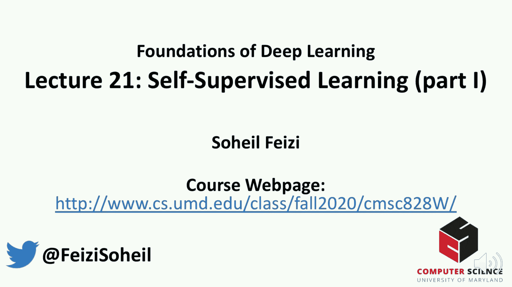
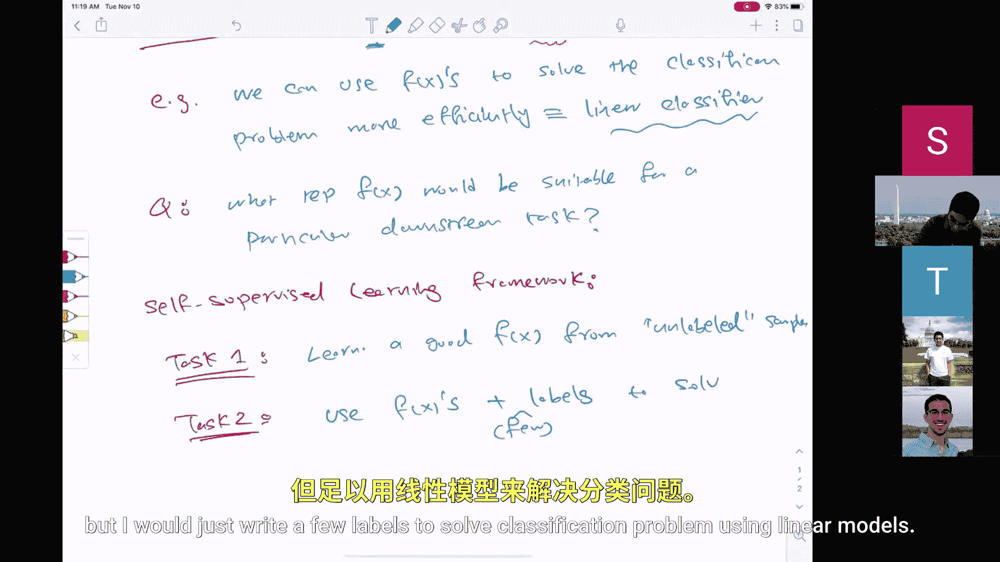

# 020：自监督学习

在本节课中，我们将要学习自监督学习。这是一种从无标签数据中学习数据有效表示（或称嵌入）的方法，这些表示随后可以用于提升下游任务（如图像分类）的性能。

## 概述

首先，让我们简要回顾一下本课程中已介绍过的监督学习和无监督学习框架。

在监督学习中，我们拥有一个带标签的数据集。假设我们有 `M` 个样本，表示为 `(x_i, y_i)`，其中 `i` 从 1 到 `M`。我们的目标是学习一个函数，在测试时，给定一个新的输入 `x`，能够预测出其对应的标签 `y`。

在无监督学习中，我们没有标签 `y`，只有数据 `x`。任务的定义更具灵活性，例如生成建模，其目标是从与训练样本相同的底层分布中生成逼真的合成样本。我们已学习过处理此类问题的不同方法，如生成对抗网络、变分自编码器和基于流的模型。

## 自监督学习的目标

今天的目标与监督学习和无监督学习都略有不同。我们的核心目标是：**从无标签数据中学习数据的强大表示**。

给定无标签数据 `x`（这与无监督学习设置类似），我们希望找到一个好的表示 `f(x)`。那么，什么是“好”的表示呢？一个好的表示应该能够让我们更高效地解决一些下游任务。

例如，在图像分类问题中，我们不直接使用原始像素 `x` 作为分类器的输入，而是希望使用其表示 `f(x)`。如果表示足够好，那么即使在学习表示时没有使用标签，来自不同类别的样本在表示空间中也可能自然地聚集在一起，从而变得线性可分。这样，我们只需在表示 `f(x)` 之上训练一个简单的线性分类器，就能高效地完成分类任务。

因此，一个具体的评估方法是：使用 `f(x)` 这些表示，结合少量标签，来解决分类问题。例如，我们可以在 `f(x)` 上使用线性分类器，并观察其性能。之所以强调线性分类器，是因为在原始高维、非线性的数据 `x` 上，线性分类器通常效果不佳。但如果表示 `f(x)` 足够好，线性分类器就可能取得很好的效果。

这里的关键点是：在学习这些表示 `f(x)` 时，我们**并不知道**下游的具体任务（例如具体的分类标签）。当然，表示学习的目标和下游任务在语义上应该相关（例如，用图像数据学习表示，然后用于图像分类），但学习表示的过程本身是完全无监督的。

这就引出了自监督学习框架的核心问题：**表示学习与下游任务之间需要存在何种关系，才能确保整个框架成功？** 换句话说，对于特定的下游任务，什么样的表示 `f(x)` 才是合适的？

## 自监督学习框架

我们可以将这个框架分为两个步骤：

**第一步：表示学习**
在此步骤中，我们从大量无标签样本中学习数据的良好表示 `f(x)`。无标签样本通常比有标签样本更容易获取，因此我们拥有丰富的数据来完成此任务。

**第二步：下游任务评估**
在此步骤中，我们使用第一步学到的表示 `f(x)`，并结合（可能少量的）标签，来解决具体的下游任务（如分类问题），以此评估所学表示的质量。

整个流程如下图所示，它概括了从无标签数据学习表示，再到利用表示解决有标签任务的完整过程。

## 总结

本节课我们一起学习了自监督学习的基本概念。我们了解到，自监督学习旨在从无标签数据中学习数据的有效表示 `f(x)`。一个好的表示能够使下游任务（如使用线性分类器进行分类）的解决变得更加高效。整个框架分为表示学习和下游任务评估两个阶段，其成功关键在于所学表示必须与下游任务在语义上相关联。通过这种方法，我们可以利用大量易得的无标签数据来为资源有限的有监督任务提供强大的特征基础。