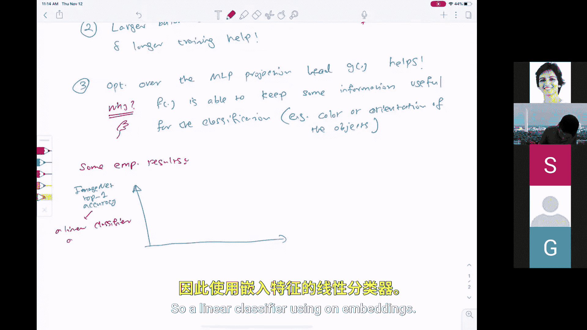

# 021：自监督学习（续）与对比学习理论 🔍

在本节课中，我们将继续探讨自监督学习，重点聚焦于对比学习的理论层面。首先，让我们简要回顾上一讲的内容。

上一节我们介绍了一种前沿的自监督学习方法——SimCLR。其框架是：从一张原始图像 **X** 出发，通过数据增强得到该图像的两个相关视图 **X_i_tilde** 和 **X_j_tilde**。接着，我们学习一个编码器（嵌入函数）**F**，将这两个视图映射为嵌入向量 **h_i** 和 **h_j**。论文中还提出了一个非线性投影头 **G**（通常是一个单隐藏层的MLP），将 **h** 映射为 **z**。损失函数基于来自同一图像的两个视图之间的相似性来定义，与其他对比损失函数类似，但存在一些细微差别。

## 实践观察与洞见 🧐

在论文中，作者提出了一些能提升最终性能的有趣实践观察。

以下是三个关键观察结果：

1.  **数据增强的组合至关重要**：在自监督学习中，组合使用多种数据增强方法（如色彩抖动、随机裁剪、高斯噪声）比仅使用单一方法能带来更好的性能。这通过在线性分类器评估嵌入质量时得到验证。
2.  **更大的批次规模和更长的训练时间有益**：在监督学习中，批次规模通常不会太大。但在自监督学习中，由于我们需要从批次中随机选取负样本，更大的批次规模有助于降低误将同类样本选为负样本（即“碰撞”）的概率，从而提升性能。实验也观察到更长的训练时间同样有帮助。
3.  **使用非线性投影头有助于优化**：这是一个比较神秘的发现。先前的方法通常在嵌入向量 **h** 上直接计算相似度或损失。SimCLR则增加了一个非线性投影头 **G** 来得到 **z**，并在 **z** 上计算对比损失，但在推理时却丢弃 **G** 而使用 **h** 作为最终嵌入。实验表明，这样得到的 **h** 质量更高。一种可能的解释是：**h** 可能保留了一些对下游分类任务有用但可能存在伪相关（如物体颜色、方向与标签的偶然关联）的信息。而训练 **G** 的过程可能让 **z** 摒弃了这些伪相关，使得任务更具挑战性，从而让 **h** 学习到更稳健、对下游任务更有效的特征。

接下来，我们看看他们取得的一些实证结果。

## 实证结果 📊

他们在线性分类器上评估了所学嵌入的质量，结果令人印象深刻。具体来说，他们观察了在ImageNet数据集上，仅在线性分类器上使用这些嵌入时达到的Top-1准确率。

---

本节课中，我们一起回顾了SimCLR的框架，分析了其在数据增强、训练策略和模型结构方面的关键实践观察，并预览了其出色的实证性能。下一节，我们将深入对比学习的理论核心，探讨其为何有效。