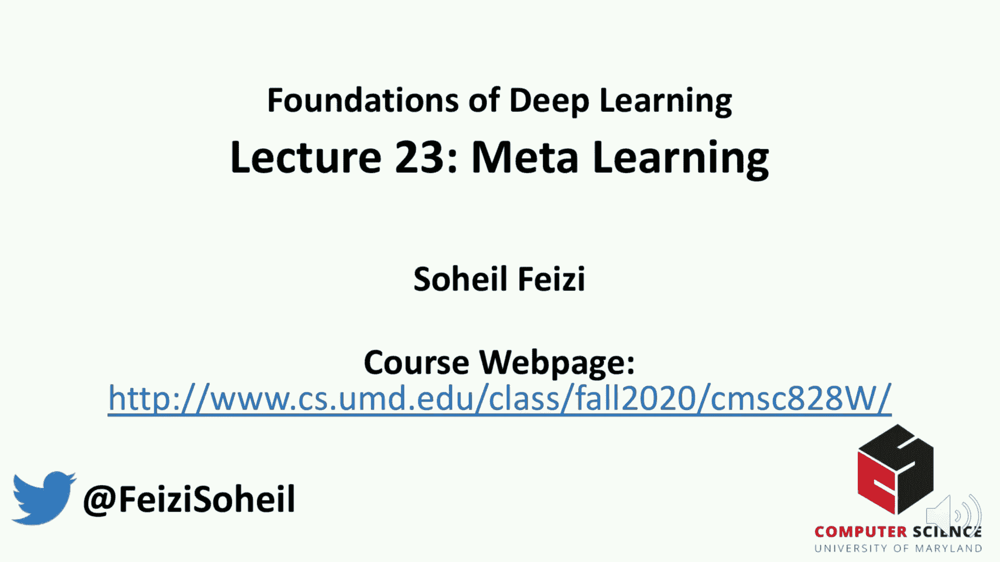
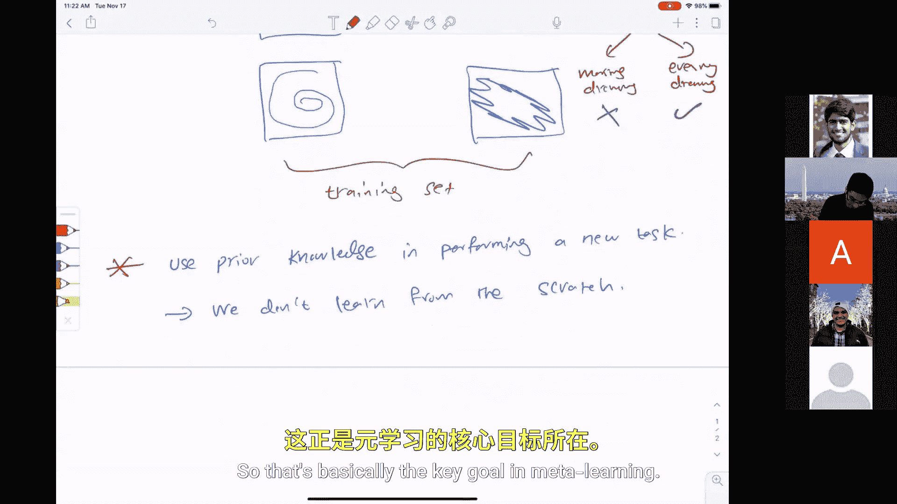

# 022：元学习

在本节课中，我们将要学习元学习。我们将从动机开始，然后深入探讨元学习的技术公式以及当前元学习方法的现状。

在许多应用中，我们并没有大型的训练数据集。我们已经讨论过监督学习、无监督学习（如GANs、VAEs）以及自监督学习（无需标签数据）。但在某些情况下，我们甚至连有标签的数据集也很少。这正是我们将要探讨的场景：训练样本数量很少的情况。

有趣的是，对于人类而言，即使只有很少的样本，我们也能在一些基本的学习任务上表现得相当好，例如图像分类。人类如何能够用极少的例子就适应新任务？而当前主流的监督模型则需要大量的训练样本。这将是我们要讨论的核心问题。

## 动机：人类的小样本学习能力

在许多应用中，我们并没有大型的训练数据集。但有趣的是，人类能够快速适应并即时学习。为什么会这样？为什么人类能够用很少的训练例子就适应新任务？

为了让大家更好地理解，让我们看一个具体的例子来热身。

假设我有两种类型的涂鸦。第一种是我在早上画的，经过一夜好眠，喝了咖啡，心情愉快，我画的形状是这样的（平滑的曲线）。第二种是在漫长工作后的晚上画的，我画的形状是这样的（尖锐的边角）。

第一列是我的早上涂鸦，第二列是我的晚上涂鸦，这就是我的训练集。现在，在测试时，我给你一个例子，让你判断这个例子是早上画的还是晚上画的。

训练集中每个类别只有三个例子，总共两个标签。在测试时，我给你一个例子，让你判断它更可能来自哪个时间。大家怎么看？

几乎所有人都正确地预测了测试样本的标签是“晚上涂鸦”。看这个学习任务：一个二元分类问题，每个类别只有三个例子。人类几乎都能用这么少的例子在测试时做出正确预测。

为什么会这样？为什么人类非常擅长用极少的例子完成这个任务？你的想法是什么？

是的，我们无法用一个只有每类三个例子的深度监督模型，并期望它在测试时表现良好。关键在于上下文学习。大家观察的是纹理：早上涂鸦的曲线更平滑，而晚上涂鸦的曲线更尖锐、有棱角。这正是你们用来判断的特征。

本质上，我们拥有大量关于涂鸦的先验知识或信息。我们利用这些先验知识，结合手头这少量的例子，来做出良好的测试预测。这里的关键在于**利用先验知识或信息来执行新任务**。我们并非从零开始，而是大脑中已经存储了关于图像、形状等的大量先验信息。当我们看到这个特定任务的例子时，可以立即运用那些先验知识，或许稍作调整以适应这个具体任务（例如，关注曲线的平滑度或尖锐度），然后利用调整后的信息来处理新任务。

这基本上就是元学习的核心目标。

那么，基本问题就是：如何实现？