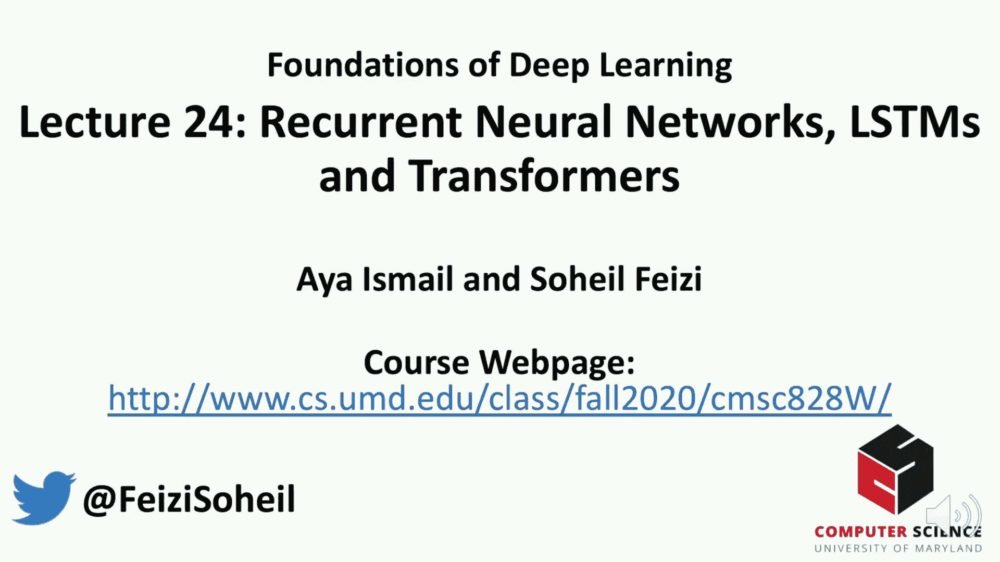
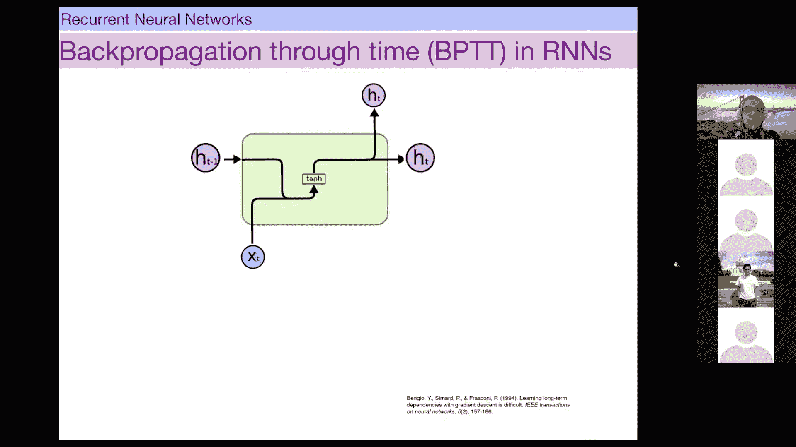

# 023：循环神经网络 (RNNs)

在本节课中，我们将要学习循环神经网络。这是一种专门为处理**可变长度序列数据**（如句子、时间序列）而设计的神经网络架构。我们将了解其基本结构、工作原理以及一个简单的训练示例。

---

## 概述：从固定输入到序列输入

上一节我们介绍了处理固定尺寸输入输出的前馈网络和卷积网络。这种架构适用于图像分类等任务。

但在许多场景中，输入尺寸是变化的。例如，在自然语言处理中，句子的长度各不相同；在时间序列预测中，输入是历史数据点序列。这些任务无法用之前的架构直接处理。

因此，人们开始思考如何处理这种可变长度的输入，循环神经网络应运而生。

---

## 什么是循环神经网络？

循环神经网络是一种具有**隐藏状态**的架构。它接收一个输入，产生一个输出，并且其隐藏状态具有**循环性**：每个时间步的隐藏状态值都依赖于前一个时间步的隐藏状态值。

如果我们将其在时间上展开，它会呈现如下结构：

当前隐藏状态 **H_t** 是前一个隐藏状态 **H_{t-1}** 和当前输入 **X_t** 的函数。

---

## RNN 单元的内部结构

如果我们深入观察单个RNN单元的内部结构，它看起来是这样的：

其中，**F_w** 本质上是一个权重矩阵。具体计算过程如下：

1.  将前一个隐藏状态 **H_{t-1}** 乘以一个权重矩阵 **W_hh**。
2.  将当前输入 **X_t** 乘以另一个权重矩阵 **W_xh**。
3.  将上述两个结果相加。
4.  将总和通过一个非线性激活函数（如 **tanh**）进行处理，得到新的隐藏状态 **H_t**。

用公式可以表示为：
**H_t = tanh(W_hh * H_{t-1} + W_xh * X_t)**

使用 **tanh** 函数是为了给网络引入非线性，其输出范围在 -1 到 1 之间，有助于信息的平滑传递。

需要特别注意的是，**所有权重在所有时间步的RNN单元之间是共享的**。这意味着 **W_hh** 和 **W_xh** 在整个序列处理过程中保持不变。

如果我们想基于最终的隐藏状态做出预测，可以将其乘以另一个权重矩阵 **W_hy** 来得到输出 **Y_t**：
**Y_t = W_hy * H_t**

---

## 一个简单的语言模型示例

让我们通过一个极简的语言模型来理解RNN的工作流程。假设我们的词汇表只有五个词：`[I, am, very, not, hungry]`。

我们的训练序列是：`"I am very"`。

以下是处理步骤：

1.  **词表示**：首先，我们将每个词转换为**词嵌入向量**。由于词汇表很小，我们可以使用独热编码。例如，“I”表示为 `[1, 0, 0, 0, 0]`，“am”表示为 `[0, 1, 0, 0, 0]`，以此类推。
2.  **初始化**：处理第一个词“I”之前，我们将隐藏状态 **H_0** 初始化为一个零向量。
3.  **前向传播**：
    *   输入“I”（`X_1`）和 `H_0`，计算得到 `H_1`。
    *   输入“am”（`X_2`）和 `H_1`，计算得到 `H_2`。
    *   输入“very”（`X_3`）和 `H_2`，计算得到 `H_3`。
4.  **预测**：将最终的隐藏状态 `H_3` 乘以权重矩阵 **W_hy**，得到一个输出向量。经过Softmax等处理后，模型应预测出下一个最可能的词，例如“hungry”或“not”。理想情况下，模型应学会输出“hungry”，以构成“I am very hungry”这个合理的句子。

---

## 如何训练RNN？

训练RNN的过程与其他神经网络类似，但有其特殊性，称为**随时间反向传播**。

以下是训练步骤：

1.  **前向传播**：将整个输入序列（如“I am very”）依次输入RNN，得到最终的输出预测。
2.  **计算损失**：将预测结果与真实目标（如下一个词“hungry”）进行比较，计算损失值。损失函数取决于任务类型，例如分类任务常用交叉熵损失，回归任务常用均方误差。
3.  **反向传播**：计算损失函数关于所有权重（**W_hh**, **W_xh**, **W_hy**）的梯度。由于RNN在时间上展开，梯度需要沿着时间步从最后一步反向传播回第一步，因此这个过程被称为**随时间反向传播**。
4.  **更新权重**：使用计算出的梯度（例如通过梯度下降法）来更新网络中的所有权重。

---

## 总结

本节课中，我们一起学习了循环神经网络的基础知识。我们了解到：

*   RNN是为处理**序列数据**而设计的，其核心是**循环的隐藏状态**，能够记忆之前的信息。
*   单个RNN单元通过共享的权重矩阵和激活函数（如 **tanh**）来更新隐藏状态。
*   我们通过一个简单的语言模型示例，直观地理解了RNN如何逐步处理输入序列并做出预测。
*   RNN的训练使用**随时间反向传播**算法，通过沿时间轴反向传播误差来更新网络参数。

RNN为处理语言、时间序列等序列问题提供了强大的基础框架。