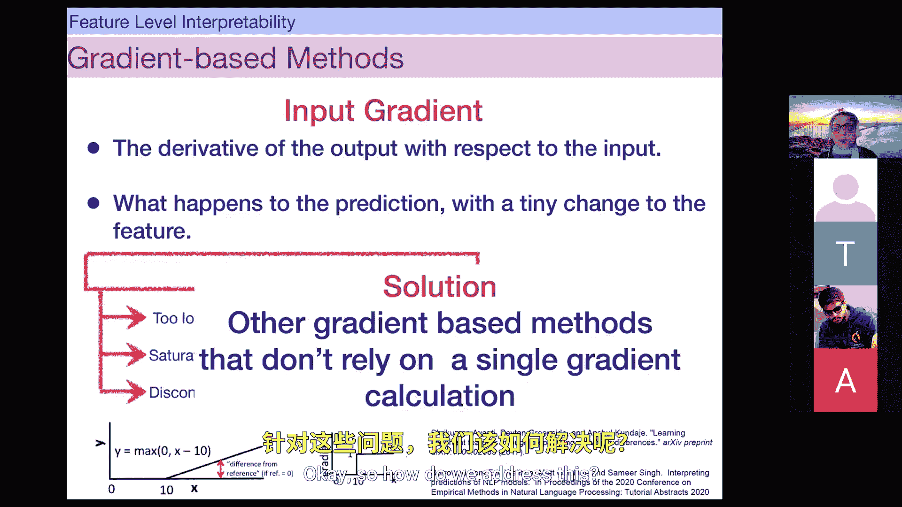

# 024：模型可解释性方法

## 概述

在本节课中，我们将探讨深度学习中的一个重要主题：模型可解释性。我们将了解为什么理解模型决策的原因至关重要，并介绍几种主流的特征级可解释性方法，特别是基于梯度的显著性图方法。

---

今天，我们很高兴再次邀请到Aya Ismail来讲解深度学习中的可解释性。Aya是马里兰大学的博士生，也是该领域的专家。我们非常高兴能请她来为我们介绍这个问题以及该主题的最新进展。现在，有请Aya。

谢谢Samil。今天我们将讨论深度学习的可解释性。

我们通常有一个输入，一个黑盒模型，然后得到一个输出。模型可解释性指的是，我希望理解模型为何做出某个特定的预测。

我们为什么需要关心可解释性？为什么不能仅仅信任模型并使用它做出的决策，而不去理解其背后的原因？主要原因是，在现实世界的应用中，仅仅有高准确率是不够的。让我们看一些需要可解释性的例子。

例如，如果一个模型在工业中被使用，我们需要识别它是否存在不良行为。我们基本上需要确保它基于正确的原因做出正确的决策。比如，曾有一个AI被用于判断一个人是否应获得保释。使用后人们发现，它根据肤色做出保释决定。具体来说，如果某人是黑人，他很可能无法获得保释。因此，我们需要确保模型做出正确的决策，并且是基于正确的原因。

另一种情况是，如果我们想提升模型性能。如果我们知道模型为何做出某个预测，我们就可以直接尝试修复它，从而获得性能更好的模型。

我们可能需要可解释性的另一个原因是科学发现。神经网络架构会接收所有输入，并尝试理解我们人类自身可能都不知道的模式和潜在分布。在某些情况下，我们确实想知道这些。例如，如果一个神经网络被用于分类人类大脑活动，我们会想知道大脑的哪些区域负责哪些功能。这在许多科学应用中会非常有用。

最后，有时应用场景过于关键，不能仅仅说“我们做出了这个预测，就这样了”。例如，在医疗应用中，你必须向用户解释为何做出这个诊断，而不能只是说因为我们有一个黑盒模型，它就是这么说的。

现在，我希望我已经说服你们，模型可解释性确实非常重要。接下来，让我们深入了解一下可解释性方法。

首先，我们可以有内置的模型可解释性。这是什么意思？我们有一个模型，我们训练它来解释自己。当它接收到一个输入时，它能够提供为何为该输入做出某个决策的解释。

另一种可解释性选项是特征级可解释性。这基本上是指，我们有一组特征，我们想知道每个特征对最终预测的贡献。

还有基于实例的解释。如果我们有一个测试样本，模型对它做出了预测，我们想知道是哪些训练样本导致了那个预测。

最后，有全局决策规则。我们想理解模型做出某个预测的全局性原因，即对模型本身的高层次理解。

在本讲座中，我们将主要关注特征级可解释性。

再次强调，对于特征级可解释性，我们将其定义为：如果我们有一个训练好的模型和一个可解释性方法，该方法会为每个特征分配一个重要度分数，该分数与该特征对给定预测的重要性相关。

这通过显著性图来展示，它基本上是一个特征分数图。

显著性图有不同的类型，主要有两种。一种是基于扰动的显著性图。这基本上意味着，我取我的输入，将其通过我的模型，得到一个输出。然后我扰动其中一个特征，将新的输入传递给模型，得到另一个输出。基本上，该特征的贡献就是模型输出的变化。有不同的方法可以做到这一点。例如，有“留一法”，即完全移除某个特征，观察模型如何受影响；有特征振荡法，即稍微扰动特征，观察其对模型的影响；还有其他方法。

另一类显著性方法是基于梯度的显著性方法，这类方法更为流行。

基于梯度的方法有很多，这里列出的并非全部方法。每次学术会议都会有更多新方法出现。让我们稍微详细地看看基于梯度的方法。我们首先有的是输入梯度，这是我们可以得到的最简单的东西。我们有一个输入，将其通过模型，然后得到每个类别的概率。我们取概率最高的类别，然后计算该类别输出相对于给定输入的偏导数。

这个偏导数向我们展示了，我们需要最少改变哪些特征，才能最大程度地改变那个特定类别的输出。我们最终得到一个显著性图，它基本上会突出显示对该模型重要的特征。那么，偏导数意味着什么？为什么它有意义？它实际上是如何做到这一点的？如果我们把它画出来，基本上它的意思是，导数是特征输入的微小变化。如果这是输入，那么导数基本上是一个非常非常微小的变化。这就是为什么它代表了当我们改变输入时输出的变化。

这是人们在基于梯度的方法中最基本的方法。但它有一些局限性。一个主要的局限是，它对微小的扰动非常敏感。例如，如果我们只是将输入在任一方向上移动一点点，我们会得到一个非常不同的梯度。

另一个问题是，我们可能会有饱和的输出，导致产生反直觉的梯度。如果我们看这个例子，我们有 `y = x1 + x2`（如果 `x1 + x2 < 1`），否则 `y = 1`。假设 `x1` 和 `x2` 都等于1，我们想计算梯度，然后我们得到的梯度是0。这意味着什么？它意味着两个特征都不重要吗？这真的不直观，也无助于我们理解发生了什么。

我们还可能有梯度不连续的问题。例如，这里 `y = max(0, x - 10)`。然后当你绘制梯度时，它基本上是一个阶跃函数，先是0，然后是1。这有两个问题：一是突然的跳跃，二是梯度完全没有显示关于 `x` 值如何变化的信息。

那么，我们如何解决这些问题呢？人们开始说，好吧，你不能仅仅依赖...

## 总结

本节课中，我们一起学习了深度学习模型可解释性的重要性及其应用场景。我们了解到，仅凭高准确率不足以在关键领域（如司法、医疗）信任模型。我们介绍了特征级可解释性的核心概念，即通过为每个特征分配重要度分数来理解其对预测的贡献。我们重点探讨了基于梯度的显著性图方法，特别是输入梯度法，并分析了其直观意义（通过微小输入变化观察输出变化）及其存在的局限性，如对微小扰动敏感、输出饱和导致梯度消失以及梯度不连续等问题。这些局限性为后续更高级的可解释性方法的发展提供了动机。