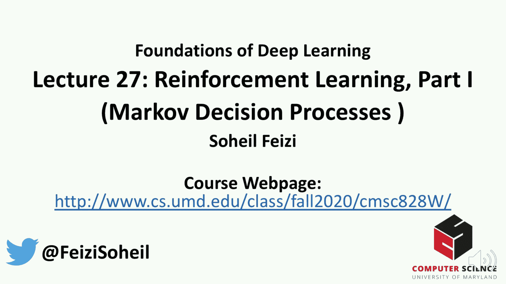
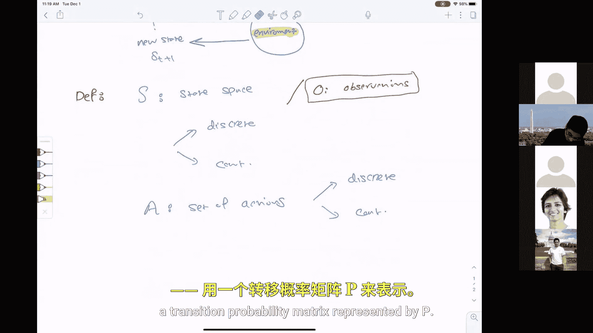

# 025：强化学习入门

在本节课中，我们将要学习强化学习的基本概念。强化学习是机器学习的一个重要分支，其核心目标是解决**序列决策问题**。与之前讨论过的分类或回归问题不同，在强化学习中，当前的决策会影响未来的决策和状态。本节课我们将介绍强化学习的基本框架、核心要素以及其数学表示。

## 序列决策问题

上一节我们回顾了监督学习、无监督学习等范式。本节中我们来看看强化学习所关注的**序列决策问题**。

序列决策问题的核心特征是：**当前的决策会影响未来的决策或行动**。这意味着决策不是孤立的，而是相互关联的序列。

以下是序列决策问题的一些典型例子：
*   **游戏**：如国际象棋，你走一步棋会改变棋盘状态，从而影响你及对手后续的走法。
*   **机器人学**：机器人的每一个移动或操作都会改变其环境状态，进而影响其后续的行动规划。
*   **自动驾驶**：车辆的每一个驾驶决策（如加速、转向）都会改变其与周围环境的关系，影响后续的决策。
*   **金融**：投资决策会影响未来的资产状态和后续的投资选择。
*   **生活决策**：例如选择学习某门课程，可能会影响你未来的知识储备和职业选择。

## 强化学习基本框架

为了形式化地描述序列决策问题，我们引入一个由**智能体**、**环境**和**交互**构成的基本框架。

在这个框架中：
1.  智能体在时间 `t` 处于某个**状态** `s_t`。
2.  智能体根据状态选择一个**动作** `a_t`。
3.  环境接收这个动作，并转移到下一个**状态** `s_{t+1}`。
4.  智能体进入新状态，并可能获得一个**奖励** `r_t`。
5.  这个过程不断重复，形成一个序列：`s_0, a_0, r_0, s_1, a_1, r_1, ...`

## 核心概念定义

接下来，我们更精确地定义框架中的各个核心组件。

### 状态空间

状态 `S` 是对系统当前情况的**充分描述**。所有可能状态的集合称为**状态空间**，用 `S` 表示。

状态可以是：
*   **离散变量**：例如棋盘上棋子的位置。
*   **连续变量**：例如车辆的速度、位置。
*   离散与连续变量的混合。

在本课程中，我们假设智能体能够**完全观测**到当前状态 `s_t`。在更复杂的情况下（如部分可观测马尔可夫决策过程，POMDP），智能体只能看到与状态相关的**观测值**，而非状态本身。

### 动作空间

动作 `A` 是智能体在给定状态下可以执行的操作。所有可能动作的集合称为**动作空间**，用 `A` 表示。

动作同样可以是：
*   **离散变量**：例如“向左转”、“向右转”这类二元或有限选择。
*   **连续变量**：例如将方向盘转动一个特定的角度，或将油门踩到某个程度。

### 环境动态

环境决定了智能体执行动作后，系统如何转移到下一个状态。我们通常用**转移概率**来刻画环境动态。

对于离散状态和动作空间，环境动态可以用一个**转移概率矩阵** `P` 来描述：

`P(s' | s, a) = Pr(S_{t+1} = s' | S_t = s, A_t = a)`

这个公式表示：在状态 `s` 下执行动作 `a` 后，环境转移到状态 `s'` 的概率。

对于连续空间，则使用概率密度函数来描述。

## 总结

本节课中我们一起学习了强化学习的基础。我们首先明确了强化学习致力于解决**序列决策问题**，其特点是当前决策影响未来。接着，我们介绍了强化学习的核心交互框架：智能体、环境和状态-动作-奖励序列。最后，我们精确定义了三个基本要素：**状态空间**（系统描述）、**动作空间**（可用操作）和**环境动态**（由转移概率刻画）。理解这些概念是学习后续更高级的强化学习算法（如价值函数、策略优化）的重要基础。