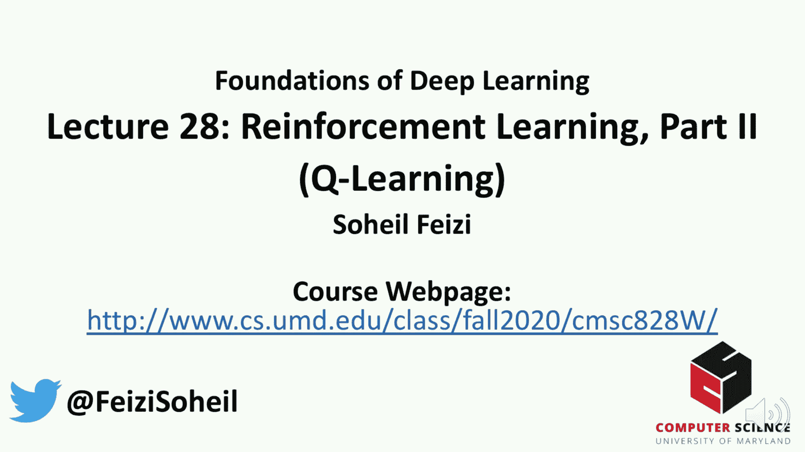
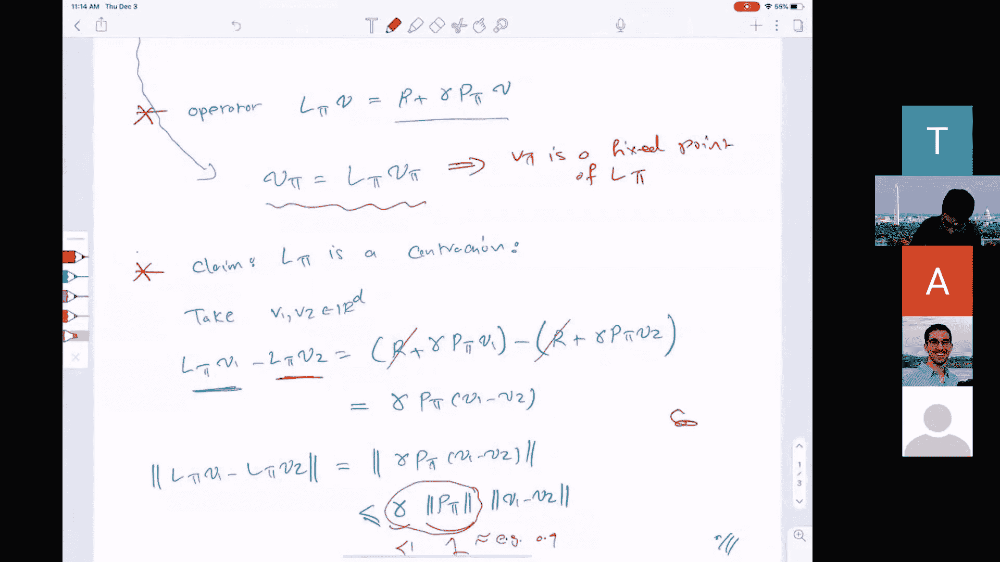

# 026：强化学习（续）

在本节课中，我们将继续探讨强化学习的核心内容。我们将首先回顾马尔可夫决策过程的基本概念，然后深入讨论价值迭代算法，并最终介绍深度强化学习的初步思想。

## 回顾：马尔可夫决策过程与价值函数

上一节我们介绍了马尔可夫决策过程的基本框架。它包含有限的状态空间、有限的动作空间、遵循马尔可夫链的转移概率，以及一个策略函数 π。

我们定义了**价值函数 V^π(s)**，它表示从状态 s 开始，并遵循策略 π 所能获得的**期望总奖励**。同时，我们也定义了**动作价值函数 Q^π(s, a)**，它表示从状态 s 开始，首先执行动作 a，然后遵循策略 π 所能获得的期望总奖励。

一个核心问题是：如何评估给定策略 π 的价值函数？我们得到了一个递归公式，称为贝尔曼方程：

**V^π(s) = R(s) + γ * Σ_{s'} P(s' | s, π(s)) * V^π(s')**

其中，γ 是折扣因子（0 < γ < 1），R(s) 是即时奖励，P 是转移概率。

我们可以将所有状态的这个方程写成矩阵形式：

**V^π = R + γ * P_π * V^π**

这里，V^π 和 R 是向量，P_π 是转移概率矩阵。通过求解这个线性方程组，我们可以得到 V^π = (I - γ * P_π)^{-1} * R。由于 P_π 是随机矩阵，其最大特征值为1，而 γ < 1，保证了矩阵 (I - γ * P_π) 是可逆的。

然而，直接求逆矩阵计算量可能很大。因此，我们引入了**价值迭代**这种迭代方法。

## 价值迭代：一个收缩映射

我们定义了一个贝尔曼算子 L_π，它作用于任意价值向量 V：

**L_π(V) = R + γ * P_π * V**

那么，策略 π 的价值函数 V^π 就是这个算子的**不动点**，即 V^π = L_π(V^π)。

关键性质在于，L_π 是一个**收缩映射**。这意味着对于任意两个价值向量 V1 和 V2，应用该算子后，它们之间的距离会缩小。

以下是证明思路：
考虑 L_π(V1) 和 L_π(V2) 的差：
L_π(V1) - L_π(V2) = γ * P_π * (V1 - V2)

取范数并应用不等式：
|| L_π(V1) - L_π(V2) || ≤ γ * || P_π || * || V1 - V2 ||

由于 P_π 是随机矩阵，其谱范数（最大奇异值）为 1。因此：
|| L_π(V1) - L_π(V2) || ≤ γ * || V1 - V2 ||

因为 γ < 1，所以这是一个严格的收缩。

这个性质的直观理解是：无论我们从哪个初始价值向量 V0 开始，反复应用贝尔曼算子 L_π，生成的序列 {V, L_π(V), L_π(L_π(V)), ...} 都会**收敛**到唯一的不动点 V^π。这为我们提供了一种计算价值函数的有效迭代算法。

## 从策略评估到策略优化

到目前为止，我们讨论的是如何**评估**一个给定的策略 π。但强化学习的最终目标是找到一个**最优策略 π***，以最大化期望总奖励。

最优策略对应的价值函数称为**最优价值函数 V***，它满足贝尔曼最优方程：

**V*(s) = max_a [ R(s, a) + γ * Σ_{s'} P(s' | s, a) * V*(s') ]**

类似地，我们可以定义最优动作价值函数 Q*，并且可以设计类似价值迭代的算法（如Q-learning）来寻找最优策略。这些算法通常交替进行策略评估（计算当前策略的价值）和策略改进（根据价值函数更新策略以获取更高奖励）。

## 深度强化学习简介

传统的强化学习方法在状态空间或动作空间很大时会遇到困难，因为价值函数或策略函数难以用表格表示。这就是**深度强化学习**的用武之地。

深度强化学习的核心思想是使用**深度神经网络**作为函数近似器，来近似表示：
*   价值函数 V(s) 或 Q(s, a)
*   策略函数 π(a | s)

以下是两种主要范式：

**1. 基于价值的深度强化学习（如 DQN）**
使用深度神经网络来近似最优动作价值函数 Q*(s, a; θ)，其中 θ 是网络参数。网络输入是状态 s，输出是每个可能动作 a 的 Q 值。然后通过选择 Q 值最大的动作来制定策略。

**2. 基于策略的深度强化学习（如策略梯度方法）**
使用深度神经网络直接参数化策略 π(a | s; θ)。网络输入状态 s，输出动作的概率分布（对于离散动作）或动作的参数（对于连续动作）。通过优化网络参数 θ 来直接最大化期望奖励。

许多现代算法（如 Actor-Critic）结合了这两种思路，同时学习价值函数（Critic）和策略（Actor），以达到更稳定、更高效的学习效果。

## 总结

本节课中我们一起学习了：
1.  **策略评估**：通过贝尔曼方程和收缩映射的性质，我们可以使用价值迭代等算法有效地计算给定策略的价值函数。
2.  **策略优化**：强化学习的核心目标是找到最优策略，这引出了贝尔曼最优方程。
3.  **深度强化学习**：为了解决高维问题，我们引入深度神经网络作为函数近似器，分别用于近似价值函数（价值基方法）或直接参数化策略（策略基方法），这为处理复杂的现实世界任务（如游戏、机器人控制）提供了强大的工具。

从理解MDP的基础，到掌握价值迭代的原理，再到窥见深度强化学习的广阔天地，我们正在构建解决序列决策问题的坚实知识框架。