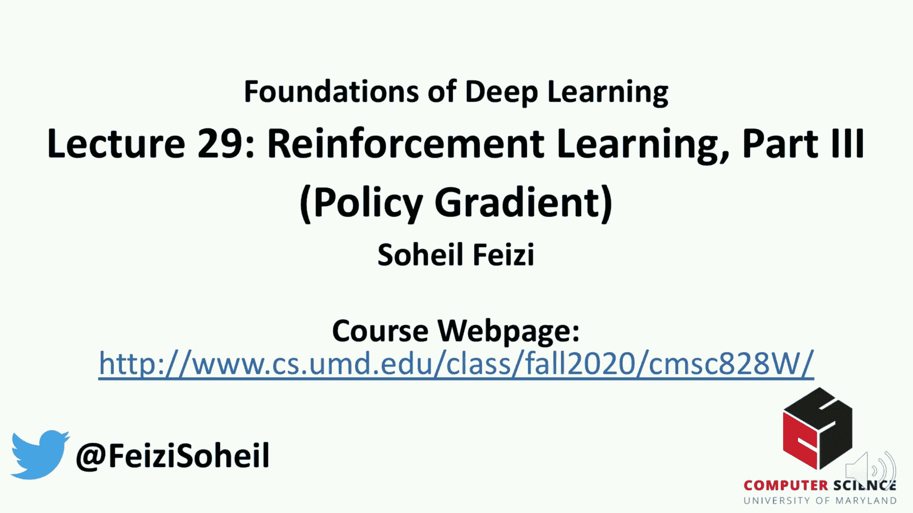
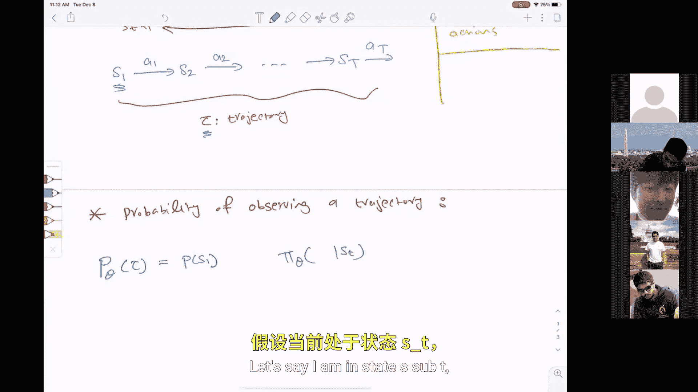

# 027：策略梯度方法



## 概述
在本节课中，我们将学习如何使用梯度下降方法来解决强化学习问题。我们将探讨如何参数化策略函数，并计算期望奖励关于策略参数的梯度，从而通过优化策略来最大化累积奖励。

---

上一节我们介绍了使用神经网络参数化Q函数或价值函数的方法。本节中，我们来看看如何直接对策略本身进行参数化和优化。

核心问题在于，我们能否使用梯度下降来优化策略，以最大化期望奖励。这要求策略函数必须是可微的。

## 参数化策略
为了应用梯度下降，我们需要一个可微的策略函数。一个自然的选择是使用深度神经网络来参数化策略。

策略函数 **π_θ** 是一个以参数 **θ** 定义的神经网络，它将状态 **s_t** 映射到动作 **a_t**。其过程可以描述为：
```
a_t = π_θ(s_t)
```
在时间步 **t**，智能体处于状态 **s_t**，策略网络输出动作 **a_t**。随后，环境根据其转移概率将智能体带到新状态 **s_{t+1}**，如此循环。我们考虑一个有限时间范围 **T** 的问题，因此暂时无需考虑折扣因子。

需要注意的是，在部分可观测环境中，策略函数的输入是观测值而非完全的状态。本节课我们主要讨论完全可观测的情况。

## 轨迹概率
给定一个特定的轨迹 **τ**（即状态和动作的序列），我们关心在特定策略 **π_θ** 和环境模型下，观察到该轨迹的概率 **P_θ(τ)**。

该概率由初始状态分布、策略给出的动作选择概率以及环境的动态（转移概率）共同决定。其计算公式为：
```
P_θ(τ) = p(s_1) * ∏_{t=1}^{T} π_θ(a_t | s_t) * p(s_{t+1} | s_t, a_t)
```
其中，**p(s_1)** 是初始状态分布，**π_θ(a_t | s_t)** 是策略在状态 **s_t** 下选择动作 **a_t** 的概率，**p(s_{t+1} | s_t, a_t)** 是环境的转移概率。

## 目标函数
我们的目标是最大化从初始状态开始的期望总奖励 **J(θ)**。期望总奖励是所有可能轨迹的奖励按其发生概率的加权和。

目标函数 **J(θ)** 定义为：
```
J(θ) = E_{τ ~ P_θ(τ)} [R(τ)] = ∑_{τ} P_θ(τ) * R(τ)
```
其中，**R(τ)** 是轨迹 **τ** 的总奖励。

## 策略梯度定理
为了使用梯度上升最大化 **J(θ)**，我们需要计算其关于参数 **θ** 的梯度。直接计算涉及对概率分布的求和，计算困难。

策略梯度定理提供了一个优雅的解决方案，它将梯度表达为期望形式，便于通过采样来估计。梯度公式为：
```
∇_θ J(θ) = E_{τ ~ P_θ(τ)} [ (∑_{t=1}^{T} ∇_θ log π_θ(a_t | s_t)) * R(τ) ]
```
这个公式表明，我们可以通过从当前策略下采样的轨迹来估计梯度。梯度的方向是增加高奖励轨迹对应动作的概率，减少低奖励轨迹对应动作的概率。

## 方差缩减技术
基于上述公式的原始策略梯度估计器通常具有高方差，导致训练不稳定。以下是两种常用的方差缩减技术：

**引入基线：**
从奖励 **R(τ)** 中减去一个基线 **b**（通常是与状态相关的价值函数估计），可以在不引入偏差的情况下减少方差。梯度公式变为：
```
∇_θ J(θ) = E_{τ ~ P_θ(τ)} [ (∑_{t=1}^{T} ∇_θ log π_θ(a_t | s_t)) * (R(τ) - b) ]
```

**使用时间差分误差：**
更进一步，我们可以用每个时间步的优势函数 **A(s_t, a_t)**（即动作价值函数 **Q(s_t, a_t)** 减去状态价值函数 **V(s_t)**）来替代整个轨迹的累积奖励。这能提供更精细、方差更低的更新信号。公式变为：
```
∇_θ J(θ) = E_{τ ~ P_θ(τ)} [ ∑_{t=1}^{T} ∇_θ log π_θ(a_t | s_t) * A(s_t, a_t) ]
```

## 总结
本节课我们一起学习了策略梯度方法的核心思想。我们了解到，通过使用神经网络参数化策略，并利用策略梯度定理，可以直接对策略进行优化以最大化期望奖励。我们还探讨了通过引入基线和优势函数来减少梯度估计方差的技术。这种方法构成了现代深度强化学习算法（如A3C、PPO等）的基础。



---