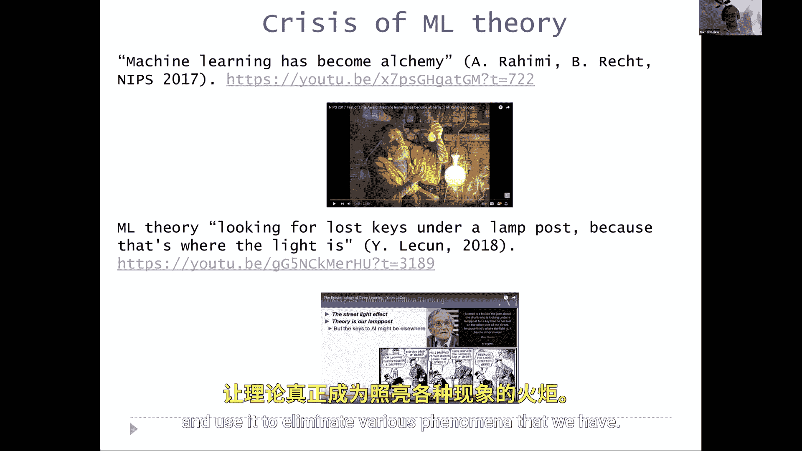
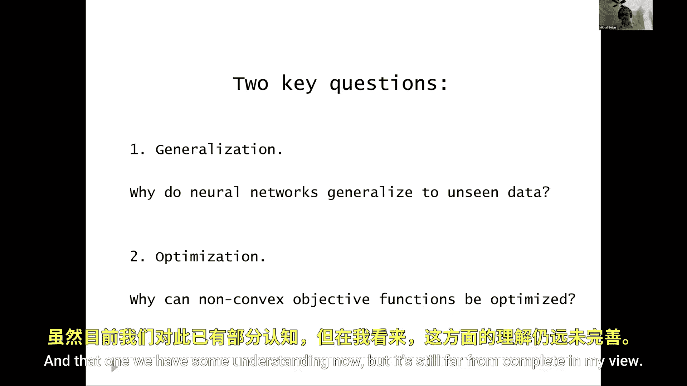
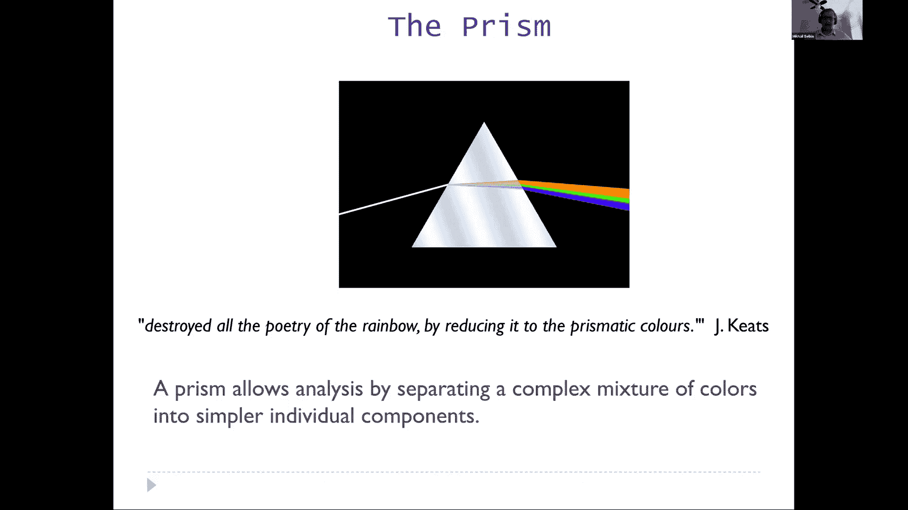
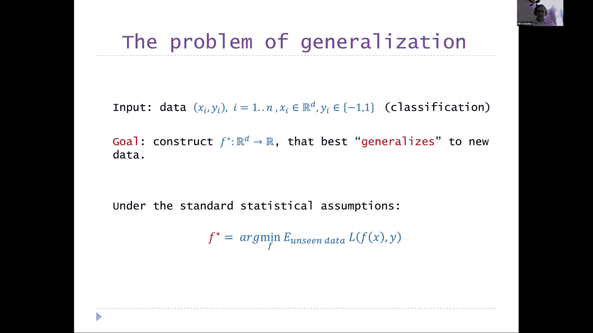

# 029：Misha Belkin 关于深度学习的演讲

在本节课中，我们将学习 Misha Belkin 教授关于深度学习现象的演讲内容，特别是“插值”概念如何帮助我们理解这些现象。我们将探讨深度学习理论面临的挑战，以及如何通过分解复杂问题来获得新的见解。

## 概述

深度学习在过去十年取得了巨大成功，但其成功背后是极其复杂的结构和海量参数，这使得其原理难以理解。本次演讲将回顾一些引人注目的现象，并重点阐述“插值”如何从理论和实践层面为理解这些现象提供线索。

## 经典方法与理论危机

上一节我们概述了深度学习理解上的困境，本节中我们来看看传统的机器学习理论方法及其面临的危机。

在机器学习中，我们通常拥有数据 `(X_i, Y_i)`。例如，`X_i` 是 R^D 空间中的数据点（如图像），`Y_i` 是对应的标签（如猫为-1，狗为1）。目标是根据这些数据构建一个从输入空间到输出（如{-1, 1}）的函数，该函数能很好地泛化到新数据。

传统的统计学习理论对此有一套解释框架。然而，深度学习的实践似乎打破了这些经典规则。

## 深度学习的两个核心问题

以下是两个长期困扰研究者的核心问题：

1.  **泛化问题**：为何参数极多、结构复杂的神经网络能在未见数据上表现良好，而不会严重过拟合？
2.  **优化问题**：为何非凸的目标函数能够被有效优化？

目前，我们对第二个问题的理解已较为深入。本次演讲将主要聚焦于第一个问题——泛化，虽然已有一些理解，但远未完善。

## 插值的作用：像棱镜一样分解问题

上一节我们提出了核心问题，本节中我们来看看“插值”如何充当理解这些问题的“棱镜”。

棱镜的作用是将复杂的白光分解为不同频率的单色光，使其易于分析。类似地，在机器学习中，“插值”能够将复杂的现象分解为更简单、可单独分析的组成部分。

其基本思想是：通过分离复杂现象为更简单的组件，从而允许进行分析。

## 总结

本节课中，我们一起学习了 Misha Belkin 教授对深度学习理论现状的分析。我们回顾了深度学习成功背后理论解释的缺失，指出了泛化与优化两大核心挑战，并引入了“插值”作为分解和理解复杂深度学习现象的关键工具。这为我们后续深入探讨具体的泛化现象奠定了理论基础。