# 030：如何构建模型？🤖

在本节课中，我们将跟随纽约大学教授安德鲁·威尔逊的视角，探讨如何构建机器学习模型。我们将审视关于神经网络的常见误解，并从概率建模的角度理解深度学习的本质。课程将论证，神经网络并非如通常描述的那般神秘或独特，其成功很大程度上源于其灵活性与合理的归纳偏置的结合。

---

我是安德鲁·威尔逊，纽约大学教授。

我的研究领域是贝叶斯机器学习和概率建模。虽然我的工作涉及广泛的项目，包括将对称性融入神经网络、受物理学启发的深度学习等非贝叶斯方法，但贯穿我工作的核心是渴望理解一种**规范化的模型构建方法**，旨在创建能够无需人工干预进行学习和决策的智能体。这可以说是机器学习的核心目标，但真正致力于理解神经网络并利用这种理解来构建实用新方法的研究相对较少，而这正是最令我兴奋的工作方向。

从这个角度看，我认为现代深度学习中许多被视为神秘的现象实际上是相当可理解的。

同时，我认为我们声称神经网络独特且与众不同的许多方面，与其他模型类别相比，可能并没有那么不同。

如果我要做个调查，问你们神经网络与其他模型有什么非常不同之处，我猜你们可能会说什么。让我们看看聊天框里的答案。

现场观众的回答是：特征提取、参数。

当人们撰写关于神经网络的理论论文时，他们常常声称：这些模型能够泛化是疯狂的。为什么他们认为这很疯狂？

**过参数化**。常见的故事是：我们的模型参数比数据点还多，因此它们可以表示许多能达到很低训练损失的解，其中许多并不能提供良好的泛化能力。然后另一种说法是：如果我们使用像**随机梯度下降（SGD）**这样的随机优化方法，我们会收敛到那些解中的一个子集，而这个子集确实能很好地泛化。

因此，我们被SGD的**隐式偏置**所拯救。我认为这种逻辑链条中的每一个主张都存在缺陷。

首先，神经网络是否因为过参数化而显得不同寻常？我认为不是。有许多模型拥有大量参数。**高斯过程**就是一个例子，其标准协方差函数对应着无限数量的参数，实际上比任何有限神经网络都更灵活。然而，当数据点很少时，它们相对于其他模型能提供最佳的泛化性能。这似乎直接反驳了人们关于过参数化的所有主张。

其次，还有一个主张是：如果一个模型是过参数化的，我们预期它能提供许多能很好拟合数据的解，即存在某种灵活性。虽然神经网络在实践中相对灵活，但**过参数化并不直接意味着灵活性**。将参数数量简单地视为模型灵活性的某种代理是一个巨大的错误。例如，我们可以轻易地构造一个平凡的例子，只是把所有参数加在一起，而灵活性没有任何增加。因此，参数数量与模型类别的灵活性之间是一种非常间接的关系。

再次，经常提出的下一个主张是：因为模型是灵活的，所以会出现某种问题，比如我们有很多参数，因此（尽管这并不必然成立）具有灵活性。一旦我们接受了灵活性，哦，如果它灵活，我们可能会严重过拟合。但我们为什么会预期这种情况发生呢？我刚举了一个高斯过程的例子，它比任何神经网络都灵活，不仅不会过拟合，事实上在小数据情况下似乎比其他模型更好。因此，显然泛化不仅仅关乎灵活性，它是一个多维度的概念，也与所谓的**归纳偏置**有关。从概率的角度看，归纳偏置对应于我们可能偏好于哪些类型的解，而不是我们能表示哪些解。

然后，这个逻辑链条的最后一部分是：好吧，我们有了这个据称非常灵活的模型，它可以表示那些能很好拟合数据但无法泛化的解，但我们被SGD的隐式偏置拯救了。这里有几个问题：其一，如果我们相信这是真的，甚至无需做任何实验，那么我们的主张基本上是，我们只需要灵活性和随机优化，就能拥有一种能有效解决现实世界中所有问题的通用学习系统。当然，当你这样表述时，这是一个荒谬的主张。构建灵活模型的方法有很多，我不认为任何严肃的机器学习研究者会相信，只要我们简单地对这些模型使用SGD，它们就能突然解决所有有趣的问题。所以这看起来就是错误的。

我反对的第二点是，我们从实验中就知道它是错的。例如，有实验使用**全批量梯度下降**训练神经网络，Tom团队有一篇有趣的论文表明，泛化能力实际上并没有因全批量训练而受到显著损害。我们可能有很多理由想要使用随机优化，例如计算上非常方便等，但这并不是神经网络通常比替代方案泛化得更好的根本原因。

因此，我认为存在很多错误的传统观念。另一个经常出现的事情是：我们应该惊讶于我们可以在带有随机标签的数据集上训练神经网络，并且它们可以完美地拟合那些数据集，但它们仍然能在其他实际存在结构的问题上泛化。A）我不认为我们应该感到惊讶，我可以很快解释原因；B）这也并非神经网络独有。我们可以在其他模型类别中完美复现这种行为。在本次讲座指定阅读的一篇论文中，我们实际上展示了你可以用高斯过程完美复现那些结果，而且不仅仅是高斯过程，你也可以用其他模型类别做到。我们理解为什么会这样，部分原因是灵活性才是关键。你可以拥有拟合任何数据集的灵活性，但只要你具有倾向于某些类型解的归纳偏置（先验），那么你仍然应该能够在许多合理问题上泛化。

另一个被认为神经网络非常独特的现象是**双下降**，即随着模型中参数数量或模型容量的增加，泛化能力首先开始改善，然后开始变差（对应过拟合），接着又开始再次变好。这被认为是深度学习领域非常令人惊讶的现象。其实不然，我们知道甚至可以用线性模型重现这种行为。因此，我认为很少有现象是神秘的或神经网络独有的。也许有一些事情，比如我认为用于训练神经网络的目标函数的几何特性在某种程度上是不寻常且有趣的，具有诸如**模式连通性**这样的结构，即你可以从一个SGD训练的解走到另一个解，而沿途的训练损失几乎不增加。沿着这些路径遍历的各种模型往往能在测试数据上提供相当丰富的不同函数集合，这可以用于提升性能等。我认为这在某种程度上是神经网络独有的。

显然，神经网络有一些不同之处，这就是为什么我们将它们用于许多问题。但我想说，它们并不像通常呈现的那样与其他模型类别不同，它们实际上也没有那么神秘。我认为深度学习的很多方面可以从概率的角度来理解，这将是本次讲座的部分目的。让我们从零开始在白板上逐步建立这个视角。

---

假设我们有这些数据点，我们正在考虑三种可能拟合数据的函数：一个线性函数、一个三次多项式和一个一万次多项式。假设我们只考虑这三种可能的选择，我们必须使用其中之一。如果你想拟合这些数据点并对1961年做出预测，你会选择哪一个？请在聊天框中输入1、2或3，或者现场观众也可以投票。选择选项1的请举手。

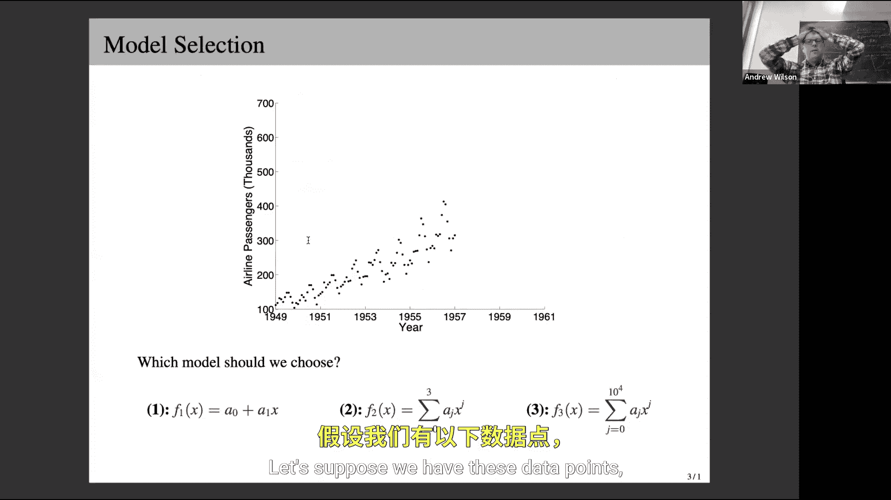
*选项1：线性函数*

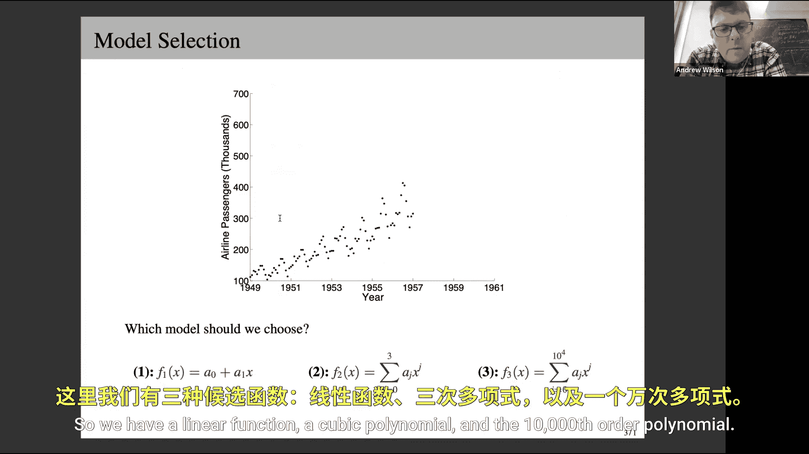
*选项2：三次多项式*

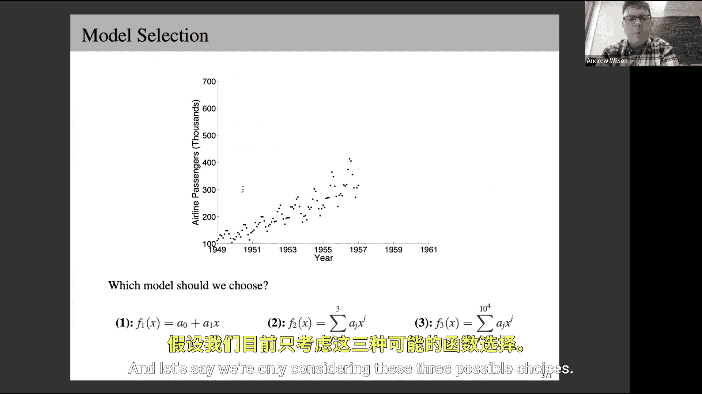
*选项3：一万次多项式*

好的，大多数人，我想，选择了选项二。好的，选项三呢？现场观众中有人选择三吗？在镜头里看不到。好吧，那些是做了课前阅读的人，我猜。

在这次讲座中，我将论证实际上我们会选择三。事实上，我们会因为选项三的灵活性水平而感到不满足，因为我们相信现实世界是复杂的，我们需要复杂的模型来捕捉这种结构。只要我们有一种合理的方法来学习这些模型，我们就应该能够越来越接近真实情况，做出越来越好的预测。

因此，我会说我更喜欢选项三，因为它比选项一或二更灵活，但它也还不够灵活。

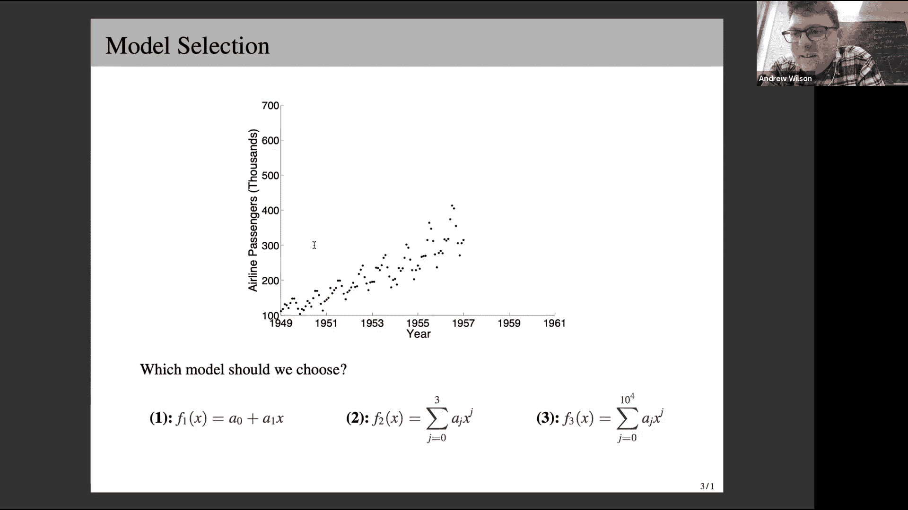
*现实世界是复杂的*

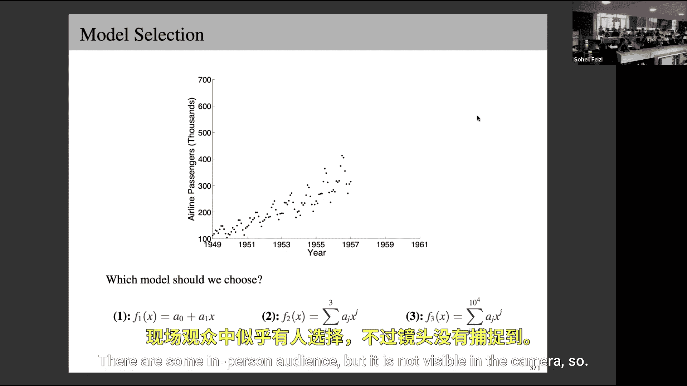
*我们需要灵活的模型*

*模型应能捕捉复杂结构*

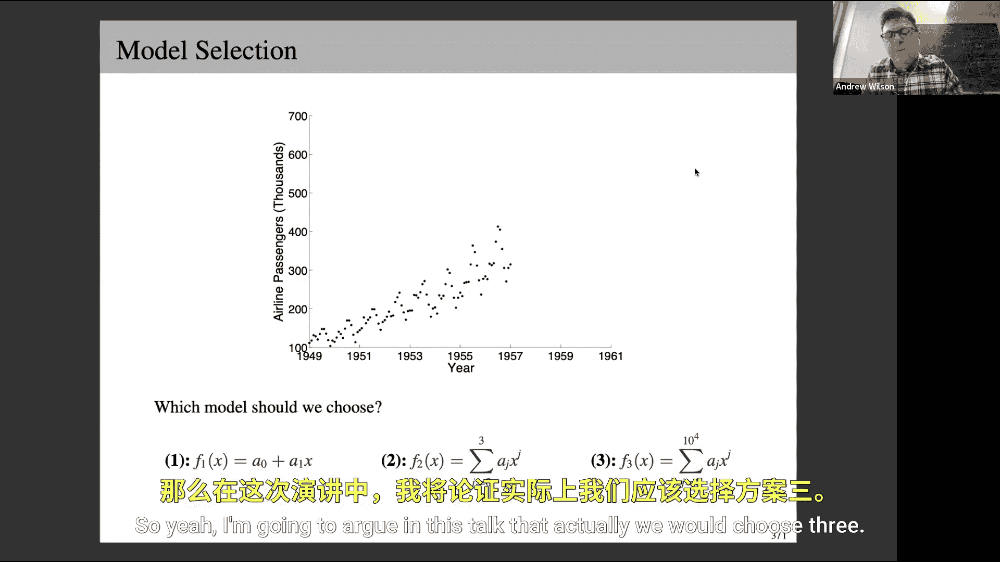
*关键在于如何学习*

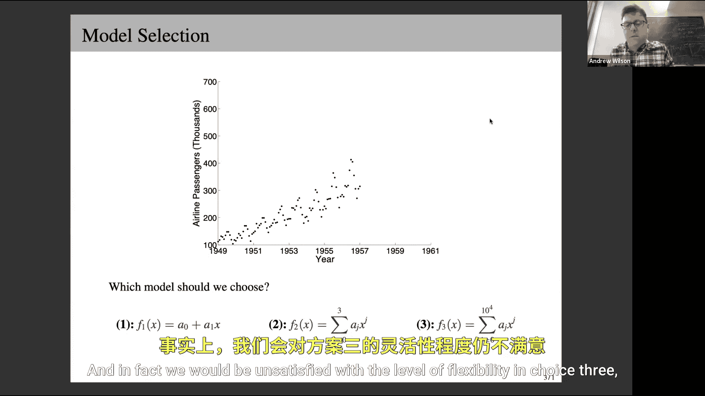
*归纳偏置引导学习方向*

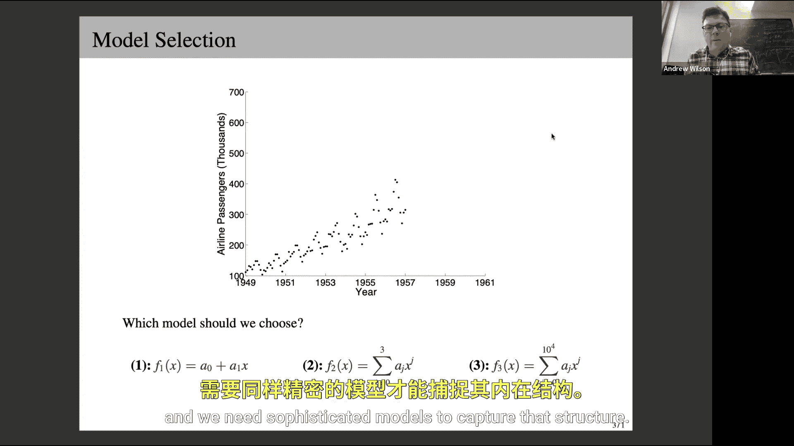
*灵活性 + 合理偏置 = 良好泛化*

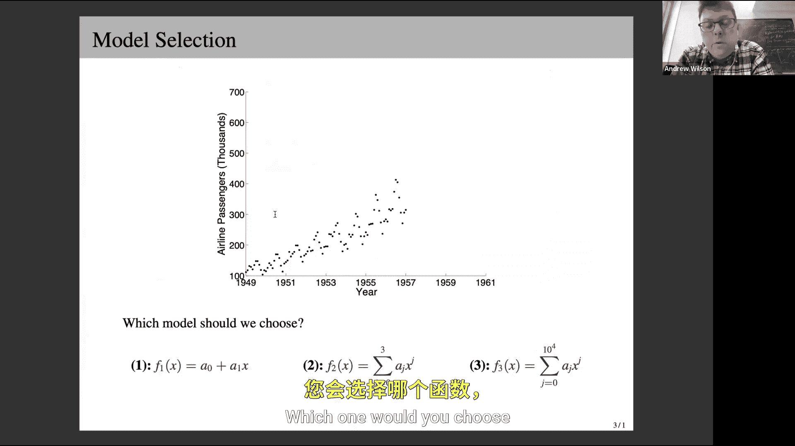

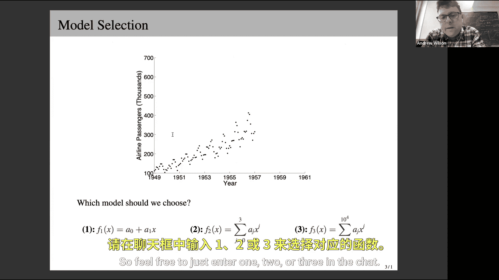

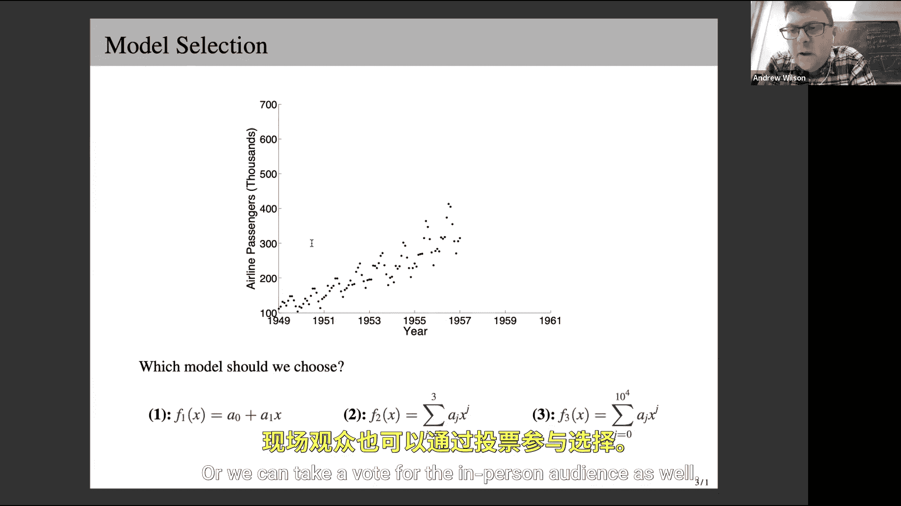

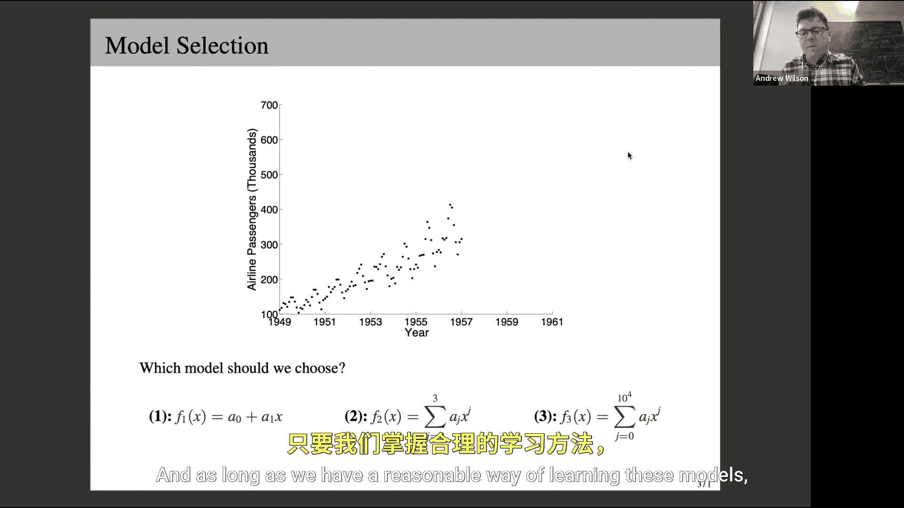
*神经网络提供了这种组合*

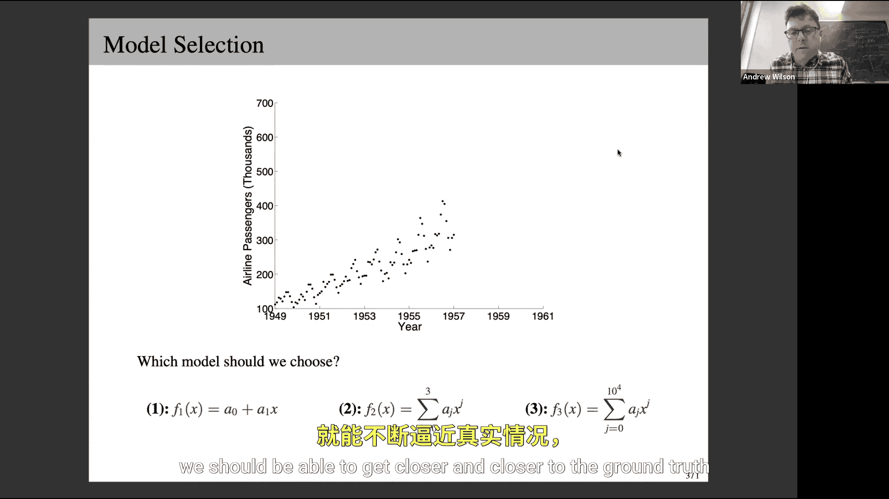
*但并非其独有特性*

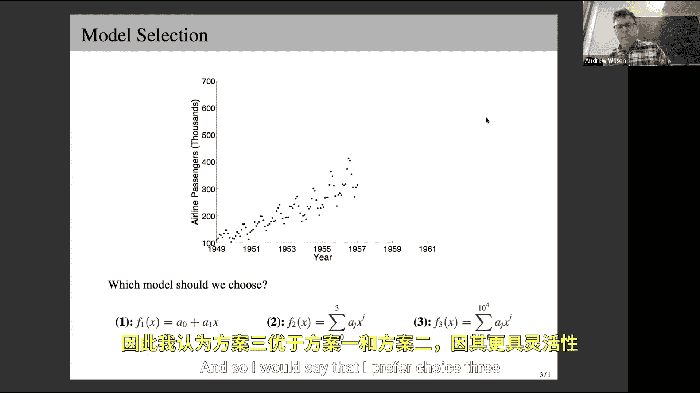
*理解原理才能更好地构建模型*

---

本节课中，我们一起学习了安德鲁·威尔逊教授关于如何构建模型的见解。我们审视并挑战了关于神经网络的几个常见误解，例如过参数化必然导致过拟合、SGD的隐式偏置是泛化的唯一原因等。核心观点是：神经网络的强大并非源于其神秘特性，而是源于**高灵活性**与**合理的归纳偏置**的有效结合。这种结合并非神经网络独有，高斯过程等模型也具备。理解这一点，有助于我们从概率建模的坚实基础上，更理性、更有效地设计和构建机器学习模型。