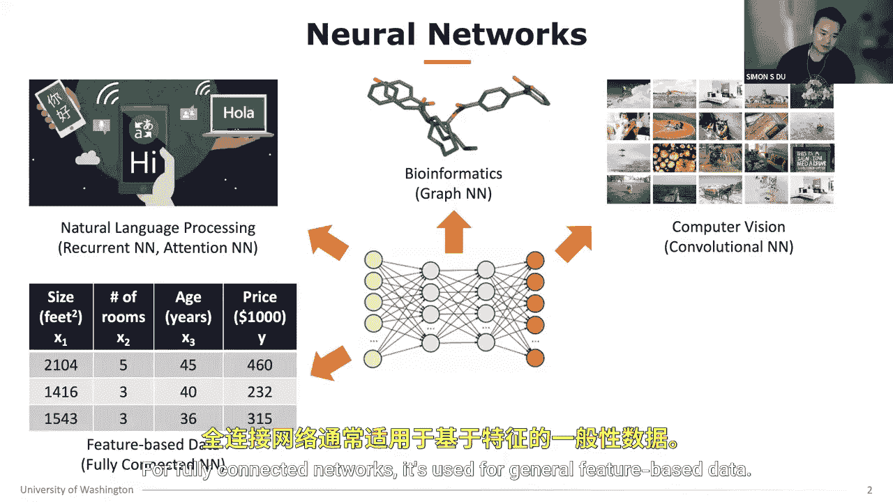
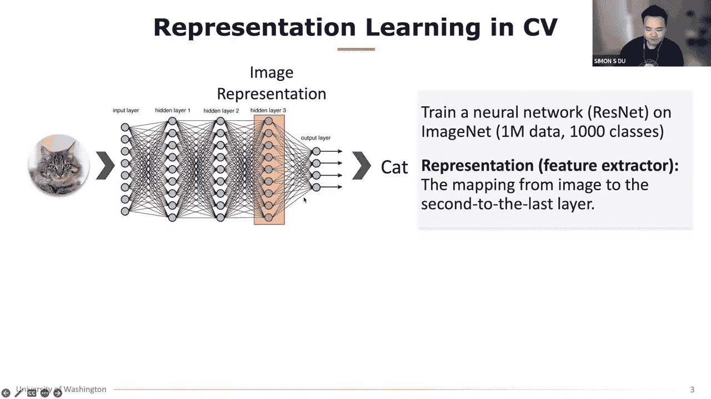
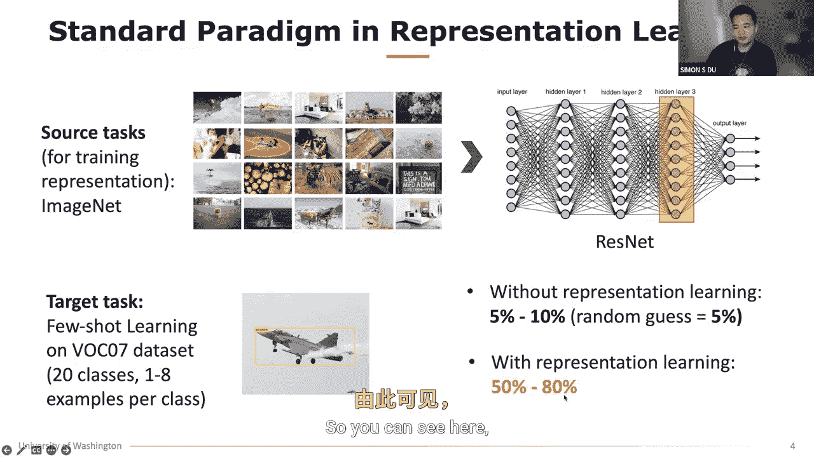
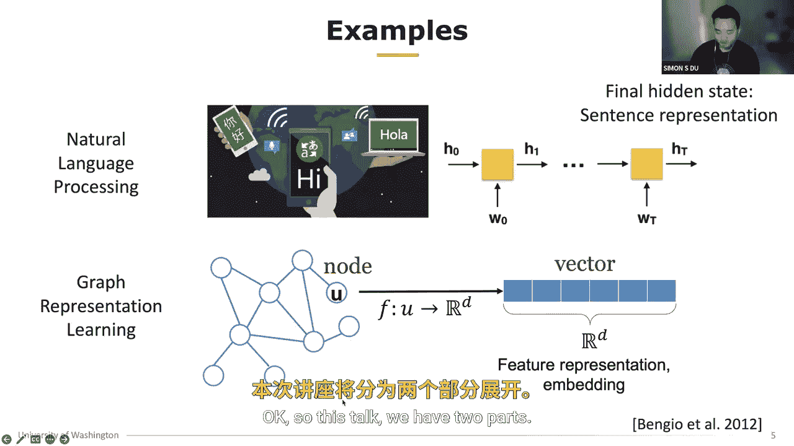
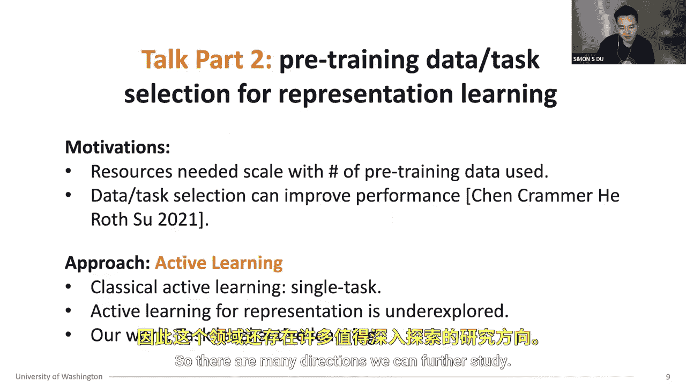

# 031：被动与主动多任务表示学习

在本节课中，我们将学习表示学习的理论与实践。首先，我们将探讨表示学习的理论基础，理解其在何种条件下能有效提升下游任务的性能。随后，我们将关注一个现实挑战：如何在资源有限的情况下，通过主动选择最相关的预训练数据来高效地进行表示学习。

## 表示学习简介

上一节我们介绍了深度神经网络在不同领域的成功应用。本节中，我们来看看表示学习这一特定用途。

表示学习旨在学习数据的良好表示。在本次讨论中，“表示”特指神经网络的倒数第二层。具体过程是：输入数据（如图像）经过多层网络映射，在倒数第二层输出一个向量，该向量即为输入数据的表示。

从输入层到倒数第二层的映射网络，可称为特征提取器，它是一个将输入映射为向量的函数。倒数第二层的输出即是表示。

通常，我们需要在非常大的数据集上训练这个神经网络以学习良好的表示。早期可能仅在图像数据上训练，如今则使用更庞大的数据集。总之，需要海量数据来为图像学习一个好的特征提取器。

## 表示学习的应用

上一节我们了解了如何学习表示，本节中我们来看看如何应用这些表示。

表示学习的用途在于，其学到的表示对其他任务也很有用。例如，你可以在ImageNet数据集上训练一个表示，而这个表示对于许多其他任务（如下游任务）同样有效。对于一个新的下游任务，你可以固定之前学到的特征提取器（即表示），仅重新训练最后的线性层（或支持向量机）。这就是利用已学表示进行下游任务的方式。

以下是一个更具体的例子。

假设我们使用ResNet架构训练一个表示函数，并在ImageNet数据集上进行训练。我们的目标下游任务是一个少样本学习任务，例如CIFAR-FS数据集。该任务包含20个类别，但每个类别只有1到5个示例样本。由于每个类别的样本极少，这是一个极具挑战性的少样本学习任务。

如果不使用表示学习，仅使用SVM或手工特征等方法，准确率可能只有5%到10%。对于一个20类的分类问题，随机猜测的准确率是5%。数据量有限是性能不佳的主要原因。

然而，如果使用表示学习，首先在ImageNet上预训练ResNet，然后固定其特征提取器，仅在下游任务的少量数据上重新训练最后一个线性层，性能可以直接从约50%提升到80%以上。

由此可见，与不使用表示学习相比，这是一个巨大的性能提升。这展示了表示学习在实践中的强大作用。虽然表示学习有多种变体，但其核心方法论是通用的，也广泛应用于自然语言处理（如将RNN的隐藏状态作为句子表示）和图神经网络（学习节点的表示以用于下游任务如节点分类）等领域。

## 表示学习的理论动机

上一节我们看到了表示学习的实践效果，本节中我们将从理论角度探讨其有效性。

本次讲座的第一部分，我们将建立表示学习的理论基础。我们将研究在何种条件下，表示学习确实能提升下游任务的性能。我们将探讨必要和充分条件，并从数学角度理解表示学习为何有效。

## 大规模表示学习的趋势与挑战

为了引出讲座的第二部分，让我们再次审视当前表示学习的发展趋势。

如今，表示学习模型变得越来越大。从2018年到2022年，模型规模增长了数个数量级。同时，用于预训练的数据量也大幅增加。例如，在语言应用中，我们使用高达3500亿单词来训练一个表示。主要原因在于，用于预训练的数据获取成本相对较低（如维基百科或网络文章），因此数据量可以非常庞大。

在机器学习中，通常应尽可能使用更多数据。大型科技公司正是利用数十亿数据训练大模型，并取得了显著的性能提升。

然而，另一方面，大多数研究人员并不在大型科技公司工作。特别是对于小型实验室或组织，他们没有资源来训练如此庞大的模型。以著名的GPT-3模型为例，它拥有1750亿参数，使用了海量数据，需要在上万个GPU上进行训练，估计总成本高达千万美元。通常，我们没有如此巨额的资源来训练单个模型。

在实践中，许多场景下资源是有限的。假设你有一个特定任务（如生物信息学或交通预测），你只有有限的计算资源（如GPU）、资金和工程师。你虽然可能想利用所有现有数据（如所有城市的交通数据），但没有足够资源像训练GPT-3那样训练一个巨大的表示学习模型。那么，我们该如何应对？

## 主动数据选择：应对资源限制

讲座的第二部分，我们将讨论我们近期开发的一种方法：主动选择最相关的预训练数据。

其动机如下：通常，训练大模型所需的资源与使用的预训练数据量成正比。数据越多，需要的GPU和时间就越多。因此，如果我们能减少预训练所需的数据量，就能降低资源需求。

另一个动机是近期的发现：并非数据越多越好，数据质量同样至关重要。精心选择对预训练最重要的数据，已经可以大幅提升性能。

因此，在讲座的第二部分，我们将讨论我们近期提出的方法：利用主动学习来选择最相关的预训练数据。通过减少预训练所需的数据量，从而降低资源消耗。这与经典的主动学习不同，经典主动学习通常针对单一监督学习任务选择数据点；而我们的方法是在多任务表示学习框架下，为特定的目标下游任务，主动选择最相关的**源任务**（我们将解释“任务”的含义）。这是一个相对较新的研究领域，虽然主动学习在监督学习中已被广泛研究，但针对表示学习的主动学习仍处于探索阶段，存在许多值得研究的方向。

## 课程总结

本节课中我们一起学习了表示学习的核心概念与应用。我们首先通过实例了解了表示学习如何通过预训练提升下游任务性能，并探讨了其背后的理论动机。接着，我们审视了当前大规模表示学习面临的资源挑战，并介绍了一种通过主动选择相关数据来高效进行表示学习的新思路。这为在有限资源下利用表示学习提供了可行的方向。