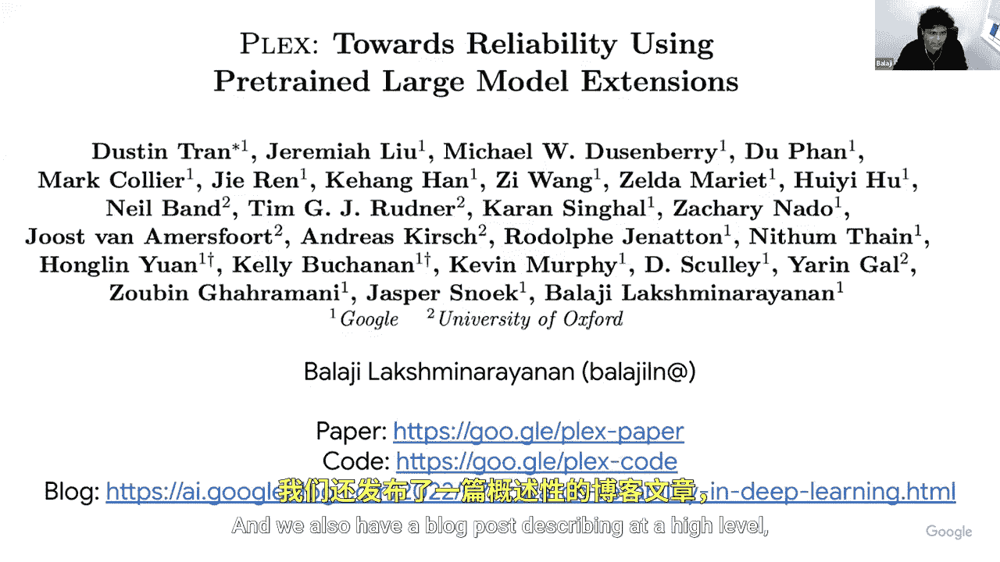
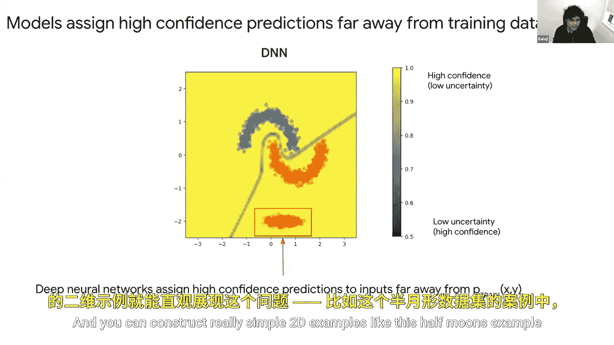

# 032：Balaji Lakshminarayanan 关于可靠性的演讲

在本节课中，我们将学习深度学习中的不确定性量化与分布外鲁棒性。我们将探讨为何需要良好的不确定性估计，以及模型在面对与训练数据分布不同的测试数据时面临的挑战。

## 概述

感谢邀请，很高兴来到这里。今天我将讨论我们最近在可扩展概率深度学习方面的工作，特别是PLX。我将尝试不仅展示最终的研究成果，还会介绍其背后的动机、发展历程以及相关假设，希望能对听众有所帮助。这项工作是与谷歌内部以及牛津大学等机构的优秀合作者共同完成的。

相关链接和一篇更偏向入门介绍的博客文章可供查阅。

## 动机：为何关注此问题？

我们希望在深度学习中能够量化不确定性。这些幻灯片来自我们几年前的欧洲教程，更多细节可查阅。我将简要介绍一些背景。

我们关注不确定性的原因是，良好的不确定性估计可以帮助我们理解何时可以真正信任模型的预测。

*   对于分类问题，不确定性可能意味着不仅输出最可能的标签，还输出一个相关的置信度分数。
*   对于回归问题，它可能意味着不仅输出一个均值，还输出一个均值及方差。

在概率深度学习中，核心目标是返回预测的分布，而非点预测。良好的不确定性对于了解何时可以信任模型的预测非常有用，并且在许多下游任务中变得至关重要。

## 分布外鲁棒性

您可能也听说过所谓的分布外鲁棒性。许多机器学习研究都假设测试数据与训练数据来自相同的独立同分布。然而，在现实世界的许多挑战性应用中，这个假设经常被打破。

现在，人们对所谓的OOD设置非常感兴趣。简而言之，OOD可以理解为“非IID”，即测试数据与训练数据不同。显然，我们需要对研究的具体情况做出一些特定假设。

以下是一些数据分布发生偏移的例子，我们也在研究中对其进行分类。我认为这是机器学习的重大挑战之一，原因在于：只有一种方式是IID，但OOD的方式却有无数种。要真正解决鲁棒性问题，我们需要模型能够应对各种不同的情况，这是一个更具挑战性的问题。

以下是数据偏移的一些例子：

*   **协变量偏移**：我们假设条件概率 `P(Y|X)` 保持不变，但输入 `X` 的边缘分布 `P(X)` 在训练和测试之间发生了变化。
*   **开放集识别**：我们假设在测试时可能出现训练时未见过的新类别的输入。这在科学应用中经常发生。例如，在基因组序列识别中，人们不断发现新的类别。如果你基于历史数据训练分类器并试图在现实世界中应用，你不仅需要准确的模型，还需要OOD检测能力，才能使机器学习在这些新应用中成功应用。
*   **子群体偏移**：数据子群体的频率发生变化等。

这是一个不完整的列表，我鼓励您深入了解相关文献，还有其他类型的偏移，如标签偏移等。正如您将看到的，这些挑战本身就足够艰巨。

## 深度学习在IID与OOD下的表现

深度学习在IID设置下表现非常出色，但在OOD设置下，模型的表现仍不尽如人意。

一个典型的例子是Dan Hendrycks和Tom Dietterich提出的ImageNet-C基准测试。他们基本上表明，即使在ImageNet干净测试集上表现非常好的模型，在面对即使是轻微的自然图像损坏时，模型也开始失效。我非常喜欢这个数据集，因为它可以让你“控制”OOD的程度。你可以测量模型在干净集上的性能，然后随着测试集与训练集的距离逐渐增加，你可以看到模型是如何失效的。

我同时讨论OOD和不确定性的原因是，不确定性的重要性在分布外情况下变得尤为突出。随着数据逐渐偏离训练分布，模型不可避免地会犯更多错误。但重要的是，模型需要知道它们不知道什么，这样它们至少可以通过其不确定性发出信号，表明它们何时可能出错。我们只能期望在训练数据附近信任模型，随着数据越来越远，对模型预测的信任度应该降低。这是一种理想的行为。

我们使用这个基准测试来检验模型在此问题上的校准程度如何。

## 模型校准与分布偏移

这张图来自我们2019年的基准测试论文。X轴显示了偏移强度。典型的测试集没有损坏，这是通常的测试集，你可以看到模型准确率在这里。随着你逐渐增加偏移强度，模型准确率开始下降。但你可能想知道，如果模型准确率在下降，模型本身是否知道这一点？模型的置信度是否反映了准确率下降的事实？

我们提出了这个问题，以评估模型不确定性作为分布偏移函数的性能。当时，我们对所有流行方法进行了大规模基准测试。我们特别关注了所谓的**预期校准误差**。

对于不熟悉校准误差的听众，可以将其视为一种“元准确率”。它衡量的是置信度（即模型预测的正确概率，例如当模型说80%置信度时，意味着它认为自己有80%的可能性正确）与准确率（实际观测到的正确频率，通过测量真实标签得到）之间的一致性。

校准直观上可以理解为模型自身对其正确性的估计与其实际正确性之间的一致性。理想情况下，我们希望这两者高度一致，这被称为校准良好的模型。衡量这一点的一种方法是计算**预期校准误差**，它本质上是在分箱概率后测量这两者之间的差异。

我们在这篇论文中发现的一个令人惊讶的事情是，模型校准也随着分布偏移而显著变差。这是一个问题，因为模型正在犯更多错误，但它们并不知道自己在犯更多错误。因此，从业者很难知道当模型给出80%的概率时，是否应该信任它。对于安全部署来说，这是一个大问题。这就是我们所说的“神经网络不知道它们不知道什么”，这是我们想要解决的问题。

理想情况下，我们希望这条线尽可能平坦，这样如果估计是校准良好的，我们就可以利用不确定性来决定何时信任模型。

## 开放集识别问题

我还想强调另一个问题，即我简要提及的开放集识别。在开放集中，根本问题是模型可能会在远离数据的地方产生高置信度预测。即使你训练一个在MNIST上的分类器，然后给它看完全不同的语义类别的图片（例如时尚MNIST），它仍然会给出非常高的置信度预测。这是开放集识别问题的核心。

你可以构造像这样的简单二维示例（如半月形示例），通过可视化来理解这个问题。

## 总结

本节课中，我们一起学习了深度学习中的不确定性量化及其重要性，探讨了分布外鲁棒性所面临的挑战。我们了解到，当前模型在IID数据上表现良好，但在面对OOD数据时，其准确率和校准度都会下降，导致模型“不知道它们不知道什么”。这在实际应用，特别是安全关键型应用中是一个严重问题。解决这一问题，需要开发能够提供良好校准的不确定性估计，并在分布偏移时保持鲁棒性的方法。