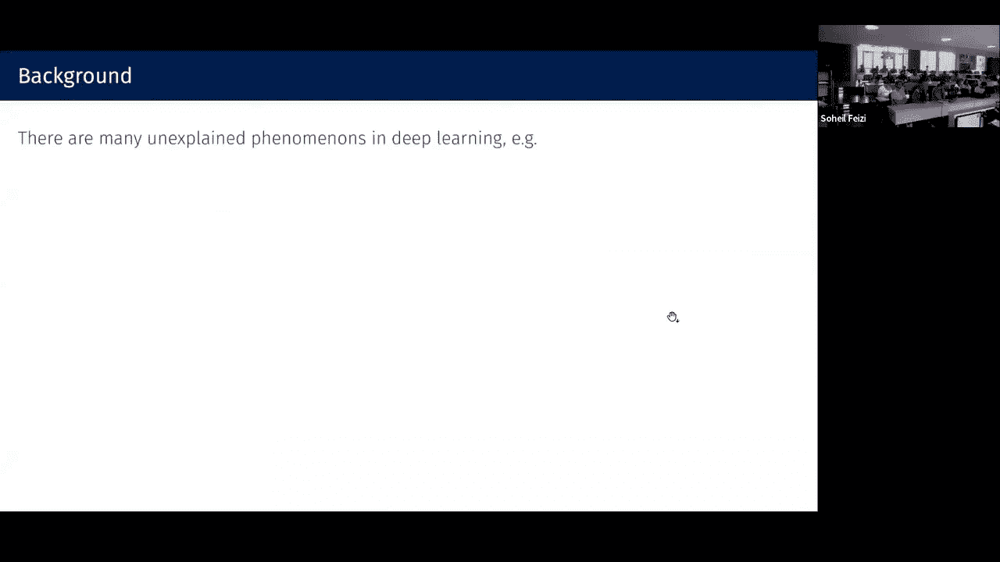
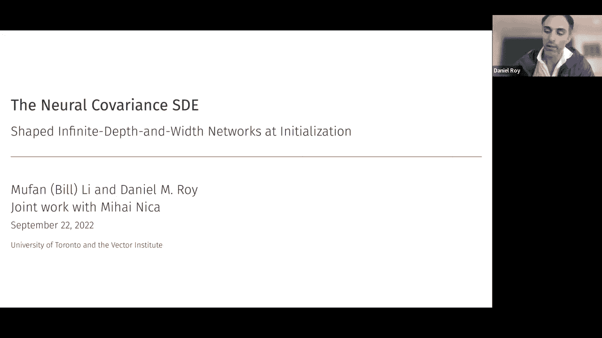
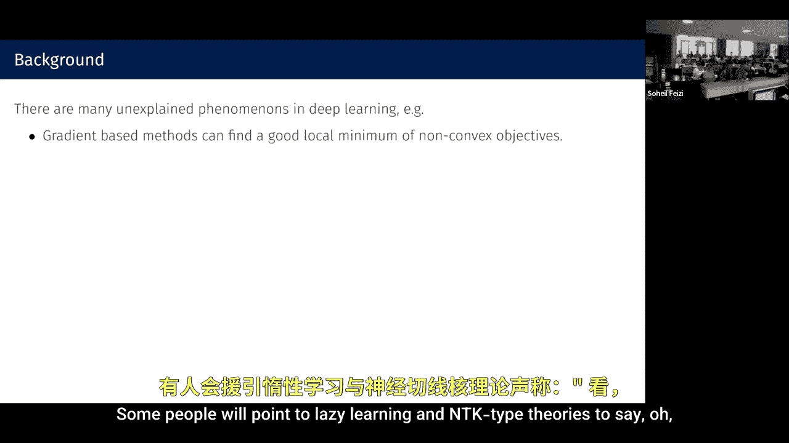
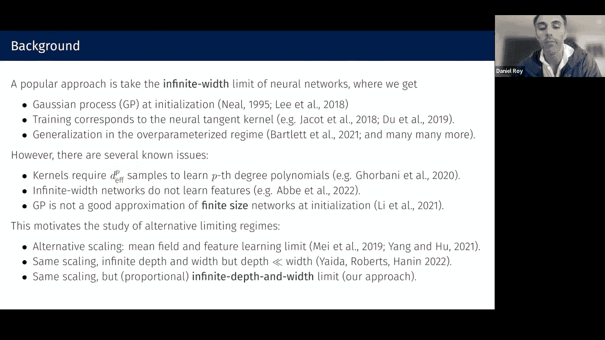
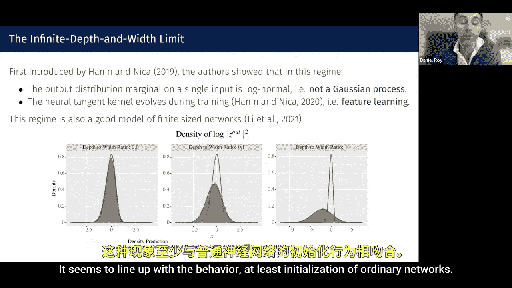
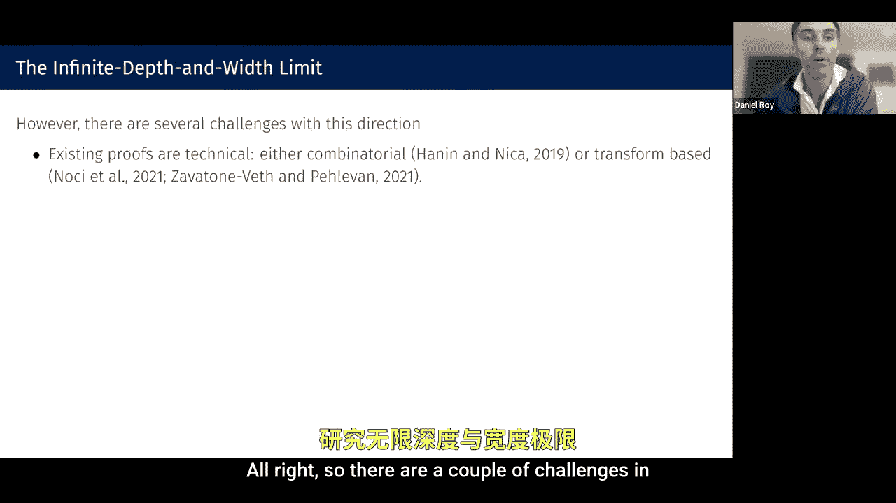

# 033：Daniel Roy 和 Mufan Li 关于“神经协方差 SDE”的演讲

感谢介绍，也感谢邀请我们。

我们将讨论关于神经协方差 SDE 的这项工作。

这是最近被 NeurIPS 接受的工作。这是我们为不断增长的无限深度和宽度网络文献做出的第二项贡献。

当我说“我们”时，实际上是指即将发言的 Mufan Li。

他在 Miha Nika 的专家指导下领导了这个项目。

Miha Nika 是我们在圭尔夫大学的同事，他与 Boris Hanin 一起，

完成了关于无限深度和宽度极限的一些最早的工作。

现在开始。我看到我的幻灯片可以正常翻页。在深度学习中存在许多未解释的现象，我将列出两个。当然，我可以列出六张幻灯片，但那也无法涵盖所有未解之谜。早期困扰人们的两个现象是：基于梯度的方法如何找到良好的局部最小值？因为目标函数是非凸的。

一些人会指向惰性学习和 NTK 理论，认为我们现在理解了这一点。但那些理论是在特定设置下成立的。

对于任意网络，我们还没有一个完整的理论。

另一个问题是深度学习的统计现象。目前尚不清楚为什么过参数化的模型能够泛化到测试数据。

这些通过 SGD 等过程训练的模型可以插值数据，意味着它们达到零训练误差。尽管这些模型具有巨大的容量，足以记忆噪声，但它们仍然能够泛化。这其中必有原因。当然，最近有一些进展，例如在这些 NTK 极限中，可以依赖线性预测器的经典理论。

但这并不能真正解释问题。因此，在过去几年里，良性插值的理论开始被勾勒出来，这很令人兴奋。然而，理解深度学习面临的挑战之一是，深度学习的数学相当难以处理。

我们没有一个像线性回归那样简单、可依赖的分析模型来解释深度学习。线性回归之所以成为大家最初发展插值等理论的模型，是有充分理由的。

我们将采取的方法是识别并分析一个无限极限。我们将看似矛盾地研究一个无限大的神经网络。这个无限极限将简化有限对象的某些方面，并使我们得到一些更易于处理的结果。同时，只有当极限对象仍然是有限规模网络的良好模型时，这项研究才有意义。这条路径已被广泛探索，著名的无限宽度极限就是这种方法的一个例子。

无限宽度极限已知已久。我的一位多伦多同事在 1995 年就观察到，单隐藏层神经网络的无限宽度极限会产生高斯过程。最近，这一理论已被显著扩展到更复杂的架构。

随后，基于这一发展，人们用所谓的神经正切核描述了在这个无限宽度极限下训练的工作方式。神经正切核通常是一个随机对象，但在无限宽度极限下，它几乎必然成为一个非随机对象。这很有趣。神经正切核的描述部分可以由共轭核来刻画，而共轭核是在初始化时的高斯过程极限中定义的。这两个理论相互影响，初始化理论的发展后来成为训练理论的一部分。

无限宽度极限带来了可处理性，人们随后将其转化为该极限下的泛化理论、插值理论等许多令人兴奋的内容。尽管取得了这些令人兴奋的进展，但仍存在几个已知问题。首先，从某些无限宽度极限得到的核，其能力确实较弱。例如，学习多项式等函数的样本复杂度不如真实的神经网络。

一些研究者观察到，在 NTK 极限下，模型不进行特征学习。即使是初始化时的高斯过程，也不是典型形状的有限神经网络的良好近似。我们在这篇论文中提供了一个非常简单的统计量，如果你比较高斯过程理论的预测和真实网络的情况，会发现差异很大。

无限宽度极限的这些问题是，它虽然是一个非常简单的模型，允许你进行所有分析，但你分析的并不是正确的对象。这促使我们寻找替代的极限机制。

一种改变是调整缩放方式。这会产生所谓的平均场和特征学习极限，最近已有研究，并可能有助于预测超参数调整的效果。

我们今天讨论的工作是关于保持相同的缩放方式，但让深度和宽度都趋于无限。这个领域已有一些研究。

如果深度在某种意义上远小于宽度，但两者都趋于无穷，那么你会得到 Yada、Roberts 和 Hanin 等人一直在研究的极限。Hanin 和我本人在这个子集上也有贡献。

我们今天要讨论的工作采用相同的缩放方式，没有对最后一层做特殊处理。我们将研究无限深度和宽度，但要求深度和宽度成比例，即存在一个固定的纵横比。

你可以想象，我的神经网络有一个特定的形状和纵横比，网络根据这个纵横比变得更宽、更深。我们研究的就是这个极限。

这个特定的极限首先由 Hanin 和 Nika 引入。他们在这个模型中已经有一些结果。现在，如果我们看单个输出的边际分布或其范数的分布，它是**对数正态分布**，这与高斯过程的结果不同。但这与实践相符，你在普通规模的神经网络中也能发现这种分布。

在无限宽度极限中，神经正切核在整个训练过程中是固定的。但如果你在训练过程中观察或测量普通网络中的神经正切核，会发现它在演化。你可以证明这一点。这意味着 NTK 极限的一个本质特征并不匹配。

相比之下，在无限深度和宽度极限中，你可以证明（这是 Hanin 和 Nika 的结果），神经正切核在演化，它在时间零（初始化）就已经有导数。因此，除了在定性特征上正确外，至少在初始化时，你还能看到一些显著的对齐。这里展示的是输出平方的对数分布，这是一个相对简单的统计量，表示单个输入通过深度网络初始化后的情况。

直方图是实际数据，来自一个真实网络。左边偏离很远的曲线是 NTK 或高斯过程的预测。还有一条曲线与直方图完全重合，那就是无限深度和宽度极限的预测。这些图是 Mufan Li 主导的工作成果，也是我们研究这个模型的一部分，它似乎与普通网络在初始化时的行为一致。

研究无限深度和宽度极限存在一些挑战。目前已有一些...

