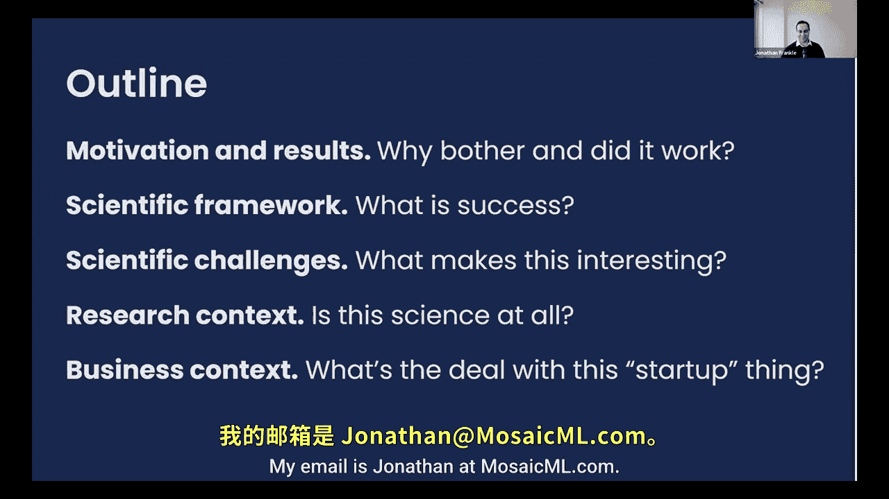
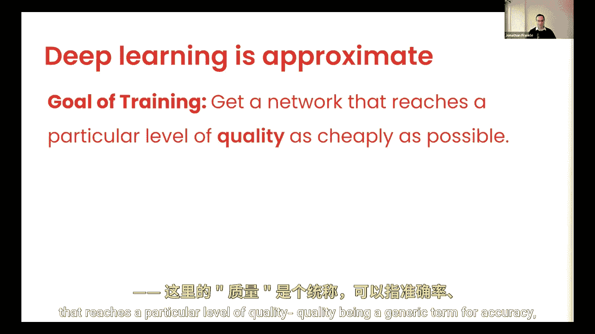

# 034：Jonathan Frankle关于更快的神经网络训练的讲座

在本节课中，我们将探讨深度学习训练成本不断上升的问题，并分析当前应对策略的局限性。主讲人Jonathan Frankle将分享其研究思路，即通过改变深度学习背后的数学原理，而非仅仅加速现有计算，来从根本上解决成本问题。

## 概述

感谢邀请。首先确认大家能听清我的声音。请随时打断我，如果我没注意到，请大声喊叫、举手或挥手示意。我将展示的是正在进行中的科研工作，欢迎大家持怀疑或不同意见。内容会较为宏观，但我希望最终能激发大家产生新的研究想法，并对训练过程中真正重要的因素有新的思考。

## 课程大纲

以下是本次讲座的五个主要部分。由于时间有限，且欢迎大家随时提问，我们将尽可能多地涉及。

1.  **动机与成果**：探讨问题的背景以及我们取得的初步成果。
2.  **科学视角**：分析为何这是一个值得研究的科学问题。
3.  **科学与工程的界限**：区分我所讲述的内容是科学发现还是工程项目。
4.  **商业与创业视角**：如果大家感兴趣，可以讨论相关的商业和创业考量。
5.  **招聘信息**：根据规定，我需要告知大家Mosaic公司正在招聘研究和工程方向的实习生及全职员工。我的邮箱是Jonathan@mosaicemel.com，欢迎联系。

## 1. 动机：训练成本危机

让我们从一个图表开始，这个图表如今出现在许多机器学习讲座中。它来自一篇名为《机器学习的三个时代》的论文。

该图表以对数坐标轴展示了历年重要论文发表时，训练达到当时最先进水平的神经网络所需的计算成本（以浮点运算次数计）。作者得出的结论是：**训练最先进神经网络的成本正以每年约400%的速度增长**。

为了理解这个数字的严重性，我们可以对比一下摩尔定律。摩尔定律在其巅峰时期，大约每18个月带来200%的性能提升，折算下来每年约60%-160%。显然，深度学习训练成本的增速远远超过了摩尔定律曾经带来的红利，更不用说现在了。

一个常见的质疑是：有人真的关心训练成本吗？毕竟推理才是主要开销。然而，根据一份关于谷歌机器学习能耗的论文（该论文本身对谷歌的能耗持乐观态度），在其考察的三年中，**约五分之三的能耗用于推理，五分之二用于训练**。考虑到训练加速器通常比推理加速器单位成本更高，这个比例表明训练和推理的成本在谷歌可能大致相当。无论谷歌是否具有代表性，训练成本高昂已成为一个切实的问题。

## 2. 传统解决方案及其局限

在摩尔定律的“黄金时代”，硬件性能的提升与软件需求的增长基本同步，成本得以控制。我们希望在深度学习领域也能达到这种平衡，即训练成本的下降速度能抵消我们雄心壮志的增长速度。但现实是，我们需要每年降低400%的成本才能抵消当前趋势，这远未实现。

假设你获得风险投资，被要求去解决训练成本问题，你会怎么做？

### 方案一：构建专用芯片 🚀

许多人首先想到的是构建神经网络专用加速器。这确实是一个主流方向。

然而，根据我公司CEO（一位硬件架构专家）的估算，更好的加速器结合摩尔定律，**大约只能解决所需400%降幅中的50%**。以英伟达A100和H100为例，基于公开的FP16算力数据计算，其每美元性能的年增长率约为16%。即使我们乐观估计，加速器带来的年化收益也远低于50%。

### 方案二：优化计算操作与编译器 🛠️

下一个思路是优化在芯片上运行的操作。例如，斯坦福大学的研究者提出的**Flash Attention**，通过根据A100的缓存层次结构优化Transformer中注意力机制的计算方式，实现了巨大的速度提升。这本质上是编译器的工作：将高级神经网络操作高效地映射到底层处理器指令。

这类优化能带来显著收益，我们慷慨地假设其每年能贡献**30%** 的性能提升。但这存在上限，因为可优化的操作终归是有限的。

## 3. 核心问题：我们是否被“正确性”束缚？

以上两种传统方法存在一个有趣且奇怪的地方：它们都在尝试**更快地运行完全相同的数学运算、完全相同的配方和完全相同的优化策略**。

这在某种程度上是有效的。但关键在于，**深度学习并非一门精确科学**。它不像归并排序那样存在一个“正确”的排序方法。深度学习背后的数学并无神圣不可侵犯之处。

在传统的计算机科学算法中，我们必须保证**正确性**，这是不可触碰的底线。

然而在深度学习中，**不存在所谓的“正确性”**。我们处理带有错误标签的数据，在高度非凸、我们对其一无所知的损失函数景观中，使用本质上经过美化的凸优化策略。我们依赖各种技巧和“黑魔法”，需要在合适的超参数空间、合适的时机，甚至以“正确”的方式看待网络，训练才能成功。稍有偏差，网络就可能发散或崩溃。

我们所做的一切都谈不上“正确”或“准确”。因此，**我们不应该害怕去改变深度学习背后的数学原理**。深度学习本质上是**近似计算**。在近似计算中，目标是在满足特定约束（例如达到某个质量水平）的前提下，找到接近最优的解决方案。

对于训练而言，这个约束就是：**我需要一个达到特定质量水平（如准确率、困惑度等）的网络**。

## 总结

本节课我们一起探讨了深度学习训练成本急剧上升的挑战。我们分析了通过构建更好硬件（加速器）和优化现有计算流程（编译器）这两种传统解决方案，并指出它们因受限于“必须执行完全相同计算”的思维而存在天花板。最后，我们提出了一个根本性的思路：深度学习是近似计算，没有绝对的“正确性”，因此我们应该勇于探索和改变其底层的数学与算法，以更高效的方式达到所需的模型质量，这才是应对成本危机的关键科学方向。