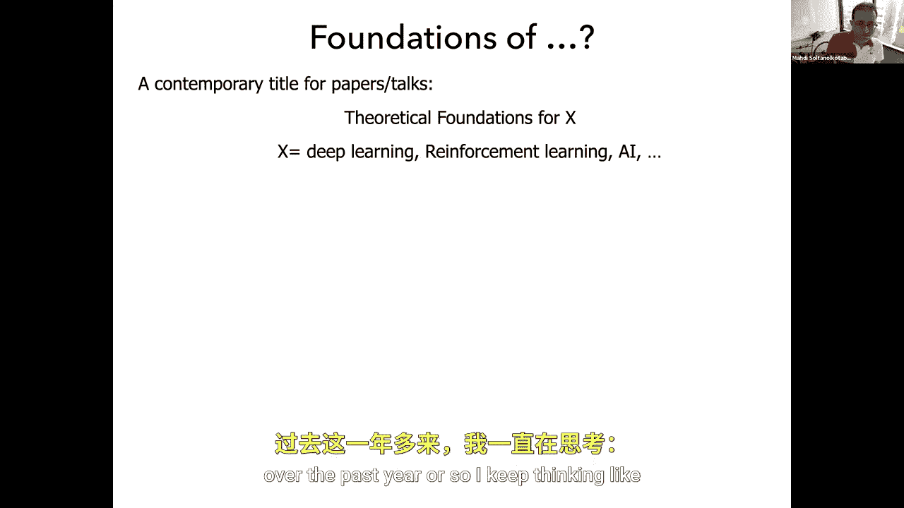
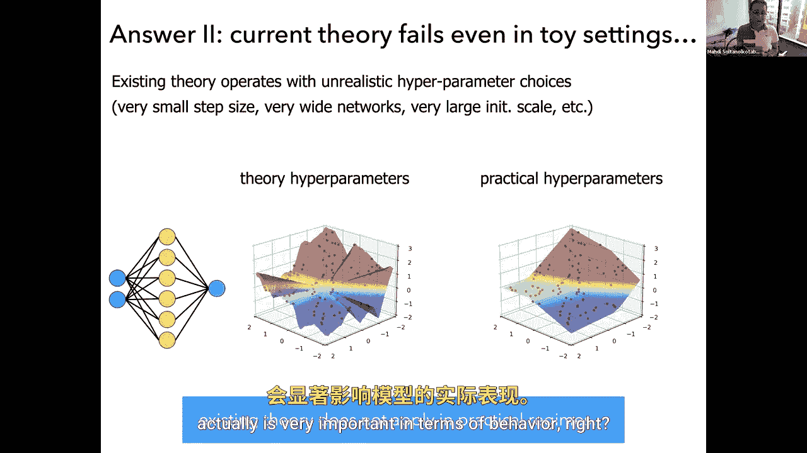
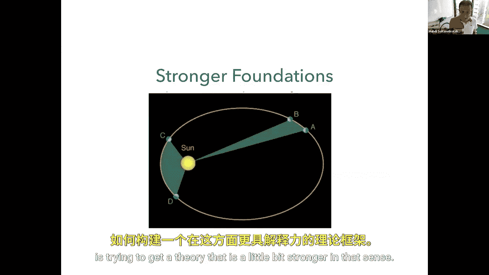

# 035：特征学习与梯度下降

在本节课中，我们将探讨深度学习中的一个核心话题：**特征学习**。我们将分析为什么现有的理论（如神经正切核理论）在解释现代深度学习实践时存在局限性，并探索通过梯度下降进行特征学习的新视角。

## 为什么需要更坚实的理论基础？

上一节我们介绍了课程背景，本节中我们来看看为什么当前的理论基础需要加强。尽管已有许多优秀的理论模型，但它们仍难以充分解释许多当代实践。

以下是现有理论面临挑战的几个方面：

*   **架构选择**：我们缺乏深刻的见解来解释为何某些架构（如全连接网络、卷积网络、Transformer网络）表现良好。
*   **归一化技术**：对于批归一化、层归一化、实例归一化等众多技术，我们同样缺乏清晰的理论理解。
*   **表征学习实践**：对于预训练、微调、知识蒸馏等近年来流行的、与表征学习相关的实践，理论洞察也相对匮乏。

更根本的问题是，现有理论甚至在简单的**玩具设定**中也面临困难。这通常是因为这些理论依赖于不切实际的高参数选择，例如：

*   非常小的步长
*   非常宽的网络
*   非常大的初始化尺度

为了阐明这一点，考虑一个简单的例子：使用一个单隐藏层神经网络拟合三维空间中的一组数据点。

*   如果使用理论导向的超参数，得到的拟合曲面可能不够理想。
*   如果使用实践中常用的参数，则能得到更平滑、更优的曲面。

这表明，现有理论在**实际应用场景**中可能并不适用。神经网络的函数类非常丰富，训练方式和超参数选择对其行为至关重要。因此，本课程的第一部分将致力于建立一个在这方面更强大的理论。

## 过参数化与不“过拟合”的奥秘

上一节我们指出了现有理论的局限性，本节中我们来看看深度学习中的一个核心谜题：过参数化。在现代神经网络中，参数数量通常远多于训练数据，理论上应发生**过拟合**，但实践中却能获得非常好的拟合效果。

这个现象背后存在两个谜题：

1.  **优化之谜**：为什么梯度下降能收敛到全局最优解？
2.  **泛化之谜**：在存在无数全局最优解的情况下，模型为何能良好地泛化？

为了理解“过参数化”的含义，请看一个简单的实验：

*   假设数据由一个具有3个隐藏节点的单隐藏层神经网络生成。
*   如果你使用一个**相同规模**的模型进行训练，梯度下降可能会陷入**局部最优**。
*   如果你使用一个**更大规模**（过参数化）的模型，梯度下降则能收敛到**全局最优**。

这就是第一个谜题：为什么使用实践中常见的小随机初始化时，梯度下降能收敛到全局最优？

然而，更引人深思的是第二个谜题：**泛化**。由于过参数化，训练损失存在许多全局最优解。根据初始化的不同，优化器会收敛到不同的全局最优解，而这些解对应的测试损失（泛化性能）也截然不同。

在实践中，仅通过改变初始化的尺度，就能到达具有不同泛化能力的全局最优解。例如，在一个数据由3节点网络生成的实验中，我们用一个更大的模型去拟合它，并改变初始化的标准差（x轴）：

*   **训练误差**：无论初始化尺度大小，总能达到全局最优（训练误差为0）。
*   **测试误差**：行为差异巨大。使用**小尺度初始化**（左侧）时，测试误差很低；使用**大尺度初始化**（右侧）时，测试误差很高。

现有理论（如神经正切核理论）主要研究的是**右侧的大初始化尺度区域**。在这个区域，神经网络的行为类似于其初始点的线性近似，即表现得像一个**核方法**。虽然这能提供一定的泛化性能保证，但通常只是一个粗略的上界。

真正有趣且具有挑战性的问题是：**如何建立从小随机初始化出发的梯度下降的泛化理论？** 这正是我们试图回答的核心问题。

## 神经正切核（NTK）或“惰性”区域回顾

上一节我们提出了核心问题，本节中我们简要回顾一下神经正切核（NTK）理论，以明确其适用范围。当使用非线性模型（如神经网络）拟合数据时，梯度下降的更新公式涉及模型的**输出关于参数的雅可比矩阵**。

NTK理论的基本思想是，在满足某些技术假设（如网络足够宽、初始化足够大）的条件下，沿着梯度下降的轨迹，网络的行为近似是**线性的**。具体来说，网络的性能可以近似用其在初始化点的线性展开来描述，公式如下：

`f(θ_t) ≈ f(θ_0) + ∇f(θ_0)^T (θ_t - θ_0)`

这意味着，尽管网络本质是非线性的，但在这种“惰性”或“线性”区域，其训练动态表现得就像在一个固定的非线性特征（由初始网络决定）之上进行线性学习。这就是NTK区域。

然而，NTK区域的问题在于，它对应的是**大初始化尺度**的情况。正如前面实验所示，在这个区域获得的泛化性能往往不是最优的。我们观察到的最佳泛化性能出现在**小初始化尺度**的区域，而现有理论对此缺乏解释。

## 总结

本节课中我们一起学习了：
1.  现有深度学习理论在解释架构选择、归一化、表征学习等当代实践时存在不足，甚至在简单玩具设定中也因依赖不实际的超参数而失效。
2.  过参数化神经网络存在两大谜题：优化上能收敛至全局最优，以及泛化上能在众多全局最优解中获得良好性能。
3.  神经正切核（NTK）理论解释了**大初始化尺度**下网络的线性化行为，但这通常对应次优的泛化结果。
4.  当前的核心理论挑战是理解并建立**从小随机初始化**出发的梯度下降的优化与泛化理论，这直接关联到神经网络如何进行有效的**特征学习**。