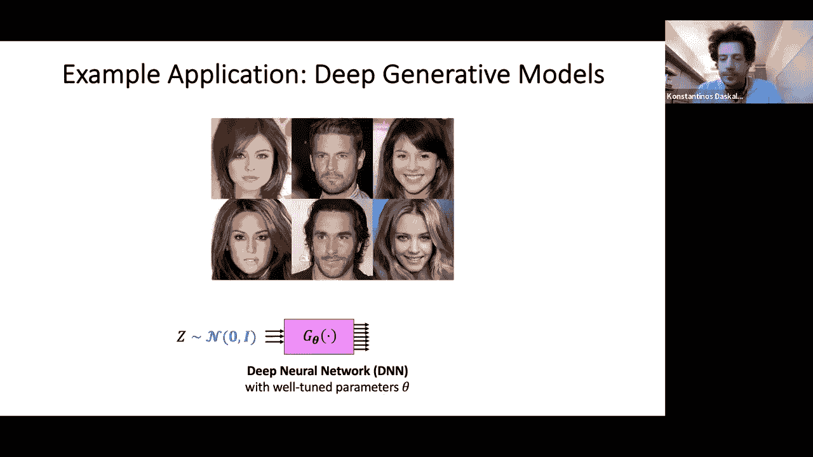

# 036：Constantinos Daskalakis 关于均衡计算的讲座 🧠

在本节课中，我们将探讨复杂性理论、博弈论与深度学习之间一些美妙的交汇点。我们将了解深度学习在优化范式上的根本转变，以及当学习问题涉及多个智能体（即多智能体世界）时，这一范式所面临的挑战。

---

## 深度学习的突破与优化范式的转变 📈

正如我们所知，机器学习近年来无疑取得了许多突破。

从优化的角度来看，我们处理与学习任务相关的估计问题的方式发生了根本性的变化。我们离开了凸优化的“舒适港”，越来越多地考虑我们估计问题的非凸公式化。

以下是几个例子：
*   **经典最小二乘回归**：这是一个非常理想的估计场景，目标是找到通过数据点的最佳线性拟合。可以写出一个关于参数 `θ` 是凸的目标函数。
*   **指数族模型的最大似然估计**：当数据来自指数族分布且没有隐变量时，负对数似然作为估计问题，其关于索引指数族分布的参数 `θ` 也是凸函数。

这两个都是很好的场景，其估计问题是漂亮的凸优化问题。

相比之下，当我们训练深度神经网络时，估计问题在很大程度上是一个非凸问题。实际上，处理非凸问题并非深度学习独有的新事物。例如，在上述例子中，如果考虑包含**隐变量**的模型，那么最大似然估计问题通常也会变得非凸。这时，我们必须使用期望最大化算法或变分推断等工具来启发式地处理出现的非凸性。

因此，从凸优化到非凸优化的转变并非全新，但在我们思考如何训练深度网络时，它变得非常重要和核心。

---

## 深度网络训练的关键特征与应对方法 ⚙️

当然，当问题是凸优化问题时，估计的目标是找到全局最优解。而对于非凸问题，全局最优解通常是不可及的，它是一个NP难问题，因此目标转变为寻找某个局部最优解。

深度网络训练的一些更“新”且重要的特征如下：
*   参数向量 `θ` 的维度非常高。
*   优化的函数是非凸的。
*   对目标函数的访问非常原始（例如，通常只有一阶访问，可以查询梯度，但高阶查询成本更高）。
*   通常，函数至少在大多数地方是Lipschitz连续且光滑的。

简而言之，处理这类问题时，我们没有太多选择。为了应对非凸性和高维变量，我们必须运行一个简单的方法，即某种形式的**梯度下降**。

梯度下降不会找到全局最优解，但至少能保证不会停留在某些虚假的临界点，并且保证能找到局部最优解。经验发现，对于许多我们感兴趣的问题，局部最优解在实践中表现相当不错。虽然没有理论保证局部最优解一定表现良好，但在许多学习应用中，通过这种方法找到的局部最优解确实是有用的。

---

## 新兴的通用框架与“规模至上”的迷思 🏗️

人们对这一新范式感到非常兴奋，并形成了一个应对挑战性学习问题的通用框架：
1.  编写一个非常复杂的模型（拥有数百万或数十亿参数）。
2.  从外部收集大量数据。
3.  获得超级计算机的访问权限。
4.  运行梯度下降，尽可能地在数据上训练模型。

人们如此兴奋，以至于经常有人说：“规模就是一切”。参数越多，能访问的超级计算机越强大，就能构建越好的模型。

然而，我并不同意“规模就是一切”这种观点。我想讨论一系列应用场景，在这些场景中，规模并非一切，而且我们知道它并非一切。

---

## 多智能体世界中的挑战与灾难 🎲

许多新兴且有趣的深度学习应用都涉及多个智能体。例如：
*   游戏场景：扑克、围棋、星际争霸。
*   机器人交互。
*   生成对抗网络和对抗攻击等应用。

这些应用并非天生就是多智能体的，但将其表述为多智能体问题，有助于我们达到那些原本可能无法达到的学习结果。

以**生成对抗网络**为例，这是一个并非先验多智能体，但通过博弈公式化有助于达到期望学习结果的例子。在这种情况下，我们希望达到的学习目标是识别一个神经网络，该网络能够将输入（例如，无聊的多变量高斯随机样本）转换为有趣的随机样本（例如，逼真的人脸图像）。

---

## 总结 📝

本节课中，我们一起学习了：
1.  深度学习如何从凸优化转向非凸优化范式。
2.  深度网络训练的非凸、高维特性，以及梯度下降作为核心应对方法。
3.  当前流行的“大规模模型+大数据+大算力”的通用学习框架及其局限性。
4.  当学习问题进入多智能体领域时（如博弈、GANs），新的挑战随之出现，“规模至上”的观点在此并不适用，需要借助博弈论等工具进行更深入的分析和设计。