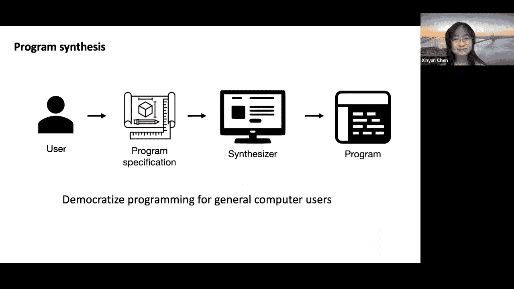
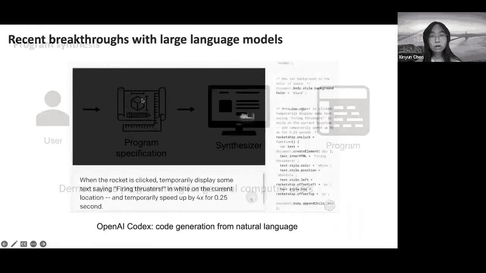
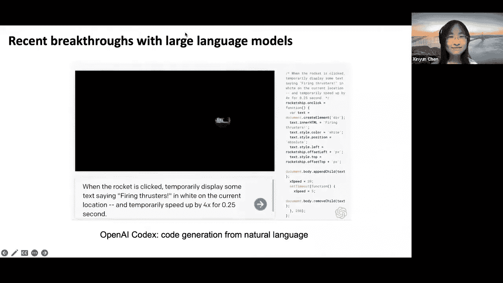
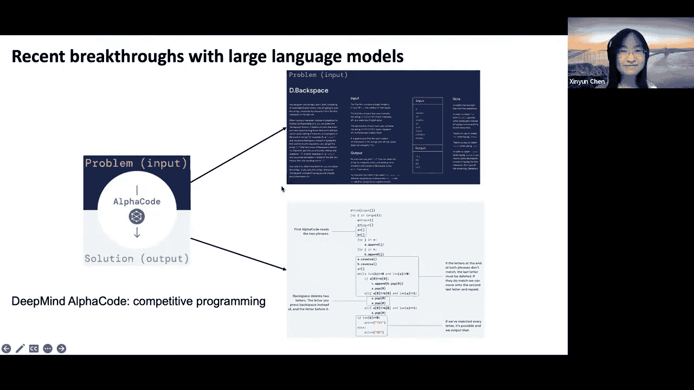
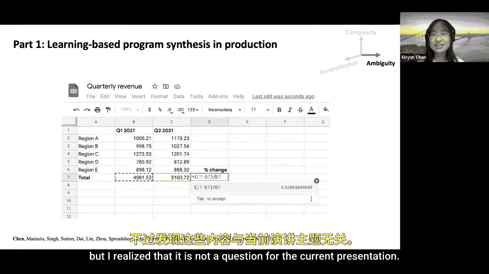

# 037：基于学习的程序合成

在本节课中，我们将学习基于学习的程序合成。我们将探讨如何让机器根据描述自动生成程序，并了解该领域面临的核心挑战，包括输入模糊性、程序容量和泛化能力。课程将涵盖从处理自然语言描述到利用执行反馈，再到提升模型组合泛化能力等多个方面的研究与应用。

## 什么是程序合成？

程序合成是指，我们无需亲自编写所有代码，而是希望机器能根据我们的描述自动生成程序。程序合成研究的长期目标是普及编程，让不具备编码技能的一般计算机用户也能受益于编程技术的进步，从而实现任务的自动化。

## 语言模型在代码生成中的突破

近年来，我们在用于代码的大型语言模型方面取得了巨大突破，尤其是在从自然语言生成代码方面。

例如，OpenAI的Codex模型拥有1750亿参数。它从GPT-3检查点初始化，并在文本上进行预训练，然后进一步在GitHub代码库上进行训练。通过这种大规模预训练和大规模模型，Codex能够在遵循自然语言指令方面取得令人印象深刻的性能。

另一个展示语言模型代码生成能力的近期成果是DeepMind的AlphaCode项目。该项目专注于解决竞争性编程问题。除了理解复杂的自然语言描述，模型还需要具备一定程度的推理能力，以构思出能高效解决问题的算法并准确实现代码。

## 程序描述的其他形式

自然语言只是描述预期程序功能的一种形式。另一种描述形式是输入输出示例。在这种情况下，生成的程序应在执行后将给定的输入转换为对应的输出。

在实际应用中，编程上下文并非总是顺序的。有时我们可能希望处理包含多种数据格式的半结构化上下文。例如，在SpecialCoder项目中，我们设计了一个模型来生成Google Sheets中的特殊公式，这些公式包含了表格上下文。该模型已集成到Google Sheets产品中，目前拥有数亿用户。

## 程序合成的核心挑战

在基于学习的程序合成研究中，我认为有两个核心挑战需要考虑：**输入模糊性**和**程序容量**。

*   **输入模糊性**：指程序描述是否足够精确，能够明确指定程序的执行行为。
*   **程序容量**：指可以合成的程序的长度和控制流结构的复杂性。

在本次讲座中，我将讨论几个应用，它们分别突出了这些挑战的不同方面。

*   在基于文本的程序合成工作中，主要挑战是处理输入模糊性，因为用户编写的自然语言描述通常缺乏足够的细节。
*   在基于示例的程序合成问题中，程序描述包含输入输出示例，因此更容易利用执行结果来扩展程序搜索。
*   在竞争性编程问题中，程序描述同时包含自然语言和输入输出对，我们可以利用这些额外信息来减少程序描述的模糊性，并生成更复杂的代码。

## 用于学习的程序合成

基于学习的程序合成研究不仅关注编程和软件工程应用，另一个研究方向是**用于学习的程序合成**。我们将程序视为表示更广泛学习问题中推理过程的一种手段。

为什么在编程和软件工程应用之外，学习这些程序是有益的？主要目标是提升现有神经网络在执行符号推理和泛化任务方面的能力。

这里我将重点介绍一个称为**组合泛化**的挑战，并使用一个伪语言理解任务的例子来说明。

假设训练集中有一些指令，展示了伪单词与彩色圆圈之间的基本映射关系。除了这些基本定义，训练集还包括一些函数描述。例如，指令“lug Fab”被翻译为三个蓝色圆圈。由于我们已经知道“lu”映射到一个蓝色圆圈，一个假设是“Fab”意味着“三”。我们可以用另一条指令“fan”来确认这个假设。

在测试时，我们会得到一些新的测试指令，例如“stop5”。这些是训练集中已学习的基本元素和函数的新组合。对于我们人类来说，仅凭少量样本，我们就可以推断出“Fab”意味着三个黄色圆圈。

在这个组合泛化实验中，总共只有略多于10条的训练指令。一些测试指令比任何训练指令都要长。对于我们人类来说，仅凭少量演示，就非常擅长理解这种语法的组合。但标准的序列到序列模型在实现这种水平的泛化方面确实很困难。

因此，我在程序合成学习领域的研究旨在解决这些挑战，并强调**泛化**这第三个挑战。

## 本次讲座内容概览

在本次讲座中，我将重点介绍围绕这三个挑战维度展开的三方面工作。

1.  **第一部分**：我将讨论SpecialCoder工作，展示如何设计基于学习的程序合成模型来处理用户编写描述中的模糊性，以及该模型如何应用于生产环境。
2.  **第二部分**：我将讨论关于利用执行进行程序合成学习的工作。首先介绍“执行引导的程序合成”工作，展示了在程序描述包含输入输出样本的情况下，我们的模型如何利用中间执行结果来提高可合成程序的容量。接着，在AlphaCode项目中，我们进一步表明，通过大规模利用执行，可以使模型解决更具挑战性的竞争性编程问题。
3.  **第三部分**：我将讨论关于通过程序学习实现组合泛化的工作。首先介绍“神经符号栈机”工作，展示了将符号模块整合到深度神经网络中，对于仅从少量样本和链式模型从头开始训练时实现这种水平的泛化至关重要。然后，我也会简要讨论我们最近的项目“动态最少到最多提示”，表明通过适当设计提示方案，我们也能解锁现有强大的预训练大型语言模型在理解如SQL等真实世界编程语言方面的组合泛化能力。

让我们从关于SpecialCoder的第一部分开始。我想先确认一下是否有问题。如果没有问题，我可以继续。如果有任何课堂问题，我也可以停下来回答。目前我没有看到针对当前演示的问题。

---

本节课中，我们一起学习了基于学习的程序合成的基本概念。我们了解了程序合成的目标，探讨了大型语言模型在代码生成方面的突破，并认识了程序描述的多种形式。我们重点分析了程序合成面临的两个核心挑战：**输入模糊性**和**程序容量**，并引入了**组合泛化**作为第三个关键挑战。最后，我们概述了本次讲座将深入探讨的三个研究方向，为后续内容的学习奠定了基础。