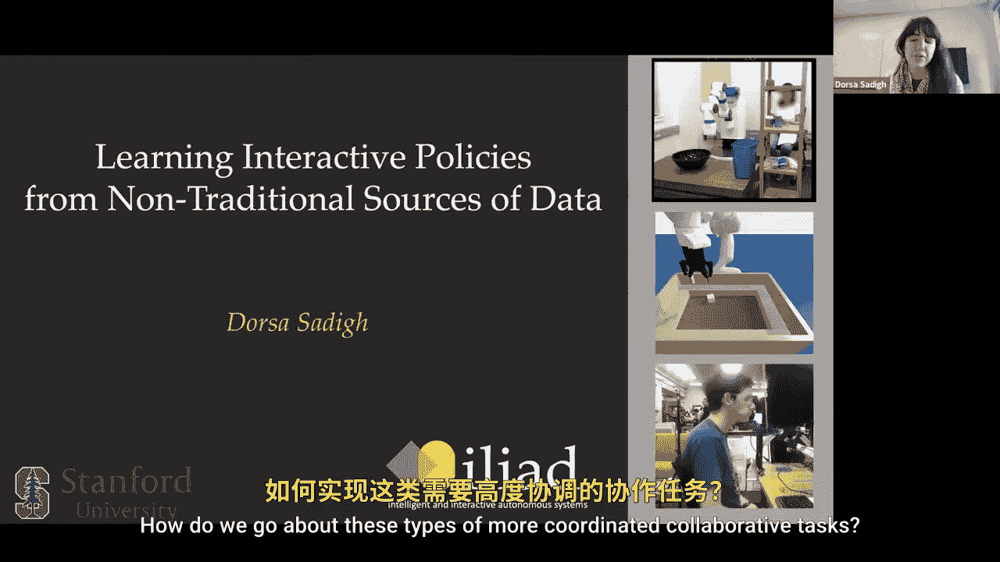
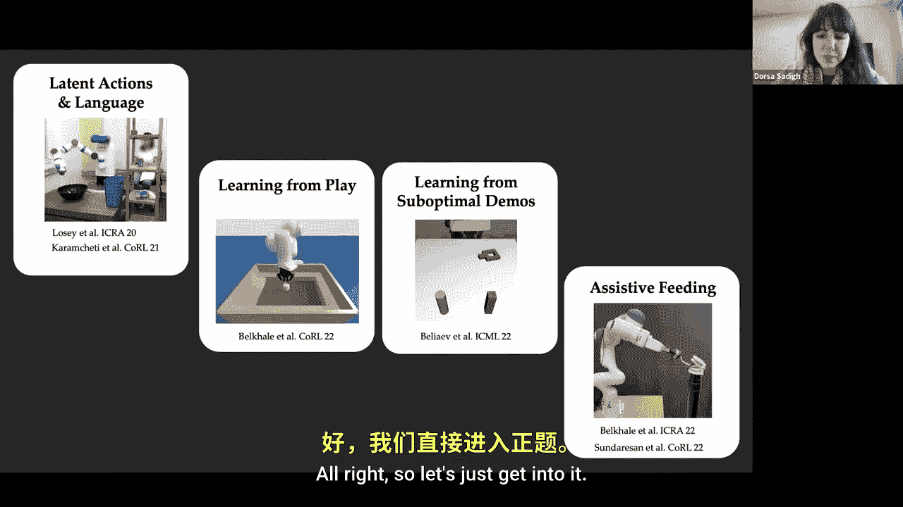
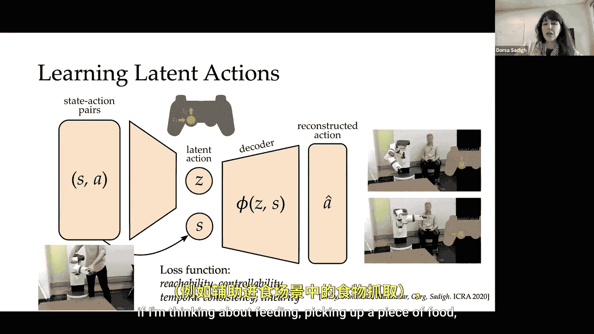

# 038：学习机器人策略

在本节课中，我们将跟随Dorsa Sadigh的演讲，探讨如何利用机器学习，特别是从人类数据中学习，来构建更有效的机器人策略。我们将从实际问题出发，分析现有方法的局限性，并探索利用交互数据、次优演示等新范式来改进机器人策略学习。

---

## 引言：从实践视角看机器人策略学习

感谢Soha的邀请，我很高兴来到这里。今天我想讨论我们实验室在“学习机器人策略”领域的一些近期工作。需要说明的是，本次演讲将更侧重于实践层面。在你们的研讨课中，可能听过从理论到实践的各种讲座，而本次是从实践者的视角，探讨如何在机器人学、控制领域乃至更广泛的范围内应用机器学习。

我的实验室主要兴趣在于构建能与人类良好协作的交互式机器人策略。我们关注诸如辅助喂食（如何让机器人拾取食物并送入人口中）或其他类型的交互式机器人任务。相关研究工作主要分为两类：第一类是如何利用交互数据、人类数据来更好地学习策略（这也是本次演讲的主题）；第二类是如何实现更无缝的人机交互，例如更好的共享自主权，以及如何让人类与机器人协作完成制作三明治等协调性任务。

接下来，我将深入本次演讲的细节。过程中如有任何问题，请随时提出。我不会一直关注聊天框，但欢迎大家随时发言。如果不需要讲完所有幻灯片，我们也可以随时停下来讨论。

---

## 辅助喂食：一个极具挑战的实际问题

大约两年前，我们开始研究辅助喂食问题，这是我最喜欢的机器人学问题之一。问题定义是：我希望机器人能够拿起叉子，拾取一块食物，并将其送入人的口中。这听起来很实际。

但这实际上是一个极其困难的机器人学问题。原因在于，不同类型的食物具有不同的几何形状和可变形特性，操纵可变形物体本身就非常困难，这是一个完整的研究方向。此外，在拾取食物后，将其送入人口中也是一个非常有趣的交互问题：如何确保食物能顺利送入？如何施加合适的力？如何考虑人的舒适度？

我们首先审视了该领域的最新技术。目前，辅助喂食的先进方法是遵循一个**固定策略**。这是一个基于模型的策略，机器人进行某种程度的视觉伺服控制：它会观察人脸的位置，计算一个固定的位姿，并尝试移动到那里，然后让人在那个位置咬取食物。

正如你所见，这种方式非常不舒适。我非常感谢这位用户，他坐在那里允许我们使用机器人进行喂食。总体来看，这种策略显然不是我们想要的理想策略。

事实证明，这种基于模型的策略并不完美。问题在于：为什么？我们能否做得更好？

一个想法是：近年来机器学习解决了许多研究问题，我们能否利用机器学习来解决这里的一些问题？

---

## 探索机器学习解决方案：从模仿学习到新数据源

如果目标是使用机器学习，我们有许多选择。例如，我们可以使用**强化学习**。但我不想在真人身上进行实时强化学习，因为我不想撞到人的鼻子并获得负奖励，这可不是好主意。同时，我也没有好的模拟器来生成大量数据并在模拟中运行强化学习，无论是胡萝卜还是人嘴都没有好的模拟器。因此，在这个场景下，模拟和强化学习似乎都很困难。

另一个我认为在机器人学领域更有前景、并且感觉范式正在向此方向转变的想法是：收集**专家演示**，并从这些演示中学习一个**模仿学习**策略。有证据表明，拥有大量数据的巨型Transformer模型在许多领域都很有用。

那么问题来了：我们能否在此应用相同的范式？我能否收集专家演示，并从中学习一个用于喂食的机器人策略？

如果我拥有大量数据，那将非常理想。但在这个领域，我并没有大量的**机器人演示数据**（我稍后会再谈这个概念）。这让我想到，也许我们应该利用其他数据源。如果想学习机器人策略，仅靠专家演示是很有局限的，也许我们应该关注其他数据源，例如**游戏数据**或**次优演示**，并利用这些信息来思考如何学习机器人策略。这正是本次演讲要讨论的主题。

回到喂食问题，目前看来，基于模型的策略不够好，学习似乎也无法直接解决问题。那么，人们实际是如何使用机器人完成这个任务的呢？如果以上两种方法都行不通，也许我们可以**遥操作**机器人。如果无法使用学习或基于模型的策略，最简单的方法就是使用操纵杆遥操作机器人，让它跟随我的输入将食物送入人口中。这应该是最简单的方式，市面上许多辅助机器人也正是这样使用的。

这里有一段视频，展示了一个人使用操纵杆遥操作机械臂打开冰箱并移动里面的物品。

需要注意的是，即使是遥操作这种最简单的方式——用操纵杆控制机器人——完成这些简单的家庭任务仍然非常困难。例如，打开冰箱门就需要花费相当长的时间。

你可能会问：为什么？我完全在控制机器人，它没有任何智能行为。但仔细想想，这个机器人有六或七个自由度，而我们控制它的方式是**末端执行器控制**，即控制末端执行器的位姿。这意味着我要控制六个变量：末端执行器的X、Y、Z坐标（线性控制）以及偏航、俯仰等角度（角度控制）。观察视频中操作者的手，他不断切换操纵杆的侧面按钮，这实际上是在**切换控制模式**（从线性控制切换到角度控制）。正是这种模式切换耗费了大量时间，使得任务极具挑战性。

因此，在本次演讲中，我将首先讨论遥操作。既然遥操作也不能完美解决问题，我想探讨的是：如何利用学习构建更好的交互界面？如何学习更好的界面，让人们能够提供**更低自由度的动作**，甚至使用**语言**来遥操作机器人，从而使机器人能在环境中完成有趣的任务。

然后，我将稍微转换话题，回到学习**完全自主策略**的想法上。这不是共享自主权领域，而是真正的完全自主领域，我希望为各种任务学习机器人策略。在这里，我将探讨利用其他数据源，如游戏数据或次优演示。

最后，我将以辅助喂食面临的一些挑战作为结束，这些挑战更多是基于模型的，是当前学习算法尚未解决的。我们需要更仔细地思考食物拾取和转移这个具体问题。我会用一些视频和想法来结束演讲。

好的，让我们开始吧。

## 构建低维动作空间以改进遥操作

回到这张图，我们的核心想法如下：考虑一个状态和动作的序列。

这个状态-动作序列可以来自专家或护理人员（在本例中是Dylan，他曾是我们实验室的博士后，现在是弗吉尼亚理工学院的教授）。Dylan提供了这些专家数据。我们想要做的是：开发一个**低维动作空间**，供人们用于遥操作机器人，而不是使用那六或七个自由度。

思路是：收集专家数据，并尝试使用简单的**条件变分自编码器**来降低其维度，得到一个低维动作空间（在本例中，动作空间是Z）。你可以将Z想象成一个**二维动作空间**（两个自由度）。如果你有一个操纵杆，你可以在操纵杆上上下、左右推动。

我们通过训练一个**以状态为条件的自编码器架构**，来确保学习到的动作是合理的。

让我们退一步思考。如果想让机器人在状态空间中从一点移动到任意另一点，我们确实需要所有六个自由度，它们的存在是有原因的。

但这里的关键思想是：如果我将此过程**限定在特定任务**上，比如喂食、拾取一块食物。

那么实际上可能存在一个**更低自由度的动作空间**。

---

## 总结

本节课中，我们一起探讨了学习机器人策略的实践挑战与可能路径。我们分析了现有基于模型策略和直接遥操作的局限性，并提出了利用机器学习（特别是模仿学习）和改进人机交互界面的方向。核心思路包括利用专家数据构建低维动作空间，以及探索游戏数据、次优演示等更丰富的数据源来训练策略。最后，我们认识到像辅助喂食这样的复杂任务，仍需结合更精细的模型来应对食物操纵等具体挑战。