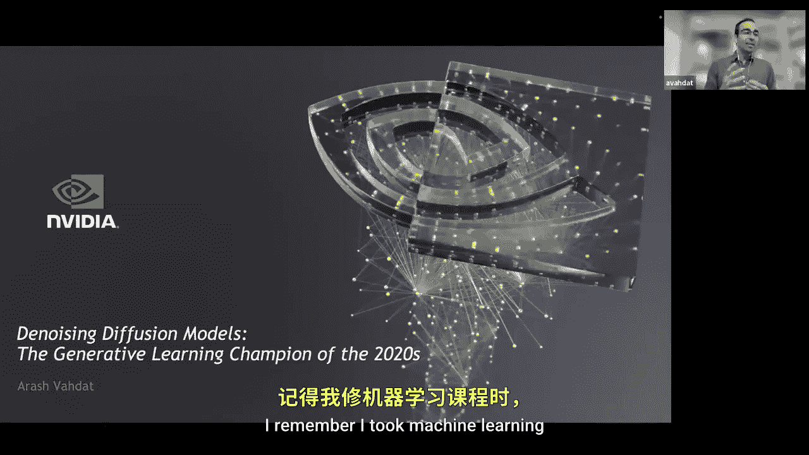
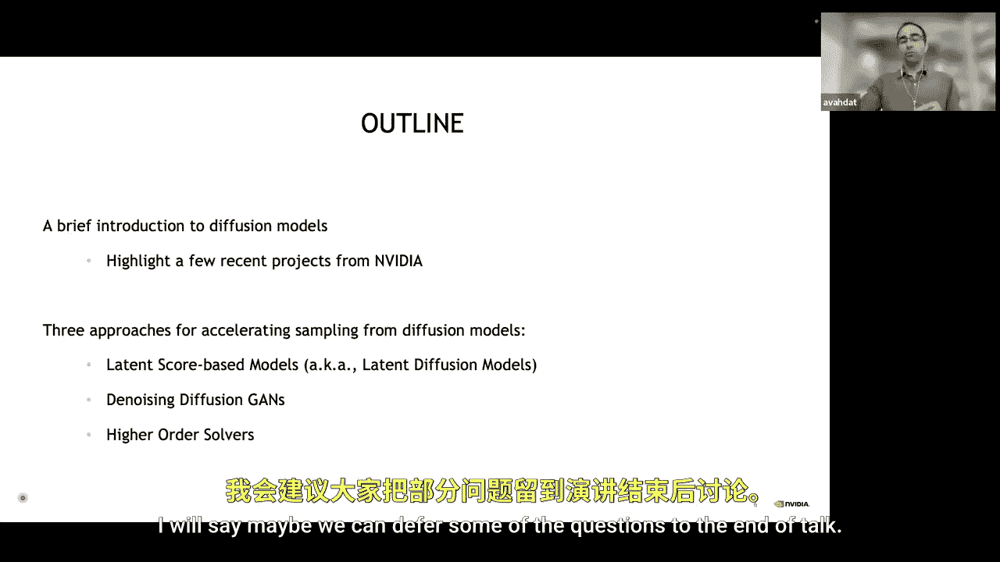
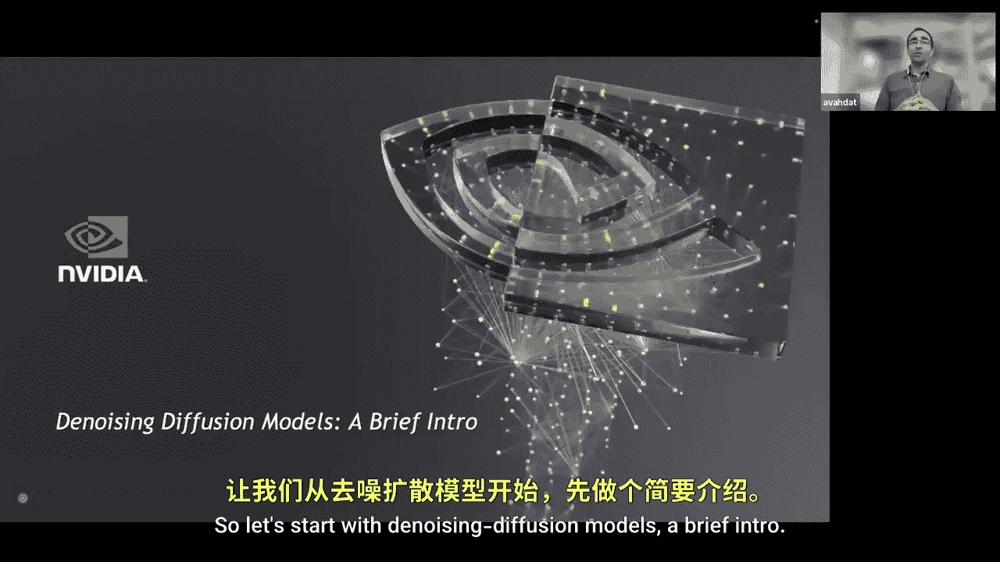
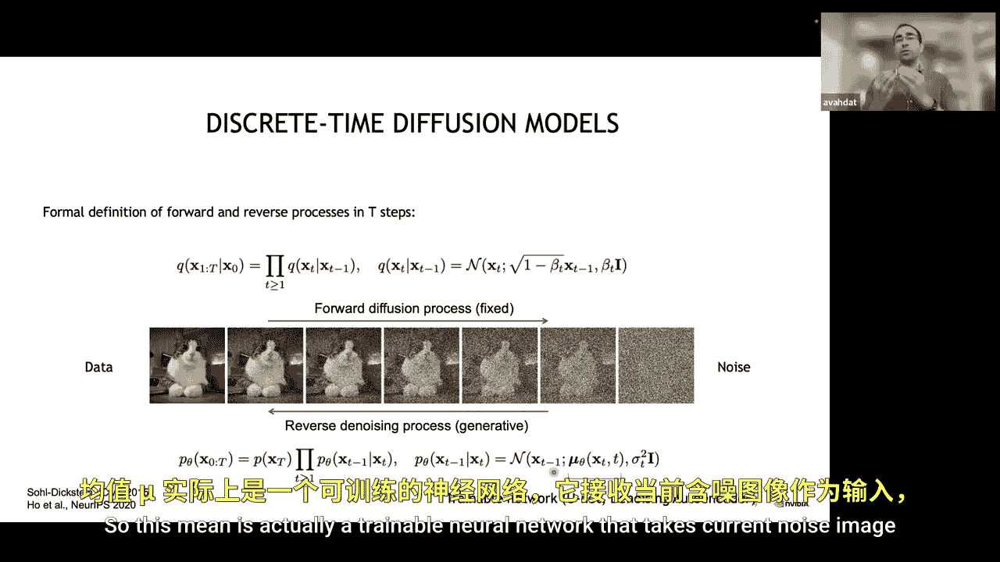

# 039：去噪扩散模型

在本节课中，我们将学习去噪扩散模型的基本概念。这是一种新兴且强大的深度生成模型，近年来在图像生成等领域取得了令人瞩目的成果。我们将从基本原理开始，逐步了解其工作机制，并探讨其优势。

## 概述

去噪扩散模型，有时也简称为扩散模型，或被称为基于分数的生成模型。它们由两个核心过程组成：一个固定的前向扩散过程和一个需要学习的反向去噪过程。通过训练神经网络来学习复杂的反向过程，模型能够从简单的噪声开始，逐步生成高质量的数据样本，如图像。

## 深度生成学习概览

上一节我们介绍了课程背景，本节中我们来看看深度生成学习的整体图景。在深度生成学习中，我们的目标是利用从某个未知分布中抽取的一组样本（例如一组可爱的猫咪图片）来训练一个深度生成模型。如果训练成功，在测试时，我们可以使用这个模型来生成新的、与训练数据分布相似的新样本。

以下是几种主要的深度生成模型框架：
*   **生成对抗网络**：在很长一段时间内，尤其是在图像生成和计算机视觉领域非常流行。
*   **变分自编码器**：另一种重要的生成模型框架。
*   **自回归模型**：通过顺序预测数据点来生成样本。
*   **标准化流**：通过一系列可逆变换将简单分布映射到复杂分布。
*   **基于能量的模型**：通过能量函数来定义数据分布。
*   **去噪扩散模型**：这是当前该领域的新兴关键参与者，也是本节课的重点。

## 扩散模型的崛起

正如前面提到的，去噪扩散模型正在成为强大的生成模型。它们甚至在ImageNet等具有挑战性的数据集上超越了生成对抗网络的表现。这里展示了两项示例工作：左边来自OpenAI，右边来自Google。研究表明，通过在ImageNet等数据集上训练扩散模型，可以生成与数据集中类别对应的高质量、多样化的图像。

大约一年后，OpenAI和Google的团队进一步证明，类似的去噪扩散模型也可用于训练文本到图像的生成模型。如果你关注社交媒体，可能很难不注意到围绕这些模型的巨大热情。DALL-E 2和Imagen就是两个非常强大的模型示例，它们能够根据输入的文本生成与之对应的图像，其图像质量令人惊叹。

例如，Imagen可以生成一个场景：泰迪熊们正在为同事庆祝生日，而蛋糕看起来像披萨。对于许多在生成式学习领域工作了五、六年的研究者来说，能够构建出表现如此出色的生成模型曾是一个梦想。坦率地说，我认为毫不夸张地讲，每天研究这些模型都让我感觉像是在实现梦想，因为这是以往框架难以企及的。

## 去噪扩散模型简介

现在，让我们开始对去噪扩散模型进行一个非常简短的介绍。去噪扩散模型有两个名称：一个是去噪扩散模型，有时简称为扩散模型；它们也被称为基于分数的生成模型。这两者几乎相同。

它们包含两个过程：
1.  **前向过程**：这是一个从数据（例如一张可爱的猫咪图片，这是我的猫，名叫花生）开始，逐步添加噪声的过程。我们一步一步地添加噪声，重复很多次，直到最终在右侧得到纯粹的白噪声。如果你对一张图像持续添加少量高斯噪声，最终会破坏图像的所有视觉内容，得到白噪声。这个前向过程通常是固定的，我们称之为前向扩散过程。
2.  **反向过程**：这是一个从噪声开始，逐步去除噪声以重建图像的过程。这个过程从右向左进行，即从噪声开始，返回数据。这个过程可以被视为一个生成过程，因为它从噪声开始，学习一步一步地从右侧向左侧对输入图像进行去噪。因此，你可以将这个反向去噪过程看作生成过程。这实际上是参数化的部分，我们将尝试训练它，以便能够生成可爱猫咪的样本。

## 深入理解两个过程

让我们更深入地探讨这两个过程。我们假设这些过程定义在T个步骤上，这个大写的T通常非常大，例如1000步。

**前向过程**：我们使用马尔可夫过程来定义前向过程。这个过程定义了所有噪声实例的分布。从 `x_0`（原始数据）到 `x_1`，一直到 `x_T`。它使用条件概率的乘积来定义这些噪声实例的联合分布，每个条件概率定义在每个采样步骤上。给定 `x_{t-1}`，我们定义下一个状态 `x_t` 的分布。这只是一个简单的马尔可夫过程。

每个条件分布也只是一个简单的正态分布。每个条件分布以前一步的样本（例如图像）作为输入，将其乘以一个标量 `sqrt(1 - β_t)`（`β_t` 通常是一个非常小的正值，如0.001），这个标量略小于1，因此这个系数会使样本略微缩小。然后我们加上 `β_t` 项，它再次添加一点高斯噪声。所以在每一步，我们基本上只是取前一步的样本，将其稍微缩小一点，然后添加一点噪声。你可以将其视为扩散，它一步一步地扩散样本。

**反向过程**：反向过程也是一个马尔可夫过程，从 `x_T` 开始。我们假设我们知道 `P(x_T)` 的分布，例如它可以表示为标准正态分布。我们设计前向过程，使得我们知道任何数据点最终都会被映射到例如标准正态分布。因此，我们假设在最后 `x_T` 的分布是正态的。然后，我们再次定义一个从该处样本开始的马尔可夫过程，定义这些噪声步骤的联合分布。同样，我们需要推断给定当前输入噪声图像 `x_t` 时，其去噪版本 `x_{t-1}` 的分布。

这些模型做了一个非常简单的假设：它们也假设去噪模型是高斯分布。这里的高斯分布以当前步骤的 `x_t` 作为输入，并预测其噪声更少的版本。为此，我们需要均值和标准差（或方差）。方差部分很容易，我们通常可以将其设置为与前向过程中使用的方差 `β_t` 相同。然而，均值部分变得棘手，这实际上是我们需要训练模型的部分。这个均值实际上是一个可训练的神经网络，它以当前噪声图像作为输入，并预测其噪声更少版本的平均值。

## 总结

本节课中，我们一起学习了去噪扩散模型的基本原理。我们了解到，它通过一个固定的前向过程逐步破坏数据，再通过一个可学习的反向过程从噪声中重建数据，从而实现生成建模。这种模型在图像生成等任务上展现出了卓越的性能，是当前深度生成学习领域的一个重要发展方向。