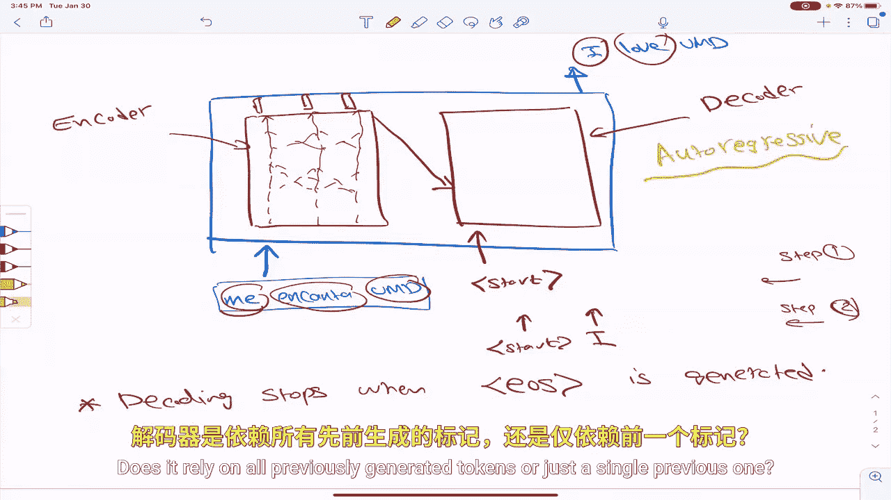

# 040：Transformer模型

在本节课中，我们将学习Transformer模型。这是一种在现代人工智能和机器学习中极为重要的架构，尤其在自然语言处理领域。

我们将从一篇名为《Attention Is All You Need》的核心论文出发。这篇2017年发表的论文引用次数已超过10万次，这充分说明了Transformer模型的重要性。

我们不打算直接罗列Transformer的各个组件，而是尝试一起设计和构建一个Transformer模型。我们将思考为什么需要特定的处理流程和模块，以及我们有哪些设计选择。通过这个过程，希望能加深理解，甚至激发改进现有架构或创造新架构的想法。

## 问题定义与应用场景 🎯

我们将聚焦于一个自然语言处理应用：机器翻译。Transformer模型已被广泛应用于多种领域，事实上，在本节课或下节课，我们还会讨论将其应用于图像领域的视觉Transformer。

假设我们有一个西班牙语短语“Me encanta UMD”（我使用了谷歌翻译，不确定是否完全准确）。我们的目标是开发一个基于Transformer的方法，将其翻译成英语：“I love UMD”。

## 整体架构：编码器-解码器 📐

Transformer的整体架构是编码器-解码器结构。

输入是原始句子“Me encanta UMD”。输出是我们希望生成的翻译版本“I love UMD”。

首先，文本会经过模型的一部分，称为**编码器**。

编码器的任务是为每个单词或标记编码信息。更具体地说，它需要基于整个短语的上下文，为每个单词生成一个向量表示。因此，对于三个单词的输入，编码器将输出三个向量，向量的长度是一个设计选择。

你可能熟悉词嵌入的概念，它可以将单词或标记映射为一个向量。如果直接进行词嵌入，我们会得到每个单词独立的向量表示。

但这里存在一个问题：我们希望每个标记的嵌入表示也包含上下文信息，而不是与上下文无关。因此，我们需要在这些路径之间建立某种依赖关系，让每个向量不仅包含自身的信息，也包含其他标记的信息。这就是编码器需要完成的工作。

编码器为每个标记生成了融合上下文信息的向量后，这些信息将被传递给**解码器**。

解码器的任务是根据编码信息进行解码，在这个应用中就是进行翻译。解码过程通常从一个通用的起始标记开始，例如“<SOS>”（句子开始）。

在第一步解码中，解码器以起始标记为输入，生成第一个输出单词“I”。在第二步解码中，解码器的输入不仅包括起始标记，还包括上一步生成的单词“I”，然后它生成下一个单词“love”。这个过程持续进行。

一个关键点是，在整个解码过程中，编码器是固定不变的。一旦原始短语的信息被编码完成，解码器就基于这个固定的编码信息，反复预测下一个单词。

解码过程会持续，直到生成一个特殊的结束句子标记，例如“<EOS>”，此时翻译完成。

## 解码过程与自回归模型 🔄

如上所述，解码器的每一步都依赖于之前生成的所有标记。

正是由于这种特性，这类模型也被称为**自回归模型**。

有一个常见问题：解码是依赖于所有之前生成的标记，还是仅依赖于前一个标记？答案是：依赖于所有之前生成的标记。

## 总结 📝

本节课我们一起学习了Transformer模型的高级原理。我们了解到Transformer采用编码器-解码器架构来解决如机器翻译等序列到序列的任务。编码器负责将输入序列编码为包含丰富上下文信息的向量表示，而解码器则以自回归的方式，根据编码信息和已生成的部分输出，逐步生成完整的目标序列。这种依赖于全部历史输出的特性，使得Transformer成为一种强大的自回归模型。在接下来的课程中，我们将深入探讨编码器和解码器内部的具体机制。