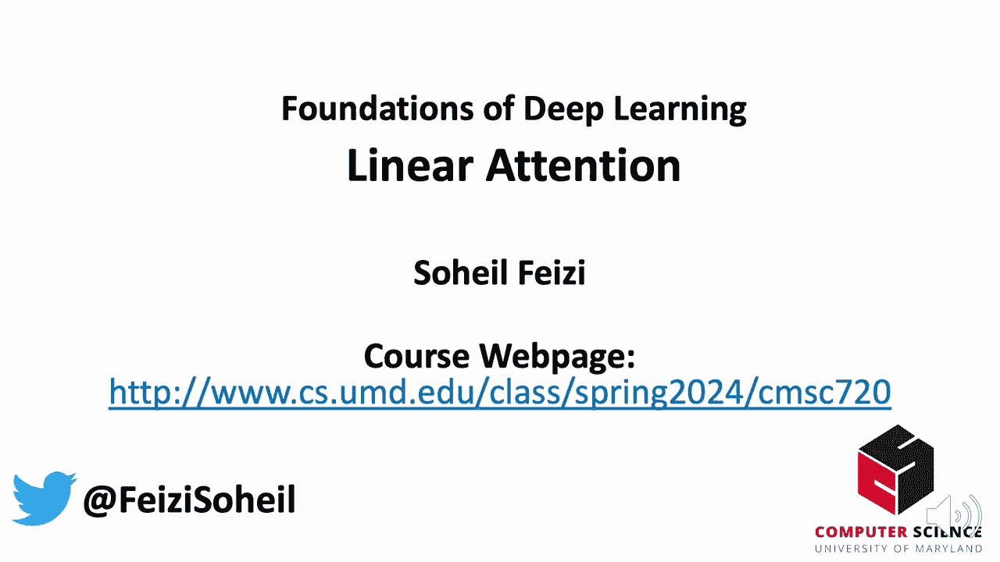
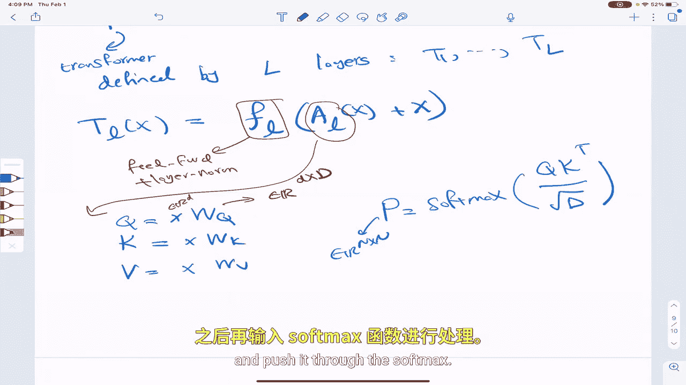
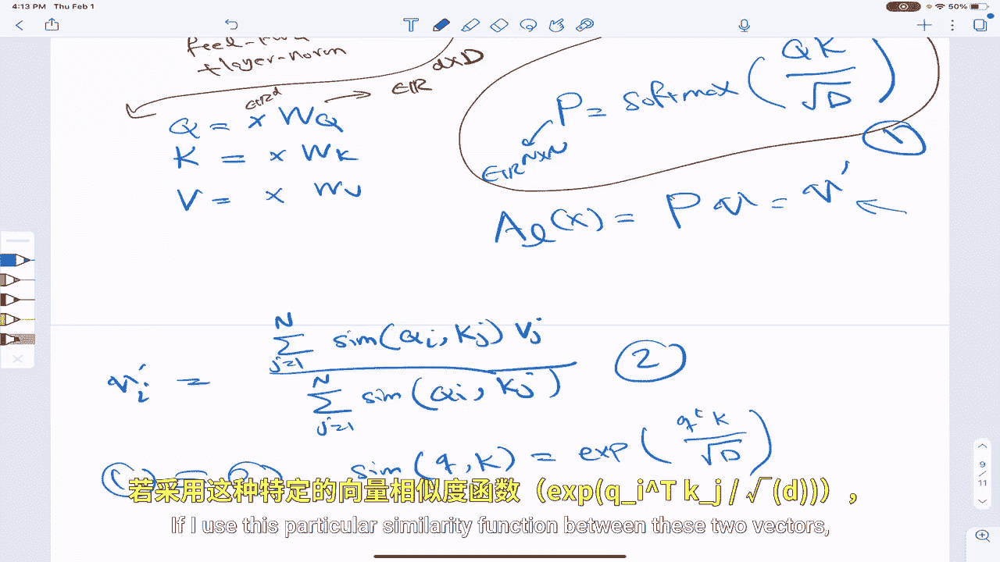

# 041：线性注意力

## 概述
在本节课中，我们将要学习一种名为“线性注意力”的技术。这项技术旨在解决传统注意力机制在处理大量输入时，计算和存储成本过高的问题。我们将从回顾标准注意力机制开始，逐步推导出线性注意力的核心思想。

---

## 标准注意力机制回顾

上一节我们介绍了Transformer模型中的自注意力机制。本节中，我们来看看其计算复杂度。

注意力矩阵 **P** 是一个 **n × n** 的矩阵，它存储了任意一对令牌之间的注意力概率。对于较大的 **n**，即使只是存储这个矩阵也可能非常昂贵。想象一下，如果你要处理10,000甚至30,000个令牌，仅仅计算这个矩阵就可能代价高昂。

我们通过计算查询向量和键向量的内积来生成这个矩阵。虽然单次内积计算在查询和键的维度上是线性的，但我们需要重复这个操作大约 **n²** 次。因此，这部分计算可能非常昂贵。

核心问题是：我们如何使这个计算在 **n** 上是线性的？这就是“线性注意力”的核心思想，它允许我们扩展到更大的输入规模。

---

## 模型设定与符号说明

首先，让我们设定一些符号。假设我们有 **n** 个令牌，每个令牌用 **d** 维向量表示。在之前的例子中，**d** 是512，**n** 是3。这就是输入矩阵 **X**。

Transformer可以被看作是一个映射，它将 **n** 个 **d** 维的令牌，转换为 **n** 个 **t** 维的令牌。这个映射由 **L** 个层定义：**T₁, T₂, ..., Tₗ**。

在每一层 **l**，我们应用以下函数：
1.  首先，将自注意力层应用于输入 **X**。
2.  然后，通过残差连接，将输出与输入相加。
3.  接着，进行层归一化。
4.  最后，通过一个前馈网络。

用公式总结如下：
`Tₗ(X) = FFN(LayerNorm(X + Attention(X)))`
其中，前馈网络 **FFN** 独立地应用于每一行。

---

## 注意力机制的数学形式

那么，注意力的具体形式是什么呢？我们首先生成三个矩阵：
*   查询矩阵 **Q**：通过 **X** 乘以权重矩阵 **W_q** 得到。
*   键矩阵 **K**：通过 **X** 乘以权重矩阵 **W_k** 得到。
*   值矩阵 **V**：通过 **X** 乘以权重矩阵 **W_v** 得到。

这里，**X** 的维度是 **ℝ^(n×d)**。这些权重矩阵将向量从 **d** 维映射到 **D** 维（注意：在原始设计中，**D** 通常小于 **d**，例如64）。

使用这三个矩阵，我们形成注意力矩阵 **P**。这是一个 **n × n** 的矩阵，其公式基于查询和键的内积：
`P = softmax( (Q K^T) / √D )`
其中，除以 **√D** 是为了稳定训练。然后，注意力层的输出就是将该矩阵与值矩阵 **V** 相乘：
`Output = P V`
对于多头注意力，我们并行执行多次上述操作，然后将输出拼接并通过一个线性投影层。

---

## 重新审视注意力公式

然而，使用上述特定公式并没有根本性的原因。这只是一个很好的初始尝试。你想计算查询和键之间的相似度，可以进行内积，也许进行归一化，然后通过softmax函数。但相似度度量不一定非得是内积。

事实上，如果我们看输出的第 **i** 行（即第 **i** 个令牌生成的嵌入向量），我们可以将整个公式重写为一种更通用的形式。

以下是标准注意力输出第 **i** 行的计算公式：
`output_i = Σⱼ ( similarity(q_i, k_j) * v_j ) / Σⱼ similarity(q_i, k_j)`
在这个通用公式中，**similarity** 可以是一个通用的相似度函数，而不仅仅是特定的指数内积形式。

如果我们使用的相似度函数恰好是指数内积形式，即：
`similarity(q, k) = exp( (q·k) / √D )`
那么，这个通用公式（公式2）就等价于我们之前的标准注意力公式（公式1）。

---

## 线性注意力的核心思想

关键在于，如果我们能找到一个**特征映射函数 φ**，使得两个向量的内积可以表示为它们各自映射后向量的内积，即：
`similarity(q, k) = φ(q)·φ(k)`
那么，注意力输出的计算就可以被重新组织。

将 `similarity(q_i, k_j) = φ(q_i)·φ(k_j)` 代入通用公式（公式2），我们可以进行如下推导：
`output_i = [ Σⱼ ( φ(q_i)·φ(k_j) ) * v_j ] / [ Σⱼ φ(q_i)·φ(k_j) ]`
由于点积的线性性质，我们可以将 **φ(q_i)** 提到求和外面：
`output_i = φ(q_i)·[ Σⱼ φ(k_j) ⊗ v_j ] / [ φ(q_i)·( Σⱼ φ(k_j) ) ]`
这里，**⊗** 表示外积。

观察这个新公式，我们发现：
*   `Σⱼ φ(k_j) ⊗ v_j` 是一个矩阵，可以预先为整个序列计算一次，其计算复杂度为 **O(n)**。
*   `Σⱼ φ(k_j)` 是一个向量，也可以预先计算一次，复杂度为 **O(n)**。
*   对于每个查询 **q_i**，我们只需要计算 `φ(q_i)` 与这两个预计算结果的点积，复杂度为 **O(1)**。

因此，**计算所有 n 个输出令牌的总复杂度从 O(n²) 降低到了 O(n)**，这就是“线性”注意力的由来。

---

## 总结

本节课中，我们一起学习了线性注意力的原理。我们从标准注意力机制 **O(n²)** 的计算复杂度问题出发，通过将相似度函数重新表述为特征映射的内积形式，成功地将计算复杂度降低到了 **O(n)**。这种方法的核心在于找到一个合适的特征映射 **φ**，并利用矩阵运算的线性性质重组计算顺序，从而实现对长序列的高效处理。